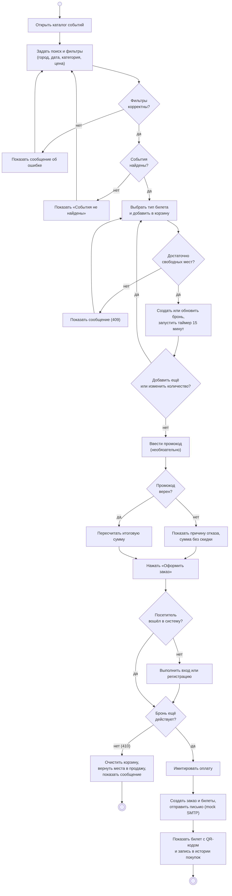
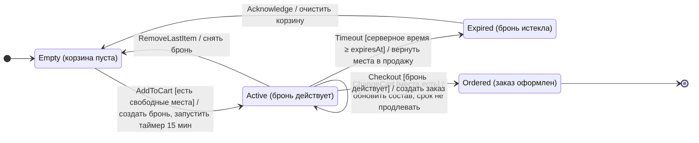
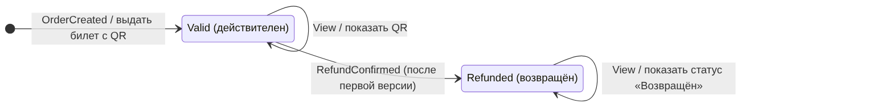
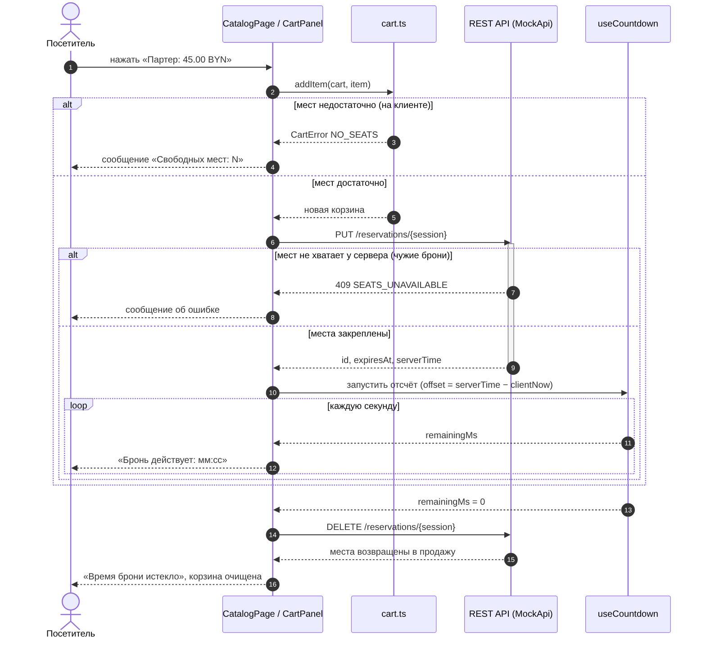
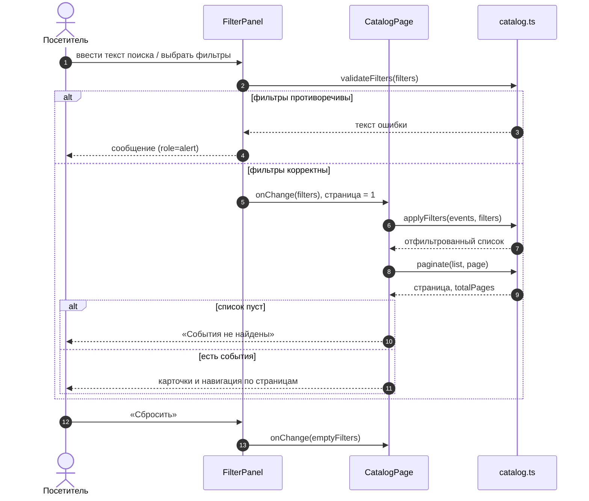

# Динамическая модель EventPass (UML)

Версия 0.1. Диаграммы описаны текстом (Mermaid, PlantUML), исходники — `uml/src/`, изображения — `uml/*.png`; Mermaid отображается на GitHub.

| Диаграмма | Файл | Источник | Прецеденты | Требования |
|-----------|------|----------|------------|------------|
| Use-case | `uml/usecase.png` | `uml/src/usecase.puml`, `uml/build_usecase.py` | UC-01…UC-12 | REQ-FUNC-001…009, FEAT-01…09 |
| Активность «Покупка билета» | `uml/activity-purchase.png` | `uml/src/activity-purchase.mmd` | UC-02, 03, 05…08 | REQ-FUNC-002, 003, 005, 006, FEAT-02, 09 |
| Состояния брони/корзины | `uml/state-reservation.png` | `uml/src/state-reservation.mmd` | UC-05, 06, 08, 12 | FEAT-02, REQ-REL-001 |
| Состояния билета | `uml/state-ticket.png` | `uml/src/state-ticket.mmd` | UC-08, 09 | REQ-FUNC-007 |
| Последовательность «Бронирование» | `uml/sequence-reserve.png` | `uml/src/sequence-reserve.mmd` | UC-05, 06, 12 | FEAT-02, REQ-SEC-001 |
| Последовательность «Поиск и фильтры» | `uml/sequence-filter.png` | `uml/src/sequence-filter.mmd` | UC-02, 03 | REQ-FUNC-002, 003, REQ-PERF-001 |

Связь диаграмм: прецедент задаёт сценарий → диаграмма активности раскладывает его на шаги и ветвления → диаграммы состояний описывают объекты, меняющиеся в этих шагах (бронь, билет) → диаграммы последовательности показывают участников (компоненты кода `src/`) и сообщения.

Как построить: Mermaid — `mmdc -i uml/src/<имя>.mmd -o uml/<имя>.png -s 2` или расширение VS Code для Mermaid; PlantUML — расширение PlantUML (Alt+D).

