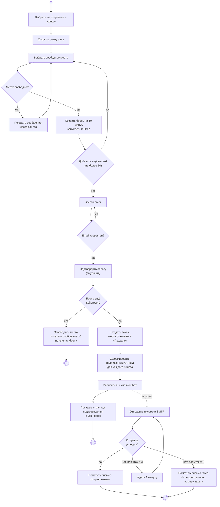
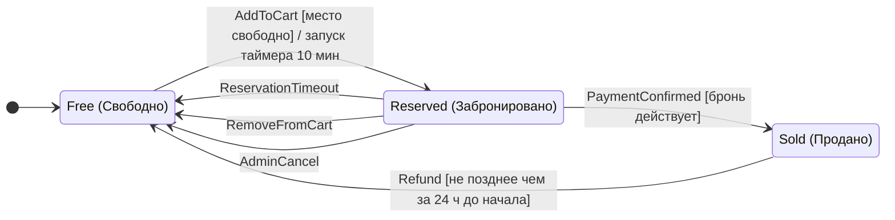
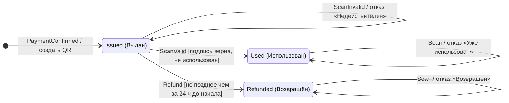
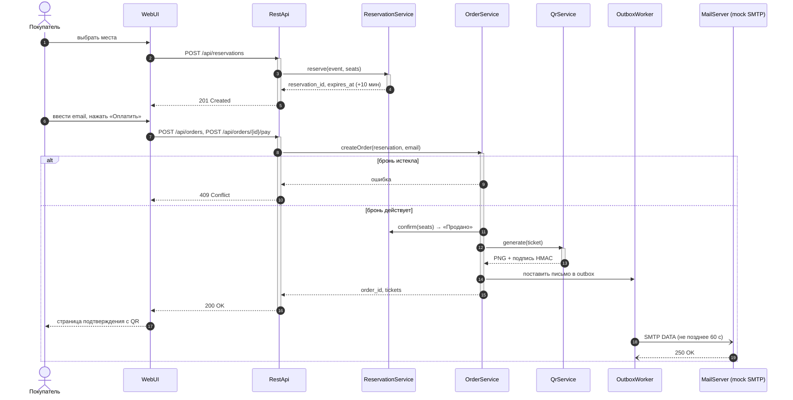
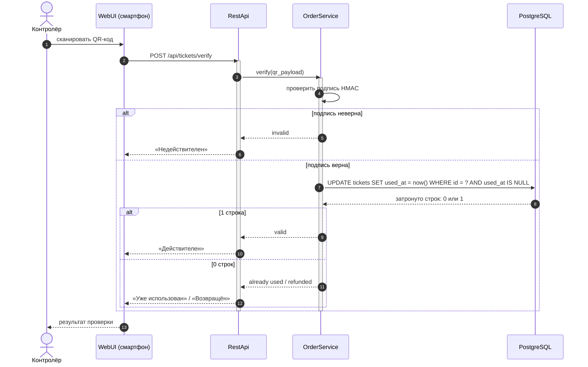

# UML-модели динамического поведения EasyTicket

Версия 0.1. Подготовил: Питковский В.В. Дата: 12.11.2026. Диаграммы описаны текстом (Mermaid) и отображаются на GitHub; растровые копии лежат в `uml/*.png`, исходники — в `uml/src/*.mmd`.

Диаграммы строятся последовательно: **вариант использования** (`docs/use-cases.md`) задаёт сценарий → **диаграмма активности** описывает его шаги и ветвления → **диаграммы состояний** показывают жизненный цикл объектов, которые меняются по ходу сценария → **диаграммы последовательности** показывают, какие компоненты и в каком порядке обмениваются сообщениями. Связь с требованиями — в разделе «Трассировка».

## 1. Диаграмма активности: покупка билета

Сценарий UC-03 → UC-04 → UC-05. Ромбы — ветвления, пунктирная стрелка — параллельная фоновая отправка письма. Реализует REQ-FUNC-004…008, REQ-REL-001.

## 2. Диаграмма состояний: место

Жизненный цикл места на мероприятии. Реализует REQ-FUNC-003, 005, 006, 014, 015.

## 3. Диаграмма состояний: билет

Жизненный цикл билета. Реализует REQ-FUNC-007, 010, 015.

## 4. Диаграмма последовательности: покупка билета

Взаимодействие компонентов при UC-03, UC-04, UC-05; фрагмент `alt` показывает путь истёкшей брони. Реализует REQ-FUNC-005…008.

## 5. Диаграмма последовательности: проверка билета

Взаимодействие при UC-08; атомарное условное обновление исключает повторный проход. Реализует REQ-FUNC-010, REQ-SEC-006.

## 6. Трассировка

| Диаграмма | Прецеденты | Требования | Представление SDD |
|-----------|-----------|------------|-------------------|
| Активность: покупка | UC-03, UC-04, UC-05 | REQ-FUNC-004…008 | DV-014 |
| Состояния: место | UC-03, UC-04, UC-07, UC-12, UC-13 | REQ-FUNC-003, 005, 006, 014, 015 | DV-015 |
| Состояния: билет | UC-05, UC-07, UC-08 | REQ-FUNC-007, 010, 015 | DV-015 |
| Последовательность: покупка | UC-03, UC-04, UC-05 | REQ-FUNC-005…008 | DV-016 |
| Последовательность: проверка | UC-08 | REQ-FUNC-010 | DV-016 |
