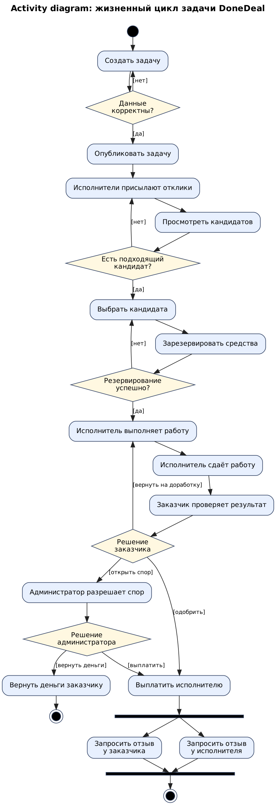
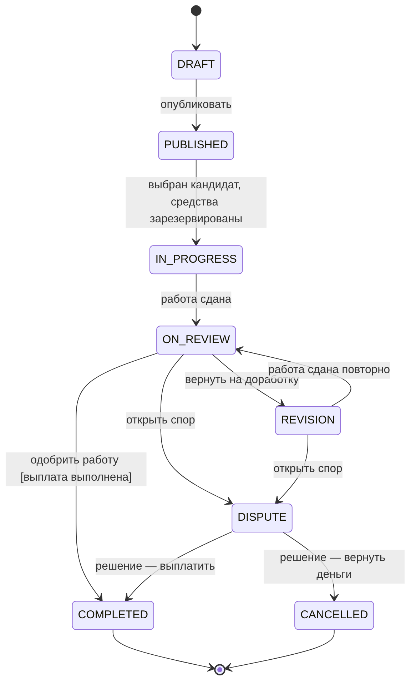
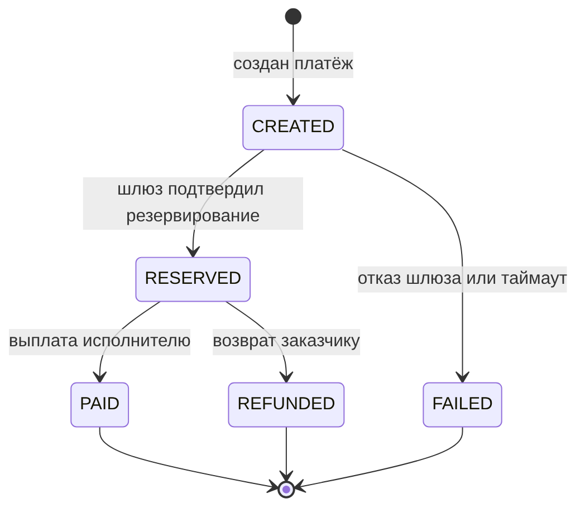
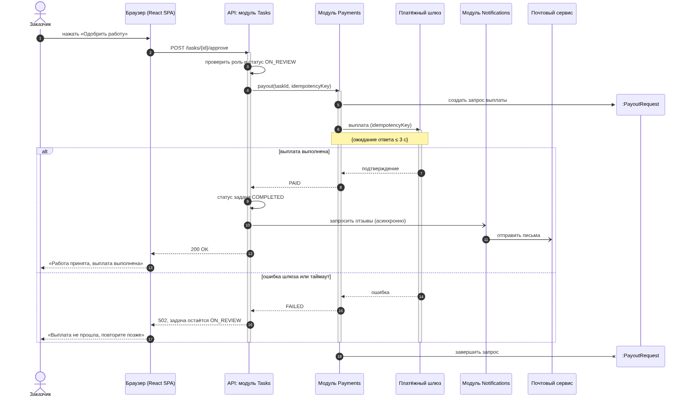

# DoneDeal — диаграммы динамического поведения

Все диаграммы построены на основе use-case модели (`use-cases.md`). Исходные коды лежат в `docs/uml/src/`.

## 1. Диаграмма активности

Показывает жизненный цикл задачи от создания до выплаты или возврата. Исходный код: `src/activity.dot`.

Элементы: начальный узел (чёрный круг), действия (скруглённые прямоугольники), ветвления с условиями в квадратных скобках (ромбы), параллельные ветви (чёрные линии fork и join), конечные узлы. Циклы показывают повторы: исправление данных, ожидание откликов, повторный выбор при неудачном резервировании, доработка. Прецеденты UC-02, UC-04–UC-07, UC-09–UC-13, UC-15, UC-16 разворачиваются в действия диаграммы. После выплаты запросы отзыва заказчику и исполнителю выполняются параллельно.

## 2. Диаграммы состояний

### 2.1 Задача (Task)

Исходный код: `src/state_task.mmd` (Mermaid).

Состояния соответствуют статусам задачи. Переход вызывается событием (действием пользователя или системы); условие в квадратных скобках ограничивает переход. Конечные состояния: COMPLETED и CANCELLED.

### 2.2 Платёж (Payment)

Исходный код: `src/state_payment.mmd`.

Платёж создаётся в состоянии CREATED. Он переходит в RESERVED после подтверждения шлюзом, затем либо в PAID (выплата), либо в REFUNDED (возврат). При отказе шлюза платёж получает статус FAILED.

## 3. Диаграмма последовательности: «Одобрить работу» (UC-10)

Исходный код: `src/sequence.mmd`.

Обозначения:

- линии жизни — вертикальные пунктирные линии участников;
- синхронные сообщения — сплошные стрелки с закрашенным наконечником, возврат — пунктирные стрелки;
- асинхронные сообщения — стрелки с открытым наконечником (запрос отзывов, отправка писем);
- спецификации выполнения — узкие прямоугольники на линиях жизни;
- сообщение создания — стрелка к новому объекту `:PayoutRequest`, уничтожение — крест на конце его линии жизни;
- ограничение длительности `{ожидание ответа ≤ 3 с}` — заметка над шлюзом;
- фрагмент `alt` — два варианта: выплата выполнена или ошибка шлюза.

Сообщения соответствуют REST-интерфейсам из `sdd/sdd.md` (раздел 5).
