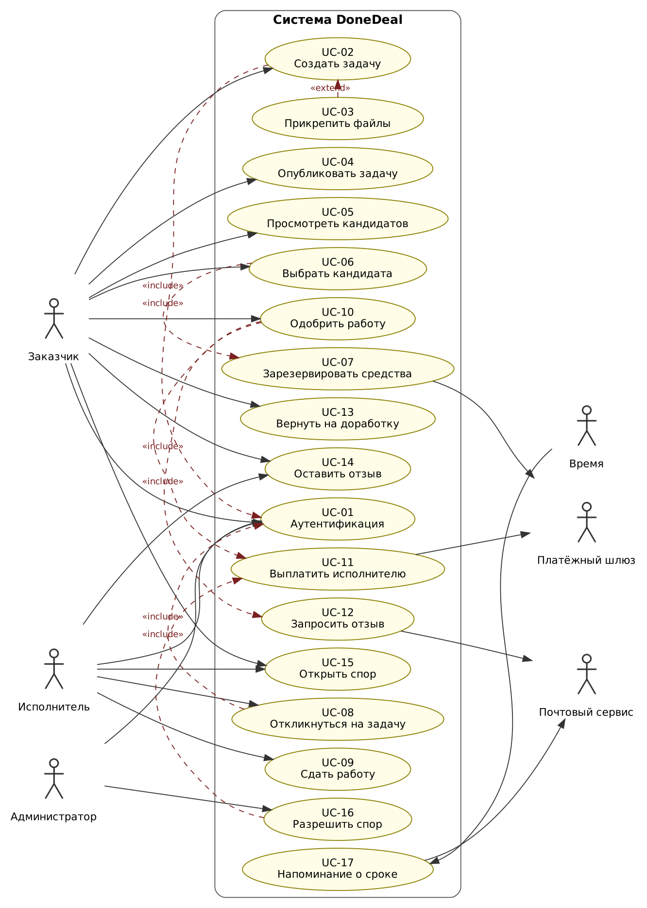

# DoneDeal — модель вариантов использования

Диаграмма построена на основе бизнес-требований (`srs/srs.md`) и системных требований (`sdd/sdd.md`). Исходный код диаграммы — `docs/uml/src/usecase.dot` (Graphviz).

## Актёры

| Актёр | Описание |
|---|---|
| Заказчик (Customer) | Пользователь, который публикует задачи, выбирает исполнителя и принимает выполненную работу. |
| Исполнитель (Performer) | Пользователь, который откликается на задачи, выполняет работу и сдаёт результат. |
| Администратор (Administrator) | Сотрудник платформы, который разрешает споры между заказчиком и исполнителем. |
| Платёжный шлюз (Payment Gateway) | Внешняя система, которая резервирует средства и выполняет выплаты и возвраты. |
| Почтовый сервис (Email Service) | Внешняя система, которая доставляет email-уведомления пользователям. |
| Время (Timer) | Планировщик, который по расписанию запускает проверку сроков задач. |

## Связи между элементами

| Связь | Где применена | Смысл |
|---|---|---|
| Коммуникация | актёр — прецедент | Актёр инициирует прецедент (стрелка от актёра); для внешних систем стрелка идёт к актёру, которому система передаёт запрос |
| include | UC-02, UC-08 → UC-01; UC-06 → UC-07; UC-10 → UC-11, UC-12; UC-16 → UC-11 | Обязательное повторяющееся поведение выделено в отдельный прецедент |
| extend | UC-03 → UC-02 | Необязательное расширение: файлы можно прикрепить, но можно и не прикреплять |

Связи между актёрами не показаны: актёры находятся вне системы. Обобщение актёров не применялось, так как поведение Заказчика и Исполнителя различается.

## Описание прецедентов

### UC-01 Аутентификация

- **Актёры:** Заказчик, Исполнитель, Администратор
- **Требование:** FR-01
- **Краткое описание:** Позволяет пользователю зарегистрироваться или войти в систему по email и паролю.
- **Предусловия:**
  - Пользователь открыл страницу входа.
- **Основной поток:**
  1. Пользователь вводит email и пароль.
  2. Система проверяет формат данных.
  3. Система находит учётную запись и сверяет хеш пароля.
  4. Система создаёт сессию и открывает кабинет пользователя.
- **Альтернативные потоки и ошибки:**
  - A1. Новый пользователь выбирает «Регистрация», вводит email, пароль и роль; система создаёт учётную запись и продолжает с шага 4.
  - E1. Данные неверны: система показывает сообщение об ошибке и возвращает к шагу 1; после 5 неудачных попыток вход блокируется на 10 минут.
- **Постусловия:**
  - Пользователь аутентифицирован, сессия создана.

### UC-02 Создать задачу

- **Актёры:** Заказчик
- **Требование:** FR-02
- **Краткое описание:** Заказчик заполняет форму и сохраняет задачу как черновик. Включает UC-01.
- **Предусловия:**
  - Заказчик аутентифицирован (UC-01).
- **Основной поток:**
  1. Заказчик открывает форму «Новая задача».
  2. Вводит название, описание, категорию, бюджет и срок.
  3. Нажимает «Сохранить».
  4. Система проверяет обязательные поля (бюджет больше нуля, срок в будущем).
  5. Система сохраняет задачу со статусом DRAFT.
- **Альтернативные потоки и ошибки:**
  - A1. Заказчик прикрепляет файлы (расширение UC-03).
  - E1. Данные не прошли проверку: система подсвечивает поля с ошибками и возвращает к шагу 2.
- **Постусловия:**
  - Задача сохранена, статус DRAFT.

### UC-03 Прикрепить файлы

- **Актёры:** Заказчик
- **Требование:** FR-03
- **Краткое описание:** Расширяет UC-02: позволяет приложить файлы к описанию задачи.
- **Предусловия:**
  - Открыта форма создания задачи.
- **Основной поток:**
  1. Заказчик нажимает «Прикрепить файлы».
  2. Выбирает файлы на компьютере.
  3. Система проверяет тип и размер (до 10 МБ).
  4. Система сохраняет файлы и показывает их в списке вложений.
- **Альтернативные потоки и ошибки:**
  - E1. Файл слишком большой или недопустимого типа: система отклоняет файл и показывает причину.
- **Постусловия:**
  - Файлы связаны с задачей.

### UC-04 Опубликовать задачу

- **Актёры:** Заказчик
- **Требование:** FR-04
- **Краткое описание:** Делает задачу доступной исполнителям.
- **Предусловия:**
  - Существует задача в статусе DRAFT.
- **Основной поток:**
  1. Заказчик открывает «Мои задачи» и выбирает черновик.
  2. Нажимает «Опубликовать».
  3. Система проверяет полноту данных.
  4. Система переводит задачу в статус PUBLISHED.
- **Альтернативные потоки и ошибки:**
  - E1. Не заполнено обязательное поле: система возвращает заказчика к редактированию.
- **Постусловия:**
  - Статус PUBLISHED, задача видна исполнителям.

### UC-05 Просмотреть кандидатов

- **Актёры:** Заказчик
- **Требование:** FR-05
- **Краткое описание:** Показывает список откликов с рейтингом, ценой и сроком.
- **Предусловия:**
  - Задача в статусе PUBLISHED.
- **Основной поток:**
  1. Заказчик открывает страницу задачи.
  2. Система загружает отклики.
  3. Система показывает карточки кандидатов (имя, рейтинг, цена, срок, сообщение).
  4. При желании заказчик открывает профиль кандидата.
- **Альтернативные потоки и ошибки:**
  - A1. Откликов нет: система показывает сообщение «Пока нет откликов».
- **Постусловия:**
  - Данные не изменены.

### UC-06 Выбрать кандидата

- **Актёры:** Заказчик
- **Требование:** FR-06
- **Краткое описание:** Заказчик выбирает исполнителя, после чего резервируется сумма. Включает UC-01 и UC-07.
- **Предусловия:**
  - Заказчик аутентифицирован.
  - Задача в статусе PUBLISHED и есть хотя бы один отклик.
- **Основной поток:**
  1. Заказчик нажимает «Выбрать» у кандидата.
  2. Система показывает сумму и просит подтверждение.
  3. Заказчик подтверждает выбор.
  4. Система резервирует средства (UC-07).
  5. Система переводит задачу в IN_PROGRESS, остальные отклики помечает отклонёнными.
  6. Система уведомляет исполнителя по email.
- **Альтернативные потоки и ошибки:**
  - A1. Заказчик нажимает «Отклонить»: отклик получает статус REJECTED.
  - E1. Резервирование не удалось: задача остаётся PUBLISHED, заказчику показывается причина.
- **Постусловия:**
  - Исполнитель назначен, сумма зарезервирована, статус IN_PROGRESS.

### UC-07 Зарезервировать средства

- **Актёры:** Платёжный шлюз
- **Требование:** FR-07
- **Краткое описание:** Резервирует сумму бюджета на платёжной странице шлюза до приёмки работы.
- **Предусловия:**
  - Заказчик подтвердил выбор кандидата.
- **Основной поток:**
  1. Система создаёт платёж с ключом идемпотентности.
  2. Система перенаправляет заказчика на платёжную страницу шлюза (hosted checkout).
  3. Заказчик вводит данные карты на стороне шлюза.
  4. Шлюз подтверждает резервирование через webhook.
  5. Система сохраняет платёж со статусом RESERVED.
- **Альтернативные потоки и ошибки:**
  - E1. Шлюз отказал или время ожидания истекло: платёж получает статус FAILED, резервирование не выполнено.
- **Постусловия:**
  - Платёж в статусе RESERVED.

### UC-08 Откликнуться на задачу

- **Актёры:** Исполнитель
- **Требование:** FR-13
- **Краткое описание:** Исполнитель предлагает цену и срок через упрощённую форму. Включает UC-01.
- **Предусловия:**
  - Исполнитель аутентифицирован.
  - Задача в статусе PUBLISHED.
- **Основной поток:**
  1. Исполнитель открывает задачу.
  2. Нажимает «Откликнуться».
  3. Вводит цену, срок и сообщение.
  4. Система проверяет данные и сохраняет отклик.
  5. Система уведомляет заказчика по email.
- **Альтернативные потоки и ошибки:**
  - E1. Исполнитель уже откликался: система предлагает изменить существующий отклик.
- **Постусловия:**
  - Отклик сохранён, заказчик уведомлён.

### UC-09 Сдать работу

- **Актёры:** Исполнитель
- **Требование:** FR-08
- **Краткое описание:** Исполнитель загружает результат, и задача уходит на проверку заказчику.
- **Предусловия:**
  - Задача в статусе IN_PROGRESS, исполнитель назначен.
- **Основной поток:**
  1. Исполнитель открывает задачу.
  2. Прикладывает результат и комментарий.
  3. Нажимает «Сдать работу».
  4. Система переводит задачу в статус ON_REVIEW.
  5. Система уведомляет заказчика.
- **Альтернативные потоки и ошибки:**
  - A1. После доработки (статус REVISION) работа сдаётся повторно по тому же потоку.
- **Постусловия:**
  - Статус ON_REVIEW.

### UC-10 Одобрить работу

- **Актёры:** Заказчик
- **Требование:** FR-09
- **Краткое описание:** Заказчик принимает результат; система выплачивает деньги и запрашивает отзывы. Включает UC-01, UC-11 и UC-12.
- **Предусловия:**
  - Задача в статусе ON_REVIEW.
  - Платёж в статусе RESERVED.
- **Основной поток:**
  1. Заказчик открывает страницу задачи и просматривает результат.
  2. Нажимает «Одобрить работу».
  3. Система просит подтверждение (действие необратимо, BR-5).
  4. Заказчик подтверждает.
  5. Система выполняет выплату (UC-11).
  6. Система переводит задачу в статус COMPLETED.
  7. Система запрашивает отзывы (UC-12).
- **Альтернативные потоки и ошибки:**
  - A1. Заказчик отменяет подтверждение: состояние не меняется.
  - E1. Выплата не прошла: задача остаётся ON_REVIEW, заказчик видит сообщение; повторное нажатие безопасно благодаря идемпотентности.
- **Постусловия:**
  - Задача COMPLETED, платёж PAID, запросы отзыва отправлены.

### UC-11 Выплатить исполнителю

- **Актёры:** Платёжный шлюз
- **Требование:** FR-09
- **Краткое описание:** Переводит зарезервированную сумму исполнителю.
- **Предусловия:**
  - Платёж в статусе RESERVED.
  - Заказчик одобрил работу.
- **Основной поток:**
  1. Система отправляет шлюзу запрос на выплату с ключом идемпотентности.
  2. Шлюз выполняет перевод.
  3. Шлюз возвращает подтверждение.
  4. Система фиксирует статус PAID и пишет запись в журнал.
- **Альтернативные потоки и ошибки:**
  - A1. Повторный запрос с тем же ключом: система возвращает прежний результат без повторной выплаты.
  - E1. Ошибка шлюза: система повторяет запрос до 3 раз, затем сообщает об ошибке.
- **Постусловия:**
  - Платёж PAID, запись в журнале операций.

### UC-12 Запросить отзыв

- **Актёры:** Почтовый сервис
- **Требование:** FR-11
- **Краткое описание:** После выплаты просит обе стороны оставить отзыв.
- **Предусловия:**
  - Задача в статусе COMPLETED.
- **Основной поток:**
  1. Система формирует письма заказчику и исполнителю со ссылкой на форму отзыва.
  2. Система передаёт письма почтовому сервису.
  3. Сервис доставляет письма.
- **Альтернативные потоки и ошибки:**
  - E1. Доставка не удалась: система повторяет отправку позже.
- **Постусловия:**
  - Запросы на отзыв отправлены.

### UC-13 Вернуть на доработку

- **Актёры:** Заказчик
- **Требование:** FR-10
- **Краткое описание:** Заказчик возвращает работу исполнителю с комментарием.
- **Предусловия:**
  - Задача в статусе ON_REVIEW.
- **Основной поток:**
  1. Заказчик нажимает «Вернуть на доработку».
  2. Вводит комментарий с замечаниями.
  3. Система переводит задачу в статус REVISION.
  4. Система уведомляет исполнителя.
- **Альтернативные потоки и ошибки:**
  - E1. Комментарий пуст: система требует его заполнить.
- **Постусловия:**
  - Статус REVISION, платёж остаётся RESERVED.

### UC-14 Оставить отзыв

- **Актёры:** Заказчик, Исполнитель
- **Требование:** FR-11
- **Краткое описание:** Участник завершённой задачи оценивает партнёра и пишет отзыв.
- **Предусловия:**
  - Задача в статусе COMPLETED.
  - Пользователь — участник задачи и ещё не оставлял отзыв.
- **Основной поток:**
  1. Пользователь переходит по ссылке из письма или открывает задачу.
  2. Ставит оценку от 1 до 5 и вводит текст.
  3. Система сохраняет отзыв и пересчитывает рейтинг.
- **Альтернативные потоки и ошибки:**
  - E1. Отзыв уже оставлен: система показывает его без возможности повторить.
- **Постусловия:**
  - Отзыв сохранён, рейтинг обновлён.

### UC-15 Открыть спор

- **Актёры:** Заказчик, Исполнитель
- **Требование:** FR-14
- **Краткое описание:** Участник открывает спор, если не согласен с итогом приёмки.
- **Предусловия:**
  - Задача в статусе ON_REVIEW или REVISION.
- **Основной поток:**
  1. Участник нажимает «Открыть спор».
  2. Указывает причину.
  3. Система переводит задачу в статус DISPUTE и блокирует выплату.
  4. Система уведомляет вторую сторону и администратора.
- **Альтернативные потоки и ошибки:**
  - E1. Спор по задаче уже открыт: система показывает его.
- **Постусловия:**
  - Статус DISPUTE, платёж заморожен.

### UC-16 Разрешить спор

- **Актёры:** Администратор
- **Требование:** FR-14
- **Краткое описание:** Администратор изучает спор и решает: выплатить исполнителю или вернуть деньги заказчику. Включает UC-11.
- **Предусловия:**
  - Задача в статусе DISPUTE.
- **Основной поток:**
  1. Администратор открывает список споров.
  2. Изучает причину и результат работы.
  3. Выбирает решение «Выплатить исполнителю».
  4. Система выполняет выплату (UC-11) и переводит задачу в COMPLETED.
  5. Система закрывает спор и уведомляет обе стороны.
- **Альтернативные потоки и ошибки:**
  - A1. Выбрано «Вернуть заказчику»: система выполняет возврат, платёж получает статус REFUNDED, задача — CANCELLED.
- **Постусловия:**
  - Спор закрыт, задача COMPLETED или CANCELLED.

### UC-17 Отправить напоминание о сроке

- **Актёры:** Время, Почтовый сервис
- **Требование:** FR-15
- **Краткое описание:** Ежедневно проверяет сроки задач и напоминает участникам о приближении срока.
- **Предусловия:**
  - Есть задачи в статусе IN_PROGRESS со сроком в ближайшие 2 дня.
- **Основной поток:**
  1. Планировщик ежедневно запускает проверку.
  2. Система находит задачи со сроком не более 2 дней.
  3. Система формирует напоминания.
  4. Почтовый сервис отправляет письма исполнителю и заказчику.
- **Альтернативные потоки и ошибки:**
  - A1. Напоминание по задаче уже отправлено: задача пропускается.
- **Постусловия:**
  - Напоминания отправлены.
