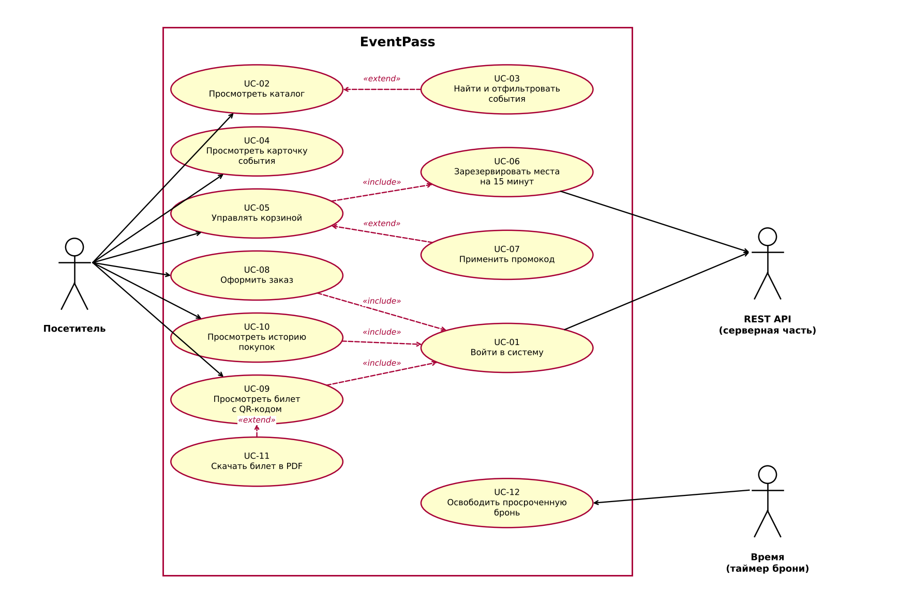

# Модель вариантов использования EventPass

Версия 0.1. Автор: Овсяник А.Н. Основание: SRS (`srs/srs.md`), глоссарий (`docs/glossary.md`), дополнительные спецификации (`docs/supplementary-spec.md`).

## 1. Диаграмма вариантов использования

Текстовое описание (PlantUML): `uml/src/usecase.puml`; рисунок построен скриптом `uml/build_usecase.py`.

Правила построения: актёры находятся вне системы, связи между ними не моделируются; от актёра к прецеденту ведёт сплошная стрелка; для внешней системы (REST API) стрелка идёт от прецедента к актёру; расширяющие прецеденты (UC-03, UC-07, UC-11) запускаются из базового прецедента и отдельной связи с актёром не имеют; между прецедентами используются только `include` и `extend`.

## 2. Актёры

| Актёр | Описание роли |
|-------|---------------|
| Посетитель | Пользователь приложения: ищет события, собирает корзину, оформляет заказ, хранит и предъявляет билеты. Каталог и карточка события доступны без входа. |
| REST API (серверная часть) | Внешняя система: хранит события, брони, заказы и билеты, отвечает на запросы клиента (в разработке — `MockApi`). |
| Время (таймер брони) | Системное событие «прошло 15 минут с создания брони»; запускает освобождение мест. |

## 3. Прецеденты

### UC-01 Войти в систему
- **Пояснение:** регистрация и вход по e-mail и паролю; требуется для покупки и просмотра билетов (REQ-FUNC-001, FEAT-07).
- **Актёры:** Посетитель; REST API.
- **Предусловия:** посетитель открыл приложение.
- **Основной поток:** 1. Посетитель вводит e-mail и пароль. 2. Приложение отправляет запрос в REST API. 3. API возвращает токен. 4. Приложение сохраняет сессию и показывает профиль.
- **Альтернативные потоки:** A1 — новый посетитель выбирает «Регистрация» и вводит данные. A2 — токен уже действителен, шаги 1–3 пропускаются.
- **Ошибки:** E1 — неверный e-mail или пароль: общее сообщение без уточнения, что именно неверно. E2 — REST API недоступен: сообщение и возможность повторить.
- **Постусловия:** сессия установлена; пароль нигде не хранится в открытом виде.

### UC-02 Просмотреть каталог
- **Пояснение:** показывает постраничный список событий с названием, датой, местом, категорией и минимальной ценой (REQ-FUNC-002).
- **Актёры:** Посетитель.
- **Предусловия:** приложение загружено; вход не требуется.
- **Основной поток:** 1. Посетитель открывает главную страницу. 2. Приложение запрашивает события и сортирует их по дате. 3. Приложение показывает первую страницу (6 событий) и навигацию.
- **Альтернативные потоки:** A1 — посетитель переходит на другую страницу; номер приводится к допустимому диапазону.
- **Ошибки:** E1 — REST API недоступен: сообщение об ошибке и повторный запрос.
- **Постусловия:** отображён список; данные не изменены.

### UC-03 Найти и отфильтровать события
- **Пояснение:** сужает каталог текстовым поиском и фильтрами по городу, дате, категории и цене (REQ-FUNC-003). Расширяет UC-02 (точка расширения «после показа каталога»).
- **Актёры:** Посетитель.
- **Предусловия:** открыт каталог (UC-02).
- **Основной поток:** 1. Посетитель вводит текст и/или выбирает фильтры. 2. Приложение проверяет согласованность условий. 3. Приложение применяет условия по «И» и возвращается на первую страницу. 4. Приложение показывает результат.
- **Альтернативные потоки:** A1 — посетитель нажимает «Сбросить»: показан полный каталог. A2 — ничего не найдено: «События не найдены» с подсказкой.
- **Ошибки:** E1 — дата «с» позже даты «по» или минимальная цена больше максимальной: сообщение, список не обновляется.
- **Постусловия:** показан список, соответствующий условиям.

### UC-04 Просмотреть карточку события
- **Пояснение:** показывает описание, место, типы билетов, цены и число свободных мест (REQ-FUNC-004).
- **Актёры:** Посетитель.
- **Предусловия:** событие существует.
- **Основной поток:** 1. Посетитель выбирает событие в каталоге. 2. Приложение показывает описание, место, дату. 3. Приложение показывает типы билетов с ценой и свободными местами.
- **Альтернативные потоки:** A1 — для типа билета мест нет: кнопка добавления недоступна, показана пометка «нет мест».
- **Ошибки:** E1 — событие не найдено: сообщение и возврат в каталог.
- **Постусловия:** данные не изменены.

### UC-05 Управлять корзиной
- **Пояснение:** добавление билетов, изменение количества, удаление позиций и расчёт суммы (REQ-FUNC-005). Включает UC-06. Расширяется UC-07.
- **Актёры:** Посетитель.
- **Предусловия:** есть тип билета со свободными местами.
- **Основной поток:** 1. Посетитель добавляет билет. 2. Приложение объединяет одинаковые позиции и проверяет число свободных мест. 3. Выполняется UC-06 (include). 4. Приложение показывает позиции, таймер и итоговую сумму. 5. Посетитель меняет количество или удаляет позицию; шаги 2–4 повторяются.
- **Альтернативные потоки:** A1 — количество 0 удаляет позицию; после удаления последней позиции бронь снимается.
- **Ошибки:** E1 — мест меньше запрошенного количества: сообщение, корзина не меняется. E2 — количество не целое или меньше 0: отклонено.
- **Постусловия:** корзина и бронь согласованы; сумма пересчитана.

### UC-06 Зарезервировать места на 15 минут
- **Пояснение:** закрепляет места за посетителем на серверной стороне, чтобы исключить продажу одного места дважды (FEAT-02). Включается в UC-05.
- **Актёры:** REST API.
- **Предусловия:** корзина изменена.
- **Основной поток:** 1. Приложение отправляет состав корзины в API. 2. API проверяет места с учётом чужих броней. 3. API создаёт бронь или обновляет её состав; срок не продлевается. 4. API возвращает `expiresAt` и `serverTime`. 5. Приложение запускает таймер.
- **Альтернативные потоки:** A1 — в корзине не осталось позиций: API снимает бронь.
- **Ошибки:** E1 — места заняты другими посетителями: 409, корзина остаётся прежней.
- **Постусловия:** места удерживаются до `expiresAt`.

### UC-07 Применить промокод
- **Пояснение:** пересчитывает сумму корзины со скидкой (FEAT-09). Расширяет UC-05.
- **Актёры:** Посетитель.
- **Предусловия:** корзина не пуста.
- **Основной поток:** 1. Посетитель вводит промокод. 2. Приложение приводит код к верхнему регистру и ищет его в списке. 3. Приложение считает скидку (не больше суммы корзины) и показывает новую сумму.
- **Альтернативные потоки:** A1 — код пустой: просьба ввести промокод.
- **Ошибки:** E1 — код неизвестен. E2 — сумма меньше минимальной для кода. E3 — корзина пуста. Во всех случаях сумма без скидки.
- **Постусловия:** сумма пересчитана или осталась прежней.

### UC-08 Оформить заказ
- **Пояснение:** превращает бронь в заказ с имитацией оплаты (REQ-FUNC-006, FEAT-03). Включает UC-01.
- **Актёры:** Посетитель.
- **Предусловия:** корзина не пуста, бронь действует.
- **Основной поток:** 1. Посетитель нажимает «Оформить заказ». 2. Выполняется UC-01 (include), если вход не выполнен. 3. Приложение проверяет, что бронь действует. 4. Посетитель подтверждает оплату (имитация). 5. API создаёт заказ и билеты, отправляет письмо через mock SMTP. 6. Приложение показывает билеты и запись в истории.
- **Альтернативные потоки:** A1 — посетитель отказывается от оплаты: бронь сохраняется до истечения.
- **Ошибки:** E1 — бронь истекла (410): корзина очищена, показано сообщение. E2 — места уже проданы (409): корзина актуализируется. E3 — сбой API: заказ не создаётся, бронь сохраняется.
- **Постусловия:** заказ создан, билеты доступны в «Моих билетах».

### UC-09 Просмотреть билет с QR-кодом
- **Пояснение:** показывает билет, QR-код, данные события, тип, место и статус (REQ-FUNC-007, FEAT-01). Включает UC-01. Расширяется UC-11.
- **Актёры:** Посетитель.
- **Предусловия:** билет принадлежит посетителю.
- **Основной поток:** 1. Посетитель открывает билет из истории (не более 2 действий). 2. Выполняется UC-01 (include). 3. Приложение рисует QR-код локально и показывает данные билета и статус.
- **Альтернативные потоки:** A1 — статус «Возвращён»: QR-код помечен как недействительный.
- **Ошибки:** E1 — билет принадлежит другому посетителю: доступ запрещён (REQ-SEC-001).
- **Постусловия:** данные не изменены.

### UC-10 Просмотреть историю покупок
- **Пояснение:** список заказов с датой, составом, суммой и статусом, фильтр по статусу, переход к QR-коду (REQ-FUNC-008). Включает UC-01.
- **Актёры:** Посетитель.
- **Предусловия:** посетитель вошёл в систему.
- **Основной поток:** 1. Посетитель открывает «История покупок». 2. Приложение запрашивает заказы текущего пользователя. 3. Приложение показывает список. 4. Посетитель выбирает заказ и переходит к UC-09.
- **Альтернативные потоки:** A1 — заказов нет: «Покупок пока нет». A2 — фильтр по статусу.
- **Ошибки:** E1 — REST API недоступен: сообщение и повтор.
- **Постусловия:** данные не изменены.

### UC-11 Скачать билет в PDF
- **Пояснение:** выгрузка билета с QR-кодом в PDF (REQ-FUNC-009, FEAT-08). Расширяет UC-09.
- **Актёры:** Посетитель.
- **Предусловия:** открыт билет (UC-09); статус «Действителен».
- **Основной поток:** 1. Посетитель нажимает «Скачать PDF». 2. Приложение формирует PDF на клиенте. 3. Браузер сохраняет файл.
- **Ошибки:** E1 — сбой формирования: сообщение, билет остаётся доступным на экране.
- **Постусловия:** файл сохранён.

### UC-12 Освободить просроченную бронь
- **Пояснение:** возвращает места в продажу по истечении 15 минут (FEAT-02).
- **Актёры:** Время (таймер брони).
- **Предусловия:** бронь создана и не оформлена в заказ.
- **Основной поток:** 1. Серверное время достигает `expiresAt`. 2. API удаляет бронь, места становятся свободными. 3. Клиент по таймеру (или по ответу 410) очищает корзину и показывает сообщение.
- **Ошибки:** E1 — клиентские часы расходятся с серверными: остаток считается с поправкой `offset`, поэтому преждевременного и отложенного освобождения нет.
- **Постусловия:** бронь удалена, корзина пуста, места свободны.
