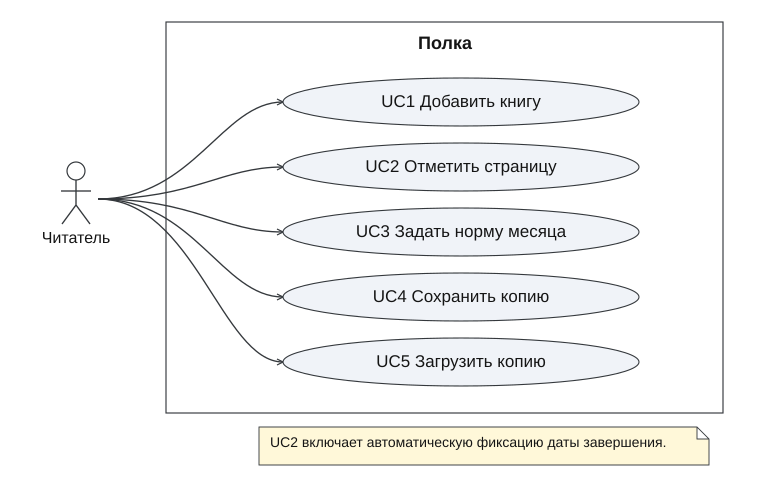

# Варианты использования «Полки»

**Актёр — читатель.** Ведёт личный список книг, отмечает прочитанное и переносит полку файлом. Все пять прецедентов инициирует читатель.

## UC1 Добавить книгу

**Назначение.** Создать карточку для последующих отметок.

**Предусловие.** Открыта полка.

**Основной поток.** Читатель вводит название, автора и объём. Форма проверяет поля, хранилище присваивает записи уникальный идентификатор. На экране появляется карточка.

**Альтернативный поток.** Пустое после обрезки пробелов название или имя автора, дробный либо неположительный объём оставляют форму для исправления.

**Постусловие.** Новая книга имеет страницу 0, статус «Запланирована» и пустую историю.

## UC2 Отметить страницу

**Назначение.** Зафиксировать место остановки и увидеть остаток.

**Предусловие.** На полке есть книга объёмом N страниц.

**Основной поток.** Читатель вводит страницу p. При целом p от 0 до N приложение вычисляет статус, дату и положительный прирост, записывает снимок, обновляет карточку и итог месяца.

**Альтернативный поток.** Вне диапазона ввод отклоняется. Уменьшение страницы исправляет позицию и снимает дату завершения. Повтор последней страницы сохраняет прежнюю дату.

**Постусловие.** После успешной записи карточка показывает p из N, долю и остаток. При ошибке сохранена прежняя позиция.

## UC3 Задать норму месяца

**Назначение.** Сопоставить прочитанные за месяц страницы с личной целью.

**Предусловие.** Открыт раздел нормы.

**Основной поток.** Читатель вводит положительное целое число и сохраняет его. Экран показывает норму рядом с суммой положительных продвижений за местный календарный месяц.

**Альтернативный поток.** Пустое, дробное или неположительное значение отклоняется. При отсутствии событий сумма равна нулю.

**Постусловие.** Норма сохраняется между сеансами. История чтения сохраняется без изменений.

## UC4 Сохранить копию

**Назначение.** Выгрузить полку для переноса.

**Предусловие.** Открыта исправная полка.

**Основной поток.** Читатель выбирает сохранение копии. Приложение сериализует книги, норму и события. Браузер предлагает polka-shelf.json.

**Альтернативный поток.** Отмена сохранения в диалоге завершает сценарий. Пустую полку также можно выгрузить.

**Постусловие.** После сохранения файл содержит полный снимок, исходная полка доступна.

## UC5 Загрузить копию

**Назначение.** Восстановить полку из файла.

**Предусловие.** У читателя есть файл копии.

**Основной поток.** Читатель выбирает файл. Система разбирает JSON, проверяет весь снимок и записывает его одним вызовом. Экран показывает загруженную полку.

**Альтернативный поток.** При отмене выбора, ошибке чтения, синтаксиса, схемы или записи текущая полка сохраняется.

**Постусловие.** После успеха загруженная полка целиком заменяет прежнюю и доступна после повторного открытия.