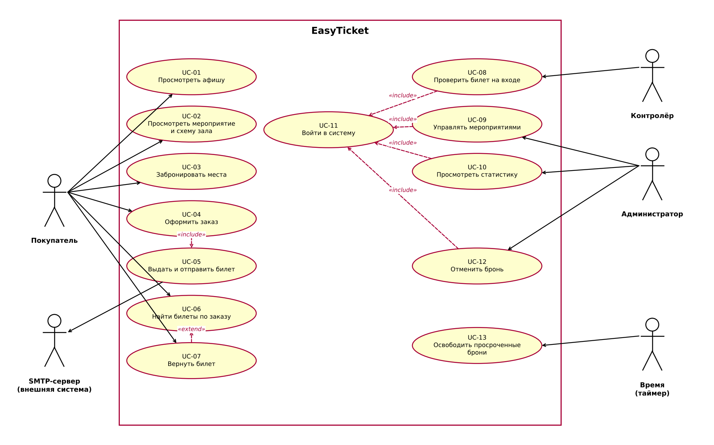

# Модель вариантов использования EasyTicket

Версия 0.1. Подготовил: Питковский В.В. Дата: 12.11.2026. Основание: SRS (`srs/srs.md`), глоссарий (`docs/glossary.md`), дополнительные спецификации (`docs/supplementary-spec.md`).

## 1. Диаграмма вариантов использования

Текстовое описание диаграммы (PlantUML): `uml/src/usecase.puml`.

Правила построения: действующие лица находятся вне системы, связи между ними не моделируются; каждый прецедент инициирован актёром (сплошная стрелка от актёра к прецеденту); для внешней системы-получателя (SMTP-сервер) стрелка идёт от прецедента к актёру; прецеденты не соединяются коммуникационной связью друг с другом, используются только `include` и `extend`.

## 2. Актёры

| Актёр | Описание роли |
|-------|---------------|
| Покупатель | Посетитель сайта: просматривает афишу, бронирует места, оформляет заказ, получает и при необходимости возвращает билеты. Регистрации не требуется. |
| Администратор | Сотрудник зала: управляет мероприятиями, просматривает статистику продаж и отменяет брони. Входит по логину и паролю. |
| Контролёр | Сотрудник на входе: проверяет подлинность билетов по QR-коду со смартфона. Входит по логину и паролю. |
| SMTP-сервер | Внешняя система, принимающая письма с билетами (в разработке — mock SMTP); получает данные от системы. |
| Время (таймер) | Системное событие «истёк срок брони»; запускает освобождение просроченных броней. |

## 3. Прецеденты

### UC-01 Просмотреть афишу

- **Пояснение:** позволяет покупателю увидеть список предстоящих мероприятий и отфильтровать его по дате, жанру и цене (REQ-FUNC-001).
- **Актёры:** Покупатель.
- **Предусловия:** система доступна.
- **Основной поток:**
  1. Покупатель открывает главную страницу.
  2. Система показывает предстоящие активные мероприятия: жанр, название, дату, место и минимальную цену, постранично.
  3. Покупатель задаёт фильтры (диапазон дат, жанр, диапазон цены) и сортировку.
  4. Система обновляет список в соответствии с фильтрами.
- **Альтернативные потоки:** A1 — по фильтрам ничего не найдено: система выводит «Мероприятия не найдены». A2 — покупатель переходит на другую страницу списка (шаг 2).
- **Ошибки:** E1 — сбой загрузки данных: система показывает сообщение об ошибке и предлагает повторить.
- **Постусловия:** отображается список, соответствующий фильтрам; данные не изменены.

### UC-02 Просмотреть мероприятие и схему зала

- **Пояснение:** показывает полную информацию о мероприятии и схему зала со статусами мест (REQ-FUNC-002, 003).
- **Актёры:** Покупатель.
- **Предусловия:** мероприятие существует и имеет статус «Активно».
- **Основной поток:**
  1. Покупатель выбирает мероприятие в афише (UC-01).
  2. Система показывает название, описание, дату, время, место проведения и цены по категориям мест.
  3. Система показывает схему зала: свободные, забронированные и проданные места с подписью статуса.
  4. Покупатель при необходимости фильтрует схему по категории мест.
- **Альтернативные потоки:** A1 — при наведении на место система показывает ряд, номер и цену.
- **Ошибки:** E1 — мероприятие не найдено, в статусе «Черновик» или «Завершено»: ответ 404.
- **Постусловия:** данные не изменены.

### UC-03 Забронировать места

- **Пояснение:** временно закрепляет выбранные места за покупателем на 10 минут, чтобы исключить двойную продажу (REQ-FUNC-004, 005).
- **Актёры:** Покупатель.
- **Предусловия:** открыта страница мероприятия (UC-02), есть свободные места.
- **Основной поток:**
  1. Покупатель выбирает свободное место.
  2. Система атомарно создаёт бронь на 10 минут; место получает статус «Забронировано».
  3. Система показывает таймер оставшегося времени и корзину с ценами и итоговой суммой.
  4. Покупатель добавляет ещё места (всего не более 10); время брони общее для всей корзины.
- **Альтернативные потоки:** A1 — место занято другим покупателем: ответ 409, сообщение, покупатель выбирает другое место. A2 — покупатель убирает место из корзины: место становится «Свободно».
- **Ошибки:** E1 — превышен лимит 10 мест: система отклоняет добавление.
- **Постусловия:** выбранные места имеют статус «Забронировано» до истечения брони или до оформления заказа.

### UC-04 Оформить заказ

- **Пояснение:** превращает бронь в заказ после ввода email и подтверждения оплаты (эмуляция) (REQ-FUNC-006).
- **Актёры:** Покупатель.
- **Предусловия:** есть действующая бронь (UC-03).
- **Основной поток:**
  1. Покупатель вводит email.
  2. Система проверяет формат email.
  3. Покупатель подтверждает оплату (эмуляция).
  4. Система создаёт заказ с номером `ORD-ГГГГ-NNNNNN`; места получают статус «Продано».
  5. Система выполняет UC-05 (include).
  6. Система показывает страницу подтверждения с билетами и QR-кодами.
- **Альтернативные потоки:** A1 — email некорректен: сообщение, возврат к шагу 1. A2 — бронь истекла: ответ 409, места свободны, корзина очищена, показано сообщение об истечении брони.
- **Ошибки:** E1 — сбой при записи заказа: транзакция откатывается, места остаются в состоянии брони до её истечения.
- **Постусловия:** заказ создан, места проданы, билеты выданы.

### UC-05 Выдать и отправить билет

- **Пояснение:** формирует подписанный QR-код для каждого билета и отправляет билет на email (REQ-FUNC-007, 008). Включается в UC-04.
- **Актёры:** SMTP-сервер (получатель).
- **Предусловия:** заказ оплачен.
- **Основной поток:**
  1. Система создаёт билет и QR-код с подписью HMAC для каждого места.
  2. Система записывает письмо в outbox.
  3. Фоновый обработчик отправляет письмо в SMTP не позднее 60 секунд после оплаты.
  4. Система помечает письмо отправленным.
- **Альтернативные потоки:** A1 — SMTP недоступен: до 3 повторных попыток с интервалом 1 минута.
- **Ошибки:** E1 — после 3 неудачных попыток письмо получает статус `failed`; билет остаётся доступным по номеру заказа (UC-06).
- **Постусловия:** письмо отправлено или помечено `failed`; QR-коды созданы.

### UC-06 Найти билеты по заказу

- **Пояснение:** возвращает билеты покупателя по номеру заказа и email, если письмо не получено или утеряно (REQ-FUNC-009).
- **Актёры:** Покупатель.
- **Предусловия:** покупатель знает номер заказа и email.
- **Основной поток:**
  1. Покупатель вводит номер заказа и email.
  2. Система проверяет пару и находит заказ.
  3. Система показывает билеты и QR-коды.
- **Альтернативные потоки:** A1 — пара неверна: общее сообщение об ошибке без раскрытия факта существования заказа.
- **Ошибки:** E1 — сбой поиска: сообщение и предложение повторить.
- **Постусловия:** данные не изменены.

### UC-07 Вернуть билет

- **Пояснение:** позволяет вернуть неиспользованный билет (REQ-FUNC-015). Расширяет UC-06: доступно после показа найденных билетов (точка расширения «после показа билетов»).
- **Актёры:** Покупатель.
- **Предусловия:** билет в состоянии «Выдан»; до начала мероприятия не менее 24 часов.
- **Основной поток:**
  1. Покупатель выбирает «Вернуть» у билета.
  2. Система проверяет условия возврата.
  3. Билет получает состояние «Возвращён», QR-код перестаёт проходить проверку, место становится «Свободно».
  4. Система отправляет письмо с подтверждением возврата и записывает действие в журнал.
- **Альтернативные потоки:** A1 — до начала менее 24 часов: возврат отклонён с пояснением. A2 — билет уже возвращён или использован: возврат отклонён.
- **Ошибки:** E1 — сбой при записи: транзакция откатывается, билет остаётся «Выдан».
- **Постусловия:** место снова доступно для продажи; билет недействителен.

### UC-08 Проверить билет на входе

- **Пояснение:** определяет подлинность билета по QR-коду и однократно отмечает его использованным (REQ-FUNC-010).
- **Актёры:** Контролёр.
- **Предусловия:** контролёр вошёл в систему (UC-11, include).
- **Основной поток:**
  1. Контролёр сканирует QR-код.
  2. Система проверяет подпись HMAC.
  3. Система атомарно отмечает билет использованным.
  4. Система показывает «Действителен» с данными мероприятия и места.
- **Альтернативные потоки:** A1 — подпись неверна: «Недействителен». A2 — билет уже использован или возвращён: «Уже использован» / «Возвращён».
- **Ошибки:** E1 — QR-код не распознан: сообщение, повторное сканирование.
- **Постусловия:** при успехе билет имеет состояние «Использован».

### UC-09 Управлять мероприятиями

- **Пояснение:** позволяет администратору вести афишу (REQ-FUNC-012).
- **Актёры:** Администратор.
- **Предусловия:** администратор вошёл в систему (UC-11, include).
- **Основной поток:**
  1. Администратор открывает список мероприятий (поиск по названию и месту, фильтр по статусу и периоду).
  2. Выбирает «Создать» или «Изменить».
  3. Вводит название, жанр, описание, дату и время, место, схему зала, цены по категориям и статус.
  4. Система сохраняет мероприятие.
- **Альтернативные потоки:** A1 — удаление: допускается только при отсутствии проданных билетов, перед удалением запрашивается подтверждение (в релизе 0.1 удаление отложено). A2 — мероприятие в статусе «Черновик» не показывается покупателям.
- **Ошибки:** E1 — не заполнено обязательное поле: система показывает ошибку, данные не сохраняются.
- **Постусловия:** изменения сохранены в базе данных.

### UC-10 Просмотреть статистику продаж

- **Пояснение:** показывает администратору продажи, выручку и заполненность залов (REQ-FUNC-013).
- **Актёры:** Администратор.
- **Предусловия:** администратор вошёл в систему (UC-11, include).
- **Основной поток:**
  1. Администратор открывает панель.
  2. Система показывает число мероприятий, активных мероприятий, проданных билетов и выручку в BYN.
  3. Система показывает по каждому мероприятию число проданных билетов, выручку и процент заполненности.
- **Альтернативные потоки:** A1 — обновление данных по кнопке.
- **Ошибки:** E1 — сбой расчёта: сообщение об ошибке.
- **Постусловия:** данные не изменены.

### UC-11 Войти в систему

- **Пояснение:** выполняет вход администратора или контролёра по логину и паролю (REQ-FUNC-011). Включается в UC-08, UC-09, UC-10, UC-12.
- **Актёры:** Администратор, Контролёр.
- **Предусловия:** у сотрудника есть учётная запись.
- **Основной поток:**
  1. Сотрудник вводит логин и пароль.
  2. Система сравнивает хеш пароля.
  3. Система создаёт сессию и определяет роль.
- **Альтернативные потоки:** A1 — неверные данные: сообщение без уточнения, что именно неверно; счётчик неудач растёт.
- **Ошибки:** E1 — 5 неудачных попыток подряд: вход блокируется на 15 минут.
- **Постусловия:** создана сессия с ролью сотрудника.

### UC-12 Отменить бронь

- **Пояснение:** позволяет администратору вручную освободить места активной брони (REQ-FUNC-014).
- **Актёры:** Администратор.
- **Предусловия:** администратор вошёл в систему (UC-11, include); есть активная бронь.
- **Основной поток:**
  1. Администратор открывает список активных броней (мероприятие, места, оставшееся время).
  2. Выбирает бронь и подтверждает отмену.
  3. Места получают статус «Свободно».
  4. Система записывает действие в журнал аудита.
- **Альтернативные потоки:** A1 — бронь уже истекла или оформлена в заказ: система сообщает, что отмена невозможна.
- **Ошибки:** E1 — сбой записи: транзакция откатывается.
- **Постусловия:** места свободны; запись аудита создана.

### UC-13 Освободить просроченные брони

- **Пояснение:** автоматически освобождает места, брони которых истекли (REQ-REL-003).
- **Актёры:** Время (таймер).
- **Предусловия:** существуют брони с истёкшим сроком.
- **Основной поток:**
  1. Раз в минуту (и при запросе схемы зала) система находит брони с `expires_at` меньше текущего времени.
  2. Система переводит места в статус «Свободно».
  3. Система журналирует операцию.
- **Альтернативные потоки:** A1 — просроченных броней нет: действий не требуется.
- **Ошибки:** E1 — сбой базы данных: повтор при следующем запуске.
- **Постусловия:** просроченных броней нет.

## 4. Трассировка на требования SRS

| Прецедент | Требования |
|-----------|------------|
| UC-01 | REQ-FUNC-001 |
| UC-02 | REQ-FUNC-002, 003 |
| UC-03 | REQ-FUNC-003, 004, 005 |
| UC-04 | REQ-FUNC-006 |
| UC-05 | REQ-FUNC-007, 008 |
| UC-06 | REQ-FUNC-009 |
| UC-07 | REQ-FUNC-015 |
| UC-08 | REQ-FUNC-010 |
| UC-09 | REQ-FUNC-012 |
| UC-10 | REQ-FUNC-013 |
| UC-11 | REQ-FUNC-011 |
| UC-12 | REQ-FUNC-014 |
| UC-13 | REQ-REL-003 |
