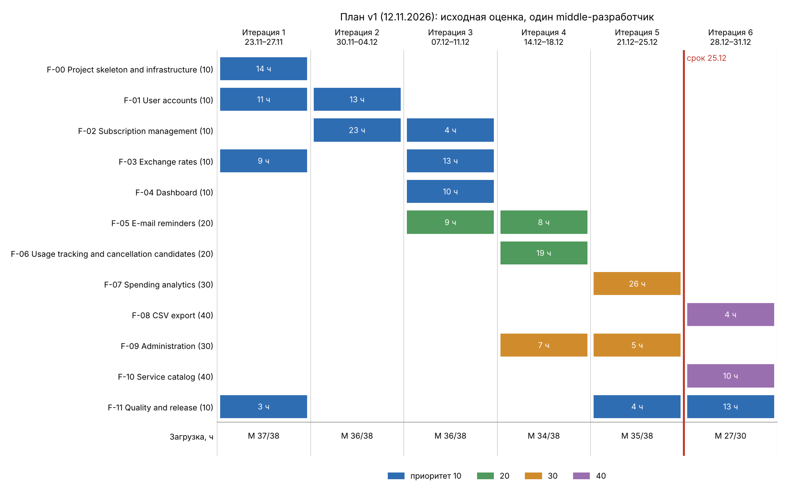
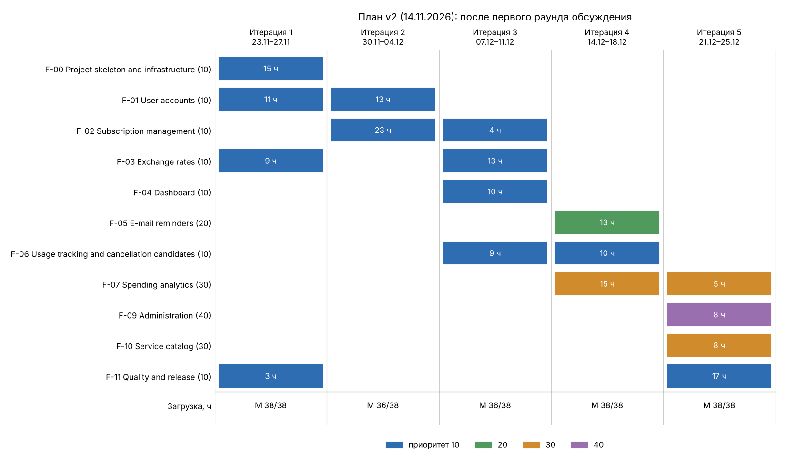
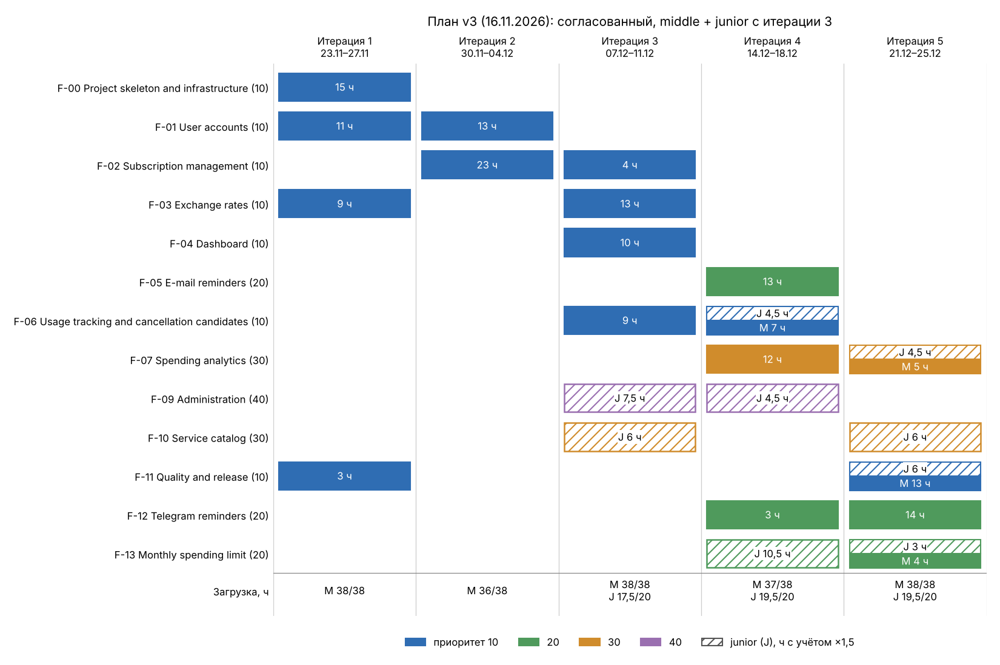

# План реализации SubScope 1.0

Подготовил Родкевич Н.А., гр. 434701 (Исполнитель, архитектор системы)

Документ содержит три версии плана реализации функционала по итерациям: исходную оценку (v1), план после первого раунда обсуждения с Заказчиком (v2) и согласованный план (v3). Ход обсуждения — в файле [correspondence.md](correspondence.md), системные требования и архитектура — в [../sdd/sdd.md](../sdd/sdd.md), требования — в [../srs/srs.md](../srs/srs.md).

> Файл строится скриптом [tools/plan.py](tools/plan.py) из данных [tools/plan_data.py](tools/plan_data.py): `python plan/tools/plan.py` из корня репозитория. Таблицы и диаграммы не редактируются вручную, чтобы суммы часов, загрузка итераций и стоимость всегда совпадали с оценками задач.

## История изменений

| Name          | Date       | Reason For Changes                                                                                                   | Version |
|---------------|------------|----------------------------------------------------------------------------------------------------------------------|---------|
| Родкевич Н.А. | 2026-11-12 | Исходная оценка трудоёмкости и план (письмо 1)                                                                        | v1      |
| Родкевич Н.А. | 2026-11-14 | Приоритеты скорректированы Заказчиком, упрощения F-03…F-10, экспорт в CSV — в резерв (письма 2–4)                     | v2      |
| Родкевич Н.А. | 2026-11-16 | Экспорт в CSV исключён, добавлены F-12 «Напоминания в Telegram» и F-13 «Месячный лимит», junior-разработчик (письма 5–9) | v3      |

---

## 1. Условия планирования

| Параметр | Значение |
|----------|----------|
| Начало разработки | 23.11.2026 (после согласования SDD) |
| Срок выпуска 1.0 | 25.12.2026 — последнее занятие семестра (REQ-DEAD-001-2); перенос Заказчиком не допускается |
| Длина итерации | 1 неделя (5 рабочих дней по 8 ч), в конце каждой итерации — показ результата Заказчику |
| Ёмкость итерации middle | 40 ч − 2 ч (планирование, показ, ретроспектива) = 38 ч на задачи |
| Единица оценки | час работы middle-разработчика, включая автоматические тесты и ревью pull request |
| Ставка middle | 40 BYN/ч, оплачиваются все рабочие часы итерации |
| Ставка junior | 15 BYN/ч; задача занимает у junior в 1,5 раза больше времени, чем у middle |
| Шкала приоритетов | 10 — наивысший: без функции релиз не имеет смысла; 20 — нужна в релизе 1.0; 30 — желательна в 1.0; 40 — допустимо упростить или сдвинуть на конец; 50 — минимальный: делается при наличии резерва, иначе после 1.0 |

Порядок задач в плане определяется приоритетом функции, затем зависимостями: задачи функции не начинаются раньше функций, от которых она зависит (столбец «Зависит от»). Задачи F-11 «Качество и выпуск» распределены по итерациям: журналирование — в первой, нагрузочный тест, развёртывание и приёмка — в последней.

---

## 2. Версия v1 — исходная оценка (12.11.2026)

Оценка выполнена по задачам (раздел 5) на основе SRS v0.3 и SDD v0.1 и отправлена Заказчику письмом 1.

| ID | Function | Функция | Приоритет | Требования SRS | Зависит от | Оценка, ч | Итерации |
|----|----------|---------|-----------|----------------|------------|-----------|----------|
| F-00 | Project skeleton and infrastructure | Каркас проекта и инфраструктура | 10 | REQ-INT-001, REQ-SEC-003, REQ-BUILD-001, REQ-CM-001 | — | 14 | 1 |
| F-01 | User accounts | Учётные записи | 10 | REQ-FUNC-001…003, 021; REQ-SEC-001; REQ-COMP-001 | F-00 | 24 | 1–2 |
| F-02 | Subscription management | Ведение подписок | 10 | REQ-FUNC-004…008, 017, 019; REQ-SEC-002 | F-01 | 27 | 2–3 |
| F-03 | Exchange rates | Курсы валют и пересчёт | 10 | REQ-INT-002, REQ-FUNC-013, REQ-REL-001, REQ-POC-001 | F-00 | 22 | 1–3 |
| F-04 | Dashboard | Обзор расходов | 10 | REQ-FUNC-009, 010 | F-02, F-03 | 10 | 3 |
| F-05 | E-mail reminders | Напоминания по e-mail | 20 | REQ-FUNC-011, REQ-INT-003 | F-01, F-02 | 17 | 3–4 |
| F-06 | Usage tracking and cancellation candidates | Контроль использования | 20 | REQ-FUNC-012, 015 | F-02, F-04 | 19 | 4 |
| F-07 | Spending analytics | Аналитика расходов | 30 | REQ-FUNC-014 | F-02, F-03 | 26 | 5 |
| F-08 | CSV export | Экспорт в CSV | 40 | REQ-FUNC-016 | F-02 | 4 | 6 |
| F-09 | Administration | Администрирование | 30 | REQ-FUNC-018 | F-01 | 12 | 4–5 |
| F-10 | Service catalog | Каталог сервисов | 40 | REQ-FUNC-020 | F-09 | 10 | 6 |
| F-11 | Quality and release | Качество и выпуск | 10 | REQ-PERF-001, REQ-OBS-001, REQ-INST-001, REQ-MAINT-001 | все | 20 | 1–6 |
| | **Итого** | | | | | **205** | |

Таблица 2.1 — Функции, приоритеты и оценки, версия v1

| Итерация | Даты | Задачи | Часы |
|----------|------|--------|------|
| 1 | 23.11–27.11.2026 | T-00.1, T-00.2, T-00.3, T-00.4, T-01.1, T-01.2, T-03.1, T-03.2, T-11.1 | 37 из 38 |
| 2 | 30.11–04.12.2026 | T-01.3, T-01.4, T-01.5, T-02.1, T-02.2, T-02.3, T-02.4 | 36 из 38 |
| 3 | 07.12–11.12.2026 | T-02.5, T-03.3, T-03.4, T-03.5, T-04.1, T-04.2, T-05.1, T-05.2 | 36 из 38 |
| 4 | 14.12–18.12.2026 | T-05.3, T-05.4, T-06.1, T-06.2, T-06.3, T-06.4, T-09.1, T-09.2 | 34 из 38 |
| 5 | 21.12–25.12.2026 | T-07.1, T-07.2, T-07.3, T-07.4, T-09.3, T-11.2 | 35 из 38 |
| 6 | 28.12–31.12.2026 | T-08.1, T-10.1, T-10.2, T-11.3, T-11.4 | 27 из 30 |

Таблица 2.2 — Распределение задач по итерациям, версия v1

Рисунок 2.1 — План v1

**Итог v1:** 205 ч работы при ёмкости пяти итераций 190 ч. Работа не помещается в срок: требуется шестая итерация, выпуск — 31.12.2026, на 6 дней позже срока. Стоимость — 9 280 BYN.

---

## 3. Версия v2 — после первого раунда обсуждения (14.11.2026)

Изменения по письмам 2 и 3:

- Заказчик изменил приоритеты: F-06 «Контроль использования» 20 → 10 (основная ценность продукта, BG-3), F-09 «Администрирование» 30 → 40, F-10 «Каталог сервисов» 40 → 30, F-08 «Экспорт в CSV» 40 → 50;
- F-07: влияние курса считается по курсам на первое число месяца за последние 12 месяцев, диаграммы используют один общий компонент (26 → 20 ч);
- F-05: отправка писем использует модуль, созданный для восстановления пароля, настройки напоминаний размещаются в профиле из T-01.3 (17 → 13 ч);
- F-09: начальный справочник категорий загружается миграцией (+1 ч к T-00.2), список пользователей — без поиска и постраничного вывода, так как пользователей не более 100 (ASM-5) (12 → 8 ч);
- F-10: подсказки при вводе — стандартным элементом `datalist` браузера вместо собственного JavaScript (10 → 8 ч);
- F-08 (приоритет 50) не включён в итерации: делается, если останется резерв, иначе — после релиза 1.0;
- оценки F-01 (восстановление пароля), F-03 (курсы валют) и T-11.4 (стабилизация и приёмка) сохранены — обоснование в письме 3.

| ID | Function | Функция | Приоритет | Требования SRS | Зависит от | Оценка, ч | Итерации |
|----|----------|---------|-----------|----------------|------------|-----------|----------|
| F-00 | Project skeleton and infrastructure | Каркас проекта и инфраструктура | 10 | REQ-INT-001, REQ-SEC-003, REQ-BUILD-001, REQ-CM-001 | — | 15 | 1 |
| F-01 | User accounts | Учётные записи | 10 | REQ-FUNC-001…003, 021; REQ-SEC-001; REQ-COMP-001 | F-00 | 24 | 1–2 |
| F-02 | Subscription management | Ведение подписок | 10 | REQ-FUNC-004…008, 017, 019; REQ-SEC-002 | F-01 | 27 | 2–3 |
| F-03 | Exchange rates | Курсы валют и пересчёт | 10 | REQ-INT-002, REQ-FUNC-013, REQ-REL-001, REQ-POC-001 | F-00 | 22 | 1–3 |
| F-04 | Dashboard | Обзор расходов | 10 | REQ-FUNC-009, 010 | F-02, F-03 | 10 | 3 |
| F-05 | E-mail reminders | Напоминания по e-mail | 20 | REQ-FUNC-011, REQ-INT-003 | F-01, F-02 | 13 | 4 |
| F-06 | Usage tracking and cancellation candidates | Контроль использования | 10 (было 20) | REQ-FUNC-012, 015 | F-02, F-04 | 19 | 3–4 |
| F-07 | Spending analytics | Аналитика расходов | 30 | REQ-FUNC-014 | F-02, F-03 | 20 | 4–5 |
| F-08 | CSV export | Экспорт в CSV | 50 | REQ-FUNC-016 | F-02 | — | вне релиза 1.0 |
| F-09 | Administration | Администрирование | 40 (было 30) | REQ-FUNC-018 | F-01 | 8 | 5 |
| F-10 | Service catalog | Каталог сервисов | 30 (было 40) | REQ-FUNC-020 | F-09 | 8 | 5 |
| F-11 | Quality and release | Качество и выпуск | 10 | REQ-PERF-001, REQ-OBS-001, REQ-INST-001, REQ-MAINT-001 | все | 20 | 1–5 |
| | **Итого** | | | | | **186** | |

Таблица 3.1 — Функции, приоритеты и оценки, версия v2

| Итерация | Даты | Задачи | Часы |
|----------|------|--------|------|
| 1 | 23.11–27.11.2026 | T-00.1, T-00.2, T-00.3, T-00.4, T-01.1, T-01.2, T-03.1, T-03.2, T-11.1 | 38 из 38 |
| 2 | 30.11–04.12.2026 | T-01.3, T-01.4, T-01.5, T-02.1, T-02.2, T-02.3, T-02.4 | 36 из 38 |
| 3 | 07.12–11.12.2026 | T-02.5, T-03.3, T-03.4, T-03.5, T-04.1, T-04.2, T-06.1, T-06.2 | 36 из 38 |
| 4 | 14.12–18.12.2026 | T-05.1, T-05.2, T-05.3, T-05.4, T-06.3, T-06.4, T-07.1, T-07.2, T-07.4 | 38 из 38 |
| 5 | 21.12–25.12.2026 | T-07.3, T-09.1, T-09.2, T-09.3, T-10.1, T-10.2, T-11.2, T-11.3, T-11.4 | 38 из 38 |

Таблица 3.2 — Распределение задач по итерациям, версия v2

Рисунок 3.1 — План v2

Инкременты для показа Заказчику: итерация 3 — MVP (учётные записи, подписки, обзор, пересчёт валют, отметки использования); итерация 4 — напоминания, кандидаты на отмену, аналитика по категориям и месяцам; итерация 5 — влияние курса, администрирование, каталог сервисов, выпуск.

**Итог v2:** 186 ч, загрузка middle 186 ч из 190 ч, резерв 4 ч; выпуск — 25.12.2026; стоимость — 8 000 BYN. План согласован Заказчиком 14.11.2026.

---

## 4. Версия v3 — согласованный план (16.11.2026)

### 4.1 Изменения второго раунда

По письму 5 Заказчик:

- отказался от экспорта в CSV в релизе 1.0 (F-08 переведён в отложенные, REQ-FUNC-016 — после 1.0);
- передумал откладывать напоминания в Telegram: пользователи читают Telegram чаще почты (новая функция F-12, приоритет 20);
- вспомнил о месячном лимите расходов на подписки с предупреждением о превышении (новая функция F-13, приоритет 20).

Новые функции разбиты на задачи и оценены в письме 6: F-12 — 17 ч, F-13 — 13 ч, всего +30 ч. При резерве плана v2 4 ч не хватает 26 ч.

### 4.2 Рассмотренные варианты

| Вариант | Срок выпуска | Стоимость, BYN | Решение Заказчика |
|---------|--------------|----------------|-------------------|
| А. Добавить итерацию 6 (28.12–31.12) | 31.12.2026 | 9 280 (+1 280, +16 %) | Отклонён: срок 25.12 не переносится, рост стоимости велик |
| Б. Исключить из 1.0 F-07 «Аналитика» или F-10 «Каталог сервисов» | 25.12.2026 | 8 000 | Отклонён: аналитика нужна для BG-4, каталог ускоряет ввод |
| В. Подключить junior-разработчика на половину ставки с итерации 3 | 25.12.2026 | 8 900 (+900, +11,2 %) | **Принят** (письмо 9) |

Таблица 4.1 — Варианты включения нового функционала

Условия варианта В:

- junior работает 20 ч в неделю в итерациях 3–5 (07.12–25.12), всего 60 ч; подключение с итерации 3, когда есть каркас, схема данных и образцы модулей, на которые можно опираться; подключение с первой итерации потребовало бы от middle больше времени на объяснения, чем сэкономило бы;
- junior получает изолированные задачи с понятными образцами: администрирование, каталог сервисов, интерфейсная часть лимита, кандидаты на «Обзоре», выбор периода в аналитике, нагрузочный тест; middle оставляет за собой задачи с внешними сервисами и планировщиками (Telegram, ежедневная проверка лимита) и выпуск;
- знакомство junior с проектом — 4 ч в итерации 3; middle тратит 2 ч в каждой итерации 3–5 на ревью pull request junior и помощь;
- резерв: middle — 3 ч, junior — 3,5 ч; если junior не успевает, первой после 1.0 переносится задача T-10.2 «Подсказки при вводе названия» (приоритет 30), остальной функционал при этом работает.

### 4.3 План v3

| ID | Function | Функция | Приоритет | Требования SRS | Зависит от | Оценка, ч | Итерации |
|----|----------|---------|-----------|----------------|------------|-----------|----------|
| F-00 | Project skeleton and infrastructure | Каркас проекта и инфраструктура | 10 | REQ-INT-001, REQ-SEC-003, REQ-BUILD-001, REQ-CM-001 | — | 15 | 1 |
| F-01 | User accounts | Учётные записи | 10 | REQ-FUNC-001…003, 021; REQ-SEC-001; REQ-COMP-001 | F-00 | 24 | 1–2 |
| F-02 | Subscription management | Ведение подписок | 10 | REQ-FUNC-004…008, 017, 019; REQ-SEC-002 | F-01 | 27 | 2–3 |
| F-03 | Exchange rates | Курсы валют и пересчёт | 10 | REQ-INT-002, REQ-FUNC-013, REQ-REL-001, REQ-POC-001 | F-00 | 22 | 1–3 |
| F-04 | Dashboard | Обзор расходов | 10 | REQ-FUNC-009, 010 | F-02, F-03 | 10 | 3 |
| F-05 | E-mail reminders | Напоминания по e-mail | 20 | REQ-FUNC-011, REQ-INT-003 | F-01, F-02 | 13 | 4 |
| F-06 | Usage tracking and cancellation candidates | Контроль использования | 10 | REQ-FUNC-012, 015 | F-02, F-04 | 19 | 3–4 |
| F-07 | Spending analytics | Аналитика расходов | 30 | REQ-FUNC-014 | F-02, F-03 | 20 | 4–5 |
| F-08 | CSV export | Экспорт в CSV | — | REQ-FUNC-016 | F-02 | — | вне релиза 1.0 |
| F-09 | Administration | Администрирование | 40 | REQ-FUNC-018 | F-01 | 8 | 3–4 |
| F-10 | Service catalog | Каталог сервисов | 30 | REQ-FUNC-020 | F-09 | 8 | 3–5 |
| F-11 | Quality and release | Качество и выпуск | 10 | REQ-PERF-001, REQ-OBS-001, REQ-INST-001, REQ-MAINT-001 | все | 20 | 1–5 |
| F-12 | Telegram reminders | Напоминания в Telegram | 20 | REQ-FUNC-011-3, 023; REQ-INT-004 | F-05 | 17 | 4–5 |
| F-13 | Monthly spending limit | Месячный лимит расходов | 20 | REQ-FUNC-022 | F-04, F-05 | 13 | 4–5 |
| | **Итого** | | | | | **216** | |

Таблица 4.2 — Функции, приоритеты и оценки, версия v3

| Итерация | Даты | Задачи | Часы |
|----------|------|--------|------|
| 1 | 23.11–27.11.2026 | T-00.1, T-00.2, T-00.3, T-00.4, T-01.1, T-01.2, T-03.1, T-03.2, T-11.1 | 38 из 38 |
| 2 | 30.11–04.12.2026 | T-01.3, T-01.4, T-01.5, T-02.1, T-02.2, T-02.3, T-02.4 | 36 из 38 |
| 3 | 07.12–11.12.2026 | middle: T-02.5, T-03.3, T-03.4, T-03.5, T-04.1, T-04.2, T-06.1, T-06.2; наставничество 2 ч junior: знакомство с проектом 4 ч; T-09.1, T-09.2, T-10.1 | M: 38 из 38 J: 17,5 из 20 |
| 4 | 14.12–18.12.2026 | middle: T-05.1, T-05.2, T-05.3, T-05.4, T-06.3, T-07.1, T-07.2, T-12.1; наставничество 2 ч junior: T-06.4, T-09.3, T-13.1, T-13.2, T-13.3 | M: 37 из 38 J: 19,5 из 20 |
| 5 | 21.12–25.12.2026 | middle: T-07.3, T-11.3, T-11.4, T-12.2, T-12.3, T-12.4, T-12.5, T-13.4; наставничество 2 ч junior: T-07.4, T-10.2, T-11.2, T-13.5 | M: 38 из 38 J: 19,5 из 20 |

Таблица 4.3 — Распределение задач по итерациям, версия v3

Рисунок 4.1 — План v3 (штриховкой показаны задачи junior; часы junior — с учётом коэффициента 1,5)

**Итог v3:** 216 ч в оценках middle; загрузка middle 187 ч из 190 ч, junior 56,5 ч из 60 ч; выпуск — 25.12.2026; стоимость — 8 900 BYN. План согласован Заказчиком 16.11.2026.

---

## 5. Сводка

| Версия | Дата | Объём, ч | Итераций | Выпуск 1.0 | Middle, ч × 40 BYN | Junior, ч × 15 BYN | Стоимость, BYN |
|--------|------|----------|----------|------------|--------------------|--------------------|----------------|
| v1 | 12.11.2026 | 205 | 6 | 31.12.2026 | 232 | — | 9 280 |
| v2 | 14.11.2026 | 186 | 5 | 25.12.2026 | 200 | — | 8 000 |
| v3 | 16.11.2026 | 216 | 5 | 25.12.2026 | 200 | 60 | 8 900 |

Таблица 5.1 — Сравнение версий плана

| Задача | Функция | Содержание | v1, ч | v2, ч | v3, ч | Исполнитель v3 |
|--------|---------|------------|-------|-------|-------|----------------|
| T-00.1 | F-00 | Каркас Spring Boot, модули, общий макет страниц и главное меню | 6 | 6 | 6 | middle |
| T-00.2 | F-00 | PostgreSQL, миграции Flyway, начальная схема и справочник категорий | 3 | 4 | 4 | middle |
| T-00.3 | F-00 | CI в GitHub Actions: сборка и тесты для каждого pull request | 2 | 2 | 2 | middle |
| T-00.4 | F-00 | HTTPS, проверка ввода, страницы ошибок | 3 | 3 | 3 | middle |
| T-01.1 | F-01 | Регистрация, вход и выход (Spring Security, BCrypt) | 8 | 8 | 8 | middle |
| T-01.2 | F-01 | Временная блокировка после 5 неудачных попыток входа | 3 | 3 | 3 | middle |
| T-01.3 | F-01 | Профиль: базовая валюта, пароль, порог неиспользования, сроки напоминаний | 3 | 3 | 3 | middle |
| T-01.4 | F-01 | Удаление учётной записи со всеми данными | 2 | 2 | 2 | middle |
| T-01.5 | F-01 | Восстановление пароля: одноразовые ссылки, отправка писем через SMTP | 8 | 8 | 8 | middle |
| T-02.1 | F-02 | Модель подписки, форма добавления и изменения с проверками | 10 | 10 | 10 | middle |
| T-02.2 | F-02 | Удаление с подтверждением, статусы | 4 | 4 | 4 | middle |
| T-02.3 | F-02 | Список: поиск, фильтры, сортировка по цене в базовой валюте | 6 | 6 | 6 | middle |
| T-02.4 | F-02 | Совместные подписки (доля пользователя) | 3 | 3 | 3 | middle |
| T-02.5 | F-02 | Ежедневный перенос даты следующего списания | 4 | 4 | 4 | middle |
| T-03.1 | F-03 | Проверка API НБ РБ на текущую и прошедшую дату (POC) | 3 | 3 | 3 | middle |
| T-03.2 | F-03 | Клиент API, таблица курсов, ежедневная загрузка | 6 | 6 | 6 | middle |
| T-03.3 | F-03 | Курсы на прошедшую дату | 4 | 4 | 4 | middle |
| T-03.4 | F-03 | Работа по последним сохранённым курсам при недоступности API | 3 | 3 | 3 | middle |
| T-03.5 | F-03 | Пересчёт сумм: Cur_Scale, кросс-курс через BYN, округление | 6 | 6 | 6 | middle |
| T-04.1 | F-04 | Суммы в месяц и в год, число подписок и кандидатов | 6 | 6 | 6 | middle |
| T-04.2 | F-04 | Ближайшие списания и окончания пробных периодов | 4 | 4 | 4 | middle |
| T-05.1 | F-05 | Ежедневная задача в 09:00 Europe/Minsk, выбор списаний и пробных периодов | 5 | 5 | 5 | middle |
| T-05.2 | F-05 | Шаблоны писем и отправка | 4 | 2 | 2 | middle |
| T-05.3 | F-05 | Защита от повторной отправки, повторные попытки, журнал | 5 | 5 | 5 | middle |
| T-05.4 | F-05 | Настройки напоминаний | 3 | 1 | 1 | middle |
| T-06.1 | F-06 | Отметка использования в списке и на «Обзоре» | 6 | 6 | 6 | middle |
| T-06.2 | F-06 | Исправление отметки за прошлый месяц в течение 7 дней | 3 | 3 | 3 | middle |
| T-06.3 | F-06 | Расчёт кандидатов на отмену и экономии за год | 7 | 7 | 7 | middle |
| T-06.4 | F-06 | Кандидаты на отмену на «Обзоре» и в списке | 3 | 3 | 3 | junior |
| T-07.1 | F-07 | Агрегация расходов по категориям и месяцам | 8 | 8 | 8 | middle |
| T-07.2 | F-07 | Диаграммы Chart.js | 5 | 4 | 4 | middle |
| T-07.3 | F-07 | Влияние курса на стоимость подписки | 10 | 5 | 5 | middle |
| T-07.4 | F-07 | Выбор периода, пустые состояния | 3 | 3 | 3 | junior |
| T-08.1 | F-08 | Выгрузка подписок в CSV | 4 | — | — | — |
| T-09.1 | F-09 | Роль администратора и правила доступа | 3 | 3 | 3 | junior |
| T-09.2 | F-09 | Ведение справочника категорий | 4 | 2 | 2 | junior |
| T-09.3 | F-09 | Список пользователей, блокировка и разблокировка | 5 | 3 | 3 | junior |
| T-10.1 | F-10 | Ведение каталога сервисов администратором | 4 | 4 | 4 | junior |
| T-10.2 | F-10 | Подсказки при вводе названия и подстановка категории | 6 | 4 | 4 | junior |
| T-11.1 | F-11 | Журналирование событий | 3 | 3 | 3 | middle |
| T-11.2 | F-11 | Нагрузочный тест (страница не дольше 2 с) | 4 | 4 | 4 | junior |
| T-11.3 | F-11 | Развёртывание на сервере, параметры через переменные окружения | 5 | 5 | 5 | middle |
| T-11.4 | F-11 | Стабилизация, исправление ошибок, приёмка Заказчиком | 8 | 8 | 8 | middle |
| T-12.1 | F-12 | Абстракция канала уведомлений, перевод e-mail на неё | — | — | 3 | middle |
| T-12.2 | F-12 | Регистрация бота, клиент Telegram Bot API | — | — | 4 | middle |
| T-12.3 | F-12 | Привязка аккаунта по ссылке /start с одноразовым кодом | — | — | 6 | middle |
| T-12.4 | F-12 | Выбор канала в настройках, отвязка, бот заблокирован пользователем | — | — | 2 | middle |
| T-12.5 | F-12 | Тесты с заглушкой Bot API | — | — | 2 | middle |
| T-13.1 | F-13 | Поле лимита в профиле, миграция | — | — | 2 | junior |
| T-13.2 | F-13 | Индикатор лимита на «Обзоре» | — | — | 3 | junior |
| T-13.3 | F-13 | Предупреждение при сохранении подписки сверх лимита | — | — | 2 | junior |
| T-13.4 | F-13 | Ежедневная проверка после обновления курсов, одно уведомление в месяц | — | — | 4 | middle |
| T-13.5 | F-13 | Тесты лимита | — | — | 2 | junior |
| | | **Итого** | **205** | **186** | **216** | |

Таблица 5.2 — Оценки задач по версиям плана
