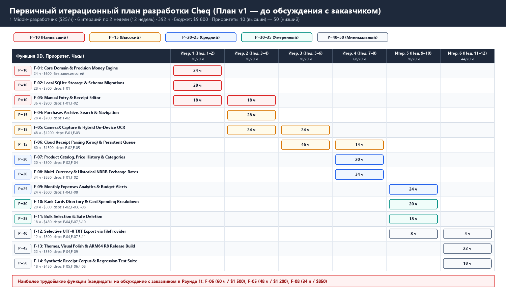

# Первичный план реализации и оценки функционала Cheq (План v1)

**Статус:** Предложено архитектором (на обсуждение с Заказчиком — Раунд 1)  
**Версия:** 1.0 (базовая, до корректировки приоритетов и объёма)  
**Автор:** А. В. Голуб, группа 434701  
**Дата:** 21.11.2026  
**Основание:** [SRS Cheq v1.2](../srs/srs-cheq.md), [SDD Cheq v0.1](sdd-cheq.md), ADR-0001..ADR-0007

---

## 1. Параметры планирования и расчёта стоимости

| Параметр | Значение | Пояснение |
|---|---|---|
| Команда (базовый вариант) | 1 Middle Android/Java разработчик (Архитектор) | Полноценная реализация `:core` и `:app` |
| Ставка Middle-разработчика | **$25 / час** | Базовая расчётная ставка для оценки бюджета |
| Длина итерации | **2 недели** (10 рабочих дней = 80 календарных ч) | Короткие итерации с демонстрацией инкремента |
| Полезная ёмкость итерации | **70 проектных ч / итерация** | 10 ч зарезервировано на демо, планирование, регрессию и риски |
| Шкала приоритетов | **10 (наивысший) — 50 (минимальный)** | Шаг 5; `10` = критический фундамент MVP, `50` = вспомогательный функционал |
| Суммарная трудоёмкость (План v1) | **392 ч** | 14 функциональных блоков (`F-01` .. `F-14`) |
| Расчётная длительность (План v1) | **6 итераций (12 недель)** | Загрузка: 70, 70, 70, 68, 70, 44 ч |
| Расчётная стоимость (План v1) | **$9 800** | 392 ч × $25/ч |

---

## 2. Приоритизированный бэклог функционала (План v1)

Приоритеты ранжированы архитектором от **10** (highest) до **50** (lowest) на основе бизнес-целей SRS (`BG-01`..`BG-05`) и технических зависимостей.

| ID | Feature (EN) | Описание функционала (RU) | Связанные требования (SRS / SYS) | Приоритет (10–50) | Зависимости | Оценка (ч) | Стоимость ($) |
|---|---|---|---|---:|---|---:|---:|
| `F-01` | Core Domain & Precision Money Engine | Чистый Java-модуль `:core`, `ReceiptDraft`/`Item`, целая денежная арифметика `Money`, валидация | `REQ-REUSE-001`, `REQ-FUNC-001`, `REQ-FUNC-004` / `SYS-FUNC-001` | **10** | — | 24 | $600 |
| `F-02` | Local SQLite Storage & Schema Migrations | База `receiptbox.db` v5 (WAL, FK, миграции v1→v5), CRUD покупок, `ReceiptPhotos` | `REQ-REL-001`, `REQ-REL-003`, `REQ-SEC-001` / `SYS-FUNC-002` | **10** | `F-01` | 28 | $700 |
| `F-03` | Manual Entry & Receipt Editor | Ручной ввод, `EditorActivity`/`EditorModel`, проверка арифметики `ReceiptArithmetic`, `DraftCache`, поворот экрана | `REQ-INT-002`, `REQ-FUNC-001`, `REQ-FUNC-003..005`, `REQ-FUNC-021` / `SYS-FUNC-003` | **10** | `F-01`, `F-02` | 36 | $900 |
| `F-04` | Purchases Archive, Search & Navigation | Нижняя навигация (4 раздела), просмотр карточек/списка, поиск по магазину/товару/дате, сортировка | `REQ-INT-001`, `REQ-FUNC-006`, `REQ-FUNC-007`, `REQ-PERF-001` / `SYS-FUNC-004` | **15** | `F-02` | 28 | $700 |
| `F-05` | CameraX Capture & Hybrid On-Device OCR | Камера CameraX, выбор фото, ручной кроп + `OcrPreparation` (тайлинг), ML Kit + Tesseract `rus+eng`, `OcrTextMerger` | `REQ-INT-003`, `REQ-FUNC-002`, `REQ-ML-001`, `REQ-ML-003`, `REQ-PERF-002` / `SYS-FUNC-005` | **15** | `F-01`, `F-03` | **48** | **$1 200** |
| `F-06` | Cloud Receipt Parsing (Groq + Worker) & Persistent Queue | Интеграция Groq (`openai/gpt-oss-20b`, strict JSON Schema) + прокси Cloudflare Worker, `PendingReceiptStore`, `RecognitionQueue`, ретраи, OCC `revision`, `completed_pending` | `REQ-INT-005`, `REQ-FUNC-020`, `REQ-ML-001..002`, `REQ-REL-002`, `REQ-OBS-001`, `REQ-SEC-003` / `SYS-FUNC-006` | **15** | `F-02`, `F-05` | **60** | **$1 500** |
| `F-07` | Product Catalog, Price History & Categories | Раздел «Товары», нормализация `product_key`, история цен в исходных валютах, смена категорий | `REQ-FUNC-008` / `SYS-FUNC-007` | **20** | `F-02`, `F-04` | 20 | $500 |
| `F-08` | Multi-Currency & Historical NBRB Exchange Rates | 6 валют, `NbrbRateClient`, кросс-курс BYN с деноминацией, кэш `exchange_rates`, предзагрузка и индикация неполных сводок | `REQ-INT-004`, `REQ-FUNC-009..011`, `REQ-AVAIL-001` / `SYS-FUNC-008` | **20** | `F-01`, `F-02` | **34** | **$850** |
| `F-09` | Monthly Expenses Analytics & Budget Alerts | Раздел «Расходы», сводка по категориям, `BudgetProgress`, пороги 80% / 100%, стартовое уведомление | `REQ-FUNC-012`, `REQ-FUNC-013` / `SYS-FUNC-009` | **25** | `F-04`, `F-08` | 24 | $600 |
| `F-10` | Bank Cards Directory & Card Spending Breakdown | Справочник карт (`label` + `last_four`), верифицируемая авто-подстановка, сводка расходов по картам и «Без карты» | `REQ-FUNC-014..016`, `REQ-SEC-002` / `SYS-FUNC-010` | **30** | `F-02`, `F-03`, `F-08` | 20 | $500 |
| `F-11` | Bulk Selection & Safe Deletion | Множественный выбор (`SelectionModel`) с учётом поиска, массовая смена карты/категории, безопасное удаление фото | `REQ-FUNC-017`, `REQ-FUNC-018` / `SYS-FUNC-011` | **35** | `F-04`, `F-07`, `F-10` | 18 | $450 |
| `F-12` | Selective UTF-8 TXT Export via FileProvider | Экспорт выбранных покупок/истории цен в TXT без OCR-текста и карт, `FileProvider`, очистка кеша через 24 ч | `REQ-FUNC-019`, `REQ-SEC-001`, `REQ-SEC-002` / `SYS-FUNC-012` | **40** | `F-04`, `F-07`, `F-11` | 12 | $300 |
| `F-13` | Themes, Visual Polish & ARM64 R8 Release Build | Светлая/тёмная/системная темы, эффекты `FrostedSurface`, R8-сборка `arm64-v8a`, аудит `THIRD_PARTY.md` | `REQ-FUNC-021`, `REQ-INST-001`, `REQ-BUILD-001`, `REQ-DIST-001`, `REQ-COMP-001`, `REQ-PORT-001` / `SYS-FUNC-013` | **45** | `F-04`, `F-09` | 22 | $550 |
| `F-14` | Synthetic Receipt Corpus & Regression Test Suite | Синтетический корпус чеков (`verify-receipt-corpus.ps1`), JUnit + Robolectric покрытие критичных модулей | `REQ-ML-003`, `REQ-POC-001`, `REQ-MAINT-001` / `SYS-FUNC-014` | **50** | `F-05`, `F-06`, `F-08` | 18 | $450 |
| **Итого** | **14 функциональных блоков** | — | **Все 50 требований SRS v1.2** | **10–50** | — | **392 ч** | **$9 800** |

---

## 3. Первичное распределение по итерациям (План v1 — 6 итераций / 12 недель)

| Итерация | Срок | Включённые задачи | Часы | Загрузка | Демонстрируемый инкремент |
|---|---|---|---:|---:|---|
| **Итерация 1** | Недели 1–2 | `F-01` (24 ч), `F-02` (28 ч), `F-03.1` каркас редактора (18 ч) | 70 ч | 100% | Ядро `:core`, БД `receiptbox.db` v5 с тестами, прототип формы ручного ввода |
| **Итерация 2** | Недели 3–4 | `F-03.2` арифметика и `DraftCache` (18 ч), `F-04` архив и поиск (28 ч), `F-05.1` CameraX + базовый OCR (24 ч) | 70 ч | 100% | Полноценный офлайн-учёт вручную, поиск по архиву, съёмка чека и базовый OCR |
| **Итерация 3** | Недели 5–6 | `F-05.2` тайлинг, `OcrTextMerger`, кроп (24 ч), `F-06.1` Groq JSON Schema, Cloudflare Worker, очередь (46 ч) | 70 ч | 100% | Полный локальный гибридный OCR и первичный облачный разбор чеков через Groq |
| **Итерация 4** | Недели 7–8 | `F-06.2` ретраи, OCC `revision`, защита от дублей (14 ч), `F-07` товары и история цен (20 ч), `F-08` курсы НБРБ и кэш (34 ч) | 68 ч | 97% | Надёжная офлайн-очередь, каталог товаров с историей цен, мультивалютные курсы НБРБ |
| **Итерация 5** | Недели 9–10 | `F-09` месячные расходы и бюджет (24 ч), `F-10` карты и расходы по картам (20 ч), `F-11` массовый выбор (18 ч), `F-12.1` TXT генерация (8 ч) | 70 ч | 100% | Аналитика, уведомления бюджета 80%/100%, справочник карт, массовые операции |
| **Итерация 6** | Недели 11–12 | `F-12.2` FileProvider и очистка кеша (4 ч), `F-13` темы, визуальный полиш, ARM64 R8 (22 ч), `F-14` корпус чеков и регрессия (18 ч) | 44 ч | 63% | Выборочный TXT-экспорт, темы, финальный R8 APK и прогон корпуса верификации |

---

## 4. Вопросы Заказчику перед утверждением плана (Раунд 1)

1. **Приоритеты (10–50):** устраивает ли предложенная очерёдность поставки? Например, нужны ли бюджет (`F-09`) и карты (`F-10`) раньше истории цен (`F-07`)?
2. **Наиболее трудоёмкие функции (`F-06` — 60 ч, `F-05` — 48 ч, `F-08` — 34 ч):** требуется ли детальное обоснование состава работ и рассмотрение вариантов сокращения сроков и бюджета (в частности, выбор маршрута Groq в [ADR-0004](../adr/0004-groq-cloud-parsing-route-worker-vs-direct-https.md))?
3. **Целевой срок релиза (deadline) и бюджет:** приемлем ли базовый срок **12 недель ($9 800)**, либо необходимо уложиться в более жёсткий срок (например, **10 недель / 5 итераций**)?
