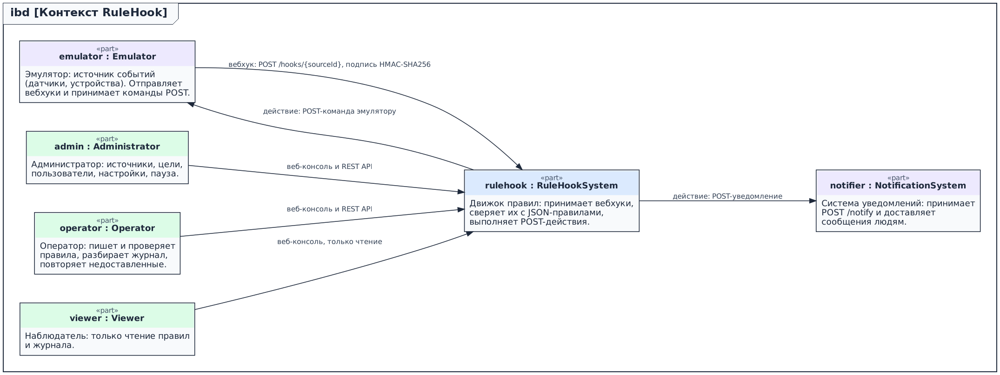
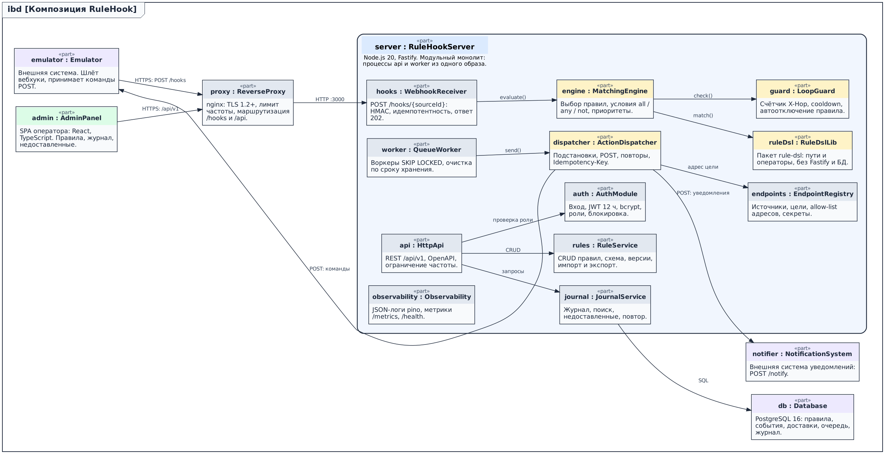
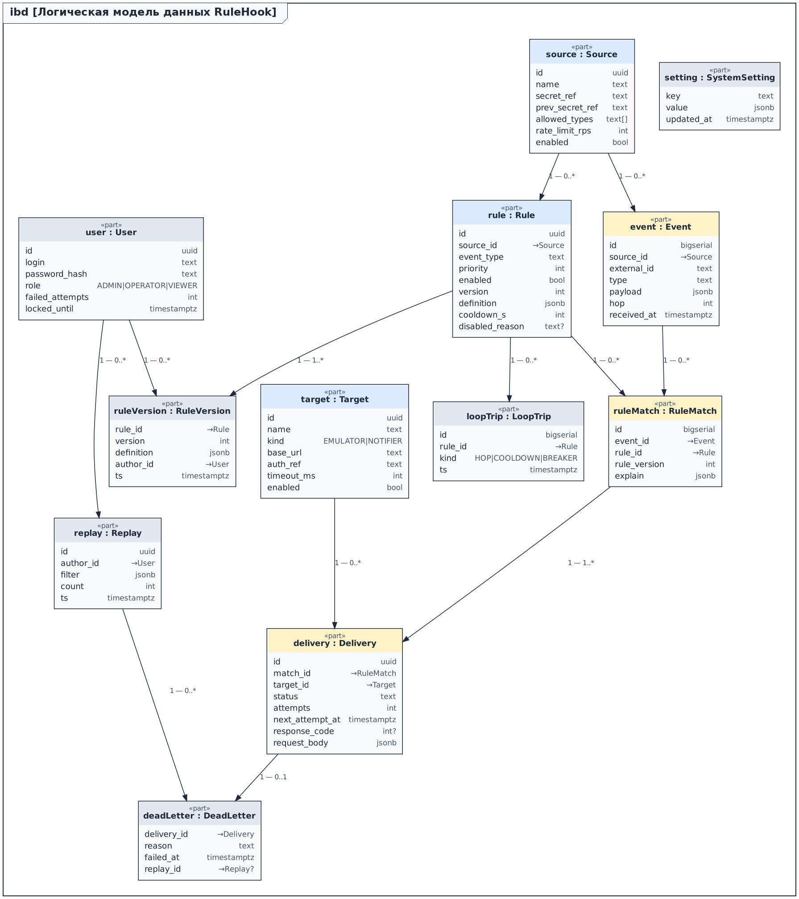
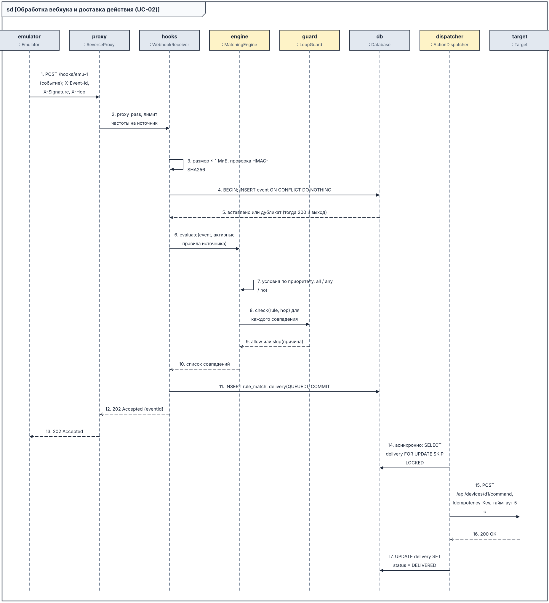
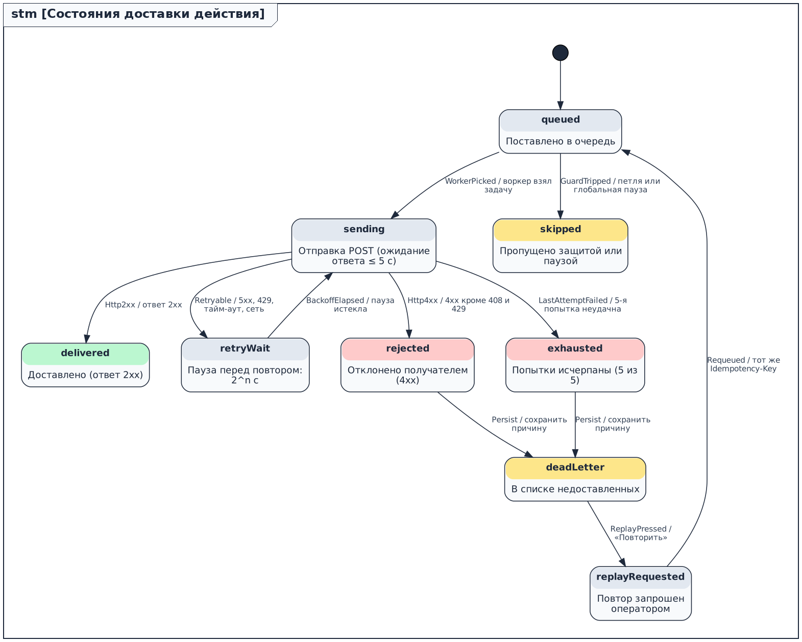
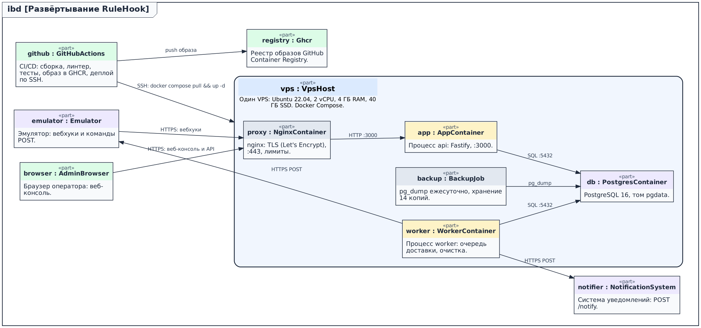

# Описание проектирования RuleHook (SDD)

Версия 0.3 (0.1 – 12.11.2026, 0.2 – 13.11.2026, 0.3 – 18.11.2026).

## 1 Введение

Документ описывает, как построена система RuleHook: backend, который принимает вебхуки от эмулятора, проверяет их по сохранённым JSON-правилам и при совпадении отправляет POST-запрос на эмулятор или в систему уведомлений. Требования – в srs/srs-rulehook.md.

## 2 Стейкхолдеры и точки зрения

| Стейкхолдер | Задачи |
|---|---|
| Заказчик | Правильная и быстрая реакция на события, срок и бюджет |
| Оператор | Создавать и проверять правила, разбирать журнал, повторять недоставленные |
| Администратор | Источники, цели, пользователи, пауза |
| Разработчики | Понятные границы модулей, тесты, трассировка |
| Эксплуатация | Развёртывание, метрики, резервные копии |
| Ответственный за данные | Срок хранения и маскирование payload |

Из 15 точек зрения шаблона выбраны 12. «Логическое представление», «Физическое представление» и «Зависимости» отдельно не выделены: их содержание покрыто представлениями 002 – 005 и 009.

## 3 Проектные представления

| ID | Точка зрения | Содержание | Язык |
|---|---|---|---|
| 001-context | Контекст | Границы системы, акторы, внешние системы | SysML v2 ibd |
| 002-composition | Композиция | Клиенты, прокси, 12 модулей сервера, хранилище | SysML v2 ibd |
| 003-structure | Структура | Монорепозиторий, слои routes → service → repo | Дерево каталогов |
| 004-information | Информация | 12 сущностей, ограничения целостности | SysML v2 ibd |
| 005-interface | Интерфейс | Входящие вебхуки и REST API | Таблица |
| 006-interaction | Взаимодействие | Обработка вебхука, доставка действия, пути отказа | SysML v2 sd |
| 007-delivery-states | Динамика состояний | 9 состояний доставки действия, повторы и недоставленные | SysML v2 stm |
| 008-algorithm | Алгоритм | Цепочка обработки вебхука и сопоставления | Псевдокод |
| 009-deployment | Развёртывание | VPS, контейнеры, CI/CD | SysML v2 ibd |
| 010-concurrency | Параллелизм | Одновременные дубликаты, параллельные воркеры | Таблица |
| 011-patterns | Паттерны | 8 применённых паттернов | Таблица |
| 012-resources | Ресурсы | Память, соединения, диск, трафик | Таблица |

### 001-context – Контекст



### 002-composition – Композиция



Ядро корректности – модули engine, guard, dispatcher и пакет rule-dsl (выделены цветом).

### 003-structure – Структура

```
rulehook/
├─ apps/
│  ├─ server/           # api и worker (один образ)
│  │  └─ src/ routes → services → repos, modules/{hooks,engine,dispatcher,guard,...}
│  └─ console/          # веб-консоль (React, TypeScript)
├─ packages/
│  └─ rule-dsl/         # пути, операторы, схема правила (без Fastify и БД)
├─ db/migrations/
├─ deploy/              # docker-compose.yml, nginx.conf
├─ srs/  sdd/  docs/  tools/
```

### 004-information – Информация



Ограничения целостности: уникальный индекс event (source_id, external_id); rule_version (rule_id, version) уникален; delivery.status ∈ {QUEUED, SENDING, RETRY_WAIT, DELIVERED, REJECTED, EXHAUSTED, DEAD, SKIPPED, REPLAY}; внешние ключи без каскадного удаления событий.

### 005-interface – Интерфейс

| Метод | Путь | Назначение | Роль | Ответы |
|---|---|---|---|---|
| POST | /hooks/{sourceId} | Приём вебхука; заголовки X-Event-Id, X-Signature, X-Hop | подпись | 202, 200 (дубликат), 400, 401, 404, 413, 429, 503 |
| POST | /api/v1/auth/login | Вход, выдача JWT на 12 ч | – | 200, 401, 423 |
| GET, POST | /api/v1/rules | Список и создание правил | OPERATOR+ | 200, 201, 422 |
| GET, PUT, DELETE | /api/v1/rules/{id} | Чтение, изменение (новая версия), удаление | OPERATOR+ | 200, 404, 422 |
| POST | /api/v1/rules/{id}/test | Пробный прогон на примере события | OPERATOR+ | 200, 422 |
| GET, POST | /api/v1/rules/export, /import | Экспорт и импорт правил | OPERATOR+ | 200, 422 |
| GET, POST | /api/v1/sources | Источники вебхуков | ADMIN | 200, 201 |
| POST | /api/v1/sources/{id}/rotate-secret | Ротация секрета (два активных секрета) | ADMIN | 200 |
| GET, POST | /api/v1/targets | Реестр целей (allow-list) | ADMIN | 200, 201, 422 |
| GET | /api/v1/journal, /journal/export.csv | Журнал обработки с фильтрами | VIEWER+ | 200 |
| GET, POST | /api/v1/failed, /failed/{id}/replay, /failed/replay | Недоставленные, повтор одного и пакетный | OPERATOR+ | 200, 202 |
| POST | /api/v1/system/pause, /resume | Глобальная пауза | ADMIN | 200 |
| GET | /health, /metrics, /docs | Готовность, метрики Prometheus, Swagger UI | – | 200 |

Пример правила:

```json
{
  "id": "overheat-alert",
  "source": "emulator-1",
  "eventType": "sensor.temperature",
  "priority": 20,
  "when": { "all": [
    { "path": "$.payload.value", "op": "gt", "value": 80 },
    { "path": "$.payload.unit",  "op": "eq", "value": "C" } ] },
  "then": [
    { "target": "emulator", "path": "/api/devices/{{payload.deviceId}}/command",
      "body": { "command": "shutdown" } },
    { "target": "notifier", "path": "/notify",
      "body": { "text": "Перегрев {{payload.deviceId}}: {{payload.value}} °C" } } ],
  "cooldownSec": 60
}
```

### 006-interaction – Взаимодействие



### 007-delivery-states – Динамика состояний



### 008-algorithm – Алгоритм

```
handleWebhook(sourceId, rawBody, headers):
  source = sources.get(sourceId)         # 404, если нет или выключен
  if size(rawBody) > 1 MiB: return 413
  if not hmac.verify(source.secret, rawBody, headers.X-Signature): return 401   # без БД
  event = parse(rawBody)                 # 400, если не JSON или нет eventId
  BEGIN
    if not INSERT event ON CONFLICT (source_id, external_id) DO NOTHING:
      COMMIT; return 200                 # повторная доставка
    for rule in rules.active(source, event.type) ordered by priority:
      if engine.match(rule, event):
        verdict = guard.check(rule, event.hop)       # hop, cooldown, breaker
        INSERT rule_match(event, rule, explain)
        for action in rule.then:
          INSERT delivery(status = verdict.allow ? QUEUED : SKIPPED, ...)
  COMMIT                                 # при ошибке БД: return 503
  return 202

worker():                                # N воркеров параллельно
  loop: d = SELECT delivery WHERE status IN (QUEUED, RETRY_WAIT) AND next_attempt_at <= now()
            FOR UPDATE SKIP LOCKED LIMIT 1
        if paused: continue
        r = http.post(target(d), render(d.template, event), Idempotency-Key = d.id, timeout 5 s)
        2xx -> DELIVERED;  5xx/429/timeout -> RETRY_WAIT (2^n с) или EXHAUSTED -> DEAD_LETTER;  4xx -> REJECTED -> DEAD_LETTER
```

### 009-deployment – Развёртывание



### 010-concurrency – Параллелизм

| Ситуация | Решение |
|---|---|
| Одновременные дубликаты вебхука | Уникальный индекс (source_id, external_id), ON CONFLICT DO NOTHING; второй запрос получает 200 |
| Параллельные воркеры | FOR UPDATE SKIP LOCKED, пул из 4 воркеров; задача берётся ровно одним воркером |
| Изменение правила во время обработки | Событие обрабатывается по снимку активных правил; кэш сбрасывается через LISTEN / NOTIFY |
| Ротация секрета | Два активных секрета на время перехода; проверка подписи принимает любой из них |
| Нагрузка на цель | Не более 8 одновременных POST на цель; остальные ждут в очереди |
| Автоотключение правила | Атомарный UPDATE с проверкой счётчика срабатываний за минуту |
| Порядок событий | Между источниками не гарантируется; внутри источника – по received_at |

### 011-patterns – Паттерны

| Паттерн | Где применён | ADR |
|---|---|---|
| Modular Monolith | Сервер и worker из одного кода | ADR-0001 |
| Transactional Outbox | Очередь доставки в той же транзакции, что и событие | ADR-0004 |
| Idempotent Receiver | Дубликаты вебхука и повторы доставки | ADR-0003, ADR-0006 |
| Retry with Exponential Backoff | Повторы доставки: пауза 2^n с, 5 попыток | ADR-0006 |
| Circuit Breaker | Автоотключение правила при петле | ADR-0008 |
| Dead Letter Queue | Недоставленные действия и их повтор | ADR-0006 |
| Repository | Слой repo над PostgreSQL | ADR-0001 |
| Strategy | Операторы условий в пакете rule-dsl | ADR-0002 |

### 012-resources – Ресурсы

| Ресурс | Оценка |
|---|---|
| Память | api ≈ 200 МБ, worker ≈ 150 МБ, PostgreSQL ≈ 512 МБ; кэш правил ≤ 10 МБ; всего ≤ 1,5 ГБ из 4 ГБ |
| Соединения БД | Пул 20: api 12, worker 8; лимит PostgreSQL 50 |
| Диск | Событие ≈ 3 КБ с журналом; в среднем 1 событие/с ≈ 260 МБ/сут, хранение 30 суток ≈ 8 ГБ из 40 ГБ |
| Сеть | Исходящие POST ≈ 1–2 КБ; пик 50 событий/с ≈ 0,3 Мбит/с |
| ЦП | Сопоставление с 200 правилами ≤ 20 мс на ядро; пик 50 событий/с занимает менее 1 ядра |

## 4 Архитектурные решения

| ADR | Решение |
|---|---|
| 0001 | Модульный монолит на Node.js 20 и Fastify |
| 0002 | Правила – JSON-документы с проверкой по JSON Schema, без исполнения кода |
| 0003 | Подпись вебхуков HMAC-SHA256 общим секретом источника |
| 0004 | Очередь доставки в PostgreSQL (FOR UPDATE SKIP LOCKED), transactional outbox |
| 0005 | Редактор правил: JSON-режим с проверкой схемы, визуальный конструктор – в релиз 3 |
| 0006 | Семантика доставки: at-least-once, Idempotency-Key, 5 попыток, затем недоставленные |
| 0007 | Один VPS, Docker Compose |
| 0008 | Защита от петель: счётчик переходов X-Hop, пауза повторного срабатывания, автоотключение правила |

## 5 Сводка плана

План v3: 322 ч, окончание 04.03.2027, 5280 USD (docs/plan/plan-v3.md).

## Приложение А. История изменений

| Версия | Дата | Изменения |
|---|---|---|
| 0.1 | 12.11.2026 | Первая редакция: 12 представлений, ADR-0001 – 0007, бэклог из 19 функций |
| 0.2 | 13.11.2026 | ADR-0005 (редактор правил: JSON-режим); F11 сокращена, F20 – релиз 3 |
| 0.3 | 18.11.2026 | Представления 002, 004, 005, 007, 012: F21, F22; ADR-0008; план v3 |

## Приложение Б. Матрица трассировки

| Требование | Представления | ADR | Функция | Итерация |
|---|---|---|---|---|
| REQ-FUNC-001 | 002, 004, 005 | 0001 | F02 | I1 |
| REQ-FUNC-002 | 005, 006, 008, 010 | 0001, 0003, 0004 | F03 | I1 |
| REQ-FUNC-003 | 005, 006, 008, 010 | 0001, 0003, 0004 | F03 | I1 |
| REQ-FUNC-004 | 004, 005 | 0002 | F04 | I2 |
| REQ-FUNC-005 | 002, 006, 008, 011 | 0002 | F05 | I2 |
| REQ-FUNC-006 | 006, 007, 010, 011 | 0004, 0006 | F06 | I2–I3 |
| REQ-FUNC-007 | 006, 007, 010, 011 | 0004, 0006 | F06 | I2–I3 |
| REQ-FUNC-008 | 005, 006 | 0002 | F07 | I3 |
| REQ-FUNC-009 | 002, 005 | 0005 | F11, F20 | I3, релиз 3 |
| REQ-FUNC-010 | 005 | 0002 | F10 | I3 |
| REQ-FUNC-011 | 004, 005 | – | F13 | I3–I4 |
| REQ-FUNC-012 | 004, 005 | 0003 | F14 | I2 |
| REQ-FUNC-013 | 005, 007 | 0006 | F15 | I4 |
| REQ-FUNC-014 | 002, 006, 007, 008 | 0008 | F21 | I3 |
| REQ-FUNC-015 | 004, 005, 007 | 0006 | F22 | I4 |
| REQ-INT-001 | 005, 006, 008, 010 | 0001, 0003, 0004 | F03 | I1 |
| REQ-INT-002 | 006, 007, 010, 011 | 0004, 0006 | F06 | I2–I3 |
| REQ-INT-003 | 004, 005 | 0006 | F08 | I1 |
| REQ-INT-004 | 004, 005 | 0002 | F04 | I2 |
| REQ-INT-005 | 004, 005 | 0002 | F04 | I2 |
| REQ-INT-006 | 004, 005 | 0006 | F08 | I1 |
| REQ-INT-007 | 005 | – | F09 | релиз 3 |
| REQ-PERF-001 | 010, 012 | 0004, 0007 | F18 | I4 |
| REQ-PERF-002 | 010, 012 | 0004, 0007 | F18 | I4 |
| REQ-PERF-003 | 002, 006, 008, 010, 011, 012 | 0002, 0004, 0007 | F05, F18 | I2, I4 |
| REQ-PERF-004 | 010, 012 | 0004, 0007 | F18 | I4 |
| REQ-REL-001 | 005, 006, 008, 010 | 0001, 0003, 0004 | F03 | I1 |
| REQ-REL-002 | 006, 007, 010, 011 | 0004, 0006 | F06 | I2–I3 |
| REQ-REL-003 | 006, 007, 010, 011 | 0004, 0006 | F06 | I2–I3 |
| REQ-REL-004 | 005, 006, 008, 010 | 0001, 0003, 0004 | F03 | I1 |
| REQ-SEC-001 | 005, 006, 008, 010 | 0001, 0003, 0004 | F03 | I1 |
| REQ-SEC-002 | 002, 010, 012 | 0004 | F12 | I3–I4 |
| REQ-SEC-003 | 002, 004, 005 | 0001 | F02 | I1 |
| REQ-SEC-004 | 002, 004, 005, 006, 008, 011 | 0002 | F04, F05 | I2, I2 |
| REQ-SEC-005-2 | 004, 012 | – | F17 | I4 |
| REQ-COMP-001 | 004, 012 | – | F17 | I4 |
| REQ-COMP-002 | 004, 005 | 0002 | F04 | I2 |
| REQ-OBS-001 | 002, 012 | 0001 | F16 | I4 |
| REQ-INST-001 | 003, 009 | 0001, 0007 | F01 | I1 |
| REQ-INST-002 | 005 | – | F19 | I4 |
| REQ-BUILD-001 | 003, 009 | 0001, 0007 | F01 | I1 |
| REQ-MAINT-001 | 003, 009 | 0001, 0007 | F01 | I1 |
| REQ-POC-001 | 005, 006, 008, 010 | 0001, 0003, 0004 | F03 | I1 |