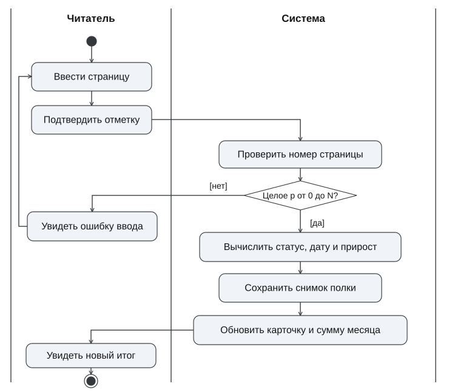
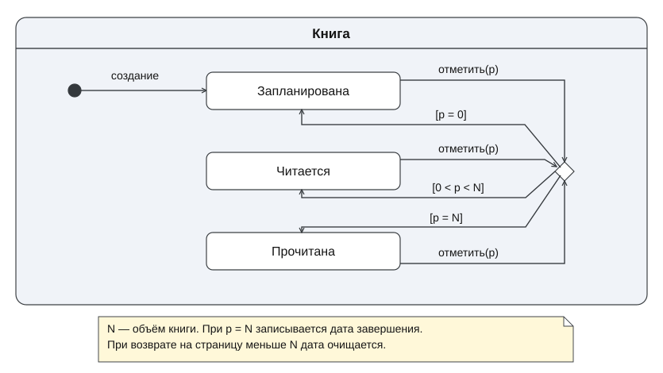
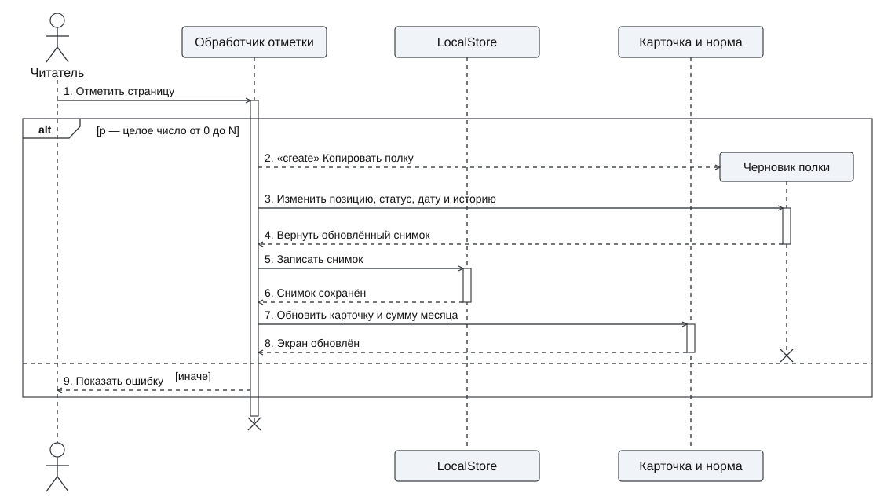

# Описание дизайна программного обеспечения

Для приложения «Полка»

Версия 0.4

Подготовил(а) Кошель Ксения

БГУИР, кафедра электронных вычислительных машин

23.11.2026

## Оглавление

<!-- TOC -->
* [1. Введение](#1-introduction)
  * [1.1 Назначение документа](#11-document-purpose)
  * [1.2 Область применения](#12-subject-scope)
  * [1.3 Определения, акронимы и сокращения](#13-definitions-acronyms-and-abbreviations)
  * [1.4 Ссылки](#14-references)
  * [1.5 Обзор документа](#15-document-overview)
* [2. Обзор дизайна](#2-design-overview)
  * [2.1 Задачи стейкхолдеров](#21-stakeholder-concerns)
  * [2.2 Выбранные точки зрения](#22-selected-viewpoints)
* [3. Проектные представления](#3-design-views)
* [4. Решения](#4-decisions)
* [5. Приложения](#5-appendixes)
<!-- TOC -->

## История изменений

| Name | Date | Reason For Changes | Version |
|------|------|--------------------|---------|
| Кошель Ксения | 09.11.2026 | Первая редакция дизайна по SRS 0.2 | 0.1 |
| Кошель Ксения | 09.11.2026 | BackupPanel, JSON-копия полки, фильтр выведен из MVP | 0.3 |
| Кошель Ксения | 23.11.2026 | Добавлена динамическая модель UML для требований SRS 0.3 | 0.4 |

---

## 1. Введение {#1-introduction}

Документ описывает, **как** устроена «Полка» версии 0.3. Требования «что должна делать система» лежат в SRS. Этот файл задаёт состав частей, данные, сценарии и принятые решения, достаточные, чтобы реализовать MVP без сервера, с ручным переносом полки через JSON-файл.

### 1.1 Назначение документа {#11-document-purpose}

SDD нужен разработчику и тому, кто будет сопровождать страницу. Заказчик сверяет границы: сервера, учёта и внешних каталогов в дизайне нет. Документ читают вместе с `srs/srs-template.md` и протоколами из каталога `adr/`.

### 1.2 Область применения {#12-subject-scope}

Проектируется однопользовательская веб-страница «Полка» 0.3. Читатель хранит книги, отмечает страницу, видит долю и остаток, сравнивает месяц с нормой в страницах и переносит полку файлом.

В дизайн входят:

- окно `MainWindow` и части `BookForm`, `ProgressPanel`, `ShelfView`, `GoalWidget`, `BackupPanel`, `LocalStore`;
- хранение полки в `localStorage` этого браузера;
- выгрузка и загрузка JSON-копии через диалог файла;
- расчёт доли, остатка страниц, статуса книги и суммы страниц текущего календарного месяца.

В дизайн не входят фильтр полки (Deferred), учётные записи, сервер, облачная синхронизация, загрузка из Goodreads, рекомендации, покупка книг и модели машинного обучения.

### 1.3 Определения, акронимы и сокращения {#13-definitions-acronyms-and-abbreviations}

| Term | Definition |
|------|------------|
| ADR | Architecture Decision Record — протокол значимого проектного решения |
| SDD | Software Design Description — описание того, как система будет построена |
| SRS | Software Requirements Specification — спецификация требований |
| SPA | Single Page Application — приложение из одной HTML-страницы |
| localStorage | Хранилище браузера, сохраняющее строку между открытиями вкладки |
| Полка | Список книг одного читателя |
| Статус | «Запланирована», «Читается» или «Прочитана» |

### 1.4 Ссылки {#14-references}

Нормативные:

- `srs/srs-template.md` — спецификация требований версии 0.3;
- `adr/0001-single-page-in-browser.md`;
- `adr/0002-localstorage-persistence.md`;
- `adr/0003-vanilla-javascript.md`;
- `adr/0004-json-file-backup.md`.

Справочные:

- `images/polka-sysml.png` — состав окна;
- `images/polka-mockup.png` — эскиз экрана;
- ISO/IEC/IEEE 1016:2009, ISO/IEC/IEEE 42010:2011.

### 1.5 Обзор документа {#15-document-overview}

Раздел 2 фиксирует стейкхолдеров и выбранные точки зрения. Раздел 3 содержит представления дизайна со ссылками на `REQ-*`. Раздел 4 сводит ADR. Раздел 5 указывает рисунки. Правка идёт новой строкой в истории изменений и отдельным коммитом.

---

## 2. Обзор дизайна {#2-design-overview}

«Полка» — локальная страница в браузере. Все части живут в одном окне и ходят в одно хранилище. Сети нет.

### 2.1 Задачи стейкхолдеров {#21-stakeholder-concerns}

| Стейкхолдер | Задача | Где закрывается |
|-------------|--------|-----------------|
| Читатель | Не потерять страницу, увидеть долю и норму месяца | Interaction, Information, Algorithm |
| Заказчик | Уложиться в две итерации, без сервера и платы за хостинг | Context, Deployment, Decisions |
| Разработчик | Понять, какие части писать и куда класть данные | Composition, Logical, Patterns |
| Сопровождение | Найти место правки, не ломая хранилище | Structure, Dependency, Information |

### 2.2 Выбранные точки зрения {#22-selected-viewpoints}

Для учебного проекта с одним экраном достаточно девяти точек зрения. Физическая инфраструктура, параллелизм и управление серверными ресурсами не применяются: процесса кроме вкладки браузера нет.

Выбраны:

- **Context** — читатель и браузер, внешних систем нет;
- **Composition** — сборка окна из пяти частей;
- **Logical** — типы «книга» и «норма»;
- **Structure** — кто пишет в `LocalStore`, кто читает;
- **Dependency** — направление вызовов;
- **Information** — поля записи полки;
- **Interaction** — сохранение книги и отметка страницы;
- **Algorithm** — доля, остаток, сумма месяца;
- **State Dynamics** — статусы книги;
- **Patterns** — разделение ввода, списка и хранения;
- **Deployment** — локальный файл страницы.

Не выбраны Physical, Concurrency, Resources: отдельного оборудования, потоков и квот нет.

---

## 3. Проектные представления {#3-design-views}

- **ID:** 001-context
- **Title:** Границы «Полки»
- **Viewpoint:** Context
- **Representation:** Единственный актор — читатель. Внешняя среда — браузер с `localStorage` и файловая система компьютера (диалог сохранения/открытия). Система предоставляет: сохранить книгу, отметить страницу, задать норму месяца, выгрузить и загрузить JSON-копию. Фильтр полки, Goodreads, почта, облако и сервер в контекст MVP не входят.
- **More Information:** REQ-FUNC-001, REQ-FUNC-002, REQ-FUNC-004, REQ-FUNC-005, REQ-FUNC-006. ADR-0001, ADR-0004.

```text
[Читатель] ----открывает----> [Страница «Полка»]
                 |                    |
                 |                    v
                 |              [localStorage]
                 |
                 +----файл JSON----> [диск компьютера]
```

- **ID:** 002-composition
- **Title:** Состав окна
- **Viewpoint:** Composition
- **Representation:** `MainWindow` собирает шесть частей. `BookForm`, `ProgressPanel` и `BackupPanel` пишут в `LocalStore`. `ShelfView` и `GoalWidget` читают из `LocalStore`. Отдельного backend-процесса нет. Фильтра по статусу в MVP нет: `ShelfView` показывает все карточки.
- **More Information:** схема `images/polka-sysml.png`. ADR-0001, ADR-0003.

- **ID:** 003-logical
- **Title:** Типы данных первой версии
- **Viewpoint:** Logical
- **Representation:** Два устойчивых типа.

`Book`: `id`, `title`, `author`, `pageCount`, `currentPage`, `status`, `finishedOn`.

`Goal`: `monthPages` — целое число страниц на календарный месяц.

`LocalStore` хранит массив `Book` и один объект `Goal`. Идентификатор книги выдаёт хранилище при первом сохранении. `BackupPanel` сериализует тот же снимок в файл и при импорте подставляет его вместо текущего.
- **More Information:** REQ-FUNC-001, REQ-FUNC-002, REQ-FUNC-005. Представление 004-information.

- **ID:** 004-information
- **Title:** Запись полки в localStorage
- **Viewpoint:** Information
- **Representation:** Один ключ `polka.shelf.v1`. Значение — JSON:

```json
{
  "goal": { "monthPages": 600 },
  "books": [
    {
      "id": "b1",
      "title": "Трудно быть богом",
      "author": "А. Стругацкий, Б. Стругацкий",
      "pageCount": 320,
      "currentPage": 142,
      "status": "reading",
      "finishedOn": null,
      "pageEvents": [{ "date": "2026-11-09", "pages": 20 }]
    }
  ]
}
```

`status`: `planned` | `reading` | `finished`. `pageEvents` нужны, чтобы сумма месяца не включала страницы прошлого месяца. Повреждённый JSON не перезаписывает полку: `LocalStore` оставляет прежнее значение.
- **More Information:** REQ-FUNC-002, REQ-FUNC-004, REQ-FUNC-005. ADR-0002.

- **ID:** 005-interaction
- **Title:** Сохранение книги и отметка страницы
- **Viewpoint:** Interaction
- **Representation:** Сценарий «счастливый путь».

1. Читатель заполняет форму и нажимает «Сохранить».
2. `BookForm` проверяет: название непустое, объём ≥ 1, текущая страница в диапазоне от 0 до объёма.
3. При ошибке полка не меняется, форма остаётся.
4. При успехе `LocalStore` записывает книгу и публикует обновление.
5. `ShelfView` перерисовывает карточки, `GoalWidget` пересчитывает месяц.

Сценарий отказа: пустое название или страница больше объёма. Сообщение на форме, запись в `localStorage` не уходит.

Сценарий копии: читатель нажимает «Сохранить копию» → `BackupPanel` запрашивает снимок у `LocalStore` → браузер предлагает файл `polka-shelf.json`. «Загрузить копию» читает файл, `LocalStore` проверяет схему и только тогда заменяет ключ `polka.shelf.v1`.
- **More Information:** REQ-FUNC-001, REQ-FUNC-002, REQ-FUNC-006. ADR-0003, ADR-0004.

- **ID:** 006-algorithm
- **Title:** Доля, остаток и норма месяца
- **Viewpoint:** Algorithm
- **Representation:** Долю P и остаток R считаем в `ProgressPanel`:

P = Nтек / Nвсего · 100, R = Nвсего − Nтек.

Сумма месяца Gтек — сумма `pageEvents.pages`, у которых `date` попадает в текущий календарный месяц. `GoalWidget` показывает пару (Gнорм, Gтек). События прошлого месяца в сумму не входят.
- **More Information:** REQ-FUNC-002, REQ-FUNC-004.

- **ID:** 007-state
- **Title:** Статусы книги
- **Viewpoint:** State Dynamics
- **Representation:** Статус не выбирается вручную.

- `currentPage = 0` → `planned` («Запланирована»);
- `0 < currentPage < pageCount` → `reading` («Читается»);
- `currentPage = pageCount` → `finished` («Прочитана»), в `finishedOn` пишется дата этого дня.

Обратный переход с «Прочитана» возможен, только если читатель уменьшит текущую страницу: дата завершения тогда стирается.
- **More Information:** REQ-FUNC-005. REQ-FUNC-003 отложен, но правила статуса остаются: они нужны карточке и дате завершения.

- **ID:** 008-patterns
- **Title:** Разделение ввода, списка и хранения
- **Viewpoint:** Patterns
- **Representation:** Применён паттерн «пассивное хранилище + наблюдатели». `LocalStore` не знает о кнопках. Части окна подписываются на изменение полки и перерисовываются. Это ближе к MVC с пассивной моделью, чем к отдельному серверному API.
- **More Information:** ADR-0003. П. 3.5.4 SRS.

- **ID:** 009-deployment
- **Title:** Поставка страницы
- **Viewpoint:** Deployment
- **Representation:** Установщика нет. Читатель открывает HTML-файл в браузере на Windows, Linux или macOS. Сборки по окружениям нет. Секретов и переменных окружения нет.
- **More Information:** SRS п. 3.5.1–3.5.6. ADR-0001.

### Динамическая модель UML

[Глоссарий](../docs/glossary.md) · [Дополнительные спецификации](../docs/supplementary.md) · [Потоки событий UC1–UC5](../docs/use-cases.md) · [Текст моделей PlantUML](../docs/uml/model.puml).

**Контекст (001-context).** Читатель создаёт книгу (REQ-FUNC-001), отмечает страницу (002, 005), задаёт норму (004), сохраняет и восстанавливает копию (006). Изменение статуса входит в UC2. Для него не требуется отдельная команда пользователя.


**Деятельность (006-algorithm).** В UC2 сначала проверяются целочисленность и диапазон страницы. Только допустимый ввод запускает пересчёт. Событие чтения создаётся для положительного прироста. При отказе хранилища сообщение выводится до замены отображаемой полки.



**Состояния (007-state).** Из каждого статуса разрешено исправить позицию. Ромб выбирает целевое состояние по новой странице. Вход в «Прочитана» устанавливает дату; повтор сохраняет её. При выходе дата очищается. Книга остаётся доступной для исправления, поэтому конечное состояние отсутствует.



**Взаимодействие (005-interaction).** Линии жизни представляют одну попытку обработки ввода и вложенное изменение снимка. В успешной ветви обновлённые данные возвращаются обработчику для сохранения и отображения. В ветви ошибки читатель получает сообщение. Кресты завершают временные взаимодействия. Книга и ключ localStorage сохраняются между попытками.



---

## 4. Решения {#4-decisions}

Полные протоколы лежат в `adr/`. Ниже сводка.

- **ID:** ADR-0001
- **Title:** Одна страница в браузере вместо клиента с сервером
- **Context:** Нужна полка на одном компьютере без платы за хостинг.
- **Options:** Java/Swing-окно; SPA с backend; одна HTML-страница.
- **Outcome:** Выбрана одна HTML-страница, потому что SRS прямо запрещает сервер и внешние каталоги.
- **More Information:** `adr/0001-single-page-in-browser.md`. 001-context, 002-composition, 009-deployment.

- **ID:** ADR-0002
- **Title:** localStorage вместо IndexedDB и файла на диске
- **Context:** Полка должна пережить закрытие вкладки.
- **Options:** localStorage; IndexedDB; сохранение файла пользователем.
- **Outcome:** Выбран localStorage: объём полки мал, API синхронный, отдельного разрешения не нужно.
- **More Information:** `adr/0002-localstorage-persistence.md`. 004-information.

- **ID:** ADR-0003
- **Title:** Vanilla JavaScript вместо React или Vue
- **Context:** Один экран, срок — учебные итерации.
- **Options:** React + Vite; Vue; чистый JavaScript.
- **Outcome:** Выбран чистый JavaScript: нет сборки, нет зависимости от npm, части окна остаются читаемыми в одном файле.
- **More Information:** `adr/0003-vanilla-javascript.md`. 002-composition, 008-patterns.

- **ID:** ADR-0004
- **Title:** Ручная JSON-копия вместо облака
- **Context:** Заказчик вспомнил про второй компьютер и запретил сдвигать дату выпуска.
- **Options:** облако; IndexedDB + расширение; JSON-файл через диалог браузера.
- **Outcome:** Выбран JSON-файл: нет сервера, junior закрывает кнопки, senior проверяет схему.
- **More Information:** `adr/0004-json-file-backup.md`. 001-context, 004-information, 005-interaction.

---

## 5. Приложения {#5-appendixes}

- `images/polka-sysml.png` — состав `MainWindow`;
- `images/polka-mockup.png` — эскиз главного экрана;
- `docs/priority-matrix.md` — приоритеты функционала 10…50.
