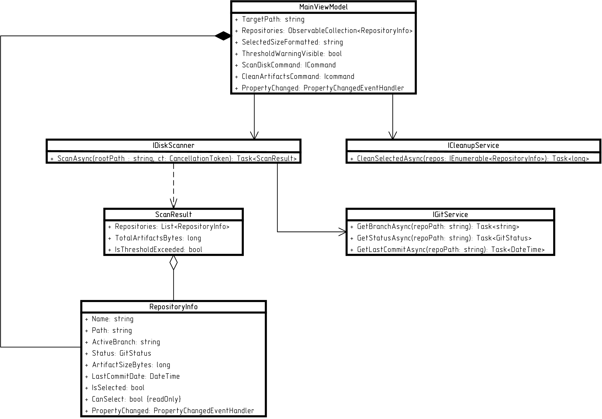
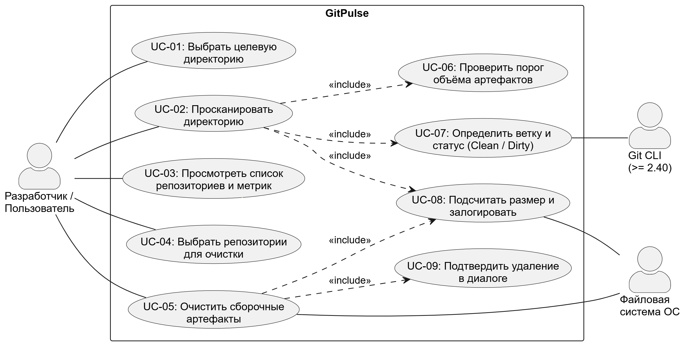
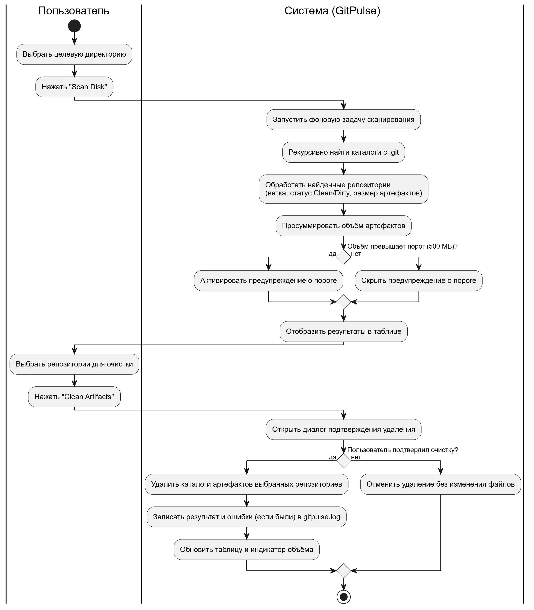
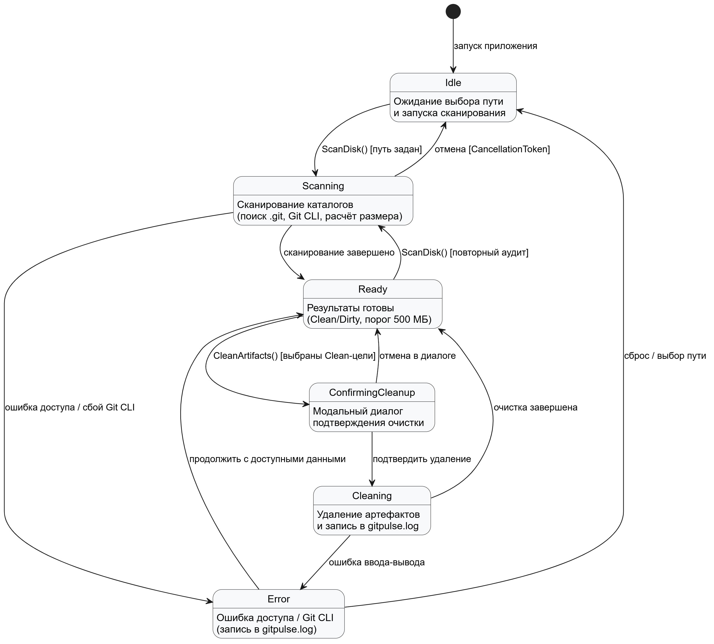
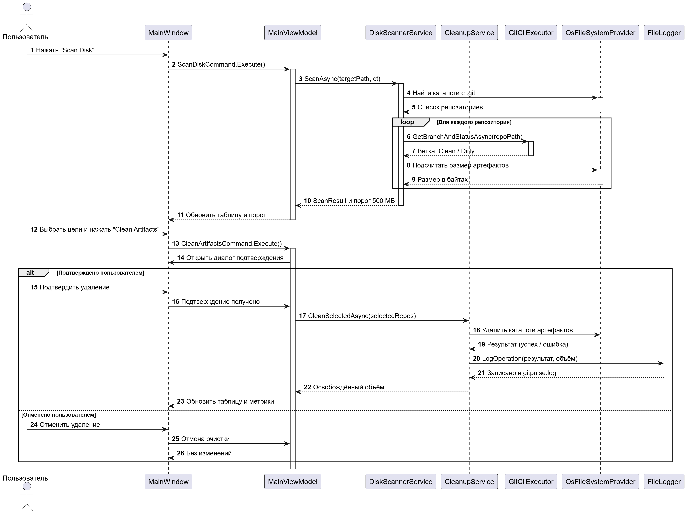
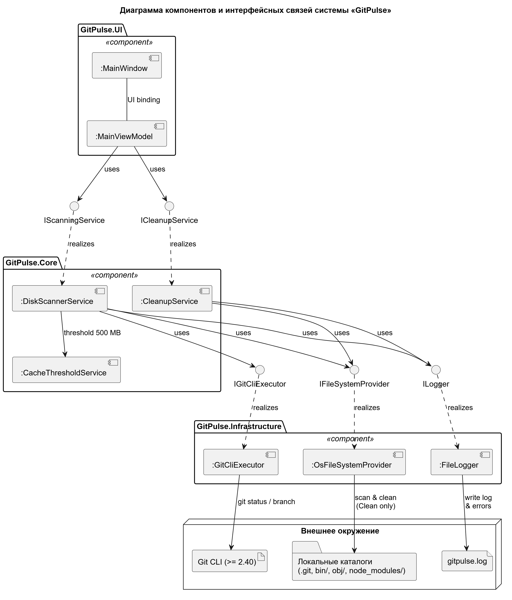
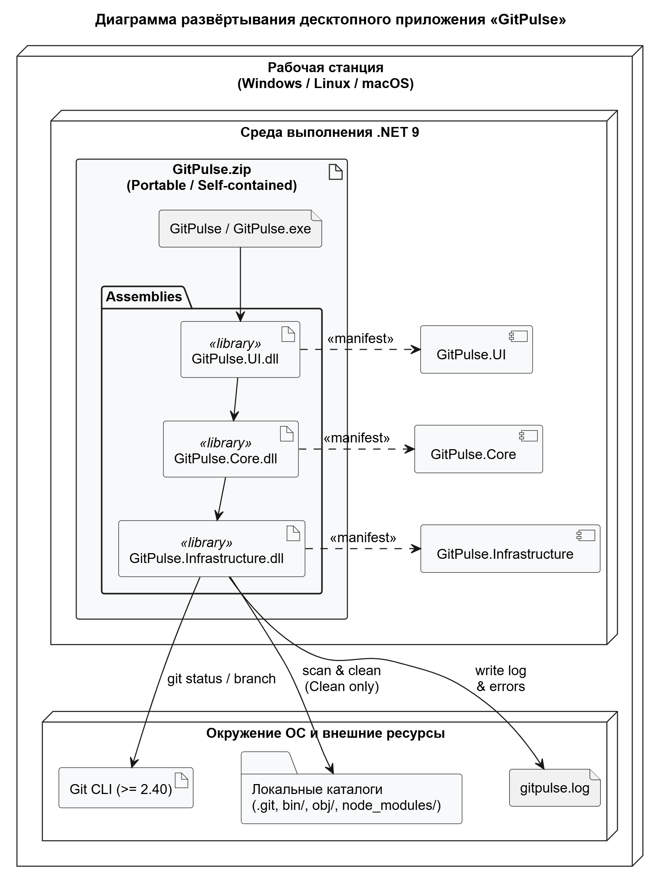

# Описание дизайна программного обеспечения

Для кроссплатформенной десктопной утилиты аудита Git-репозиториев и очистки сборочных артефактов "GitPulse"

Версия 0.6

Подготовил: Толкач Д. Г.

Группа: 450504, Вариант: 25

Белорусский государственный университет информатики и радиоэлектроники (БГУИР)

Дата изменения: 26 ноября 2026 г.

## Оглавление

<!-- TOC -->
* [1. Введение](#1-introduction)
  * [1.1 Назначение документа](#11-document-purpose)
  * [1.2 Область применения](#12-subject-scope)
  * [1.3 Определения, акронимы и сокращения](#13-definitions-acronyms-and-abbreviations)
  * [1.4 Ссылки](#14-references)
  * [1.5 Обзор документа](#15-document-overview)
* [2. Обзор дизайна](#2-design-overview)
  * [2.1 Задачи стейкхолдеров](#21-stakeholder-concerns)
  * [2.2 Выбранные точки зрения](#22-selected-viewpoints)
    * [2.2.1 Контекст](#221-context)
    * [2.2.2 Композиция](#222-composition)
    * [2.2.3 Логическое представление](#223-logical)
    * [2.2.4 Физическое представление](#224-physical)
    * [2.2.5 Структура](#225-structure)
    * [2.2.6 Зависимости](#226-dependency)
    * [2.2.7 Информация](#227-information)
    * [2.2.8 Интерфейс](#228-interface)
    * [2.2.9 Взаимодействие](#229-interaction)
    * [2.2.10 Алгоритм](#2210-algorithm)
    * [2.2.11 Динамика состояний](#2211-state-dynamics)
    * [2.2.12 Параллелизм](#2212-concurrency)
    * [2.2.13 Паттерны](#2213-patterns)
    * [2.2.14 Развёртывание](#2214-deployment)
    * [2.2.15 Ресурсы](#2215-resources)
* [3. Проектные представления](#3-design-views)
    * [3.1 Варианты использования](#31-use-cases)
    * [3.2 Поток активности](#32-activity-flow)
    * [3.3 Динамика состояний](#33-state-dynamics)
    * [3.4 Взаимодействие компонентов](#34-sequence-interaction)
* [4. Решения](#4-decisions)
* [5. Приложения](#5-appendixes)
<!-- TOC -->

## История изменений

| Name | Date | Reason For Changes | Version |
|:---|:---|:---|:---|
| Толкач Д. Г. | 15.11.2026 | Инициализация системного проекта SDD для утилиты GitPulse в рамках Лабораторной работы №4 | 0.1 |
| Толкач Д. Г. | 18.11.2026 | Добавление колонки сквозной трассировки требований (REQ) в матрицу приоритетов (Раздел 2.2) | 0.2 |
| Толкач Д. Г. | 23.11.2026 | Обновлена архитектурная диаграмма системы (gitpulse-architecture.png) в соответствии с нотацией SysML v2 (представление Interconnection) | 0.3 |
| Толкач Д. Г. | 23.11.2026 | Добавлены проектные представления динамического поведения (Use Case, Activity, State Machine, Sequence) и ссылки на диаграммы в рамках ЛР №5 | 0.4 |
| Толкач Д. Г. | 24.11.2026 | Добавлены проектные представления диаграммы компонентов (gitpulse-components.png) и диаграммы развёртывания (gitpulse-deployment.png), обновлено описание решений в рамках ЛР №6 | 0.5 |
| Толкач Д. Г. | 26.11.2026 | Актуализация спецификаций, версий и ссылок после согласования правок (500 МБ / 5 ГБ, Junior-разработчик, схема развёртывания и состав артефактов ЛР №3–№6) | 0.6 |

---

## 1. Введение {#1-introduction}

Настоящий документ определяет программную архитектуру, системные требования и структурный дизайн кроссплатформенной десктопной утилиты GitPulse. Документ служит основным техническим руководством для команды разработчиков при реализации функционала, зафиксированного в спецификации SRS.

### 1.1 Назначение документа {#11-document-purpose}

Документ описывает внутреннее устройство системы, декомпозицию на компоненты, потоки данных, механизмы взаимодействия и принятые архитектурные ограничения. Целевой аудиторией являются разработчики, системные архитекторы и проверяющие лица (Заказчик / преподаватель). Документ используется для верификации проектных решений на этапе реализации.

### 1.2 Область применения {#12-subject-scope}

Система представляет собой десктопное приложение GitPulse. В область проектирования входит локальное сканирование дисков, парсинг статусов Git-репозиториев, расчет объемов сборочных папок (`bin`, `obj`, `node_modules`) и их безопасная очистка. В область проектирования **не входят** облачные функции, сетевая синхронизация или удаленное управление репозиториями.

### 1.3 Определения, акронимы и сокращения {#13-definitions-acronyms-and-abbreviations}

| Term | Definition |
|:---|:---|
| SDD | Software Design Document – документ описания архитектуры и дизайна ПО. |
| MVVM | Model-View-ViewModel – паттерн проектирования пользовательского интерфейса. |
| Git CLI | Command Line Interface – интерфейс командной строки для управления репозиториями Git. |
| Dirty State | Состояние рабочей копии Git, содержащее незакоммиченные изменения. |

### 1.4 Ссылки {#14-references}

1. Спецификация требований к программному обеспечению (SRS) GitPulse, версия 0.3. [Нормативная ссылка]
2. Методические указания по дисциплине «Жизненный цикл разработки программного обеспечения». Минск, БГУИР. [Нормативная ссылка]
3. СТП 01–2024 «Дипломные проекты (работы). Общие требования». Минск, БГУИР, 2024. [Нормативная ссылка]

### 1.5 Обзор документа {#15-document-overview}

Раздел 2 описывает задачи стейкхолдеров, точки зрения проектирования и приоритеты функционала. Раздел 3 содержит конкретные проектные представления компонентов. Раздел 4 фиксирует ключевые архитектурные решения (ADR), а в Разделе 5 приведены вспомогательные материалы.

---

## 2. Обзор дизайна {#2-design-overview}

### 2.1 Задачи стейкхолдеров {#21-stakeholder-concerns}

- **Разработчики:** модульность кода, слабая связанность компонентов, легкость сопровождения на .NET / Avalonia UI.
- **Пользователи (инженеры):** высокая скорость сканирования дисков, безопасность данных (защита от удаления `Dirty`-репозиториев), отзывчивость интерфейса без фризов.
- **Заказчик (преподаватель):** соответствие стандарту СТП БГУИР, прослеживаемость требований из SRS в SDD.

### 2.2 Приоритезация разрабатываемого функционала
В соответствии с требованиями системного проектирования, ключевые функции утилиты GitPulse ранжированы по приоритету (от 10 – наивысший, критический для ядра, до 50 – минимальный, минорные улучшения интерфейса):

| ID приоритета | REQ (SRS) | Наименование функциональности | Ранг | Обоснование приоритета |
|:---|:---|:---|:---|:---|
| PRIO-01 | REQ-FUNC-001-01 | Рекурсивный сканер каталогов и поиск папок `.git` | **10** | Базовая функция ядра. Без обнаружения репозиториев работа утилиты невозможна. |
| PRIO-02 | REQ-FUNC-002-01, REQ-FUNC-005-01 | Интеграция с Git CLI и определение статуса рабочей копии (`Clean`/`Dirty`) | **20** | Критически важная функция безопасности, предотвращающая удаление несохраненных данных пользователя. |
| PRIO-03 | REQ-FUNC-003-01, REQ-FUNC-004-01 | Рекурсивный расчет размера артефактов (`bin`, `obj`, `node_modules`) и проверка порога 500 МБ | **30** | Основной бизнес-сценарий утилиты – аудит занимаемого дискового пространства. |
| PRIO-04 | REQ-FUNC-006-01, REQ-SEC-001-01 | Безопасная пакетная очистка выбранных директорий | **40** | Реализация целевого действия пользователя по высвобождению диска. |
| PRIO-05 | REQ-FUNC-006-01, REQ-SEC-001-01 | Модальное диалоговое окно подтверждения массового удаления | **50** | Дополнительный защитный элемент интерфейса, запроектированный по результатам код-ревью. |

### 2.3 Выбранные точки зрения {#22-selected-viewpoints}

#### 2.2.1 Контекст {#221-context}
Система работает локально в изолированном окружении операционной системы (Windows, Linux, macOS), взаимодействуя с файловой системой и утилитой Git CLI.

#### 2.2.2 Композиция {#222-composition}
Система делится на три логических слоя: представление (`GitPulse.UI`: `MainWindow`, `MainViewModel`), прикладное ядро (`GitPulse.Core`: `DiskScannerService`, `CleanupService`, `CacheThresholdService`) и инфраструктура (`GitPulse.Infrastructure`: `GitCliExecutor`, `OsFileSystemProvider`, `FileLogger`).

#### 2.2.3 Логическое представление {#223-logical}
Использование паттерна MVVM: `MainViewModel` управляет состоянием таблиц, инкапсулируя бизнес-логику фильтрации и подсчета порогов кэша (от 500 МБ).

#### 2.2.4 Физическое представление {#224-physical}
Портативный дистрибутив `GitPulse.zip` (Portable / Self-contained) для среды выполнения `.NET 9` на рабочей станции пользователя, включающий исполняемый файл `GitPulse / GitPulse.exe` и сборки `GitPulse.UI.dll`, `GitPulse.Core.dll`, `GitPulse.Infrastructure.dll`.

#### 2.2.5 Структура {#225-structure}
Компоненты взаимодействуют через интерфейсные контракты (`IScanningService`, `ICleanupService`, `IGitCliExecutor`, `IFileSystemProvider`, `ILogger`) с внедрением зависимостей, что обеспечивает слабую связанность и модульное тестирование[cite: 28, 35].

#### 2.2.6 Зависимости {#226-dependency}
Направленные зависимости от слоя представления к сервисному слою; отсутствие циклических зависимостей между модулями.

#### 2.2.7 Информация {#227-information}
Модели данных в памяти: структуры `RepositoryInfo` (путь, ветка, статус, размер артефактов).

#### 2.2.8 Интерфейс {#228-interface}
Асинхронные контракты взаимодействия между ViewModel и сервисами сканирования (`Task<List<RepositoryInfo>>`).

#### 2.2.9 Взаимодействие {#229-interaction}
Последовательность сканирования: пользователь жмет «Scan Disk» -> запускается фоновый поток `Task.Run` -> рекурсивный обход директорий -> опрос Git CLI -> обновление UI через `Dispatcher`.

#### 2.2.10 Алгоритм {#2210-algorithm}
Рекурсивный обход файловой системы с проверкой наличия папки `.git` и быстрым исключением системных директорий.

#### 2.2.11 Динамика состояний {#2211-state-dynamics}
Основные состояния жизненного цикла аудита и очистки: `Idle` -> `Scanning` -> `Ready` (результаты с веткой, статусом `Clean`/`Dirty` и проверкой базового порога 500 МБ) -> `ConfirmingCleanup` -> `Cleaning` -> возврат в `Ready`/`Idle`, а также переход в `Error` при сбоях доступа, `Git CLI` или ввода-вывода с записью в `gitpulse.log`. Фоновый режим и порог 5 ГБ зафиксированы по итогам переговоров с заказчиком как расширение без сдвига базового дедлайна.

#### 2.2.12 Параллелизм {#2212-concurrency}
Использование пула потоков .NET (`ThreadPool`) и асинхронных примитивов (`async/await`) для предотвращения блокировки пользовательского интерфейса.

#### 2.2.13 Паттерны {#2213-patterns}
MVVM, Repository Pattern, Dependency Injection.

#### 2.2.14 Развёртывание {#2214-deployment}
Портативная поставка архива для Windows x64, Linux x64 и macOS ARM64/x64.

#### 2.2.15 Ресурсы {#2215-resources}
Контроль потребления оперативной памяти при сканировании глубоких деревьев каталогов (ограничение кэширования списков путей).

---

## 3. Проектные представления {#3-design-views}

- **ID**: VIEW-001-ComponentArchitecture
- **Title**: Компонентная архитектура и слои приложения GitPulse
- **Viewpoint**: Композиция / Структура / Зависимости
- **Representation**: Приложение построено по многослойной архитектуре с применением паттерна MVVM и внедрением зависимостей (DI). Слой представления (`GitPulse.UI`) изолирован от бизнес-логики (`GitPulse.Core`) и инфраструктурных вызовов ОС (`GitPulse.Infrastructure`) через интерфейсы. Реализует требования SRS: REQ-FUNC-001..006, REQ-AVAIL-001.
  
- **More Information**: См. решения ADR-001 и ADR-002 в Разделе 4. Исходная модель SysMLv2: `../diagrams/gitpulse-architecture.sysml`.

- **ID**: VIEW-002-LogicalClassModel
- **Title**: Логическая модель данных и контракты сервисов
- **Viewpoint**: Логическое представление / Интерфейс / Информация
- **Representation**: Центральной сущностью в памяти является модель `RepositoryInfo`, инкапсулирующая состояние репозитория и флаг `CanSelect` (блокирующий выбор при `Status == GitStatus.Dirty`). Компонент проверки порога `CacheThresholdService` отслеживает превышение суммарного объёма сборочных артефактов свыше порога в 500 МБ. Реализует требования SRS: REQ-FUNC-002, REQ-FUNC-003, REQ-FUNC-005.
  
- **More Information**: Детали выбора структуры хранения в памяти без БД зафиксированы в ADR-003.

- **ID**: VIEW-003-MainWindowUI
- **Title**: Компоновка главного окна и защита от случайного удаления
- **Viewpoint**: Интерфейс / Динамика состояний
- **Representation**: Однооконный интерфейс на базе Avalonia UI включает панель путей (`PathSelectorPanel`), таблицу `RepositoryDataGrid` и нижнюю панель действий (`CleanupActionPanel`). По итогам рецензирования требований добавлено модальное диалоговое окно подтверждения (`ConfirmDialog`), отображающее список целевых директорий (`bin`, `obj`, `node_modules`) и итоговый размер перед безвозвратным удалением. Реализует требования SRS: REQ-FUNC-004, REQ-FUNC-006, REQ-SEC-001.
- **More Information**: Базовый визуальный макет приведён в Приложении А документа SRS (`../images/gitpulse-gui-mockup.png`).

- **ID**: VIEW-004-AsyncDiskScanner
- **Title**: Асинхронный конвейер сканирования и интеграция с Git CLI
- **Viewpoint**: Взаимодействие / Алгоритм / Параллелизм
- **Representation**: Сканирование выполняется асинхронно в пуле потоков (`Task.Run`) с поддержкой токена отмены (`CancellationToken`). При обнаружении каталога `.git` запускаются дочерние процессы `git status --porcelain` и `git branch --show-current`. Ошибки доступа к заблокированным файлам перехватываются и записываются в `gitpulse.log` без прерывания общего цикла. Реализует требования SRS: REQ-PERF-001, REQ-PERF-002, REQ-REL-001, REQ-OBS-001.
- **More Information**: См. решение ADR-002 и файл `../adr/adr-template.md`.

### 3.1 Варианты использования {#31-use-cases}

- **ID**: VIEW-005-UseCaseDiagram
- **Title**: Диаграмма вариантов использования утилиты GitPulse
- **Viewpoint**: Контекст / Взаимодействие
- **Representation**: Определяет сценарии работы основного актёра («Разработчик / Пользователь») и внешних систем («Git CLI (>= 2.40)», «Файловая система ОС») при выборе целевой директории, сканировании репозиториев, проверке порога 500 МБ, определении статуса `Clean`/`Dirty`, выборе целей, подтверждении в диалоге и очистке сборочных артефактов. Связи `<<include>>` фиксируют обязательные подпроцессы проверки порога, опроса Git CLI, расчёта/логирования размеров и подтверждения удаления. Реализует требования SRS: REQ-FUNC-001..006, REQ-SEC-001, REQ-OBS-001.
  
- **More Information**: См. сценарии прецедентов в `use-cases.md`, решение ADR-002 и исходный код диаграммы `../diagrams/gitpulse-usecase.puml`.

### 3.2 Поток активности {#32-activity-flow}

- **ID**: VIEW-006-ActivityDiagram
- **Title**: Диаграмма активности сценариев сканирования и очистки
- **Viewpoint**: Алгоритм / Взаимодействие / Параллелизм
- **Representation**: Разделяет действия пользователя и системы (`GitPulse`) на две дорожки: выбор директории и запуск «Scan Disk», рекурсивный поиск `.git`, сбор сведений о ветке/статусе и размере артефактов, суммирование объёма и управление предупреждением о базовом пороге 500 МБ (расширение с фоновым режимом и уведомлением на 5 ГБ включается в текущий релиз без сдвига дедлайна за счёт подключения Junior-разработчика), отображение результатов в таблице, выбор репозиториев, запуск «Clean Artifacts», модальное подтверждение удаления, очистка каталогов с записью результатов и ошибок в `gitpulse.log` либо отмена без изменения файлов, а также обновление таблицы и индикатора объёма. Реализует требования SRS: REQ-FUNC-001..006, REQ-PERF-001, REQ-SEC-001, REQ-OBS-001.
  
- **More Information**: Согласовано с приоритетами PRIO-01..PRIO-05 в Разделе 2.2 и решением ADR-003. Исходный код диаграммы: `../diagrams/gitpulse-activity.puml`.

### 3.3 Динамика состояний {#33-state-dynamics}

- **ID**: VIEW-007-StateMachineDiagram
- **Title**: Диаграмма состояний жизненного цикла аудита и очистки
- **Viewpoint**: Динамика состояний
- **Representation**: Описывает переходы между состояниями `Idle`, `Scanning`, `Ready`, `ConfirmingCleanup`, `Cleaning` и `Error` под действием команд пользователя, сторожевых условий (`[путь задан]`, `[повторный аудит]`, `[выбраны Clean-цели]`), отмены (`CancellationToken` или отмена в диалоге) и исключительных ситуаций (ошибки доступа, сбой Git CLI, ошибки ввода-вывода) с записью в `gitpulse.log` и восстановлением работы. Реализует требования SRS: REQ-FUNC-002, REQ-FUNC-005, REQ-FUNC-006, REQ-REL-001, REQ-OBS-001.
  
- **More Information**: См. описание состояний в Разделе 2.2.11, `../adr/adr-template.md` и исходный код диаграммы `../diagrams/gitpulse-statemachine.puml`.

### 3.4 Взаимодействие компонентов {#34-sequence-interaction}

- **ID**: VIEW-008-SequenceDiagram
- **Title**: Диаграмма последовательности сканирования и подтверждённой очистки
- **Viewpoint**: Взаимодействие / Структура / Зависимости
- **Representation**: Отображает хронологический обмен сообщениями между `Пользователь`, `MainWindow`, `MainViewModel`, `DiskScannerService`, `CleanupService`, `GitCliExecutor`, `OsFileSystemProvider` и `FileLogger` при выполнении `ScanAsync` (включая цикл `loop` по репозиториям) и `CleanSelectedAsync` (с ветвлением `alt` на подтверждение и отмену удаления, удалением артефактов и логированием в `gitpulse.log`). Реализует требования SRS: REQ-FUNC-001..006, REQ-SEC-001, REQ-OBS-001.
  
- **More Information**: Отражает взаимодействие слоёв MVVM, сервисов и инфраструктуры, описанное в `../adr/adr-template.md`. Исходный код диаграммы: `../diagrams/gitpulse-sequence.puml`.

- **ID**: VIEW-009-ComponentDiagram
- **Title**: Диаграмма компонентов и интерфейсных связей GitPulse
- **Viewpoint**: Композиция / Структура / Зависимости / Интерфейс
- **Representation**: Отображает статическую декомпозицию приложения на три слоя (`GitPulse.UI`: `:MainWindow`, `:MainViewModel`; `GitPulse.Core`: `:DiskScannerService`, `:CleanupService`, `:CacheThresholdService`; `GitPulse.Infrastructure`: `:GitCliExecutor`, `:OsFileSystemProvider`, `:FileLogger`), их предоставляемые и требуемые интерфейсы (`IScanningService`, `ICleanupService`, `IGitCliExecutor`, `IFileSystemProvider`, `ILogger`), контроль порога объёма артефактов (500 МБ) и взаимодействие с внешним окружением (`Git CLI >= 2.40`, локальные каталоги `.git`, `bin/`, `obj/`, `node_modules/` и журнал `gitpulse.log`). Реализует требования SRS: REQ-FUNC-001..006, REQ-SEC-001, REQ-REL-001, REQ-OBS-001.
  
- **More Information**: См. решения ADR-001..ADR-005 в Разделе 4 и файл `../adr/adr-template.md`. Исходный код диаграммы: `../diagrams/gitpulse-components.puml`.

- **ID**: VIEW-010-DeploymentDiagram
- **Title**: Диаграмма развёртывания десктопного приложения GitPulse
- **Viewpoint**: Физическое представление / Развёртывание / Ресурсы
- **Representation**: Описывает физическое размещение артефактов на рабочей станции пользователя (Windows, Linux, macOS) в среде выполнения `.NET 9` из дистрибутива `GitPulse.zip` (Portable / Self-contained): исполняемый модуль `GitPulse / GitPulse.exe` и сборки `GitPulse.UI.dll`, `GitPulse.Core.dll`, `GitPulse.Infrastructure.dll`, связанные отношением проявления (`<<manifest>>`) с соответствующими компонентами, а также взаимодействие инфраструктурной сборки с внешними ресурсами ОС (`Git CLI >= 2.40`, локальные каталоги репозиториев и файл журнала `gitpulse.log`). Реализует требования SRS: REQ-CON-001, REQ-AVAIL-001, REQ-FUNC-002, REQ-FUNC-006, REQ-OBS-001.
  
- **More Information**: См. решения ADR-001, ADR-002, ADR-003 и ADR-005 в Разделе 4. Исходный код диаграммы: `../diagrams/gitpulse-deployment.puml`.

---

## 4. Решения {#4-decisions}

- **ID**: ADR-001
- **Title**: Выбор фреймворка Avalonia UI для кроссплатформенного интерфейса
- **Context**: Требовалось обеспечить идентичный нативный интерфейс на Windows 10/11, Linux и macOS на базе технологического стека C# / .NET 9.
- **Options**: WPF (только Windows), Windows Forms (устарел, только Windows), .NET MAUI (ограниченная поддержка Linux), Avalonia UI.
- **Outcome**: Выбран вариант «Avalonia UI», потому что он обеспечивает полноценную кроссплатформенность (включая Linux), высокую производительность рендеринга и зрелую поддержку паттерна MVVM.
- **More Information**: Подробный протокол решения зафиксирован в `../adr/adr-template.md` (ADR-001).

- **ID**: ADR-002
- **Title**: Использование Git CLI через дочерние процессы вместо нативных обёрток
- **Context**: Необходимо считывать ветку и статус рабочей копии (`Clean`/`Dirty`) на трёх разных ОС без конфликтов нативных библиотек.
- **Options**: Библиотека LibGit2Sharp, запуск системного процесса `git` через `System.Diagnostics.Process`.
- **Outcome**: Выбран вариант «Запуск консольного процесса git», потому что он избавляет от проблем с кроссплатформенной сборкой нативных зависимостей `libgit2` и гарантирует полную совместимость с установленным у пользователя Git >= 2.40.
- **More Information**: Подробный протокол решения зафиксирован в `../adr/adr-template.md` (ADR-002).

- **ID**: ADR-003
- **Title**: Хранение результатов сканирования в оперативной памяти без локальной СУБД
- **Context**: Утилита выполняет разовый аудит актуального состояния файловой системы и не требует ведения исторической базы данных между запусками.
- **Options**: Встраиваемая БД SQLite, хранение состояния в оперативной памяти (`ObservableCollection<RepositoryInfo>`).
- **Outcome**: Выбран вариант «Хранение в оперативной памяти», потому что данные о состоянии репозиториев и размере кэша быстро устаревают, а отказ от СУБД сохраняет портативность приложения (Portable) и снижает накладные расходы.
- **More Information**: Подробный протокол решения зафиксирован в `../adr/adr-template.md` (ADR-003).

- **ID**: ADR-004
- **Title**: Единые механизмы взаимодействия слоёв, асинхронности, безопасности очистки и логирования
- **Context**: При моделировании динамического поведения (Use Case, Activity, State Machine, Sequence) и согласовании приоритетов с заказчиком потребовалось закрепить единые механизмы работы слоёв `UI`, `Core` и `Infrastructure`, асинхронного выполнения с отменой, защиты `Dirty`-репозиториев, обработки ошибок и записи в `gitpulse.log`.
- **Options**: Прямые вызовы `Git CLI` и файловой системы из `ViewModel` без изоляции слоёв; многослойная схема с асинхронными сервисами, явными состояниями, модальным подтверждением и логированием в `gitpulse.log`.
- **Outcome**: Выбран вариант «Многослойная схема с асинхронными сервисами, явными состояниями, модальным подтверждением и логированием в `gitpulse.log`», потому что он обеспечивает отзывчивый UI, безопасное удаление и диагностируемость ошибок без срыва сроков за счёт приоритетов и подключения Junior-разработчика к вспомогательным задачам.
- **More Information**: Подробный протокол решения зафиксирован в `../adr/adr-template.md` (ADR-004).

- **ID**: ADR-005
- **Title**: Механизмы построения, интерфейсных связей и развёртывания компонентов GitPulse
- **Context**: При статическом моделировании (диаграммы классов, компонентов и развёртывания в ЛР №6) потребовалось зафиксировать правила сборки слоёв, направления зависимостей через интерфейсы, контроль порога 500 МБ и статуса `Clean`/`Dirty`, обработку ошибок с записью в `gitpulse.log` и переносимую поставку под `.NET 9`.
- **Options**: Монолитная сборка с прямыми ссылками между слоями и установщиком под конкретную ОС; модульная сборка по слоям `UI`, `Core` и `Infrastructure` на базе интерфейсов, проверка порога/статуса/отмены, логирование в `gitpulse.log` и поставка `GitPulse.zip` (Portable / Self-contained).
- **Outcome**: Выбран вариант «Модульная сборка по слоям `UI`, `Core` и `Infrastructure` на базе интерфейсов с логированием в `gitpulse.log` и портативной поставкой `GitPulse.zip`», потому что он обеспечивает слабую связанность, тестируемость и единый запуск на Windows, Linux и macOS.
- **More Information**: Подробное обоснование механизмов построения и связей компонентов приведено в `../adr/adr-template.md` (ADR-005).

---

## 5. Приложения {#5-appendixes}

Диаграммы статической архитектуры (`../images/gitpulse-architecture.png`, `../images/gitpulse-classes.png`, `../images/gitpulse-components.png` и `../images/gitpulse-deployment.png`) и диаграммы динамического поведения (`../images/gitpulse-usecase.png`, `../images/gitpulse-activity.png`, `../images/gitpulse-statemachine.png`, `../images/gitpulse-sequence.png`) интегрированы непосредственно в Раздел 3 настоящего документа. Исходные тексты моделей SysMLv2 и PlantUML размещены в каталоге `../diagrams/`.