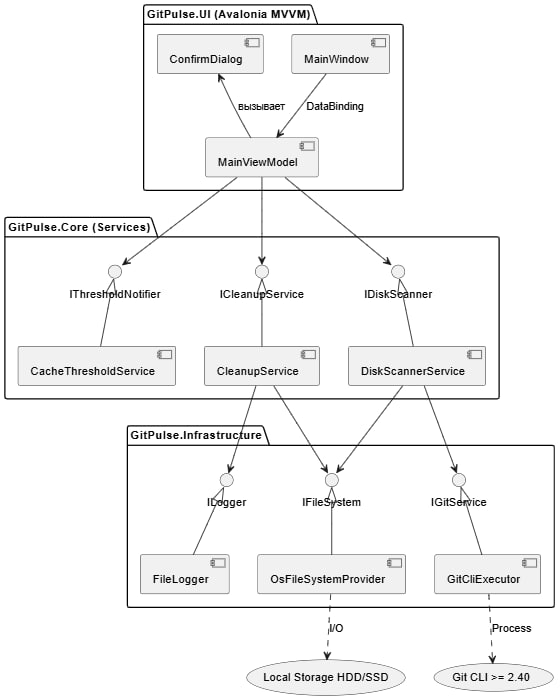

# Описание дизайна программного обеспечения

Для кроссплатформенной десктопной утилиты аудита Git-репозиториев и очистки сборочных артефактов "GitPulse"

Версия 0.1

Подготовил: Толкач Д. Г.

Группа: 450504, Вариант: 25

Белорусский государственный университет информатики и радиоэлектроники (БГУИР)

Дата изменения: 15 ноября 2026 г.

## Оглавление

<!-- TOC -->
* [1. Введение](#1-introduction)
  * [1.1 Назначение документа](#11-document-purpose)
  * [1.2 Область применения](#12-subject-scope)
  * [1.3 Определения, акронимы и сокращения](#13-definitions-acronyms-and-abbreviations)
  * [1.4 Ссылки](#14-references)
  * [1.5 Обзор документа](#15-document-overview)
* [2. Обзор дизайна](#2-design-overview)
  * [2.1 Задачи стейкхолдеров](#21-stakeholder-concerns)
  * [2.2 Выбранные точки зрения](#22-selected-viewpoints)
    * [2.2.1 Контекст](#221-context)
    * [2.2.2 Композиция](#222-composition)
    * [2.2.3 Логическое представление](#223-logical)
    * [2.2.4 Физическое представление](#224-physical)
    * [2.2.5 Структура](#225-structure)
    * [2.2.6 Зависимости](#226-dependency)
    * [2.2.7 Информация](#227-information)
    * [2.2.8 Интерфейс](#228-interface)
    * [2.2.9 Взаимодействие](#229-interaction)
    * [2.2.10 Алгоритм](#2210-algorithm)
    * [2.2.11 Динамика состояний](#2211-state-dynamics)
    * [2.2.12 Параллелизм](#2212-concurrency)
    * [2.2.13 Паттерны](#2213-patterns)
    * [2.2.14 Развёртывание](#2214-deployment)
    * [2.2.15 Ресурсы](#2215-resources)
* [3. Проектные представления](#3-design-views)
* [4. Решения](#4-decisions)
* [5. Приложения](#5-appendixes)
<!-- TOC -->

## История изменений

| Name | Date | Reason For Changes | Version |
|:---|:---|:---|:---|
| Толкач Д. Г. | 15.11.2026 | Инициализация системного проекта SDD для утилиты GitPulse в рамках Лабораторной работы №4 | 0.1 |

---

## 1. Введение {#1-introduction}

Настоящий документ определяет программную архитектуру, системные требования и структурный дизайн кроссплатформенной десктопной утилиты GitPulse. Документ служит основным техническим руководством для команды разработчиков при реализации функционала, зафиксированного в спецификации SRS.

### 1.1 Назначение документа {#11-document-purpose}

Документ описывает внутреннее устройство системы, декомпозицию на компоненты, потоки данных, механизмы взаимодействия и принятые архитектурные ограничения. Целевой аудиторией являются разработчики, системные архитекторы и проверяющие лица (Заказчик / преподаватель). Документ используется для верификации проектных решений на этапе реализации.

### 1.2 Область применения {#12-subject-scope}

Система представляет собой десктопное приложение GitPulse (версия 0.1). В область проектирования входит локальное сканирование дисков, парсинг статусов Git-репозиториев, расчет объемов сборочных папок (`bin`, `obj`, `node_modules`) и их безопасная очистка. В область проектирования **не входят** облачные функции, сетевая синхронизация или удаленное управление репозиториями.

### 1.3 Определения, акронимы и сокращения {#13-definitions-acronyms-and-abbreviations}

| Term | Definition |
|:---|:---|
| SDD | Software Design Document — документ описания архитектуры и дизайна ПО. |
| MVVM | Model-View-ViewModel — паттерн проектирования пользовательского интерфейса. |
| Git CLI | Command Line Interface — интерфейс командной строки для управления репозиториями Git. |
| Dirty State | Состояние рабочей копии Git, содержащее незакоммиченные изменения. |

### 1.4 Ссылки {#14-references}

1. Спецификация требований к программному обеспечению (SRS) GitPulse, версия 0.2. [Нормативная ссылка]
2. Методические указания по дисциплине «Жизненный цикл разработки программного обеспечения». Минск, БГУИР. [Нормативная ссылка]
3. СТП 01–2024 «Дипломные проекты (работы). Общие требования». Минск, БГУИР, 2024. [Нормативная ссылка]

### 1.5 Обзор документа {#15-document-overview}

Раздел 2 описывает задачи стейкхолдеров, точки зрения проектирования и приоритеты функционала. Раздел 3 содержит конкретные проектные представления компонентов. Раздел 4 фиксирует ключевые архитектурные решения (ADR), а в Разделе 5 приведены вспомогательные материалы.

---

## 2. Обзор дизайна {#2-design-overview}

### 2.1 Задачи стейкхолдеров {#21-stakeholder-concerns}

- **Разработчики:** модульность кода, слабая связанность компонентов, легкость сопровождения на .NET / Avalonia UI.
- **Пользователи (инженеры):** высокая скорость сканирования дисков, безопасность данных (защита от удаления `Dirty`-репозиториев), отзывчивость интерфейса без фризов.
- **Заказчик (преподаватель):** соответствие стандарту СТП БГУИР, прослеживаемость требований из SRS в SDD.

### 2.2 Приоритезация разрабатываемого функционала
В соответствии с требованиями системного проектирования, ключевые функции утилиты GitPulse ранжированы по приоритету (от 10 — наивысший, критический для ядра, до 50 — минимальный, минорные улучшения интерфейса):

| Priority ID | Functionality Name | Rank | Justification |
|:---|:---|:---|:---|
| PRIO-01 | Рекурсивный сканер каталогов и поиск папок `.git` | **10** | Базовая ядро-функция. Без обнаружения репозиториев работа утилиты невозможна. |
| PRIO-02 | Интеграция с Git CLI и определение статуса рабочей копии (`Clean`/`Dirty`) | **20** | Критически важная функция безопасности, предотвращающая удаление несохраненных данных пользователя. |
| PRIO-03 | Рекурсивный расчет размера артефактов (`bin`, `obj`, `node_modules`) и проверка порога 500 МБ | **30** | Основной бизнес-сценарий утилиты — аудит занимаемого дискового пространства. |
| PRIO-04 | Безопасная пакетная очистка выбранных директорий | **40** | Реализация целевого действия пользователя по высвобождению диска. |
| PRIO-05 | Модальное диалоговое окно подтверждения массового удаления | **50** | Дополнительный защитный элемент интерфейса, запроектированный по результатам код-ревью. |

### 2.3 Выбранные точки зрения {#22-selected-viewpoints}

#### 2.2.1 Контекст {#221-context}
Система работает локально в изолированном окружении операционной системы (Windows, Linux, macOS), взаимодействуя с файловой системой и утилитой Git CLI.

#### 2.2.2 Композиция {#222-composition}
Система делится на логические модули: презентационный слой (Avalonia UI), сервисный слой (DiskScannerService, SizeCalculator) и уровень интеграции с ОС/Git (GitProcessExecutor).

#### 2.2.3 Логическое представление {#223-logical}
Использование паттерна MVVM: `MainViewModel` управляет состоянием таблиц, инкапсулируя бизнес-логику фильтрации и подсчета порогов кэша (от 500 МБ).

#### 2.2.4 Физическое представление {#224-physical}
Однофайловый автономный исполняемый модуль (.NET Self-contained), запускаемый на локальной рабочей станции инженера.

#### 2.2.5 Структура {#225-structure}
Компоненты связаны через интерфейсы (`IDiskScanner`, `IGitService`), что обеспечивает легкость модульного тестирования.

#### 2.2.6 Зависимости {#226-dependency}
Направленные зависимости от слоя представления к сервисному слою; отсутствие циклических зависимостей между модулями.

#### 2.2.7 Информация {#227-information}
Модели данных в памяти: структуры `RepositoryInfo` (путь, ветка, статус, размер артефактов).

#### 2.2.8 Интерфейс {#228-interface}
Асинхронные контракты взаимодействия между ViewModel и сервисами сканирования (`Task<List<RepositoryInfo>>`).

#### 2.2.9 Взаимодействие {#229-interaction}
Последовательность сканирования: пользователь жмет «Scan Disk» -> запускается фоновый поток `Task.Run` -> рекурсивный обход директорий -> опрос Git CLI -> обновление UI через `Dispatcher`.

#### 2.2.10 Алгоритм {#2210-algorithm}
Рекурсивный обход файловой системы с проверкой наличия папки `.git` и быстрым исключением системных директорий.

#### 2.2.11 Динамика состояний {#2211-state-dynamics}
Состояния репозитория: `Idle` -> `Scanning` -> `Ready` (отображение `Clean`/`Dirty` и размеров) -> `Cleaning` -> `Cleaned`.

#### 2.2.12 Параллелизм {#2212-concurrency}
Использование пула потоков .NET (`ThreadPool`) и асинхронных примитивов (`async/await`) для предотвращения блокировки пользовательского интерфейса.

#### 2.2.13 Паттерны {#2213-patterns}
MVVM, Repository Pattern, Dependency Injection.

#### 2.2.14 Развёртывание {#2214-deployment}
Портативная поставка архива для Windows x64, Linux x64 и macOS ARM64/x64.

#### 2.2.15 Ресурсы {#2215-resources}
Контроль потребления оперативной памяти при сканировании глубоких деревьев каталогов (ограничение кэширования списков путей).

---

## 3. Проектные представления {#3-design-views}

- **ID**: VIEW-001-ComponentArchitecture
- **Title**: Компонентная архитектура и слои приложения GitPulse
- **Viewpoint**: Композиция / Структура / Зависимости
- **Representation**: Приложение построено по многослойной архитектуре с применением паттерна MVVM и внедрением зависимостей (DI). Слой представления (`GitPulse.UI`) изолирован от бизнес-логики (`GitPulse.Core`) и инфраструктурных вызовов ОС (`GitPulse.Infrastructure`) через интерфейсы. Реализует требования SRS: REQ-FUNC-001..006, REQ-AVAIL-001.
  
- **More Information**: См. решения DEC-001-AvaloniaUI и DEC-002-GitCliProcess в Разделе 4.

- **ID**: VIEW-002-LogicalClassModel
- **Title**: Логическая модель данных и контракты сервисов
- **Viewpoint**: Логическое представление / Интерфейс / Информация
- **Representation**: Центральной сущностью в памяти является модель `RepositoryInfo`, инкапсулирующая состояние репозитория и флаг `CanSelect` (блокирующий выбор при `Status == GitStatus.Dirty`). Сервис `CacheThresholdService` отслеживает превышение суммарного объёма сборочных артефактов свыше порога в 500 МБ. Реализует требования SRS: REQ-FUNC-002, REQ-FUNC-003, REQ-FUNC-005.
  
- **More Information**: Детали выбора структуры хранения в памяти без БД зафиксированы в ADR-003.

- **ID**: VIEW-003-MainWindowUI
- **Title**: Компоновка главного окна и защита от случайного удаления
- **Viewpoint**: Интерфейс / Динамика состояний
- **Representation**: Однооконный интерфейс на базе Avalonia UI включает панель путей (`PathSelectorPanel`), таблицу `RepositoryDataGrid` и нижнюю панель действий (`CleanupActionPanel`). По итогам рецензирования требований добавлено модальное диалоговое окно подтверждения (`ConfirmDialog`), отображающее список целевых директорий (`bin`, `obj`, `node_modules`) и итоговый размер перед безвозвратным удалением. Реализует требования SRS: REQ-FUNC-004, REQ-FUNC-006, REQ-SEC-001.
- **More Information**: Базовый визуальный макет приведён в Приложении А документа SRS (`images/gitpulse-gui-mockup.png`).

- **ID**: VIEW-004-AsyncDiskScanner
- **Title**: Асинхронный конвейер сканирования и интеграция с Git CLI
- **Viewpoint**: Взаимодействие / Алгоритм / Параллелизм
- **Representation**: Сканирование выполняется асинхронно в пуле потоков (`Task.Run`) с поддержкой токена отмены (`CancellationToken`). При обнаружении каталога `.git` запускаются дочерние процессы `git status --porcelain` и `git branch --show-current`. Ошибки доступа к заблокированным файлам перехватываются и записываются в `gitpulse.log` без прерывания общего цикла. Реализует требования SRS: REQ-PERF-001, REQ-PERF-002, REQ-REL-001, REQ-OBS-001.
- **More Information**: См. решение DEC-002-GitCliProcess и файл `adr/adr-template.md`.

---

## 4. Решения {#4-decisions}

- **ID**: DEC-001-AvaloniaUI
- **Title**: Выбор фреймворка Avalonia UI для кроссплатформенного интерфейса
- **Context**: Требовалось обеспечить идентичный нативный интерфейс на Windows 10/11, Linux и macOS на базе технологического стека C# / .NET 9.
- **Options**: WPF (только Windows), Windows Forms (устарел, только Windows), .NET MAUI (ограниченная поддержка Linux), Avalonia UI.
- **Outcome**: Выбран вариант «Avalonia UI», потому что он обеспечивает полноценную кроссплатформенность (включая Linux), высокую производительность рендеринга и зрелую поддержку паттерна MVVM.
- **More Information**: Подробный протокол решения зафиксирован в `adr/adr-template.md` (ADR-001).

- **ID**: DEC-002-GitCliProcess
- **Title**: Использование Git CLI через дочерние процессы вместо нативных обёрток
- **Context**: Необходимо считывать ветку и статус рабочей копии (`Clean`/`Dirty`) на трёх разных ОС без конфликтов нативных библиотек.
- **Options**: Библиотека LibGit2Sharp, запуск системного процесса `git` через `System.Diagnostics.Process`.
- **Outcome**: Выбран вариант «Запуск консольного процесса git», потому что он избавляет от проблем с кроссплатформенной сборкой нативных зависимостей `libgit2` и гарантирует полную совместимость с установленным у пользователя Git >= 2.40.
- **More Information**: Подробный протокол решения зафиксирован в `adr/adr-template.md` (ADR-002).

- **ID**: DEC-003-InMemoryStorage
- **Title**: Хранение результатов сканирования в оперативной памяти без локальной СУБД
- **Context**: Утилита выполняет разовый аудит актуального состояния файловой системы и не требует ведения исторической базы данных между запусками.
- **Options**: Встраиваемая БД SQLite, хранение состояния в оперативной памяти (`ObservableCollection<RepositoryInfo>`).
- **Outcome**: Выбран вариант «Хранение в оперативной памяти», потому что данные о состоянии репозиториев и размере кэша быстро устаревают, а отказ от СУБД сохраняет портативность приложения (Portable) и снижает накладные расходы.
- **More Information**: Подробный протокол решения зафиксирован в `adr/adr-template.md` (ADR-003).

---

## 5. Приложения {#5-appendixes}

Графические диаграммы статической архитектуры (`images/gitpulse-architecture.png` и `images/gitpulse-classes.png`) интегрированы непосредственно в Раздел 3 настоящего документа.