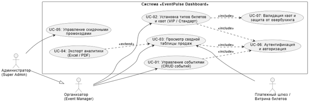
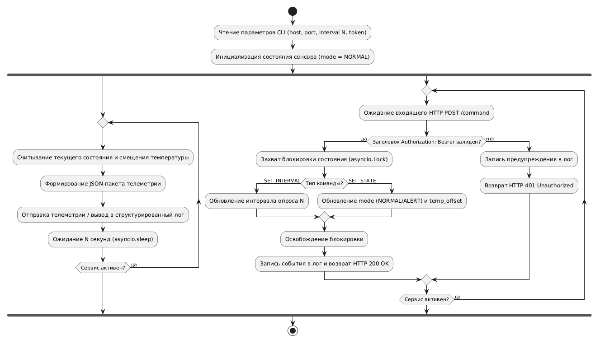
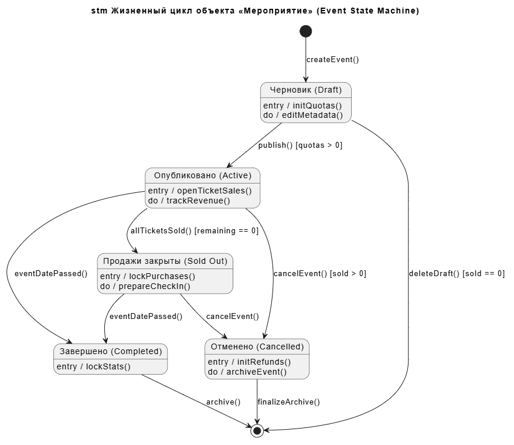
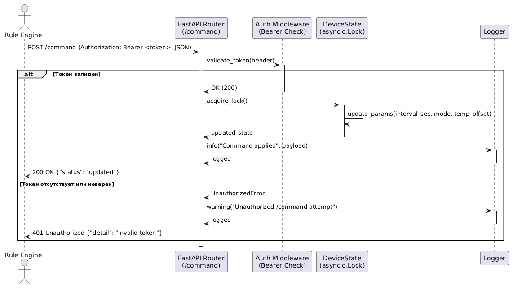

# Описание дизайна программного обеспечения

Для EventPulse (Event Organizer Backoffice Dashboard)

Версия 1.0

Подготовил: Чурик М.В. (гр. 439401)

БГУИР, Факультет компьютерных систем и сетей, Кафедра ЭВМ

2026-11-05

## Оглавление

- [1. Введение](#1-введение)
  * [1.1 Назначение документа](#11-назначение-документа)
  * [1.2 Область применения](#12-область-применения)
  * [1.3 Определения, акронимы и сокращения](#13-определения-акронимы-и-сокращения)
  * [1.4 Ссылки](#14-ссылки)
  * [1.5 Обзор документа](#15-обзор-документа)
- [2. Обзор дизайна](#2-обзор-дизайна)
  * [2.1 Задачи стейкхолдеров](#21-задачи-стейкхолдеров)
  * [2.2 Выбранные точки зрения](#22-выбранные-точки-зрения)
- [3. Проектные представления](#3-проектные-представления)
- [4. Решения](#4-решения)
- [5. Приложения](#5-приложения)

## История изменений

| Name | Date | Reason For Changes | Version |
|------|------|--------------------|---------|
| Чурик М.В. | 2026-11-04 | Начальная редакция системных требований и архитектуры | 0.1 |
| Чурик М.В. | 2026-11-05 | Включение модулей экспорта Excel/PDF и промокодов | 1.0 |

---

## 1. Введение

### 1.1 Назначение документа
Настоящий документ Software Design Description (SDD) определяет архитектурную структуру, компонентный состав, реляционную схему данных и алгоритмы взаимодействия веб-системы «EventPulse». Документ служит нормативным техническим руководством для команды разработчиков (Senior/Junior инженеры), системных архитекторов и специалистов по обеспечению качества в процессе реализации и сопровождения ПО. Спецификация базируется на бизнес-требованиях документа `srs/srs-template.md`.

### 1.2 Область применения
Проект «EventPulse» представляет собой веб-приложение для управления жизненным циклом событий, настройкой билетно-ценовой политики (категории VIP и Стандарт) и аналитическим учётом выручки. 
* **Входит в контур системы:** административный интерфейс организатора (Backoffice), CRUD-модуль событий, сервис валидации и квотирования билетов, расчет суммарной выручки, экспорт отчетов в Excel/PDF и модуль скидочных промокодов.
* **Не входит в контур:** публичная клиентская витрина оформления заказов розничными покупателями и внешние процессинговые шлюзы интернет-эквайринга (взаимодействие осуществляется через абстрактный REST API).

### 1.3 Определения, акронимы и сокращения

| Term | Definition |
|------|------------|
| ACID | Набор свойств транзакций (Atomicity, Consistency, Isolation, Durability) |
| API | Application Programming Interface — интерфейс взаимодействия компонентов |
| CRUD | Create, Read, Update, Delete — базовые операции управления сущностями |
| Overbooking | Аномалия перепродажи мест сверх доступной физической квоты зала |
| SDD | Software Design Description — описание проектирования программного обеспечения |
| SPA | Single Page Application — одностраничное веб-приложение на React |
| SRS | Software Requirements Specification — спецификация требований к ПО |

### 1.4 Ссылки
1. `srs/srs-template.md` — Спецификация требований к программному обеспечению EventPulse (Нормативная).
2. `adr/adr-template.md` — Протоколы ключевых архитектурных решений проекта (Нормативная).
3. СТП БГУИР 01-2017 — Стандарт предприятия. Общие требования к оформлению студенческих работ (Справочная).

### 1.5 Обзор документа
Раздел 2 описывает высокоуровневый подход к архитектуре и задачи стейкхолдеров. Раздел 3 содержит предписывающие спецификации компонентов, схемы БД и API. Раздел 4 фиксирует ключевые архитектурные решения. Раздел 5 содержит листинги схемы базы данных.

---

## 2. Обзор дизайна

### 2.1 Задачи стейкхолдеров
* **Организатор мероприятий (Бизнес):** онлайн-прозрачность продаж, нулевой риск перепродажи мест, удобный ввод данных быстрее чем за 3 минуты.
* **Senior Fullstack разработчик:** масштабируемость серверной части, слабая связанность модулей, гарантия целостности данных при конкурентных запросах.
* **Junior разработчик:** четко изолированные интерфейсные компоненты (таблицы, фильтрация, генерация отчетов) с понятными интерфейсными контрактами (TypeScript props/Dts).

### 2.2 Выбранные точки зрения

#### 2.2.1 Контекст (Context)
Система развертывается как веб-сервис. Основной актор — Организатор (Event Manager), управляющий карточками событий через браузер. Внешние контексты: база данных PostgreSQL и клиентское API биллинга.

#### 2.2.2 Композиция (Composition)
Трехуровневая архитектура (Three-tier):
1. **Presentation Layer (Frontend):** React SPA, TailwindCSS, Zustand Store.
2. **Business Logic Layer (Backend):** Node.js/Express REST API контроллеры и сервисы валидации.
3. **Data Access Layer:** PostgreSQL СУБД с ORM/SQL-репозиториями.

#### 2.2.3 Логическое представление (Logical)
* Сущность `Event` (идентификатор, название, дата, площадка, общая вместимость, статус).
* Сущность `TicketTier` (категория: VIP или Стандарт, стоимость, квота мест, число проданных).
* Сущность `PromoCode` (код, процент скидки, срок действия).

#### 2.2.4 Информация (Information)
Реляционная структура с внешними ключами и CHECK-ограничениями:
* Сумма квот билетов: `SUM(quota) <= capacity`.
* Стоимость: `price_vip >= price_standard`.

#### 2.2.5 Интерфейс (Interface)
RESTful JSON API для обмена данными между SPA и сервером (`/api/events`, `/api/tickets`, `/api/reports`).

#### 2.2.6 Параллелизм и надежность (Concurrency)
Транзакционная изоляция PostgreSQL (`Read Committed` / `Serializable`) и блокировка строк `SELECT ... FOR UPDATE` для исключения гонки запросов (Race Condition) при покупке последних билетов.

---

## 3. Проектные представления

### VIEW-01: Модуль экранной формы CRUD событий и квот
* **ID:** [VIEW-001]-EventCrudModal
* **Title:** Компонент создания и конфигурирования мероприятия
* **Viewpoint:** Логическое представление и интерфейс (React UI)
* **Representation:** React-компонент, включающий текстовые инпуты метаданных, селектор даты, а также два связанных блока настройки билетов («VIP» и «Стандарт»). Реализует валидацию на стороне клиента: блокировка кнопки «Сохранить», если сумма квот превышает общую вместимость.
* **SRS Traceability:** FR-EVT-01, FR-EVT-03, FR-TCK-01, FR-TCK-02, BR-1, BR-2.

### VIEW-02: Модуль аналитической сводной таблицы продаж
* **ID:** [VIEW-002]-SalesSummaryTable
* **Title:** Интерактивная таблица продаж и аналитики
* **Viewpoint:** Информация и интерфейс
* **Representation:** Табличный компонент, выполняющий агрегацию финансовых результатов по каждому мероприятию. Формула вычисления: `Revenue = (Sold_VIP * Price_VIP) + (Sold_Std * Price_Std)`. Поддерживает поиск по названию события, сортировку по столбцам и фильтры по статусам.
* **SRS Traceability:** FR-RPT-01, FR-RPT-02, BR-5.

### VIEW-03: Сервис предотвращения овербукинга
* **ID:** [VIEW-003]-TransactionQuotaManager
* **Title:** Серверный менеджер конкурентного бронирования квот
* **Viewpoint:** Алгоритм, параллелизм и целостность данных
* **Representation:** Серверная процедура, исполняемая в атомарной транзакции БД:
  ```sql
  BEGIN;
  SELECT quota, sold_count FROM ticket_tiers 
  WHERE event_id = $1 AND tier_type = $2 FOR UPDATE;
  -- Проверка: IF sold_count + requested <= quota THEN UPDATE ... ELSE ROLLBACK;
  COMMIT;
### VIEW-04: Модели динамического поведения системы (UML 2.5)
* **ID:** [VIEW-004]-DynamicBehaviorUML
* **Title:** Диаграммы вариантов использования, активности, состояний и последовательности
* **Viewpoint:** Динамическое поведение и взаимодействие компонентов (Behavior & Interaction)
* **Representation:**
  1. **Диаграмма вариантов использования (Use Case):** определяет границы системы EventPulse, роли (`Организатор`, `Администратор`, `Платежный шлюз`) и связи между прецедентами (`<<include>>`, `<<extend>>`).
     
  2. **Диаграмма активности (Activity):** описывает параллельную конфигурацию квот и цен категорий «VIP» и «Стандарт» через узлы синхронизации `Fork/Join` с циклом проверки валидности данных.
     
  3. **Диаграмма состояний (State Machine):** моделирует конечный автомат жизненного цикла сущности «Мероприятие» (`Draft` → `Active` → `Sold Out` / `Cancelled` → `Completed`).
     
  4. **Диаграмма последовательности (Sequence):** детализирует синхронное и транзакционное взаимодействие между `:EventCrudModal`, `:EventController` и `:TicketQuotaManager` при сохранении события в PostgreSQL.
     
* **More Information:** Текстовые описания актёров и потоки событий вынесены в `docs/additional-specs.md`, глоссарий — в `docs/glossary.md`.
