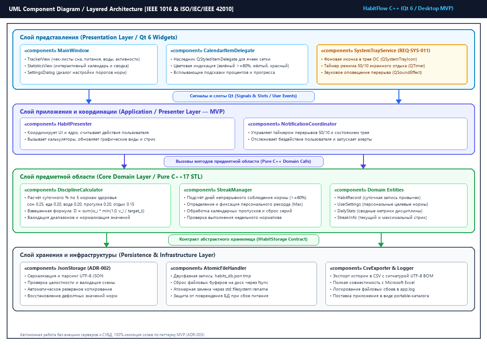

# Описание дизайна программного обеспечения (SDD)

Для проекта **«Трекер здорового распорядка дня и полезных привычек» (HabitFlow C++)**

Версия 1.0

Подготовил(а): студент группы 450503 **Петкун Роман Юрьевич**  
Заказчик (рецензент): студент группы 450503 **Равковский Андрей Владимирович**  
Организация: УО «Белорусский государственный университет информатики и радиоэлектроники» (БГУИР)  
Кафедра: Электронных вычислительных машин  
Дисциплина: Жизненный цикл разработки программного обеспечения  
Дата изменения: 12 октября 2026 г.

---

## Оглавление

<!-- TOC -->
* [1. Введение](#1-введение)
  * [1.1 Назначение документа](#11-назначение-документа)
  * [1.2 Область применения](#12-область-применения)
  * [1.3 Определения, акронимы и сокращения](#13-определения-акронимы-и-сокращения)
  * [1.4 Ссылки](#14-ссылки)
  * [1.5 Обзор документа](#15-обзор-документа)
* [2. Обзор дизайна](#2-обзор-дизайна)
  * [2.1 Задачи стейкхолдеров](#21-задачи-стейкхолдеров)
  * [2.2 Выбранные точки зрения (Viewpoints)](#22-выбранные-точки-зрения)
    * [2.2.1 Контекст (Context)](#221-контекст)
    * [2.2.2 Композиция (Composition)](#222-композиция)
    * [2.2.3 Логическое представление (Logical)](#223-логическое-представление)
    * [2.2.4 Физическое представление (Physical)](#224-физическое-представление)
    * [2.2.5 Структура (Structure)](#225-структура)
    * [2.2.6 Зависимости (Dependency)](#226-зависимости)
    * [2.2.7 Информация (Information)](#227-информация)
    * [2.2.8 Интерфейс (Interface)](#228-интерфейс)
    * [2.2.9 Взаимодействие (Interaction)](#229-взаимодействие)
    * [2.2.10 Алгоритм (Algorithm)](#2210-алгоритм)
    * [2.2.11 Динамика состояний (State Dynamics)](#2211-динамика-состояний)
    * [2.2.12 Параллелизм (Concurrency)](#2212-параллелизм)
    * [2.2.13 Паттерны (Patterns)](#2213-паттерны)
    * [2.2.14 Развёртывание (Deployment)](#2214-развёртывание)
    * [2.2.15 Ресурсы (Resources)](#2215-ресурсы)
* [3. Проектные представления (Design Views)](#3-проектные-представления)
  * [3.1 VIEW-001: Контекстное представление системы](#31-view-001)
  * [3.2 VIEW-002: Модульная компонентная архитектура](#32-view-002)
  * [3.3 VIEW-003: Логическая модель классов предметной области](#33-view-003)
  * [3.4 VIEW-004: Схема данных персистентного хранения](#34-view-004)
  * [3.5 VIEW-005: Архитектура фоновой службы системного трея (REQ-SYS-011)](#35-view-005)
  * [3.6 VIEW-006: Алгоритм расчёта стриков и непрерывных серий](#36-view-006)
* [4. Архитектурные решения (ADR)](#4-архитектурные-решения)
* [5. Приложения](#5-приложения)
<!-- TOC -->

---

## История изменений

| Name | Date | Reason For Changes | Version |
| :--- | :--- | :--- | :--- |
| HabitFlow C++ | 12.10.2026 | Создание базового документа SDD на основе согласованного SRS | 0.1 |
| HabitFlow C++ | 12.10.2026 | Включение архитектурного представления фоновой службы трея (REQ-SYS-011 / Change Request) и распределения задач между Senior/Junior | 1.0 |

---

## 1. Введение

Настоящий документ представляет собой Описание дизайна программного обеспечения (Software Design Description, SDD) для настольного приложения «Трекер здорового распорядка дня и полезных привычек» (HabitFlow C++). Документ разработан в соответствии с международными стандартами **IEEE 1016-2009** и **ISO/IEC/IEEE 42010:2011** и определяет техническую архитектуру, структуры данных, межмодульные интерфейсы и правила реализации системы.

### 1.1 Назначение документа

Настоящий SDD предназначен для инженеров-разработчиков, системных архитекторов и специалистов по качеству. Документ служит практическим руководством по реализации требований, зафиксированных в спецификации требований к ПО (SRS). Он переводит требования категории «ЧТО должна делать система» в архитектурные и технические решения «КАК система построена и функционирует».

### 1.2 Область применения

Проектируемый программный продукт — автономное настольное приложение **HabitFlow C++ v1.0** для операционных систем Windows 10/11 и Linux. Продукт реализует модули фиксации параметров сна, водного баланса, питания, прогулок, экранного отдыха, расчёта стриков, отображения интерактивного календаря и фоновых звуковых уведомлений через системный трей.

### 1.3 Определения, акронимы и сокращения

| Term | Definition |
| :--- | :--- |
| **ADR** | Architecture Decision Record — протокол фиксации значимого архитектурного решения. |
| **API** | Application Programming Interface — программный интерфейс межмодульного взаимодействия. |
| **MADR** | Markdown Architectural Decision Records — формат структурированного описания ADR в Markdown. |
| **MVP** | Model-View-Presenter — архитектурный паттерн разделения логики, модели и представления. |
| **SDD** | Software Design Description — спецификация описания архитектуры и дизайна ПО (IEEE 1016). |
| **SRS** | Software Requirements Specification — спецификация требований к ПО (ISO/IEC/IEEE 29148). |
| **SysML v2** | Systems Modeling Language v2 — язык системного моделирования следующего поколения (OMG). |
| **QSS** | Qt Style Sheets — язык таблиц стилей для кастомизации интерфейса в библиотеке Qt. |

### 1.4 Ссылки

1. **IEEE Std 1016-2009** — IEEE Standard for Information Technology — Systems Design — Software Design Descriptions. (Нормативный стандарт).
2. **ISO/IEC/IEEE 42010:2011** — Systems and software engineering — Architecture description. (Нормативный стандарт).
3. **ISO/IEC 14882:2017** — Standard for Programming Language C++ (C++17). (Нормативный стандарт).
4. **RFC 8259** — The JavaScript Object Notation (JSON) Data Interchange Format.
5. Спецификация требований SRS: `srs/srs.md` (репозиторий проекта).

### 1.5 Обзор документа

Раздел 2 описывает задачи стейкхолдеров и анализ системы по 15 точкам зрения (Viewpoints). Раздел 3 содержит конкретные проектные представления (Design Views) с диаграммами. Раздел 4 содержит каталог принятых архитектурных решений (ADR). Раздел 5 содержит приложения со ссылками на графические схемы.

---

## 2. Обзор дизайна

### 2.1 Задачи стейкхолдеров

| Стейкхолдер | Основные задачи и проблемы (Concerns) | Адресующие элементы дизайна |
| :--- | :--- | :--- |
| **Пользователь (Студент / Инженер)** | Скорость запуска, быстрый ввод отчёта (< 60 с), напоминания об отдыхе, приватность личных данных. | Qt 6 Widgets UI, SystemTrayService, 100% Air-gap локальное хранилище. |
| **Заказчик (Равковский А.В.)** | Соблюдение бюджета ($4,500) и дедлайна (4 недели), стабильность хранения данных без потерь. | WBS планирование, привлечение Junior-разработчика, атомарная запись JSON. |
| **Разработчик (Петкун Р.Ю.)** | Модульность кода, удобство отладки, разделение ответственности, высокая тестируемость ядра. | Трёхслойная архитектура, паттерн MVP, абстрактные C++ интерфейсы. |
| **Сопровождающий инженер** | Простота сборки, отсутствие редких проприетарных зависимостей, переносимость. | CMake 3.16+, C++17 STL, отсутствие Qt-зависимостей в ядре предметной области. |

### 2.2 Выбранные точки зрения (Viewpoints)

В соответствии с ISO 42010 архитектура системы декомпозирована по следующим ключевым ракурсам:

#### 2.2.1 Контекст (Context)
Определяет границы приложения HabitFlow C++ как изолированного настольного клиента, взаимодействующего исключительно с пользователем (мышь, клавиатура, дисплей) и локальной файловой системой ОС (чтение/запись JSON и логов).

#### 2.2.2 Композиция (Composition)
Система декомпозирована на 4 логических слоя:
1. **Слой представления (Presentation):** `MainWindow`, `TrackerView`, `StatisticsView`, `CalendarItemDelegate`, `SystemTrayService`.
2. **Слой приложения (Application / MVP):** `HabitPresenter`, `NotificationCoordinator`.
3. **Слой предметной области (Core Domain):** `DisciplineCalculator`, `StreakManager`, сущности `HabitRecord`, `UserSettings`.
4. **Слой хранения (Persistence):** `JsonStorage`, `AtomicFileHandler`, `CsvExporter`.

#### 2.2.3 Логическое представление (Logical)
Описывает статические объектные связи. Доменная логика вынесена в чистые C++ классы без примеси GUI, что позволяет прогонять модульные тесты в headless-режиме (без запуска графического сервера X11/Wayland/GDI).

#### 2.2.4 Физическое представление (Physical)
Приложение выполняется на стандартном персональном компьютере с x86-64 архитектурой под управлением Windows 10/11 или Linux. Требования к оперативной памяти: не более 80 МБ; дисковое пространство: менее 100 МБ вместе с библиотеками Qt.

#### 2.2.5 Структура (Structure)
Интерфейсы `IHabitStorage`, `IDisciplineCalculator` и `INotificationService` изолируют реализации. Коннекторы между UI и Presenter реализованы на механизме Qt Signals/Slots.

#### 2.2.6 Зависимости (Dependency)
Модуль `Core Domain` имеет нулевые внешние зависимости (только стандартные заголовочные файлы C++ `<vector>`, `<string>`, `<chrono>`, `<cmath>`). Модуль `Persistence` зависит от парсера JSON. Модуль `Presentation` зависит от `Qt6::Widgets`.

#### 2.2.7 Информация (Information)
Формат постоянных данных — структурированный JSON (RFC 8259). Корневой объект содержит секции `user_settings`, массив `records` и блок `statistics`.

#### 2.2.8 Интерфейс (Interface)
Специфицированы строгие C++ API:
```cpp
virtual double calculateDailyScore(const HabitRecord& record, const UserSettings& settings) = 0;
virtual StreakInfo evaluateStreak(const std::vector<HabitRecord>& history, int thresholdPct) = 0;
virtual bool saveRecords(const std::vector<HabitRecord>& records) = 0;
```

#### 2.2.9 Взаимодействие (Interaction)
Динамический сценарий сохранения отметки: UI эмитит сигнал `onSaveClicked()` -> Presenter считывает данные формы -> вызывает валидатор -> обращается к `DisciplineCalculator` -> вызывает `JsonStorage::saveAtomic()` -> возвращает результат в UI и обновляет прогресс-бар и стрик.

#### 2.2.10 Алгоритм (Algorithm)
Суточный процент дисциплины рассчитывается по взвешенной формуле:
$$D = \left( 0.25 \cdot S + 0.20 \cdot N + 0.20 \cdot \min\left(1.0, rac{W}{W_{target}}
ight) + 0.20 \cdot \min\left(1.0, rac{A}{A_{target}}
ight) + 0.15 \cdot rac{B}{B_{target}} 
ight) 	imes 100\%$$
где $S$ — соблюдение сна (0 или 1), $N$ — регулярность питания (доля выполненных приёмов пищи), $W$ — вода (мл), $A$ — прогулка (мин), $B$ — перерывы.

#### 2.2.11 Динамика состояний (State Dynamics)
Суточная запись проходит состояния: `Новая (Пустая)` -> `В процессе заполнения` -> `Сохранена (Успех >=80%)` либо `Сохранена (Частично 50-79%)` либо `Срыв режима (<50%)`.

#### 2.2.12 Параллелизм (Concurrency)
Основной GUI поток обрабатывает события пользователя. Фоновый таймер `QTimer` с шагом 1000 мс отсчитывает интервалы 50 минут работы и 10 минут отдыха, не блокируя пользовательский интерфейс.

#### 2.2.13 Паттерны (Patterns)
- **Model-View-Presenter (Passive View):** отделение интерфейса от данных.
- **Strategy:** возможность подмены алгоритма расчёта весов дисциплины.
- **RAII / Transaction Rollback:** безопасное управление файловыми дескрипторами при атомарной перезаписи.

#### 2.2.14 Развёртывание (Deployment)
Сборка CMake формирует переносимый (portable) каталог:
```
HabitFlow/
├── HabitFlow.exe
├── Qt6Core.dll, Qt6Gui.dll, Qt6Widgets.dll
├── platforms/qwindows.dll
└── data/habits_db.json
```

#### 2.2.15 Ресурсы (Resources)
В состоянии ожидания (в системном трее) загрузка центрального процессора составляет менее 0.2%, а потребление памяти стабильно и не растёт со временем (отсутствие утечек памяти благодаря умным указателям `std::unique_ptr` и дереву владения `QObject`).

---

## 3. Проектные представления (Design Views)

### 3.1 VIEW-001: Контекстное представление системы
- **ID:** `VIEW-001-Context`
- **Title:** Контекстная граница настольного приложения
- **Viewpoint:** Context Viewpoint
- **Representation:** Приложение развёртывается локально на рабочей станции пользователя. Внешние связи с облачными серверами отсутствуют. Источник входных данных — клавиатурно-мышечный ввод; приёмник выходных данных — локальный дисплей и локальные файлы `data/habits_db.json` и `export_history.csv`.
- **Traceability:** Реализует `REQ-SYS-001`, `REQ-SEC-001`.

### 3.2 VIEW-002: Модульная компонентная архитектура
- **ID:** `VIEW-002-Composition`
- **Title:** Четырёхслойная компонентная архитектура
- **Viewpoint:** Composition Viewpoint
- **Representation:** На рисунке ниже представлена архитектурная схема слоёв:



- **Traceability:** Реализует `REQ-SYS-001`, `REQ-SYS-006`, `REQ-MAINT-001`.

### 3.3 VIEW-003: Логическая модель классов предметной области
- **ID:** `VIEW-003-Logical`
- **Title:** Статическая модель классов ядра
- **Viewpoint:** Logical Viewpoint
- **Representation:**
  - `class HabitRecord`: инкапсулирует дату, параметры сна (`bedTime`, `wakeTime`, `sleepHours`), структуру питания (`breakfast`, `lunch`, `dinner`), объём воды (`waterMl`), длительность прогулки (`walkMinutes`) и счётчик перерывов (`screenBreaksDone`).
  - `class DisciplineCalculator`: статический сервис расчёта интегрального балла с валидацией диапазонов.
  - `class StreakManager`: инкапсулирует историю записей, сортирует дни по календарю и вычисляет непрерывные цепочки выполнения.
- **Traceability:** Реализует `REQ-SYS-004`, `REQ-SYS-005`.

### 3.4 VIEW-004: Схема данных персистентного хранения
- **ID:** `VIEW-004-Information`
- **Title:** Структура и формат файла JSON
- **Viewpoint:** Information Viewpoint
- **Representation:** Схема базы данных представлена в Приложении А спецификации SRS. Чтение и запись выполняются через абстракцию `IHabitStorage`. Запись осуществляется во временный файл `.tmp` с последующим вызовом атомарного переименования `std::filesystem::rename` (ADR-002).
- **Traceability:** Реализует `REQ-SYS-003`, `REQ-REL-001`.

### 3.5 VIEW-005: Архитектура фоновой службы системного трея (REQ-SYS-011)
- **ID:** `VIEW-005-SystemTray`
- **Title:** Фоновая служба напоминаний и звуковых оповещений
- **Viewpoint:** Concurrency & Interaction Viewpoint
- **Representation:** Компонент `SystemTrayService` создаёт объект `QSystemTrayIcon` в области уведомлений Windows/Linux. При закрытии главного окна приложение сворачивается в трей. Таймер `QTimer` отсчитывает 50 минут активной работы. По истечении интервала воспроизводится звуковой файл через `QSoundEffect` и выводится всплывающее системное уведомление: «Пора сделать 10-минутный перерыв для глаз!».
- **Traceability:** Реализует требование Заказчика `REQ-SYS-011` (добавлено в ходе Change Request).

### 3.6 VIEW-006: Алгоритм расчёта стриков и непрерывных серий
- **ID:** `VIEW-006-Algorithm`
- **Title:** Алгоритм вычисления текущего и рекордного стрика
- **Viewpoint:** Algorithm Viewpoint
- **Representation:**
  1. История дней сортируется по дате в хронологическом порядке.
  2. Переменные `currentStreak = 0`, `maxStreak = 0`.
  3. Для каждого последовательного календарного дня проверяется условие: `disciplinePercent >= threshold` (по умолчанию 80%).
  4. Если условие истинно и дата отстоит от предыдущей ровно на 1 день: `currentStreak++`.
  5. Если дата пропущена или процент < 80%: `currentStreak = 0`.
  6. На каждом шаге: `maxStreak = std::max(maxStreak, currentStreak)`.
- **Traceability:** Реализует `REQ-SYS-005`.

---

## 4. Архитектурные решения (ADR)

Ключевые архитектурные решения оформлены в соответствии с форматом MADR в каталоге `adr/`:

1. **[ADR-001: Выбор графического фреймворка Qt 6 Widgets для десктопного интерфейса](adr/0001-choose-qt-as-desktop-gui-framework.md)**
   - *Статус:* Принято.
   - *Суть:* Выбран промышленный фреймворк Qt 6 Widgets взамен Dear ImGui и нативного Win32 для обеспечения кроссплатформенности, нативного Look&Feel и развитых контролов календаря и трея.

2. **[ADR-002: Механизм локального хранения данных на базе JSON с атомарной записью](adr/0002-atomic-json-persistence-engine.md)**
   - *Статус:* Принято.
   - *Суть:* Применена схема «Save to Temp + Atomic Rename» для гарантированной защиты от потери базы данных при сбоях питания в условиях 100% локальной изоляции.

3. **[ADR-003: Применение трёхслойной архитектуры и паттерна Model-View-Presenter (MVP)](adr/0003-adopt-layered-architecture-and-mvp.md)**
   - *Статус:* Принято.
   - *Суть:* Полная изоляция ядра математических расчётов на чистом C++17 STL от графической библиотеки Qt, обеспечивающая автономное модульное тестирование и параллельную разработку.

---

## 5. Приложения

- Диаграмма компонентов архитектуры: [`sdd/img/sdd_architecture_diagram.png`](img/sdd_architecture_diagram.png)
- Дорожная карта и план итераций: [`sdd/img/sdd_iteration_plan.png`](img/sdd_iteration_plan.png)
- Протоколы архитектурных решений: каталог [`adr/`](../adr/)
