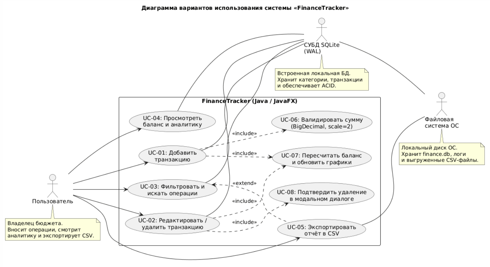
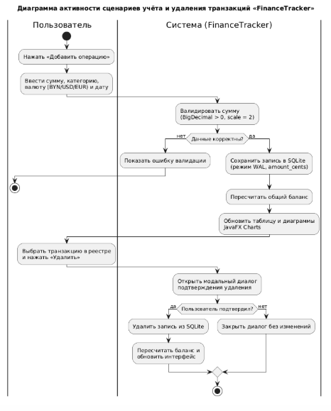
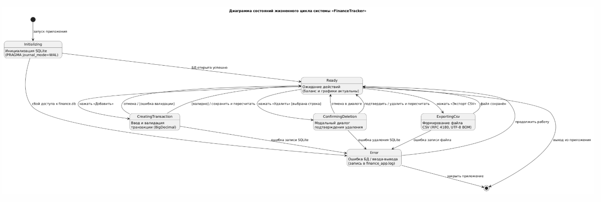
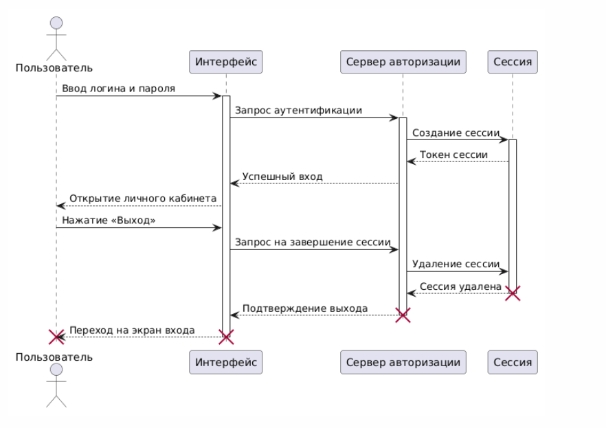

# Описание дизайна программного обеспечения

Для **FinanceTracker** — десктопной кроссплатформенной системы персонального финансового учета и аналитики

Версия 0.2

Подготовил: Богдан М. А., гр. 450504

Белорусский государственный университет информатики и радиоэлектроники (БГУИР)

Дата изменения: 19 ноября 2026 г.

## Оглавление

* [1. Введение](#1-introduction)
  * [1.1 Назначение документа](#11-document-purpose)
  * [1.2 Область применения](#12-subject-scope)
  * [1.3 Определения, акронимы и сокращения](#13-definitions-acronyms-and-abbreviations)
  * [1.4 Ссылки](#14-references)
  * [1.5 Обзор документа](#15-document-overview)
* [2. Обзор дизайна](#2-design-overview)
  * [2.1 Задачи стейкхолдеров](#21-stakeholder-concerns)
  * [2.2 Выбранные точки зрения](#22-selected-viewpoints)
    * [2.2.1 Контекст](#221-context)
    * [2.2.2 Композиция](#222-composition)
    * [2.2.3 Логическое представление](#223-logical)
    * [2.2.4 Информация](#227-information)
    * [2.2.5 Взаимодействие](#229-interaction)
    * [2.2.6 Паттерны](#2213-patterns)
    * [2.2.7 Развёртывание](#2214-deployment)
* [3. Проектные представления](#3-design-views)
* [4. Решения](#4-decisions)
* [5. Приложения](#5-appendixes)

## История изменений

| Name | Date | Reason For Changes | Version |
|:---|:---|:---|:---|
| Богдан М. А. | 19.11.2026 | Первичная разработка архитектуры, декомпозиция системных модулей и назначение приоритетов (10–50) на основе SRS | 0.1 |
| Богдан М. А. | 19.11.2026 | Актуализация плана итерации по итогам двух раундов переговоров с Заказчиком: добавление модуля визуальной аналитики (SYS-08) и распределение задач с привлечением Junior-разработчика | 0.2 |

---

## 1. Введение {#1-introduction}

Настоящий документ представляет собой спецификацию проектирования программного обеспечения (Software Design Description, SDD) для десктопной системы персонального финансового учета **FinanceTracker** (версия 0.2). Документ переводит бизнес-требования и системные ограничения из спецификации `srs/srs-template.md` в конкретную программную архитектуру, структуру модулей, схему хранения данных и календарно-ресурсный план реализации.

### 1.1 Назначение документа {#11-document-purpose}

Настоящий SDD определяет внутреннюю архитектуру, компонентную декомпозицию, модель данных и интерфейсы взаимодействия компонентов приложения FinanceTracker. Документ предназначен для команды разработки (Lead/Middle и Junior Java-разработчиков), системного архитектора и Заказчика. Разработчики используют SDD как руководство к реализации программного кода и тестов, а Заказчик и руководитель проекта — для контроля приоритетов (10–50), сроков и стоимости итераций.

### 1.2 Область применения {#12-subject-scope}

Проектируемой системой является автономное кроссплатформенное десктопное приложение **FinanceTracker** на платформе Java SE 17+ (JavaFX + локальная СУБД SQLite).

**В область проектирования входит:**
- Трехслойная архитектура приложения (`Presentation / MVVM`, `Business Logic / Service`, `Data Access / DAO`).
- Реляционная схема локальной базы данных SQLite (`categories`, `transactions`) и механизмы обеспечения целостности данных.
- Подсистема учета финансовых операций (CRUD), валидации и расчетов с фиксированной точностью (`BigDecimal`).
- Модуль фильтрации, визуальной аналитики расходов (JavaFX `PieChart`/`BarChart`) и экспорта выписок в формат CSV (RFC 4180).
- Декомпозиция системных требований на задачи с приоритетами (10–50), оценкой трудоемкости и распределением между исполнителями.

**В область проектирования НЕ входит:**
- Серверная инфраструктура для облачной синхронизации и сетевые протоколы взаимодействия с банковскими API.
- Мобильные клиенты под ОС Android и iOS.

### 1.3 Определения, акронимы и сокращения {#13-definitions-acronyms-and-abbreviations}

| Term | Definition |
|:---|:---|
| ADR | Architectural Decision Record — протокол фиксации значимого архитектурного решения и его обоснования. |
| API | Application Programming Interface — программный интерфейс взаимодействия между слоями и библиотеками (JDBC, JavaFX). |
| DAO | Data Access Object — паттерн проектирования, изолирующий слой доступа к реляционной базе данных от бизнес-логики. |
| MVP | Minimum Viable Product — минимально жизнеспособный продукт, включающий функционал с наивысшим приоритетом (10–20). |
| MVVM | Model-View-ViewModel — архитектурный шаблон разделения графического интерфейса JavaFX и логики представления. |
| SDD | Software Design Document — спецификация проектирования программного обеспечения. |
| WAL | Write-Ahead Logging — режим журналирования упреждающей записи в SQLite, обеспечивающий высокую скорость и ACID-надежность. |

### 1.4 Ссылки {#14-references}

1. `srs/srs-template.md` — Спецификация требований к ПО (SRS) для FinanceTracker, автор Богдан М. А., версия 0.2, БГУИР, 2026. [Нормативная ссылка]
2. `adr/adr-template.md` — Протокол архитектурных решений (ADR-001) для FinanceTracker, автор Богдан М. А., БГУИР, 2026. [Нормативная ссылка]
3. СТП 01–2024 «Дипломные проекты (работы). Общие требования». Минск, БГУИР, 2024. [Нормативная ссылка]
4. Спецификация ISO/IEC/IEEE 1016:2009 «Systems and software engineering — Software design descriptions». [Справочная ссылка]
5. Официальная документация JavaFX 17+ (https://openjfx.io/javadoc/17/) и SQLite (https://www.sqlite.org/docs.html). [Справочная ссылка]

### 1.5 Обзор документа {#15-document-overview}

Раздел 1 определяет цели, границы и нормативную базу дизайна. Раздел 2 описывает ключевые задачи стейкхолдеров и выбранные архитектурные точки зрения (контекст, композиция, логическая модель, данные, взаимодействие, паттерны и развёртывание). Раздел 3 содержит формализованные проектные представления (`VIEW-001` – `VIEW-004`). Раздел 4 фиксирует принятые проектные решения (`DEC-001` – `DEC-003`), а Раздел 5 содержит таблицы системных требований, ранжирования приоритетов (10–50) и эволюции календарно-ресурсного плана по итогам переговоров с Заказчиком.

---

## 2. Обзор дизайна {#2-design-overview}

### 2.1 Задачи стейкхолдеров {#21-stakeholder-concerns}

| Стейкхолдер | Основные задачи и интересы (Concerns) | Точки зрения SDD, адресующие задачи |
|:---|:---|:---|
| **Конечный пользователь** | Приватность данных, автономность без Интернета, наглядная аналитика расходов, быстрый отклик интерфейса (< 200 мс) и точность денежных расчетов. | Контекст, Информация, Взаимодействие, Развёртывание |
| **Заказчик** | Прозрачность трудозатрат, соблюдение жесткого дедлайна (до 10–11 раб. дней), контроль бюджета и приоритетное внедрение визуальной аналитики. | Композиция, Приложение А (Таблицы приоритетов и планов) |
| **Lead / Middle Java-разработчик** | Четкая модульность, низкая связанность слоев, ACID-надежность БД, безопасное распараллеливание задач для Junior-разработчика. | Композиция, Логическое представление, Паттерны, Информация |
| **Junior Java-разработчик** | Наличие изолированных, четко специфицированных модулей (UI-графики, экспорт CSV, фильтры) с понятными контрактами сервисов. | Композиция, Логическое представление, Взаимодействие |

### 2.2 Выбранные точки зрения {#22-selected-viewpoints}

Для полного описания архитектуры FinanceTracker выбраны следующие точки зрения в соответствии со стандартом IEEE 1016:

#### 2.2.1 Контекст {#221-context}
Определяет систему как «чёрный ящик» и фиксирует её внешние границы: единственный актор — локальный пользователь, внешние зависимости отсутствуют, взаимодействие с ОС сводится к чтению/записи локального файла БД `finance.db` и экспорту отчетов `.csv`.

#### 2.2.2 Композиция {#222-composition}
Описывает функциональную декомпозицию системы на три изолированных архитектурных слоя: слой представления (`ui`), сервисный слой бизнес-логики (`service`) и слой доступа к данным (`dao`). Позволяет распараллелить разработку между основным и младшим разработчиками.

#### 2.2.3 Логическое представление {#223-logical}
Фиксирует статическую структуру классов, интерфейсов и моделей предметной области (`Transaction`, `Category`, `CurrencyCode`, `BalanceSummary`), обеспечивая строгую типизацию и инкапсуляцию вычислений на базе `java.math.BigDecimal`.

#### 2.2.4 Информация {#227-information}
Моделирует схему реляционной базы данных SQLite, типы столбцов, ограничения целостности (`PRIMARY KEY`, `FOREIGN KEY`, `CHECK`) и индексирование по дате и категории для быстрой агрегации.

#### 2.2.5 Взаимодействие {#229-interaction}
Описывает последовательность вызовов в рантайме при выполнении ключевых сценариев: «Добавление новой транзакции с пересчетом баланса» и «Построение диаграммы расходов за выбранный период».

#### 2.2.6 Паттерны {#2213-patterns}
Фиксирует применяемые шаблоны проектирования: **Layered Architecture** (трехслойная архитектура), **MVVM** (для связывания JavaFX-контроллеров и моделей), **DAO / Repository** (абстракция над SQLite JDBC) и **Singleton** (управление пулом соединений `SqliteConnectionManager`).

#### 2.2.7 Развёртывание {#2214-deployment}
Определяет отображение программных артефактов на рабочую станцию пользователя: приложение поставляется в виде исполняемого JAR-архива (с включенными зависимостями JavaFX и `sqlite-jdbc`), запускаемого в среде JRE 17+ на ОС Windows, Linux или macOS.

---

## 3. Проектные представления {#3-design-views}

* **ID:** VIEW-001
* **Title:** Компонентная декомпозиция слоев приложения (Composition View)
* **Viewpoint:** Композиция (раздел 2.2.2)
* **Representation:**
  ```text
  +-------------------------------------------------------------------+
  |                   Presentation Layer (JavaFX / MVVM)              |
  |  [MainWindow] -> [AccountSummaryPanel] | [TransactionDataGrid]    |
  |               -> [TransactionEntryDialog] | [AnalyticsChartView]  |
  +---------------------------------+---------------------------------+
                                    | вызывает интерфейсы сервисов
                                    v
  +-------------------------------------------------------------------+
  |                   Business Logic Layer (Service)                  |
  |  [TransactionService] | [BalanceCalculatorService]                |
  |  [AnalyticsAggregationService] | [CsvReportExporter]              |
  +---------------------------------+---------------------------------+
                                    | вызывает DAO-контракты
                                    v
  +-------------------------------------------------------------------+
  |                   Data Access Layer (DAO / JDBC)                  |
  |  [SqliteConnectionManager (WAL)] -> [TransactionDao] [CategoryDao]|
  +---------------------------------+---------------------------------+
                                    | JDBC SQL
                                    v
  +-------------------------------------------------------------------+
  |                   Local Storage (SQLite: finance.db)              |
  +-------------------------------------------------------------------+

---

## Итоговый согласованный план итерации с привлечением Junior-разработчика (версия 2.0)

*Изменения по итогам двух раундов переговоров с Заказчиком: добавлен модуль визуальной аналитики расходов `SYS-08` (приоритет 15, 24 ч), исключен инсталлятор `SYS-07` (-8 ч) в пользу JAR, привлечен Junior Java-разработчик (12 у.е./ч) для параллельной разработки изолированных модулей (ставка Lead/Middle — 25 у.е./ч, 1 рабочий день = 8 часов).*

| ID | Задача / Модуль | Приор. (10–50) | Исполнитель | Часы | Дни | Стоимость, у.е. |
|:---|:---|:---:|:---|:---:|:---:|:---:|
| **SYS-01** | Ядро БД SQLite, схема и DAO-слой | 10 | Lead/Middle (25 у.е./ч) | 16 | 2.0 | 400 |
| **SYS-02** | Учет операций (CRUD) и расчет баланса | 10 | Lead/Middle (25 у.е./ч) | 20 | 2.5 | 500 |
| **SYS-08a** | SQL-агрегация аналитики и архитектура | 15 | Lead/Middle (25 у.е./ч) | 8 | 1.0 | 200 |
| **SYS-08b** | Компоненты диаграмм JavaFX Charts | 15 | Junior Dev (12 у.е./ч) | 16 | 2.0 | 192 |
| **SYS-03** | Главное окно JavaFX и таблица операций | 20 | Lead/Middle (25 у.е./ч) | 16 | 2.0 | 400 |
| **SYS-06** | Экспорт реестра в CSV (RFC 4180) | 20 | Junior Dev (12 у.е./ч) | 8 | 1.0 | 96 |
| **SYS-04** | Фильтрация и поиск по категориям | 30 | Junior Dev (12 у.е./ч) | 12 | 1.5 | 144 |
| **SYS-05** | Выбор валюты счета (BYN/USD/EUR) | 40 | Junior Dev (12 у.е./ч) | 4 | 0.5 | 48 |
| **MGMT** | Онбординг Junior и код-ревью PR | 10 | Lead/Middle (25 у.е./ч) | 4 | 0.5 | 100 |
| **ИТОГО** | **Срок сдачи: 9.0 раб. дней (параллельно)** | — | **2 разработчика** | **104** | **9.0** | **2 080** |
---

## 6. Динамические проектные представления (UML, версия 0.3)

* **Диаграмма вариантов использования:** 
* **Диаграмма активности:** 
* **Диаграмма состояний:** 
* **Диаграмма последовательности:** 

Подробные спецификации вынесены в `docs/glossary.md`, `docs/additional-specs.md`, `docs/use-cases.md` и `diagrams/finance-tracker-ui.sysml`.
