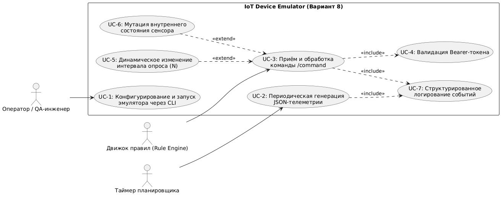
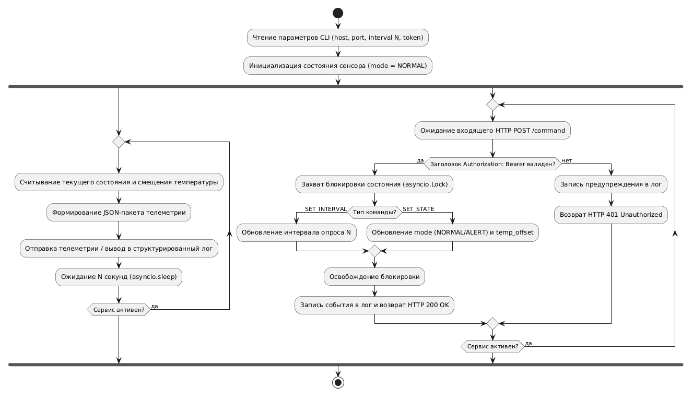
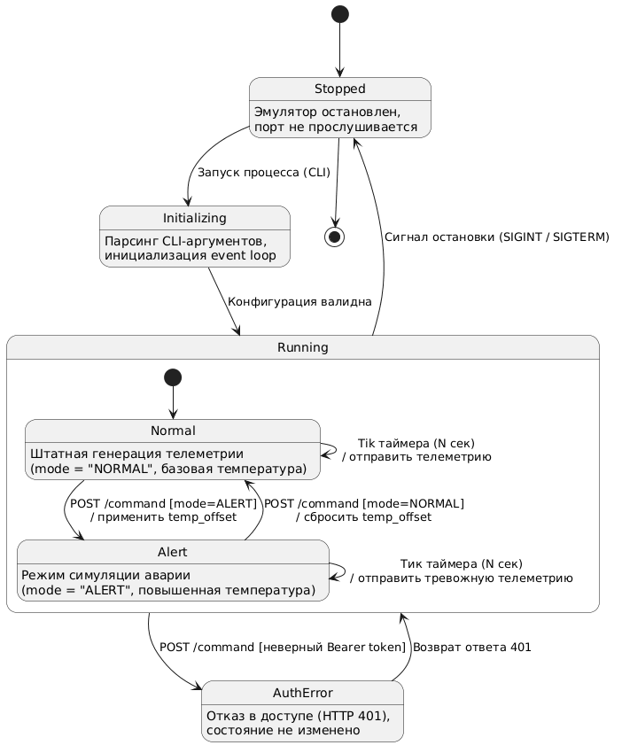
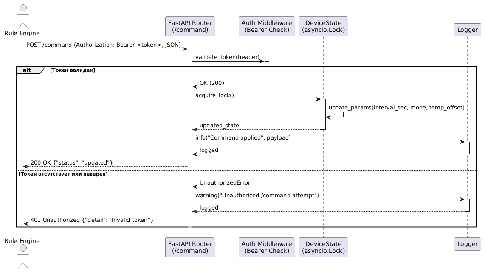

---

### 4. Динамическое поведение системы (UML Behavior Models)

#### 4.1 Модель вариантов использования (Use Case Diagram)
Определяет границы модуля «IoT Device Emulator» и его взаимодействие с внешними актёрами: Оператором (запуск через CLI), Таймером планировщика (генерация телеметрии каждые $N$ секунд) и Движком правил (управление через `POST /command` с обязательной проверкой Bearer-токена `<<include>>` и опциональными расширениями смены интервала и мутации состояния `<<extend>>`).

#### 4.2 Диаграмма активности (Activity Diagram)
Описывает параллельный поток выполнения (`fork / join`): фоновый цикл периодической генерации JSON-пакетов телеметрии и асинхронный обработчик входящих HTTP-директив с захватом блокировки `asyncio.Lock` для исключения состояния гонки (*race condition*).

#### 4.3 Диаграмма состояний (State Machine Diagram)
Отражает жизненный цикл состояния эмулятора: переход из `Stopped` через `Initializing` в композитное состояние `Running` (подсостояния `Normal` и `Alert`), обработку ошибочных запросов авторизации (`AuthError` с кодом 401) и штатное завершение работы по сигналу остановки.

#### 4.4 Диаграмма последовательности (Sequence Diagram)
Детализирует обмен сообщениями во времени при вызове `POST /command`: проверка заголовка `Authorization: Bearer` в `Auth Middleware`, потокобезопасная мутация параметров в `DeviceState` и запись события в `Logger`.

