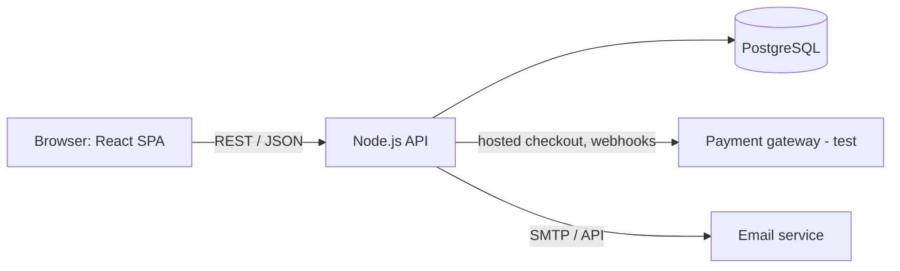
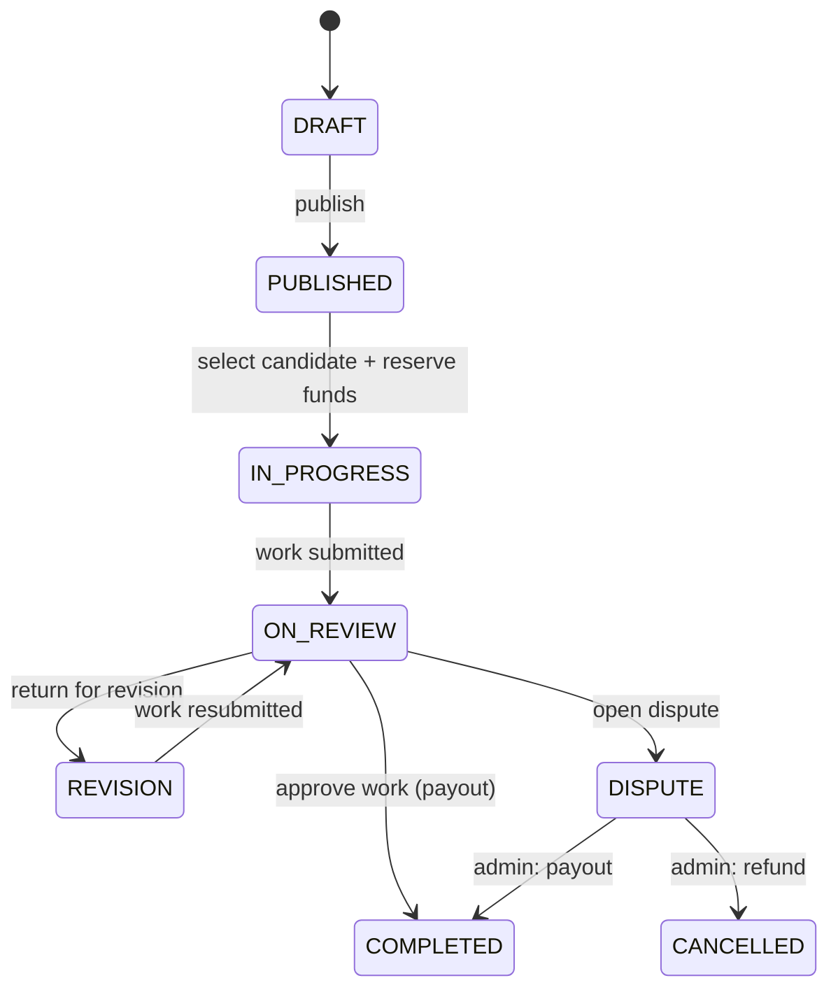

# DoneDeal — Software Design Description (SDD)

| Поле | Значение |
|---|---|
| Версия | 1.2 (согласована с Заказчиком) |
| Дата | 10.11.2026 |
| Автор (Архитектор) | _ФИО, группа_ |
| Заказчик (роль) | _ФИО напарника_ |
| Основание | `srs/srs.md` (бизнес-требования, v0.1) |

---

## 1. Введение

**Назначение.** Документ описывает системные требования и проектные решения для веб-приложения DoneDeal (кабинет заказчика) и служит руководством для разработчиков.

**Связанные документы:** `srs/srs.md`, `adr/0001-modular-monolith-ts-stack.md`, `adr/0002-payment-gateway-hosted-checkout.md`.

**Шкала приоритетов** (чем меньше число, тем важнее): 10 — critical, 20 — high, 30 — medium, 40 — low, 50 — optional.

## 2. Контекст системы

| Участник / система | Взаимодействие |
|---|---|
| Customer | Создаёт задачи, выбирает исполнителя, принимает работу |
| Performer | Откликается на задачу, сдаёт работу (упрощённая форма в MVP) |
| Admin | Разрешает споры |
| Payment gateway (test mode) | Резервирование и выплата средств |
| Email service | Отправка уведомлений |

## 3. Архитектура

Стиль: **модульный монолит** (см. ADR-0001). Клиент — SPA, сервер — REST API.

| Модуль | Ответственность |
|---|---|
| Auth | Регистрация, вход, роли |
| Tasks | Создание, публикация, статусы задач, вложения |
| Applications | Отклики исполнителей, выбор / отклонение |
| Payments | Резервирование, выплата, возврат, журнал операций |
| Reviews | Запрос и сохранение отзывов, рейтинг |
| Disputes | Открытие и разрешение споров |
| Notifications | Email-уведомления |

## 4. Данные

| Сущность | Ключевые поля |
|---|---|
| User | id, email, password_hash, role (CUSTOMER / PERFORMER / ADMIN), rating |
| Task | id, customer_id, title, description, category, budget, deadline, status |
| Application | id, task_id, performer_id, price, duration_days, message, status |
| Payment | id, task_id, amount, status (RESERVED / PAID / REFUNDED), idempotency_key |
| Review | id, task_id, author_id, target_id, rating, text |
| Dispute | id, task_id, opened_by, reason, status, resolution |
| Attachment | id, task_id, file_name, path |

### Статусы задачи

## 5. Интерфейсы (REST API)

| Метод и путь | Назначение | FR |
|---|---|---|
| POST /auth/register, POST /auth/login | Регистрация и вход | FR-01 |
| POST /tasks | Создать задачу | FR-02 |
| POST /tasks/{id}/attachments | Прикрепить файл | FR-03 |
| POST /tasks/{id}/publish, GET /tasks | Публикация, список «Мои задачи» | FR-04 |
| GET /tasks/{id}/applications | Список кандидатов | FR-05 |
| POST /tasks/{id}/applications/{appId}/select, .../reject | Выбрать / отклонить | FR-06, FR-07 |
| GET /tasks/{id} | Страница задачи со статусом | FR-08 |
| POST /tasks/{id}/approve | Одобрить работу (выплата) | FR-09 |
| POST /tasks/{id}/return | Вернуть на доработку | FR-10 |
| POST /tasks/{id}/reviews | Оставить отзыв | FR-11 |
| POST /tasks/{id}/applications | Форма отклика исполнителя | FR-13 |
| POST /tasks/{id}/disputes, POST /admin/disputes/{id}/resolve | Спор и его разрешение | FR-14 |

## 6. Системные требования

### 6.1 Functional requirements

| ID | Requirement | Priority | Estimate, days |
|---|---|---|---|
| FR-01 | The system shall allow a user to register and log in with email and password | 10 | 3 |
| FR-02 | The system shall allow a customer to create a task via a form with validation (title, description, category, budget, deadline) | 10 | 3 |
| FR-03 | The system shall allow a customer to attach files to a task | 40 | 2 |
| FR-04 | The system shall allow a customer to publish a task and view the "My tasks" list with statuses | 10 | 3 |
| FR-05 | The system shall show the list of candidates for a task (name, rating, price, term) | 10 | 3 |
| FR-06 | The system shall allow a customer to select or reject a candidate | 10 | 2 |
| FR-07 | The system shall reserve funds when a candidate is selected (gateway, test mode) | 20 | 4 |
| FR-08 | The system shall show a task page with the status flow | 20 | 2 |
| FR-09 | The system shall pay out to the performer only after the customer clicks "Approve work" | 10 | 5 |
| FR-10 | The system shall allow a customer to return the work for revision | 20 | 2 |
| FR-11 | The system shall request and store reviews after the payout | 30 | 4 |
| FR-12 | The system shall send email notifications (new response, work submitted, payout done) | 30 | 2 |
| FR-13 | The system shall provide a simplified response form for candidates | 20 | 3 |
| FR-14 | The system shall allow opening a dispute; an admin resolves it (payout or refund) | 20 | 6 |
| FR-15 | The system shall send task deadline reminders by email | 40 | 2 |

Итого: 46 дней функционала (+ 8 дней на стабилизацию, тестирование и документацию).

### 6.2 Non-functional requirements

| ID | Requirement | Priority |
|---|---|---|
| NFR-01 | Security: passwords hashed (bcrypt), HTTPS, role-based access control, protection against OWASP Top 10 basics | 10 |
| NFR-02 | Reliability: payout is idempotent — a repeated request never pays twice (BR-1, BR-5) | 10 |
| NFR-03 | Usability: a customer creates a task in no more than 5 minutes (BO-4) | 20 |
| NFR-04 | Auditability: every payment operation is written to a log | 30 |
| NFR-05 | Performance: pages open in ≤ 2 s with 50 concurrent users | 30 |
| NFR-06 | Compatibility: latest Chrome, Firefox, Edge; responsive layout from 360 px | 30 |
| NFR-07 | Maintainability: TypeScript, linter, unit tests for business logic ≥ 60 % coverage | 40 |

## 7. План реализации (согласованный, v1.2)

Итерация — 2 недели (10 рабочих дней). С итерации 3 по 4 в проекте участвует junior-разработчик.

| Итерация | Senior | Junior |
|---|---|---|
| 1 | FR-01, FR-02, FR-04 | — |
| 2 | FR-13, FR-05, FR-06, FR-08 | — |
| 3 | FR-07, FR-09 | FR-12, FR-03 |
| 4 | FR-10, FR-14 | FR-11 |
| 5 | FR-15, стабилизация, тестирование, документация | — |

Срок: 10 недель. Стоимость: 9 080 USD (senior 48 дн. × 160 + junior 20 дн. × 70; ставки условные).

## 8. Риски

| Риск | Мера |
|---|---|
| Ограничения платёжного шлюза | Hosted checkout, изоляция в модуле Payments (ADR-0002) |
| Позднее появление требований | Приоритизация, письменное согласование, резерв в итерации 5 |
| Качество задач junior | Код-ревью, задачи с низким риском, наставничество (2 дня senior) |

## 9. Журнал изменений

| Версия | Изменение |
|---|---|
| 1.0 | Первая версия: 13 функций, 40 дней, 5 итераций, 7 680 USD |
| 1.1 | Раунд 1: FR-07 5→4 дн. (hosted checkout), FR-12 3→2 дн. (3 письма), FR-03 приоритет 30→40; итого 46 дн., 7 360 USD |
| 1.2 | Раунд 2: добавлены FR-14, FR-15; подключён junior; срок сохранён, 9 080 USD |
