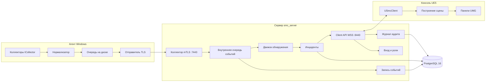
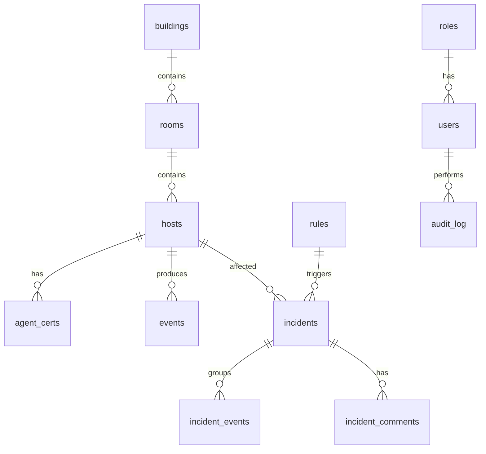
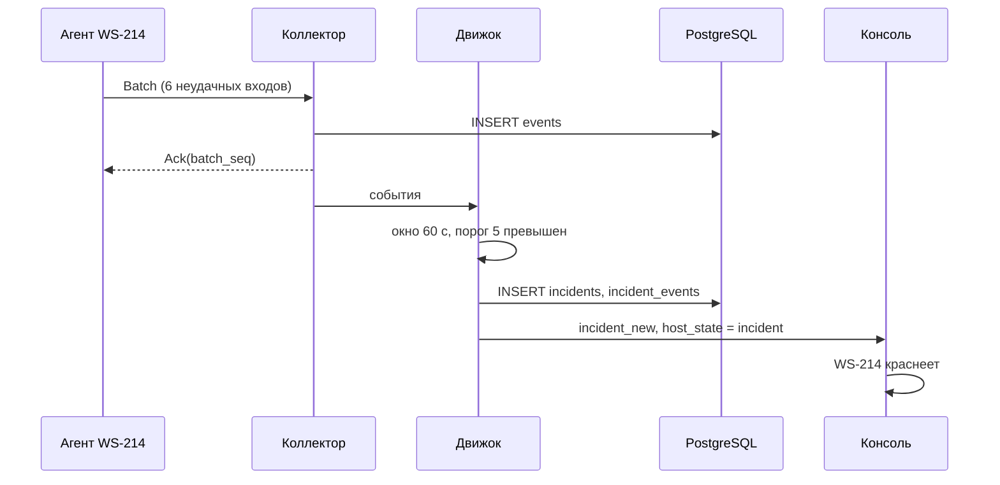
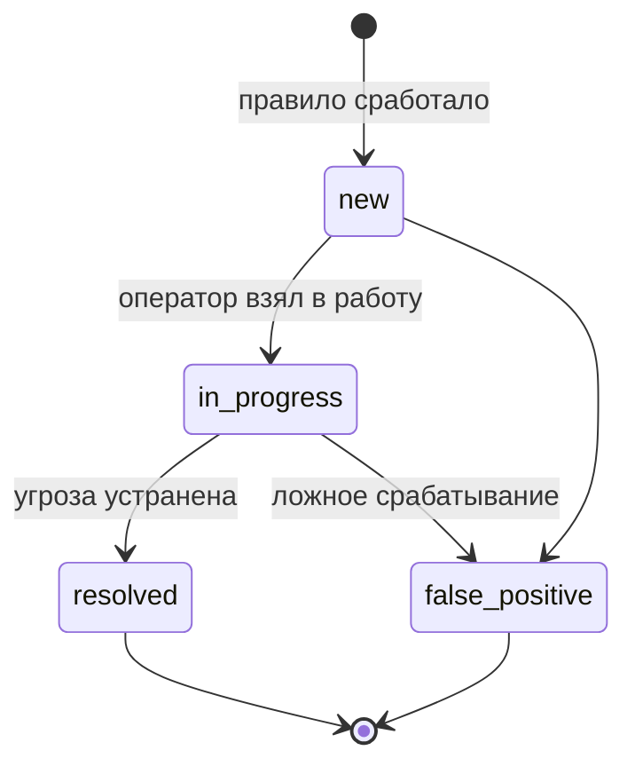
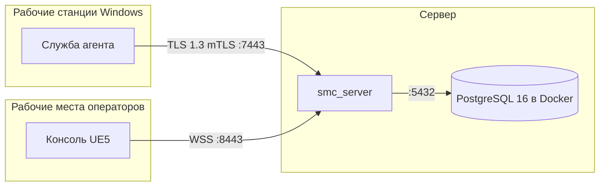

# Описание дизайна программного обеспечения

Для 3D Security Monitoring Center

Версия 0.1

Подготовил Мороз А. А., гр. 434701

БГУИР, Военный факультет

2026-11-18

## Оглавление

<!-- TOC -->
* [1. Введение](#1-введение)
  * [1.1 Назначение документа](#11-назначение-документа)
  * [1.2 Область применения](#12-область-применения)
  * [1.3 Определения, акронимы и сокращения](#13-определения-акронимы-и-сокращения)
  * [1.4 Ссылки](#14-ссылки)
  * [1.5 Обзор документа](#15-обзор-документа)
* [2. Обзор дизайна](#2-обзор-дизайна)
  * [2.1 Задачи стейкхолдеров](#21-задачи-стейкхолдеров)
  * [2.2 Выбранные точки зрения](#22-выбранные-точки-зрения)
* [3. Проектные представления](#3-проектные-представления)
* [4. Решения](#4-решения)
* [5. Приложения](#5-приложения)
<!-- TOC -->

## История изменений

| Name | Date | Reason For Changes | Version |
|------|------|--------------------|---------|
| Мороз А. А. | 2026-11-18 | Первая редакция по SRS версии 0.1 | 0.1 |

---

## 1. Введение

Документ описывает, **как** будет построена система 3D Security Monitoring Center, требования к которой заданы в спецификации [srs/srs.md](../srs/srs.md). Дизайн представлен набором проектных представлений по стандарту IEEE 1016 и ISO/IEC/IEEE 42010, а значимые решения вынесены в записи ADR.

### 1.1 Назначение документа

SDD служит руководством к действию для команды разработчиков: по нему реализуются сервер, агент, база данных и 3D-консоль. Документ используют исполнитель (архитектор и разработчик), junior-разработчик, проверяющий при тестировании и Заказчик при согласовании плана. Требования описаны в SRS, решения – в каталоге [adr](../adr), план реализации – в [plan/plan-v1.md](../plan/plan-v1.md).

### 1.2 Область применения

Описывается версия 1.0 системы: агент для Windows, сервер на C++, база данных PostgreSQL и консоль на Unreal Engine 5. Агент для Linux и автоматическая блокировка атак в версию 1.0 не входят. Дизайн обеспечивает бизнес-цели BG-01 – BG-05 из SRS.

### 1.3 Определения, акронимы и сокращения

| Term | Definition |
|------|------------|
| ADR | Architecture Decision Record – запись архитектурного решения |
| ASIO | Boost.Asio – библиотека асинхронного ввода-вывода C++ |
| HIDS | Host-based Intrusion Detection System – хостовая система обнаружения вторжений |
| mTLS | TLS с проверкой сертификатов обеих сторон |
| Protobuf | Protocol Buffers – формат сериализации сообщений |
| SDD | Software Design Description – документ, описывающий дизайн ПО |
| UE5 | Unreal Engine 5 – игровой движок, на котором строится консоль |
| WSS | WebSocket поверх TLS |

### 1.4 Ссылки

| Документ | Расположение | Вид |
|----------|--------------|-----|
| IEEE 1016-2009 Software Design Description | – | Нормативная |
| ISO/IEC/IEEE 42010 Architecture description | – | Нормативная |
| Спецификация требований | [srs/srs.md](../srs/srs.md) | Нормативная |
| Записи архитектурных решений | [adr](../adr) | Нормативная |
| План реализации | [plan/plan-v1.md](../plan/plan-v1.md) | Справочная |
| Модели SysMLv2 | [srs/models](../srs/models) | Справочная |

### 1.5 Обзор документа

Раздел 2 перечисляет стейкхолдеров и выбранные точки зрения. Раздел 3 содержит проектные представления DV-001 – DV-011 со ссылками на требования SRS. Раздел 4 перечисляет решения, подробно описанные в ADR. Раздел 5 содержит приоритеты функций. Изменения вносятся через запрос на слияние и записываются в историю изменений.

---

## 2. Обзор дизайна

Система построена как набор из четырёх частей: агенты на хостах, один сервер, одна база данных и консоли операторов. Сервер разделён на модули с чёткими границами, обмен между частями идёт по двум собственным протоколам поверх TLS 1.3.

### 2.1 Задачи стейкхолдеров

| Стейкхолдер | Задачи | Где адресуются |
|---|---|---|
| Заказчик | Срок, стоимость, приоритеты функций | Раздел 5, план |
| Оператор безопасности | Быстро увидеть, где инцидент, и разобрать его | DV-006, DV-007 |
| Администратор | Развернуть систему, выпустить сертификаты, менять правила | DV-010, DV-008 |
| Аудитор | Доверять журналу действий | DV-003, ADR-0004 |
| Исполнитель | Понятная модульная структура, тестируемость | DV-002, DV-009 |

### 2.2 Выбранные точки зрения

| Точка зрения | Зачем выбрана | Язык |
|---|---|---|
| Context | Границы системы и акторы | Контекстная диаграмма SysMLv2 |
| Composition | Из каких модулей состоят сервер, агент и консоль | Mermaid flowchart |
| Information | Структура хранимых данных | ER-диаграмма |
| Interface | Контракты протоколов агента и консоли | Таблицы форматов |
| Interaction | Сквозной сценарий обнаружения атаки | Диаграмма последовательности |
| State Dynamics | Состояния инцидента и хоста | Диаграмма состояний |
| Algorithm | Скользящее окно в движке обнаружения | Псевдокод |
| Concurrency | Потоки сервера и доступ к базе | Описание и схема |
| Patterns | Применённые паттерны | Таблица |
| Deployment | Размещение частей на узлах | Mermaid flowchart |

Точки зрения Logical, Physical, Structure, Dependency и Resources отдельно не описываются: их вопросы закрыты представлениями Composition, Deployment и Concurrency.

---

## 3. Проектные представления

- **ID:** DV-001-context
- **Title:** Контекст системы
- **Viewpoint:** Context
- **Representation:** четыре роли пользователей работают через 3D-консоль. Агент получает события от ОС Windows и сертификат от внутреннего УЦ. Внешних сетевых сервисов нет.


- **More Information:** REQ-COMP-002, REQ-FUNC-027. Модель – `srs/models/system-context.sysml`.

- **ID:** DV-002-composition
- **Title:** Состав сервера, агента и консоли
- **Viewpoint:** Composition
- **Representation:**


- **More Information:** REQ-FUNC-010 – REQ-FUNC-015, REQ-MAINT-001. Решения – ADR-0001, ADR-0002, ADR-0003.

- **ID:** DV-003-information
- **Title:** Модель данных
- **Viewpoint:** Information
- **Representation:**



Таблица `events` разбита на партиции по дням и хранит 90 дней. Каждая запись `audit_log` содержит хеш SHA-256 предыдущей записи, поэтому изменение или удаление записи обнаруживается проверкой цепочки.
- **More Information:** REQ-PERF-005, REQ-SEC-005, REQ-SEC-010. Решение – ADR-0004.

- **ID:** DV-004-agent-interface
- **Title:** Протокол агент → сервер
- **Viewpoint:** Interface
- **Representation:** соединение TLS 1.3 с mTLS на порт 7443. Каждое сообщение – кадр с заголовком 10 байт и телом Protobuf.

| Поле | Размер | Значение |
|---|---|---|
| magic | 4 байта | «SMC1» |
| version | 1 байт | версия протокола, сейчас 1 |
| type | 1 байт | Batch, Ack, Heartbeat, Config |
| length | 4 байта | длина тела, не больше 1 МБ |
| payload | length байт | сообщение Protobuf |

Агент отправляет пачки событий с номером `batch_seq` и удаляет пачку из очереди только после подтверждения `Ack`.
- **More Information:** REQ-INT-007, REQ-REL-001, REQ-SEC-008, REQ-SEC-009. Решение – ADR-0002.

- **ID:** DV-005-console-interface
- **Title:** Протокол консоль ↔ сервер
- **Viewpoint:** Interface
- **Representation:** WebSocket поверх TLS 1.3 на порт 8443, сообщения JSON с полями `type`, `id`, `data`.

| Запрос | Ответ | Роли |
|---|---|---|
| login | login_ok | все |
| get_layout | layout | все |
| get_open_incidents | incidents | все |
| get_host, get_host_events | host, host_events | все |
| set_incident_status, add_comment | ok | admin, operator |
| get_audit_log | audit_log | admin, auditor |

Сервер сам рассылает `incident_new`, `incident_update` и `host_state` всем вошедшим консолям.
- **More Information:** REQ-INT-008, REQ-FUNC-015, REQ-SEC-004, REQ-SEC-007. Решение – ADR-0003.

- **ID:** DV-006-brute-force
- **Title:** Сквозной сценарий: перебор пароля
- **Viewpoint:** Interaction
- **Representation:**


- **More Information:** REQ-PERF-001 (до 3 с), REQ-FUNC-011, REQ-FUNC-013, REQ-POC-001.

- **ID:** DV-007-states
- **Title:** Состояния инцидента
- **Viewpoint:** State Dynamics
- **Representation:**



Состояние хоста вычисляется из его инцидентов: `incident`, если есть открытый инцидент высокой важности; `warning` – средней; `silent` – нет heartbeat 90 с; иначе `normal`.
- **More Information:** REQ-FUNC-019, REQ-FUNC-022.

- **ID:** DV-008-sliding-window
- **Title:** Алгоритм правил с окном
- **Viewpoint:** Algorithm
- **Representation:**

```
для каждого события e:
    для каждого правила r, у которого r.match подходит к e:
        key = значения полей r.group_by из e
        окно[r][key].добавить(e.time)
        удалить из окна[r][key] времена старше e.time - r.window
        если размер окна[r][key] >= r.threshold:
            если есть открытый инцидент (r, key): дописать событие в него
            иначе: создать инцидент с важностью r.severity, скорректированной зоной помещения
```

Правила читаются из таблицы `rules` и перечитываются раз в минуту без перезапуска сервера.
- **More Information:** REQ-FUNC-011, REQ-FUNC-012, REQ-FUNC-016.

- **ID:** DV-009-concurrency
- **Title:** Потоки сервера
- **Viewpoint:** Concurrency
- **Representation:** сетевой ввод-вывод выполняется в пуле потоков `boost::asio::io_context` по числу ядер. Каждое соединение обрабатывается через свой `strand`, поэтому обработчики одного соединения не выполняются параллельно. Запросы к базе и проверка паролей Argon2id выполняются в отдельном пуле потоков с пулом соединений, чтобы не блокировать сетевые потоки. Запись журнала аудита идёт в транзакции с `pg_advisory_xact_lock`, что сохраняет порядок цепочки хешей.
- **More Information:** REQ-PERF-001, REQ-PERF-002. Решение – ADR-0005.

- **ID:** DV-010-deployment
- **Title:** Развёртывание
- **Viewpoint:** Deployment
- **Representation:**



Закрытый ключ УЦ хранится вне сервера. Сборка агента и сервера – одна команда CMake с vcpkg.
- **More Information:** REQ-DIST-001, REQ-INST-001, REQ-BUILD-001, REQ-SEC-012.

- **ID:** DV-011-patterns
- **Title:** Применённые паттерны
- **Viewpoint:** Patterns
- **Representation:**

| Паттерн | Где | Зачем |
|---|---|---|
| Strategy | ICollector в агенте | Новый источник событий без изменения агента |
| Publisher – Subscriber | Рассылка изменений консолям | Сервер сам сообщает о событиях |
| Pipeline | Коллектор → очередь → движок | Независимые этапы обработки |
| Repository | Доступ к базе | SQL только в одном слое, параметризованные запросы |
| Data-driven scene | Построение сцены UE5 | Одна сборка консоли для любого здания |

- **More Information:** REQ-MAINT-001, REQ-REUSE-001, REQ-SEC-006.

---

## 4. Решения

Значимые решения оформлены по шаблону MADR в каталоге [adr](../adr).

| ADR | Решение | Затрагивает |
|---|---|---|
| [ADR-0001](../adr/0001-windows-agent-first.md) | Первым реализуется агент для Windows, сбор событий скрыт за ICollector | DV-002 |
| [ADR-0002](../adr/0002-agent-protocol-frame-protobuf.md) | Протокол агента: свой кадр 10 байт и тело Protobuf поверх mTLS | DV-004 |
| [ADR-0003](../adr/0003-console-protocol-wss-json.md) | Протокол консоли: WebSocket поверх TLS, сообщения JSON | DV-005 |
| [ADR-0004](../adr/0004-postgresql-least-privilege.md) | PostgreSQL с отдельными пользователями для приложения и аудита, партиции по дням | DV-003 |
| [ADR-0005](../adr/0005-argon2id-passwords.md) | Пароли хранятся как Argon2id через libsodium | DV-009 |
| [ADR-0006](../adr/0006-unreal-engine-console.md) | Консоль строится на Unreal Engine 5 | DV-002 |

---

## 5. Приложения

### Приоритеты функций

Приоритет задан от 10 (наивысший) до 50 (минимальный). Оценки сроков и распределение по итерациям приведены в [plan/plan-v1.md](../plan/plan-v1.md).

| ID | Feature | Priority | Обоснование |
|---|---|---|---|
| F01 | Server core and database | 10 (Critical) | Критическая основа: без сервера и базы не работает ни одна функция |
| F02 | Secure channels and PKI | 10 (Critical) | Без защищённых каналов нельзя подключать агентов |
| F03 | Login and role-based access | 10 (Critical) | Все действия консоли выполняются от имени пользователя |
| F04 | Windows agent | 10 (Critical) | Источник всех событий |
| F05 | Detection engine | 10 (Critical) | Главная функция системы |
| F07 | Live updates for consoles | 10 (Critical) | Без рассылки консоль не узнает об инцидентах |
| F08 | 3D scene from data | 10 (Critical) | Ключевое отличие продукта (BG-01) |
| F09 | Incident handling UI | 10 (Critical) | Работа оператора с инцидентом |
| F06 | Agent silent incident | 20 (High) | Защита от отключения агента |
| F10 | Tamper-evident audit log | 20 (High) | Контроль действий операторов (BG-04) |
| F18 | Testing and release | 20 (High) | Подтверждение требований к производительности и безопасности |
| F11 | Zone-aware severity | 30 (Medium) | Уточняет важность, но не блокирует остальное |
| F12 | Off-shift logon detection | 30 (Medium) | Дополнительное правило обнаружения |
| F15 | File integrity and account changes | 30 (Medium) | Дополнительные источники событий |
| F13 | Incident timeline replay | 40 (Low) | Удобство расследования |
| F14 | Administration screens | 40 (Low) | Можно временно заменить настройкой в базе |
| F16 | Network port monitoring | 50 (Optional) | Низкий приоритет у Заказчика |
| F17 | Second factor (TOTP) | 50 (Optional) | Необязательная мера защиты |
