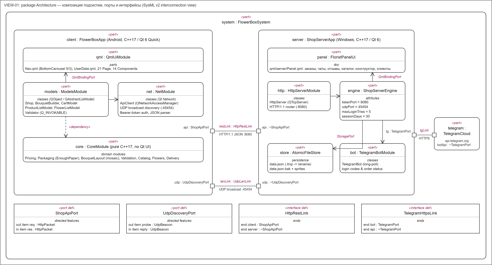
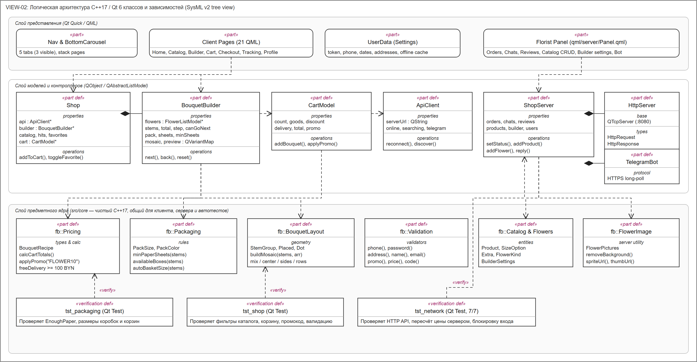
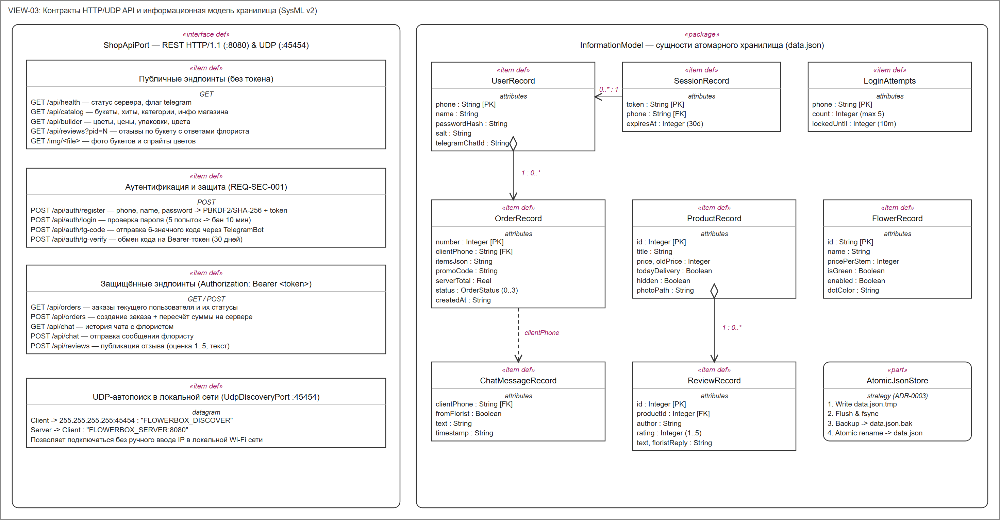
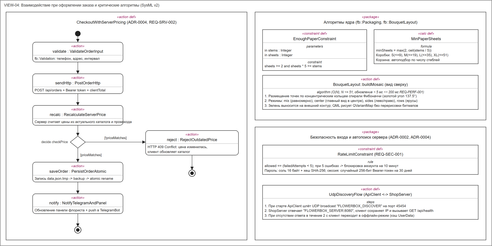
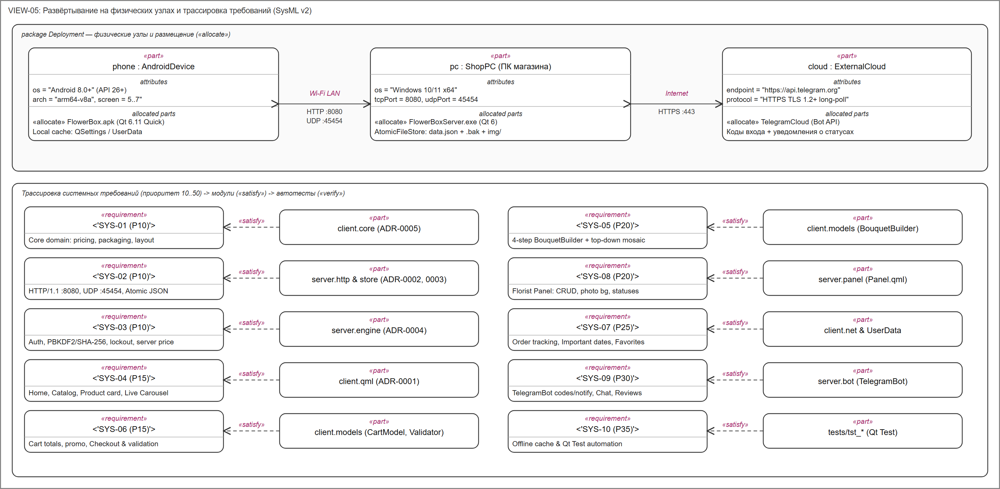

# Описание дизайна программного обеспечения (SDD)

Для мобильного приложения и серверной системы **FlowerBox** (магазин цветов)

Версия 1.0

Подготовил Санкевич А.Д., гр. 434701

БГУИР, ФКСиС, кафедра ЭВМ

24.11.2026

## Оглавление

<!-- TOC -->
* [1. Введение](#1-introduction)
  * [1.1 Назначение документа](#11-document-purpose)
  * [1.2 Область применения](#12-subject-scope)
  * [1.3 Определения, акронимы и сокращения](#13-definitions-acronyms-and-abbreviations)
  * [1.4 Ссылки](#14-references)
  * [1.5 Обзор документа](#15-document-overview)
* [2. Обзор дизайна и системные требования](#2-design-overview)
  * [2.1 Задачи стейкхолдеров](#21-stakeholder-concerns)
  * [2.2 Системные требования и приоритизация функционала (10–50)](#22-system-requirements)
  * [2.3 Выбранные точки зрения (ISO/IEC/IEEE 42010)](#23-selected-viewpoints)
* [3. Проектные представления (Design Views)](#3-design-views)
  * [VIEW-01: Композиция подсистем, порты и интерфейсы](#view-01)
  * [VIEW-02: Логическая архитектура C++17 / Qt 6 классов](#view-02)
  * [VIEW-03: Контракты HTTP/UDP API и информационная модель](#view-03)
  * [VIEW-04: Взаимодействие при оформлении заказа и критические алгоритмы](#view-04)
  * [VIEW-05: Физическое развёртывание и трассировка требований](#view-05)
* [4. Архитектурные решения (ADR)](#4-decisions)
* [5. Приложения](#5-appendixes)
<!-- TOC -->

## История изменений

| Автор | Дата | Причина изменений | Версия |
|-------|------|-------------------|--------|
| Санкевич А.Д. | 18.11.2026 | Первичная версия SDD на основе согласованного SRS v0.1: системные требования, приоритеты 10–50, 5 проектных представлений и ADR-0001..0005 | 0.1 |
| Санкевич А.Д. | 21.11.2026 | Обновление после 1-го раунда переговоров с заказчиком: оптимизация алгоритма конструктора (мозаика вместо 3D-рендера), уточнение приоритетов и итерационного плана v1 | 0.2 |
| Санкевич А.Д. | 24.11.2026 | Обновление после 2-го раунда переговоров: исключена онлайн-карта курьера, добавлены панель флориста (`SYS-08`) и Telegram-бот с чатом (`SYS-09`), подключён junior-разработчик, утверждён план v3 | 1.0 |

---

## 1. Введение {#1-introduction}

### 1.1 Назначение документа {#11-document-purpose}

Настоящее описание дизайна программного обеспечения (Software Design Description, SDD) фиксирует системные требования, программную архитектуру, интерфейсы, модель данных, ключевые алгоритмы и схему развёртывания системы **FlowerBox 1.0**. Документ составлен в соответствии со стандартами IEEE 1016-2009 и ISO/IEC/IEEE 42010:2011 на основе согласованной спецификации требований [srs/srs.md](../srs/srs.md) и модели [srs/flowerbox.sysml](../srs/flowerbox.sysml). SDD является руководством к действию для архитектора, разработчиков (основного и подключаемого junior-разработчика) и тестировщиков, а также базой для планирования итераций и согласования сроков с заказчиком.

### 1.2 Область применения {#12-subject-scope}

Проектируемая система **FlowerBox 1.0** состоит из двух взаимодействующих программных приложений на едином стеке C++17 / Qt 6:
1. **FlowerBoxApp** — мобильное Android-приложение покупателя (Android 8.0+, API 26+, Qt 6 Quick / QML): главный экран, каталог с поиском/фильтрами/сортировкой, карточка букета, 4-шаговый конструктор букетов с мозаикой «вид сверху» и правилами упаковки, корзина с промокодами, оформление и отслеживание заказа, важные даты с напоминаниями, избранное, отзывы и чат с флористом.
2. **FlowerBoxServer** — локальный сервер магазина (`FlowerBoxServer.exe`, Windows x64, Qt 6) с встроенным HTTP/1.1 API, UDP-автообнаружением в локальной сети, атомарным файловым хранилищем, настольной панелью флориста (`qml/server/Panel.qml`) и опциональной интеграцией с Telegram Bot API.

**Вне границ версии 1.0:** реальный интернет-эквайринг банковских карт (оплата имитируется / при получении), GPS-трекинг курьера на карте в реальном времени (исключён во 2-м раунде переговоров в пользу панели флориста), версия под iOS и отдельный веб-сайт.

### 1.3 Определения, акронимы и сокращения {#13-definitions-acronyms-and-abbreviations}

| Термин | Определение |
|--------|-------------|
| ADR | Architecture Decision Record — запись значимого архитектурного решения в формате MADR |
| API | Application Programming Interface — программный интерфейс взаимодействия клиента и сервера (HTTP/1.1 JSON) |
| APK | Android Package — установочный пакет приложения для ОС Android |
| BYN | Белорусский рубль — валюта расчётов в системе FlowerBox |
| LAN | Local Area Network — локальная Wi-Fi сеть цветочного магазина |
| MADR | Markdown Architectural Decision Records — легковесный формат фиксации архитектурных решений |
| QML | Qt Modeling Language — декларативный язык описания пользовательского интерфейса в Qt Quick |
| SDD | Software Design Description — документ описания архитектуры и проектирования ПО (IEEE 1016) |
| SRS | Software Requirements Specification — спецификация бизнес- и пользовательских требований ПО |
| SysML v2 | OMG Systems Modeling Language 2.0 — язык текстового и графического системного моделирования |
| UDP Broadcast | Широковещательный пакет UDP (порт 45454) для автоматического поиска сервера в локальной сети |

### 1.4 Ссылки {#14-references}

| Документ | Владелец | Расположение | Тип |
|----------|----------|--------------|-----|
| Спецификация требований SRS FlowerBox v0.1 | Санкевич А.Д. | [`srs/srs.md`](../srs/srs.md) | Нормативный |
| Модель требований SysML v2 (ЛР №3) | Санкевич А.Д. | [`srs/flowerbox.sysml`](../srs/flowerbox.sysml) | Нормативный |
| Архитектурная модель дизайна SysML v2 (ЛР №4) | Санкевич А.Д. | [`sdd/flowerbox-design.sysml`](flowerbox-design.sysml) | Нормативный |
| План итераций, переписка с заказчиком и смета | Санкевич А.Д. | [`sdd/planning.md`](planning.md) | Нормативный |
| Шаблон SDD (IEEE 1016 / ISO 42010) | Кафедра ЭВМ БГУИР | [`sdd/sdd-template.md`](sdd-template.md) | Нормативный |
| Шаблон ADR (MADR) | Кафедра ЭВМ БГУИР | [`adr/adr-template.md`](../adr/adr-template.md) | Нормативный |
| Реестр архитектурных решений | Санкевич А.Д. | [`adr/0001..0005-*.md`](../adr/) | Нормативный |

### 1.5 Обзор документа {#15-document-overview}

Раздел 2 определяет интересы стейкхолдеров, сводный перечень системных требований с ранжированием приоритетов от 10 до 50 (на английском языке согласно заданию) и выбранные архитектурные точки зрения. Раздел 3 содержит 5 проектных представлений (`VIEW-01`–`VIEW-05`), сопровождаемых диаграммами в графической нотации SysML v2. Раздел 4 резюмирует 5 принятых архитектурных решений (ADR). Раздел 5 содержит ссылки на приложения (текстовую модель SysML v2, исходники диаграмм и протокол планирования).

---

## 2. Обзор дизайна и системные требования {#2-design-overview}

### 2.1 Задачи стейкхолдеров {#21-stakeholder-concerns}

| Стейкхолдер | Ключевые задачи и интересы (Concerns) | Адресующие представления и ADR |
|-------------|---------------------------------------|-------------------------------|
| Владелец магазина (Заказчик) | Попадание в фиксированный deadline и бюджет; рост среднего чека через конструктор (BG-2); автономное управление каталогом без программиста (REQ-SRV-001); защита от подмены цен (REQ-SRV-002) | `VIEW-01`, `VIEW-04`, `VIEW-05`, `ADR-0001`, `ADR-0004`, `planning.md` |
| Покупатель | Быстрый запуск (≤ 3 с), плавный интерфейс (живая карусель 5/3), понятная мозаика букета, отсутствие потери корзины без сети, автоподключение к серверу | `VIEW-01`, `VIEW-04`, `ADR-0002`, `ADR-0005` |
| Флорист | Простой запуск сервера одним файлом без настройки БД, удобная панель заказов/чатов/каталога, соблюдение правил упаковки бумаги и коробок | `VIEW-01`, `VIEW-03`, `VIEW-05`, `ADR-0001`, `ADR-0003` |
| Команда разработки (Архитектор + Junior) | Чёткое разделение ядра C++17 и QML UI для параллельной работы, быстрые модульные тесты, прозрачные HTTP/JSON контракты | `VIEW-02`, `VIEW-03`, `VIEW-05`, `ADR-0001`, `ADR-0005` |

### 2.2 Системные требования и приоритизация функционала (10–50) {#22-system-requirements}

Согласно методическим указаниям, приоритеты функциональных и системных требований ранжируются от **10** (наивысший, критическое ядро) до **50** (минимальный / отложено). Итоговые приоритеты отражают согласованную версию после двух раундов переговоров с заказчиком (см. [`sdd/planning.md`](planning.md)).

| Sys ID | Feature / System Requirement (EN) | Тип | Приоритет (10–50) | Связь с SRS | Оценка, ч | Ответственный модуль |
|--------|-----------------------------------|-----|-------------------|-------------|-----------|----------------------|
| **SYS-01** | Pure C++17 domain core: pricing, packaging rules (`EnoughPaper`), top-down mosaic layout, input validation | Func / NFR | **10** | REQ-FUNC-005, 007, 008, 017 | 24 | `src/core/*` |
| **SYS-02** | Embedded HTTP/1.1 `QTcpServer` (:8080), UDP LAN discovery (:45454), atomic JSON file store with `.bak` | Infra / NFR | **10** | REQ-INT-005, REQ-REL-001 | 32 | `src/server/HttpServer`, `ShopServer` |
| **SYS-03** | Authentication & security: salted password hashing, 5-try / 10-min lockout, 30-day Bearer sessions, server-side price recalculation | Sec / Func | **10** | REQ-FUNC-001, REQ-SEC-001, 002, REQ-SRV-002 | 20 | `ShopServer`, `ApiClient` |
| **SYS-04** | Home screen, Catalog (categories, search, sort, filters), Product card (S/M/L, extras), Live 5/3 Bottom Carousel | Func / UI | **15** | REQ-FUNC-002, 003, 004, REQ-INT-002 | 28 | `qml/pages/`, `ProductListModel` |
| **SYS-06** | Cart with promo codes (`FLOWER10`, free delivery ≥ 100 BYN), Checkout form, field validation, delivery slots | Func | **15** | REQ-FUNC-008, 009, 017 | 24 | `CartModel`, `Validator`, `CheckoutSheet` |
| **SYS-05** | 4-step Bouquet Builder UI with interactive dot mosaic, conditional arrangement step (≥ 2 kinds), packaging & color | Func | **20** | REQ-FUNC-005, 006, 007 | 36 | `BouquetBuilder`, `BuilderPage.qml` |
| **SYS-08** | Desktop Florist Panel (QML): catalog & flowers CRUD, photo background removal, order status switching, client list | Func (added R2) | **20** | REQ-SRV-001 | 40 | `qml/server/Panel.qml`, `FlowerImage` |
| **SYS-07** | Order status tracking (accepted → assembled → delivering → handed), Important Dates with reminders, Favorites | Func | **25** | REQ-FUNC-010, 011, 012 | 24 | `TrackingPage`, `UserData`, `Shop` |
| **SYS-09** | Telegram Bot long-polling (login codes & order status notifications), Florist support chat, Product reviews | Func (added R2) | **30** | REQ-FUNC-001, 015, 016 | 28 | `TelegramBot`, `SupportPage`, `ReviewsPage` |
| **SYS-10** | Offline catalog cache, local state recovery, automated Qt Test suite (`tst_packaging`, `tst_shop`, `tst_network`), APK build | NFR / QA | **35** | REQ-AVAIL-001, REQ-REL-001, REQ-PERF-001, 002 | 20 | `UserData`, `tests/*`, `build_all.bat` |
| **SYS-11** | Loyalty bonus points accrual/redemption & client tiers | Func (Could) | **45** | REQ-FUNC-014 | 16 | Отложено в v1.1 |
| **SYS-12** | Real-time courier GPS map tracking (OpenStreetMap) & bank online acquiring | Func (Dropped R2) | **50** | REQ-FUNC-010 (map), CON-4 | 48 | Исключено из v1.0 |

**Нефункциональные системные требования (сводка):**
- **Производительность (`REQ-PERF-001`, `REQ-PERF-002`):** холодный запуск ≤ 3 с; расчёт мозаики `BouquetLayout::buildMosaic` за O(N) при N ≤ 51 (< 5 мс при лимите 200 мс); размер APK ≤ 60 МБ.
- **Безопасность (`REQ-SEC-001`, `REQ-SEC-002`, `REQ-SRV-002`):** хранение паролей в виде солёного хеша; блокировка входа на 10 мин после 5 ошибок; срок жизни токена 30 дней; пересчёт суммы на сервере (`HTTP 409` при несовпадении); запрет хранения реквизитов карт (CON-4).
- **Надёжность и доступность (`REQ-REL-001`, `REQ-AVAIL-001`, `REQ-INT-005`):** атомарная запись `data.json.tmp` → `rename` + `.bak`; таймаут HTTP-запросов 10 с; оффлайн-просмотр кэшированного каталога, корзины и важных дат.
- **Сопровождаемость и переносимость (`CON-1`, `CON-2`):** чистый C++17 в `src/core`, сборка CMake + Qt 6.11 под Windows (MinGW) и Android (NDK 27, API 26–36).

### 2.3 Выбранные точки зрения (ISO/IEC/IEEE 42010) {#23-selected-viewpoints}

Из 15 стандартных точек зрения IEEE 1016 / ISO 42010 для системы FlowerBox отобраны 6 ключевых, сгруппированных в 5 проектных представлений на языке **SysML v2**:

1. **Контекст и композиция (Context & Composition)** — границы системы, декомпозиция клиента и сервера на подсистемы, порты и каналы связи (`VIEW-01`).
2. **Логическое представление и зависимости (Logical & Dependency)** — трёхслойная структура классов C++17 / Qt 6 и граф зависимостей к автотестам (`VIEW-02`).
3. **Интерфейсы и информация (Interface & Information)** — контракты REST HTTP/1.1 и UDP-протокола, а также сущности атомарного файлового хранилища (`VIEW-03`).
4. **Взаимодействие и алгоритмы (Interaction & Algorithm)** — сценарий оформления заказа с серверным пересчётом цены, правила упаковки, алгоритм мозаики и защита входа (`VIEW-04`).
5. **Развёртывание и трассировка (Deployment & Traceability)** — размещение компонентов на физических узлах (Android-смартфон, ПК магазина, Telegram Cloud) и матрица `satisfy` системных требований (`VIEW-05`).

---

## 3. Проектные представления (Design Views) {#3-design-views}

Все диаграммы ниже построены в официальной графической нотации **OMG SysML v2** (определения `def` — прямоугольники с острыми углами, использования `usage` — со скруглёнными углами, порты — квадраты на границе, связи `satisfy` / `allocate` / `dependency` / `verify` — пунктирные стрелки) по текстовой модели [`sdd/flowerbox-design.sysml`](flowerbox-design.sysml).

### VIEW-01: Композиция подсистем, порты и интерфейсы {#view-01}

- **ID:** `VIEW-01-composition`
- **Title:** Композиция подсистем `FlowerBoxSystem`, порты и интерфейсы взаимодействия
- **Viewpoint:** Context, Composition, Structure
- **Реализуемые требования SRS:** `CON-1`, `REQ-INT-002`, `REQ-INT-005`, `REQ-SRV-001`, `REQ-SRV-002`
- **Связанные ADR:** `ADR-0001`, `ADR-0002`, `ADR-0005`
- **Representation:**

Система `FlowerBoxSystem` состоит из трёх верхнеуровневых частей: мобильного клиента `client : FlowerBoxApp`, сервера магазина `server : ShopServerApp` и внешнего облачного сервиса `telegram : TelegramCloud`. Клиент разделён на 4 модуля (`qml`, `models`, `net`, `core`), сервер — на 5 модулей (`panel`, `http`, `engine`, `store`, `bot`). Между клиентом и сервером определены два типизированных интерфейса: `restLink : HttpRestLink` (HTTP/1.1 JSON, порт 8080) и `lanLink : UdpLanLink` (UDP broadcast, порт 45454).

- **More Information:** текстовое описание портов и соединений находится в пакете `FlowerBoxDesign::Architecture` файла [`flowerbox-design.sysml`](flowerbox-design.sysml).

---

### VIEW-02: Логическая архитектура C++17 / Qt 6 классов {#view-02}

- **ID:** `VIEW-02-logical`
- **Title:** Трёхслойная логическая архитектура классов и зависимостей к автотестам
- **Viewpoint:** Logical, Dependency, Patterns (MVVM/MVC)
- **Реализуемые требования SRS:** `CON-1`, `REQ-FUNC-003..008`, `REQ-FUNC-017`, `REQ-SRV-001`
- **Связанные ADR:** `ADR-0001`, `ADR-0005`
- **Representation:**

Архитектура организована в три строгих слоя с однонаправленными зависимостями сверху вниз:
1. **Слой представления (`qml/`):** `Nav.qml` + `BottomCarousel.qml` (5 вкладок, 3 видимых), 21 страница покупателя, `UserData.qml` и настольная панель флориста `qml/server/Panel.qml`.
2. **Слой Qt-моделей и контроллеров (`src/models/`, `src/net/`, `src/server/`):** классы `Shop`, `BouquetBuilder`, `CartModel`, `ProductListModel`, `FlowerListModel`, `ApiClient`, `Validator` на клиенте; `ShopServer`, `HttpServer`, `TelegramBot` на сервере.
3. **Слой предметного ядра (`src/core/`):** чистый C++17 без зависимостей от GUI (`fb::Pricing`, `fb::Packaging`, `fb::BouquetLayout`, `fb::Validation`, `fb::Catalog`, `fb::Flowers`, `fb::Delivery`, а также серверная утилита `fb::FlowerImage`). Общее ядро напрямую покрывается наборами автотестов `tst_packaging`, `tst_shop` и `tst_network`.

- **More Information:** исходные коды классов располагаются в `src/core/`, `src/models/`, `src/net/`, `src/server/` ветки `dev`.

---

### VIEW-03: Контракты HTTP/UDP API и информационная модель {#view-03}

- **ID:** `VIEW-03-interface-info`
- **Title:** Спецификация программных интерфейсов и информационная модель хранилища
- **Viewpoint:** Interface, Information
- **Реализуемые требования SRS:** `REQ-FUNC-001`, `REQ-FUNC-003`, `REQ-FUNC-009`, `REQ-FUNC-015`, `REQ-FUNC-016`, `REQ-REL-001`, `REQ-SEC-001`
- **Связанные ADR:** `ADR-0002`, `ADR-0003`, `ADR-0004`
- **Representation:**

Интерфейс `ShopApiPort` разделён на три группы маршрутов: публичные (`GET /api/health`, `/api/catalog`, `/api/builder`, `/api/reviews`, `/img/<file>`), аутентификационные (`/api/auth/register`, `/login`, `/tg-code`, `/tg-verify`) и защищённые заголовком `Authorization: Bearer <token>` (`/api/orders`, `/api/chat`, `POST /api/reviews`). Для автопоиска в локальной сети используется UDP-датаграмма `FLOWERBOX_DISCOVER` → `FLOWERBOX_SERVER:8080`.

Информационная модель `InformationModel` описывает 8 персистентных сущностей (`UserRecord`, `SessionRecord`, `LoginAttempts`, `OrderRecord`, `ProductRecord`, `FlowerRecord`, `ChatMessageRecord`, `ReviewRecord`), сохраняемых атомарно (`data.json.tmp` → `fsync` → `data.json.bak` → `rename`).

- **More Information:** пакет `FlowerBoxDesign::InformationModel` в [`flowerbox-design.sysml`](flowerbox-design.sysml).

---

### VIEW-04: Взаимодействие при оформлении заказа и критические алгоритмы {#view-04}

- **ID:** `VIEW-04-interaction-algo`
- **Title:** Динамика оформления заказа с серверной проверкой цены, алгоритм упаковки и мозаики
- **Viewpoint:** Interaction, Algorithm, State Dynamics
- **Реализуемые требования SRS:** `REQ-FUNC-005`, `REQ-FUNC-006`, `REQ-FUNC-007`, `REQ-FUNC-009`, `REQ-SRV-002`, `REQ-SEC-001`, `REQ-PERF-001`
- **Связанные ADR:** `ADR-0002`, `ADR-0004`, `ADR-0005`
- **Representation:**

Представление фиксирует три критических алгоритма системы:
1. **Оформление заказа (`CheckoutWithServerPricing`):** валидация полей (`fb::Validation`) → `POST /api/orders` → пересчёт суммы сервером по актуальным ценам каталога и промокоду → при несовпадении возврат `HTTP 409 Conflict` (заказ не принимается), при совпадении — атомарная запись и уведомление панели флориста и Telegram-бота.
2. **Упаковка и мозаика (`EnoughPaperConstraint`, `BouquetLayout::buildMosaic`):** расчёт минимального числа листов бумаги `max(2, ceil(stems / 5))`, фильтрация размеров коробок S/M/L/XL и размещение до 51 стебля по спирали Фибоначчи (золотой угол 137.5°) за время O(N) (< 5 мс).
3. **Защита входа и автопоиск (`RateLimitConstraint`, `UdpDiscoveryFlow`):** блокировка после 5 ошибок на 10 минут и переход в оффлайн-кэш при отсутствии UDP-ответа за 2 с.

- **More Information:** пакет `FlowerBoxDesign::RuntimeBehavior` в [`flowerbox-design.sysml`](flowerbox-design.sysml).

---

### VIEW-05: Физическое развёртывание и трассировка требований {#view-05}

- **ID:** `VIEW-05-deployment-trace`
- **Title:** Топология развёртывания на узлах и матрица трассировки системных требований
- **Viewpoint:** Deployment, Physical, Traceability
- **Реализуемые требования SRS:** `CON-2`, `REQ-INT-004`, `REQ-AVAIL-001`, `SYS-01`–`SYS-10`
- **Связанные ADR:** `ADR-0001`, `ADR-0002`, `ADR-0003`
- **Representation:**

Программные компоненты распределяются (`allocate`) по трём физическим узлам: смартфон покупателя (`AndroidDevice`, `FlowerBox.apk`), рабочий ПК магазина (`ShopPC`, Windows 10/11, `FlowerBoxServer.exe`, порты 8080/45454) и внешнее облако Telegram (`ExternalCloud`, HTTPS :443). Нижняя часть диаграммы показывает прослеживаемость (`satisfy`) всех 10 системных требований (`SYS-01`–`SYS-10` с приоритетами 10–35) на конкретные модули и архитектурные решения.

- **More Information:** пакет `FlowerBoxDesign::Deployment` в [`flowerbox-design.sysml`](flowerbox-design.sysml).

---

## 4. Архитектурные решения (ADR) {#4-decisions}

Полные записи архитектурных решений оформлены в формате MADR в каталоге [`adr/`](../adr/). Ниже приведён их сводный реестр:

| ID | Заголовок | Статус | Ключевой итог | Файл |
|----|-----------|--------|---------------|------|
| **ADR-0001** | Единый стек C++17 / Qt 6 Quick для клиента и сервера | Accepted | Отказ от Node.js; общее ядро `src/core` и единый бинарник `FlowerBoxServer.exe` | [`0001-cpp-qt-unified-stack.md`](../adr/0001-cpp-qt-unified-stack.md) |
| **ADR-0002** | Встроенный HTTP/1.1 сервер на `QTcpServer` и UDP-автопоиск | Accepted | HTTP :8080 + UDP broadcast :45454 на стандартном `Qt6::Network` без ручной настройки IP | [`0002-embedded-http-and-udp-discovery.md`](../adr/0002-embedded-http-and-udp-discovery.md) |
| **ADR-0003** | Атомарное файловое хранилище JSON с резервной копией | Accepted | `data.json.tmp` → `rename` + `.bak` вместо внешней СУБД; нулевое администрирование | [`0003-atomic-json-file-storage.md`](../adr/0003-atomic-json-file-storage.md) |
| **ADR-0004** | Серверный пересчёт цены, защита входа и Telegram-бот | Accepted | `HTTP 409` при устаревшей цене; 5 попыток / 10 мин; 30-дневные токены; бесплатный Telegram long-poll | [`0004-server-side-pricing-and-auth-protection.md`](../adr/0004-server-side-pricing-and-auth-protection.md) |
| **ADR-0005** | Трёхслойная архитектура клиента (`core` / `models` / `qml`) | Accepted | Изоляция C++17 ядра для быстрых автотестов и параллельной работы с junior-разработчиком | [`0005-layered-core-models-qml-architecture.md`](../adr/0005-layered-core-models-qml-architecture.md) |

---

## 5. Приложения {#5-appendixes}

- **Приложение A:** Архитектурная модель SysML v2 — [`sdd/flowerbox-design.sysml`](flowerbox-design.sysml).
- **Приложение B:** Исходники генератора и векторных диаграмм SysML v2 — [`sdd/img/src/`](img/src/).
- **Приложение C:** Переписка с заказчиком (раунды 1 и 2), разработанный (v1), изменённый (v2) и согласованный (v3) планы итераций, расчёт бюджета с подключением junior-разработчика — [`sdd/planning.md`](planning.md).
