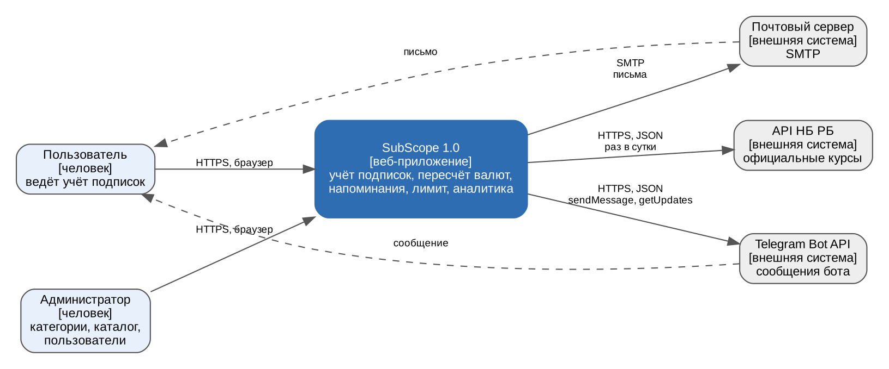
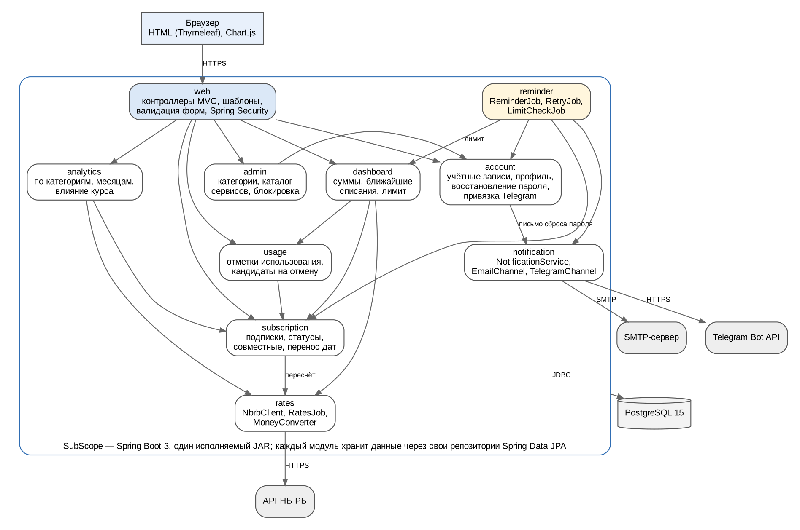
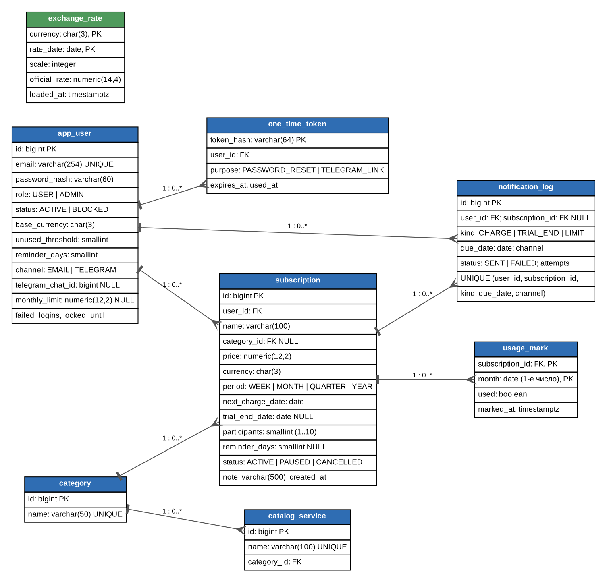
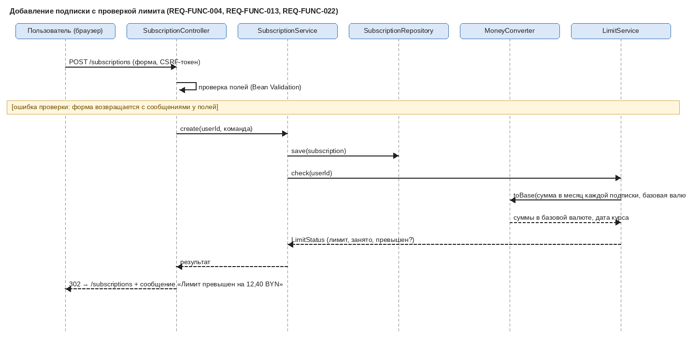
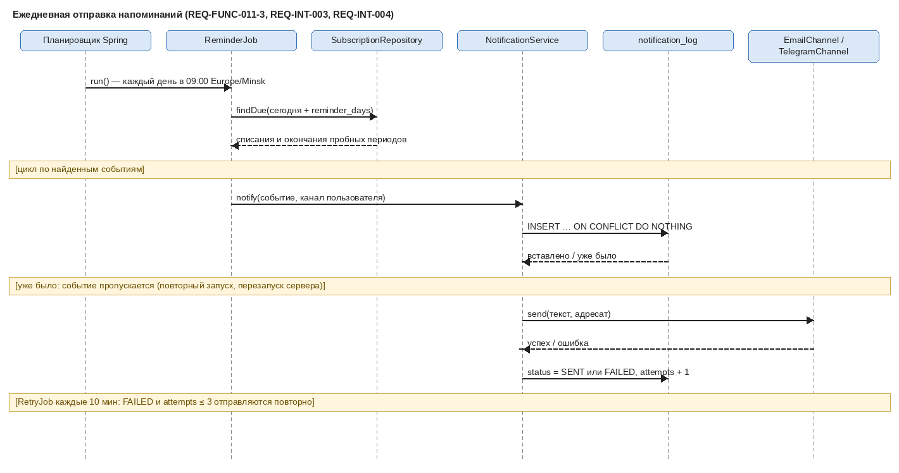
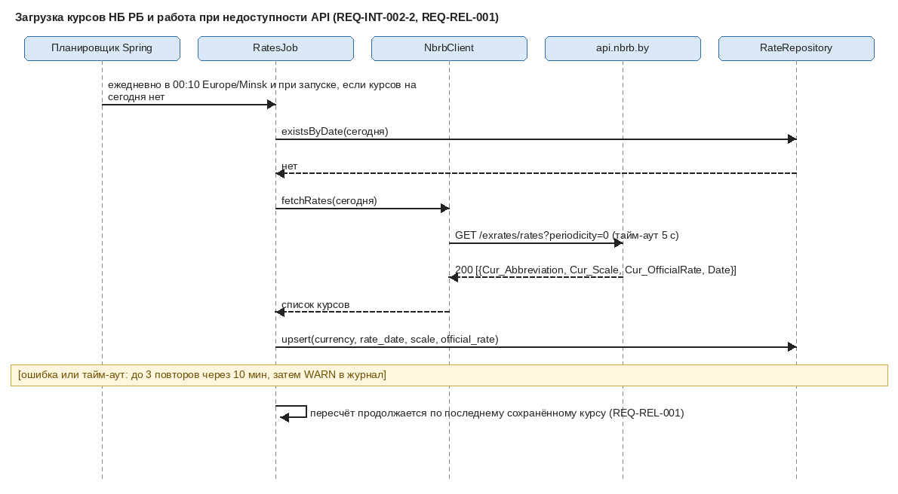
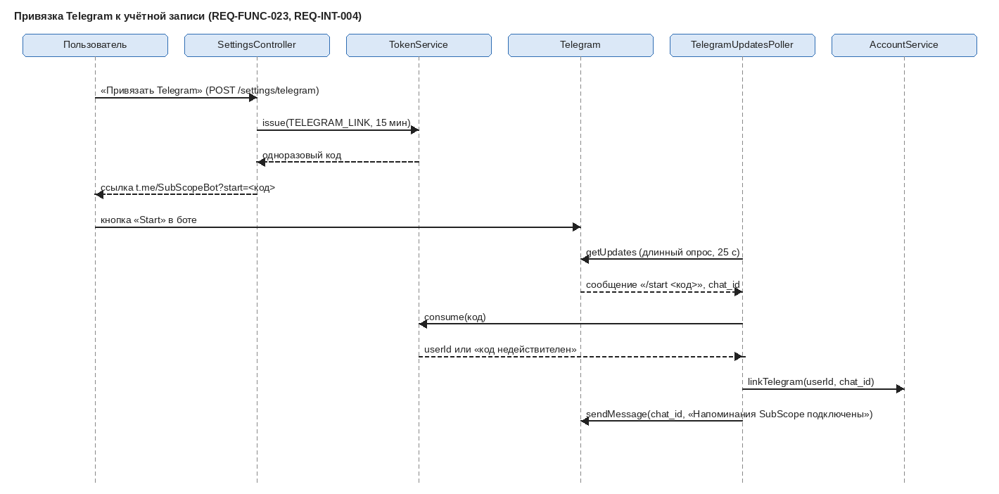
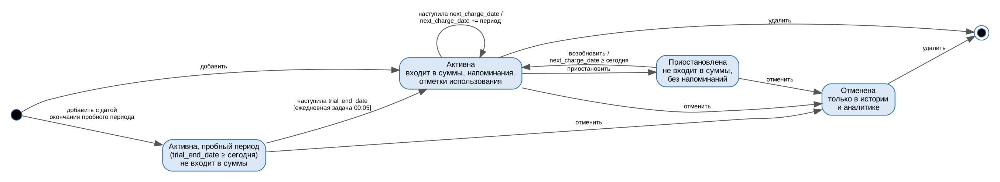
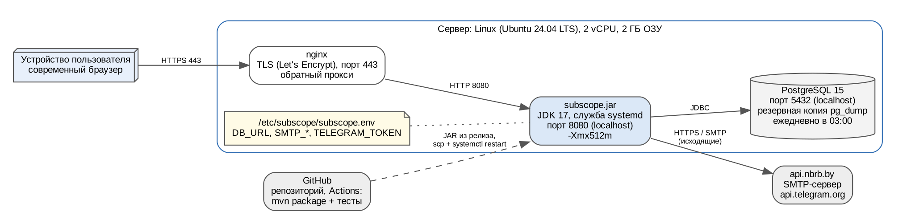

# Описание дизайна программного обеспечения

Для SubScope — веб-приложения для учёта подписок и регулярных платежей

Версия 0.3

Подготовил Родкевич Н.А., гр. 434701

БГУИР, факультет компьютерных систем и сетей, кафедра ЭВМ

2026-11-16

## Оглавление

<!-- TOC -->
* [1. Введение](#1-introduction)
  * [1.1 Назначение документа](#11-document-purpose)
  * [1.2 Область применения](#12-subject-scope)
  * [1.3 Определения, акронимы и сокращения](#13-definitions-acronyms-and-abbreviations)
  * [1.4 Ссылки](#14-references)
  * [1.5 Обзор документа](#15-document-overview)
* [2. Обзор дизайна](#2-design-overview)
  * [2.1 Задачи стейкхолдеров](#21-stakeholder-concerns)
  * [2.2 Выбранные точки зрения](#22-selected-viewpoints)
  * [2.3 Системные требования и приоритеты](#23-system-requirements)
    * [2.3.1 Функциональные системные требования](#231-functional-system-requirements)
    * [2.3.2 Нефункциональные системные требования](#232-non-functional-system-requirements)
* [3. Проектные представления](#3-design-views)
* [4. Решения](#4-decisions)
* [5. Приложения](#5-appendixes)
<!-- TOC -->

## История изменений

| Name          | Date       | Reason For Changes                                                                                                                                                                                                                       | Version |
|---------------|------------|------------------------------------------------------------------------------------------------------------------------------------------------------------------------------------------------------------------------------------------|---------|
| Родкевич Н.А. | 2026-11-12 | Первоначальная версия по SRS v0.3: системные требования SYS-F-00…SYS-F-11 и SYS-NF-01…SYS-NF-07 с приоритетами, представления 001–012, решения ADR-0001…0006                                                                                  | 0.1     |
| Родкевич Н.А. | 2026-11-14 | Первый раунд обсуждения с Заказчиком: приоритеты SYS-F-06 (10), SYS-F-09 (40), SYS-F-10 (30), SYS-F-08 (50); влияние курса — по курсам на первое число месяца (007-algorithm); начальный справочник категорий — миграцией; подсказки каталога — элемент `datalist` | 0.2     |
| Родкевич Н.А. | 2026-11-16 | Второй раунд: SYS-F-08 «CSV export» исключено из релиза 1.0; новые SYS-F-12 «Telegram reminders» и SYS-F-13 «Monthly spending limit»; модуль `notification` с каналами e-mail и Telegram; ADR-0007; согласованный план v3                     | 0.3     |

---

## 1. Введение {#1-introduction}

Документ описывает, **как** будет построено веб-приложение SubScope версии 1.0, требования к которому зафиксированы в [SRS](../srs/srs.md).

### 1.1 Назначение документа {#11-document-purpose}

SDD переводит требования SRS v0.4 в системные требования с приоритетами и в архитектуру: модули, данные, интерфейсы, взаимодействие и размещение. Документ используется разработчиками (middle и junior) как руководство при реализации, преподавателем и напарником — при рецензировании, а Заказчиком — как основа оценки сроков и стоимости (раздел 2.3 и [план](../plan/plan.md)). Обоснование значимых решений вынесено в протоколы [ADR](../adr/).

### 1.2 Область применения {#12-subject-scope}

**Система:** SubScope, релиз 1.0 — личный трекер подписок с пересчётом расходов в базовую валюту по официальному курсу НБ РБ, напоминаниями на e-mail и в Telegram, месячным лимитом расходов, контролем использования и аналитикой.

SDD охватывает всю систему: серверное приложение, его базу данных, интеграции с API НБ РБ, SMTP-сервером и Telegram Bot API, а также развёртывание на сервере. Не рассматриваются: мобильное приложение, импорт банковских выписок, семейный учёт, экспорт и импорт CSV (отложены, раздел 2.6 SRS).

### 1.3 Определения, акронимы и сокращения {#13-definitions-acronyms-and-abbreviations}

| Term | Definition |
|------|------------|
| ADR | Architecture Decision Record — протокол архитектурного решения |
| API | Application Programming Interface — набор определений и протоколов для создания и интеграции прикладного ПО |
| CSRF | Cross-Site Request Forgery — подделка межсайтового запроса |
| Flyway | Инструмент версионных миграций схемы базы данных |
| JPA | Jakarta Persistence API — стандарт объектно-реляционного отображения |
| Junior / middle | Разработчик начального и среднего уровня; оценки трудоёмкости даны в часах middle |
| MADR | Markdown Architectural Decision Records — формат ADR |
| MVC | Model–View–Controller — шаблон разделения веб-приложения на модель, представление и контроллер |
| PRG | Post/Redirect/Get — шаблон, при котором после обработки формы выполняется перенаправление |
| SDD | Software Design Description — описание дизайна программного обеспечения |
| SRS | Software Requirements Specification — спецификация требований к ПО |
| Модуль | Пакет Java верхнего уровня `by.bsuir.subscope.<модуль>` с публичным сервисом и закрытой реализацией |
| Приоритет | Число от 10 (наивысший) до 50 (минимальный), определяющее порядок реализации системного требования |
| Системное требование | Требование к системе в целом (`SYS-F-NN`, `SYS-NF-NN`), объединяющее связанные требования SRS и являющееся единицей планирования |

Остальные термины предметной области — в разделе 1.3 SRS.

### 1.4 Ссылки {#14-references}

| Источник | Владелец, версия | Статус | Расположение |
|----------|------------------|--------|--------------|
| IEEE 1016-2009 Software Design Descriptions | IEEE, 2009 | Справочная | [docs/standards.md](../docs/standards.md) |
| ISO/IEC/IEEE 42010:2011 Architecture description | ISO/IEC/IEEE, 2011 | Справочная | [docs/standards.md](../docs/standards.md) |
| Шаблоны SDD и ADR | Кафедра ЭВМ БГУИР, 2026 | Нормативная | [sdd-template.md](sdd-template.md), [adr-template.md](../adr/adr-template.md) |
| Спецификация требований SubScope | Родкевич Н.А., 0.4 | Нормативная | [srs/srs.md](../srs/srs.md) |
| Протоколы архитектурных решений ADR-0001…0007 | Родкевич Н.А. | Нормативная | [adr/](../adr/) |
| План реализации и переписка с Заказчиком | Родкевич Н.А., v3 | Нормативная | [plan/plan.md](../plan/plan.md), [plan/correspondence.md](../plan/correspondence.md) |
| API официальных курсов валют НБ РБ | Национальный банк Республики Беларусь | Нормативная | <https://www.nbrb.by/apihelp/exrates> |
| Telegram Bot API | Telegram | Нормативная | <https://core.telegram.org/bots/api> |
| Документация Spring Boot 3 | VMware Tanzu | Справочная | <https://docs.spring.io/spring-boot/> |

### 1.5 Обзор документа {#15-document-overview}

Раздел 2 перечисляет стейкхолдеров, выбранные точки зрения и системные требования с приоритетами и оценками. Раздел 3 содержит проектные представления `NNN-название` со ссылками на требования SRS и решения раздела 4. Раздел 4 кратко фиксирует решения, полное обоснование — в файлах `adr/NNNN-*.md`. Раздел 5 — перечень диаграмм и матрица трассируемости. Элементы с идентификаторами разделены горизонтальными линиями. Изменения вносятся через pull request и отражаются в таблице «История изменений»; диаграммы строятся из моделей `sdd/models/` скриптом [tools/diagrams.py](tools/diagrams.py).

---

## 2. Обзор дизайна {#2-design-overview}

### 2.1 Задачи стейкхолдеров {#21-stakeholder-concerns}

| Стейкхолдер | Задачи (concerns) | Где адресуются |
|-------------|-------------------|----------------|
| Заказчик | Выпуск 25.12.2026, стоимость не выше согласованной, бесплатная эксплуатация (BG-5), отсутствие передачи данных третьим лицам (CON-9-2) | 2.3, 011-deployment, ADR-0001, ADR-0007, план v3 |
| Пользователь | Точные суммы в базовой валюте, своевременные напоминания без дублей, скорость страниц, сохранность данных | 007-algorithm, 006-interaction, 009-concurrency, 012-resources |
| Администратор | Ведение категорий и каталога, блокировка, отсутствие доступа к чужим подпискам | 002-composition, 005-interface |
| Разработчики (middle, junior) | Понятное разделение на модули, образцы для однотипных задач, тестируемость без внешних сервисов | 002-composition, 003-logical, 010-patterns, ADR-0001 |
| Тестировщик, преподаватель | Трассируемость требований к элементам дизайна и тестам | 2.3, раздел 5 |
| Эксплуатация (автор) | Развёртывание одной командой, настройка через переменные окружения, журнал событий, резервные копии | 011-deployment, 012-resources |

### 2.2 Выбранные точки зрения {#22-selected-viewpoints}

Из пятнадцати точек зрения шаблона выбраны двенадцать. Не используются отдельно: **Physical** (один сервер; описан в 011-deployment), **Structure** и **Dependency** (внутренняя структура и зависимости модулей показаны в 002-composition и 003-logical — для приложения из десяти модулей отдельные представления дублировали бы друг друга).

| Точка зрения | Представление | Задачи | Язык |
|--------------|---------------|--------|------|
| Context | 001-context | Границы системы, внешние системы | Контекстная диаграмма C4 |
| Composition | 002-composition | Модули, ответственность, зависимости | Диаграмма компонентов |
| Logical | 003-logical | Ключевые типы и сервисы модулей | Таблица классов |
| Information | 004-information | Таблицы, связи, целостность | Диаграмма «сущность — связь» |
| Interface | 005-interface | Маршруты HTTP, внешние API | Таблицы контрактов |
| Interaction | 006-interaction | Сценарии выполнения, отказы | Диаграммы последовательности |
| Algorithm | 007-algorithm | Расчёт сумм, кандидатов, лимита | Формулы, псевдокод |
| State Dynamics | 008-state | Жизненный цикл подписки и учётной записи | Диаграмма состояний |
| Concurrency | 009-concurrency | Планировщики, идемпотентность | Таблица задач, текст |
| Patterns | 010-patterns | Применённые шаблоны | Таблица |
| Deployment | 011-deployment | Размещение, конфигурация | Диаграмма развёртывания |
| Resources | 012-resources | Память, соединения, лимиты внешних API | Таблица распределения ресурсов |

### 2.3 Системные требования и приоритеты {#23-system-requirements}

Требования SRS v0.4 сгруппированы в системные требования — функции системы, каждая из которых реализуется и показывается Заказчику целиком. Системное требование — единица планирования: для него определены приоритет, трудоёмкость, зависимости и итерации (план v3). Названия функций даны на английском языке, как принято в плане и в задачах репозитория.

Шкала приоритетов: **10** — без функции релиз не имеет смысла; **20** — нужна в релизе 1.0; **30** — желательна в 1.0; **40** — допустимо упростить или реализовать в конце; **50** — делается при наличии резерва, иначе после 1.0.

#### 2.3.1 Функциональные системные требования {#231-functional-system-requirements}

| ID | Function | Приоритет | Требования SRS | Зависит от | Оценка, ч | Итерации |
|----|----------|-----------|----------------|------------|-----------|----------|
| SYS-F-00 | Project skeleton and infrastructure | 10 | REQ-INT-001, REQ-SEC-003, REQ-BUILD-001, REQ-CM-001 | — | 15 | 1 |
| SYS-F-01 | User accounts | 10 | REQ-FUNC-001…003, 021; REQ-SEC-001; REQ-COMP-001 | SYS-F-00 | 24 | 1–2 |
| SYS-F-02 | Subscription management | 10 | REQ-FUNC-004…008, 017, 019; REQ-SEC-002 | SYS-F-01 | 27 | 2–3 |
| SYS-F-03 | Exchange rates | 10 | REQ-INT-002, REQ-FUNC-013, REQ-REL-001, REQ-POC-001 | SYS-F-00 | 22 | 1, 3 |
| SYS-F-04 | Dashboard | 10 | REQ-FUNC-009, 010 | SYS-F-02, SYS-F-03 | 10 | 3 |
| SYS-F-05 | E-mail reminders | 20 | REQ-FUNC-011, REQ-INT-003 | SYS-F-01, SYS-F-02 | 13 | 4 |
| SYS-F-06 | Usage tracking and cancellation candidates | 10 | REQ-FUNC-012, 015 | SYS-F-02, SYS-F-04 | 19 | 3–4 |
| SYS-F-07 | Spending analytics | 30 | REQ-FUNC-014 | SYS-F-02, SYS-F-03 | 20 | 4–5 |
| SYS-F-08 | CSV export | — | REQ-FUNC-016 | SYS-F-02 | — | после 1.0 |
| SYS-F-09 | Administration | 40 | REQ-FUNC-018 | SYS-F-01 | 8 | 3–4 |
| SYS-F-10 | Service catalog | 30 | REQ-FUNC-020 | SYS-F-09 | 8 | 3, 5 |
| SYS-F-11 | Quality and release | 10 | REQ-PERF-001, REQ-OBS-001, REQ-INST-001, REQ-MAINT-001 | все | 20 | 1, 5 |
| SYS-F-12 | Telegram reminders | 20 | REQ-FUNC-011-3, 023; REQ-INT-004 | SYS-F-05 | 17 | 4–5 |
| SYS-F-13 | Monthly spending limit | 20 | REQ-FUNC-022 | SYS-F-04, SYS-F-05 | 13 | 4–5 |
| | **Итого** | | | | **216** | |

Таблица 2.1 — Функциональные системные требования (оценка — в часах middle; разбиение на задачи — в [plan/plan.md](../plan/plan.md), таблица 5.2)

---

- **ID:** SYS-F-00
- **Title:** Project skeleton and infrastructure
- **Priority:** 10
- **Description:** Система должна собираться в один исполняемый JAR, иметь модульную структуру пакетов (002-composition), общий макет страниц с главным меню, версионные миграции схемы базы данных, проверку ввода на сервере, работу только по HTTPS и сборку с тестами для каждого pull request.
- **Source:** REQ-INT-001, REQ-SEC-003, REQ-BUILD-001, REQ-CM-001
- **Design:** 002-composition, 004-information, 011-deployment; ADR-0001, ADR-0002, ADR-0003

---

- **ID:** SYS-F-01
- **Title:** User accounts
- **Priority:** 10
- **Description:** Система должна обеспечивать регистрацию с согласием на обработку e-mail, вход по сеансу с хранением паролей в BCrypt, временную блокировку после 5 неудачных попыток, изменение профиля и настроек, удаление учётной записи со всеми данными и восстановление пароля по одноразовой ссылке.
- **Source:** REQ-FUNC-001-2, 002, 003-2, 021; REQ-SEC-001; REQ-COMP-001-3
- **Design:** 003-logical (`AccountService`, `TokenService`), 005-interface, 008-state; ADR-0006

---

- **ID:** SYS-F-02
- **Title:** Subscription management
- **Priority:** 10
- **Description:** Система должна позволять пользователю вести подписки (добавление, изменение, удаление, статусы, совместные подписки), выводить список с поиском, фильтрами и сортировкой по цене в базовой валюте и ежедневно переносить дату следующего списания. Каждый запрос к подписке проверяет владельца.
- **Source:** REQ-FUNC-004-3, 005…008, 017, 019; REQ-SEC-002
- **Design:** 003-logical, 004-information, 006-interaction (рисунок 3.4), 008-state

---

- **ID:** SYS-F-03
- **Title:** Exchange rates
- **Priority:** 10
- **Description:** Система должна ежедневно загружать официальные курсы НБ РБ в собственную таблицу, получать курсы на прошедшие даты, пересчитывать суммы с учётом масштаба и через BYN, указывать дату курса и продолжать работу по последним сохранённым курсам при недоступности API.
- **Source:** REQ-INT-002-2, REQ-FUNC-013, REQ-REL-001, REQ-POC-001
- **Design:** 006-interaction (рисунок 3.6), 007-algorithm (А1), 009-concurrency; ADR-0004

---

- **ID:** SYS-F-04
- **Title:** Dashboard
- **Priority:** 10
- **Description:** Система должна показывать на экране «Обзор» суммы активных подписок в месяц и в год в базовой валюте с учётом доли и пробного периода, число подписок и кандидатов, ближайшие списания и окончания пробных периодов на 30 дней, а также заполнение месячного лимита (SYS-F-13).
- **Source:** REQ-FUNC-009-3, 010
- **Design:** 007-algorithm (А2), 012-resources

---

- **ID:** SYS-F-05
- **Title:** E-mail reminders
- **Priority:** 20
- **Description:** Система должна ежедневно в 09:00 Europe/Minsk отправлять письма о предстоящих списаниях и окончании пробных периодов, не более одного письма на событие, с повторными попытками при сбое SMTP и записью в журнал.
- **Source:** REQ-FUNC-011-3, REQ-INT-003
- **Design:** 006-interaction (рисунок 3.5), 009-concurrency; ADR-0005

---

- **ID:** SYS-F-06
- **Title:** Usage tracking and cancellation candidates
- **Priority:** 10 (было 20; повышен Заказчиком 13.11.2026 — основная ценность продукта, BG-3)
- **Description:** Система должна хранить помесячные отметки использования с правом исправить отметку за прошлый месяц в течение 7 дней и определять кандидатов на отмену по порогу неиспользования с расчётом экономии за год.
- **Source:** REQ-FUNC-012-2, 015-2
- **Design:** 004-information (`usage_mark`), 007-algorithm (А3)

---

- **ID:** SYS-F-07
- **Title:** Spending analytics
- **Priority:** 30
- **Description:** Система должна строить диаграммы расходов по категориям и по месяцам за 3, 6 или 12 месяцев и график стоимости подписки в иностранной валюте в базовой валюте по курсам на первое число каждого месяца за последние 12 месяцев.
- **Source:** REQ-FUNC-014-2
- **Design:** 007-algorithm (А4), 012-resources
- **More Information:** Версия 0.2: расчёт по курсу на первое число месяца вместо курса на каждую дату списания — согласовано с Заказчиком (письмо 3), трудоёмкость 26 → 20 ч.

---

- **ID:** SYS-F-08
- **Title:** CSV export
- **Priority:** — (было 40, затем 50)
- **Description:** Исключено из релиза 1.0 решением Заказчика 15.11.2026 (письмо 5). Требование REQ-FUNC-016 переведено в отложенные; архитектура не препятствует его реализации после 1.0 (отдельный контроллер модуля `subscription`).
- **Source:** REQ-FUNC-016
- **Design:** —

---

- **ID:** SYS-F-09
- **Title:** Administration
- **Priority:** 40 (было 30; понижен Заказчиком 13.11.2026)
- **Description:** Система должна предоставлять администратору ведение справочника категорий (начальный список загружается миграцией), блокировку и разблокировку пользователей без доступа к их подпискам.
- **Source:** REQ-FUNC-018-2
- **Design:** 005-interface (`/admin/**`), 008-state
- **More Information:** Версия 0.2: список пользователей без поиска и постраничного вывода (не более 100 пользователей, ASM-5).

---

- **ID:** SYS-F-10
- **Title:** Service catalog
- **Priority:** 30 (было 40; повышен Заказчиком 13.11.2026)
- **Description:** Система должна позволять администратору вести каталог сервисов, а пользователю — выбирать сервис из подсказок при вводе названия с подстановкой категории.
- **Source:** REQ-FUNC-020
- **Design:** 005-interface (`GET /api/catalog`), 010-patterns
- **More Information:** Версия 0.2: подсказки — стандартный элемент HTML `datalist`, заполняемый ответом `GET /api/catalog?q=`.

---

- **ID:** SYS-F-11
- **Title:** Quality and release
- **Priority:** 10
- **Description:** Система должна вести журнал событий, укладываться во время ответа 2 с под нагрузкой, развёртываться на сервере одной командой с параметрами в переменных окружения и пройти приёмку Заказчиком по критериям всех требований.
- **Source:** REQ-PERF-001, REQ-OBS-001, REQ-INST-001, REQ-MAINT-001, REQ-AVAIL-001
- **Design:** 011-deployment, 012-resources

---

- **ID:** SYS-F-12
- **Title:** Telegram reminders
- **Priority:** 20 (новое, 16.11.2026)
- **Description:** Система должна позволять пользователю привязать Telegram по ссылке на бота с одноразовым кодом, выбрать канал напоминаний (e-mail или Telegram) и получать в выбранный канал те же напоминания, что и по e-mail; при блокировке бота пользователем канал переключается на e-mail.
- **Source:** REQ-FUNC-011-3, REQ-FUNC-023, REQ-INT-004, CON-9-2
- **Design:** 002-composition (`notification`), 006-interaction (рисунок 3.7), 010-patterns; ADR-0007

---

- **ID:** SYS-F-13
- **Title:** Monthly spending limit
- **Priority:** 20 (новое, 16.11.2026)
- **Description:** Система должна позволять задать месячный лимит расходов в базовой валюте, показывать его заполнение на «Обзоре», предупреждать при сохранении подписки сверх лимита и не чаще одного раза в месяц уведомлять о превышении, в том числе из-за изменения курса.
- **Source:** REQ-FUNC-022
- **Design:** 006-interaction (рисунок 3.4), 007-algorithm (А5), 009-concurrency

---

#### 2.3.2 Нефункциональные системные требования {#232-non-functional-system-requirements}

Нефункциональные требования SRS не выделяются в отдельные работы плана: каждое из них распределено по задачам функциональных требований и проверяется вместе с ними. Ниже указаны проектные меры, которыми они обеспечиваются.

---

- **ID:** SYS-NF-01
- **Title:** Performance
- **Priority:** 10
- **Description:** Любая страница формируется не дольше 2 с при 100 пользователях: курсы читаются из локальной таблицы, а не из API; расчёты выполняются в памяти по подпискам одного пользователя (не более нескольких десятков); индексы по `subscription(user_id)` и `exchange_rate(currency, rate_date)`.
- **Source:** REQ-PERF-001
- **Design:** 012-resources; ADR-0004

---

- **ID:** SYS-NF-02
- **Title:** Security
- **Priority:** 10
- **Description:** Пароли — BCrypt (cost 10); защита от подбора — счётчик неудачных входов в `app_user`; сеансовая аутентификация с CSRF-токеном во всех формах; каждый запрос к данным фильтруется по `user_id` текущего пользователя; HTTPS завершается на nginx, cookie сеанса — `Secure`, `HttpOnly`, `SameSite=Lax`; токены ссылок хранятся только в виде хеша SHA-256.
- **Source:** REQ-SEC-001…003
- **Design:** 004-information, 005-interface, 011-deployment; ADR-0006

---

- **ID:** SYS-NF-03
- **Title:** Reliability
- **Priority:** 10
- **Description:** Недоступность API НБ РБ, SMTP или Telegram не прерывает работу страниц: курсы берутся из таблицы, уведомления повторяются задачей `RetryJob`, ошибки записываются в журнал.
- **Source:** REQ-REL-001, REQ-INT-003, REQ-INT-004
- **Design:** 006-interaction, 009-concurrency; ADR-0004, ADR-0005

---

- **ID:** SYS-NF-04
- **Title:** Availability
- **Priority:** 20
- **Description:** Приложение запускается службой systemd с автоматическим перезапуском, база данных копируется ежедневно; доступность — не менее 99 % в месяц.
- **Source:** REQ-AVAIL-001
- **Design:** 011-deployment

---

- **ID:** SYS-NF-05
- **Title:** Observability
- **Priority:** 20
- **Description:** Журнал Logback в файл с ротацией по дням (30 дней): входы и неудачные попытки, загрузка курсов, отправка уведомлений, ошибки; пароли, токены и коды привязки в журнал не попадают.
- **Source:** REQ-OBS-001, REQ-SEC-001
- **Design:** 012-resources

---

- **ID:** SYS-NF-06
- **Title:** Maintainability and portability
- **Priority:** 20
- **Description:** Слои контроллер — сервис — репозиторий в каждом модуле, запрет циклических зависимостей между модулями (проверяется тестом ArchUnit), модульные тесты бизнес-логики и интеграционные тесты с Testcontainers; JDK 17 на Windows и Linux.
- **Source:** REQ-MAINT-001, REQ-PORT-001
- **Design:** 002-composition, 010-patterns; ADR-0001

---

- **ID:** SYS-NF-07
- **Title:** Cost and compliance
- **Priority:** 10
- **Description:** Только бесплатные компоненты со свободными лицензиями (Apache 2.0, PostgreSQL License, MIT) и бесплатные внешние сервисы; данные пользователя передаются только почтовому серверу и — при явной привязке — Telegram.
- **Source:** REQ-COST-001, REQ-COMP-001-3, CON-5, CON-9-2
- **Design:** 011-deployment; ADR-0007

---

## 3. Проектные представления {#3-design-views}

---

- **ID:** 001-context
- **Title:** Контекст системы
- **Viewpoint:** Context
- **Representation:** SubScope — одно веб-приложение. Пользователь и администратор работают через браузер по HTTPS. Система обращается к трём внешним системам: API НБ РБ (курсы, раз в сутки), SMTP-серверу (письма) и Telegram Bot API (сообщения, получение команды `/start`). Входящих соединений от внешних систем нет: Telegram опрашивается приложением (ADR-0007).

  

  Рисунок 3.1 — Контекстная диаграмма (модель: [models/context.dot](models/context.dot))
- **More Information:** REQ-INT-002-2, REQ-INT-003, REQ-INT-004; CON-4, CON-9-2. По сравнению с рисунком 2.1 SRS добавлен Telegram Bot API.

---

- **ID:** 002-composition
- **Title:** Модули приложения
- **Viewpoint:** Composition
- **Representation:** Приложение — модульный монолит (ADR-0001): один процесс Spring Boot, разделённый на модули-пакеты `by.bsuir.subscope.<модуль>`. Модуль открывает другим только свой сервис (`*Service`) и DTO; сущности JPA и репозитории — закрытые (package-private). Зависимости направлены сверху вниз (рисунок 3.2), циклы запрещены.

  

  Рисунок 3.2 — Модули и их зависимости (модель: [models/components.dot](models/components.dot))

  | Модуль | Ответственность | Системные требования |
  |--------|-----------------|----------------------|
  | `web` | Контроллеры MVC, шаблоны Thymeleaf, формы, конфигурация Spring Security | SYS-F-00, SYS-NF-02 |
  | `account` | Регистрация, профиль, настройки, восстановление пароля, привязка Telegram, блокировка после неудачных входов | SYS-F-01, SYS-F-12 |
  | `subscription` | Подписки, статусы, совместные подписки, ежедневный перенос дат | SYS-F-02 |
  | `rates` | Клиент API НБ РБ, таблица курсов, `MoneyConverter` | SYS-F-03 |
  | `dashboard` | Суммы, ближайшие списания, заполнение лимита | SYS-F-04, SYS-F-13 |
  | `usage` | Отметки использования, кандидаты на отмену | SYS-F-06 |
  | `analytics` | Агрегация по категориям и месяцам, влияние курса | SYS-F-07 |
  | `admin` | Категории, каталог сервисов, блокировка пользователей | SYS-F-09, SYS-F-10 |
  | `reminder` | Планировщики `ReminderJob`, `RetryJob`, `LimitCheckJob` | SYS-F-05, SYS-F-13 |
  | `notification` | `NotificationService`, каналы `EmailChannel` и `TelegramChannel`, журнал уведомлений | SYS-F-05, SYS-F-12 |
- **More Information:** ADR-0001, ADR-0002. Модуль `notification` не зависит от предметных модулей: он принимает готовый текст и адресата, поэтому им пользуется и `account` (письмо сброса пароля), и `reminder`. Версия 0.3: выделены `notification` и `reminder` (до этого — один модуль `reminder` с отправкой e-mail).

---

- **ID:** 003-logical
- **Title:** Ключевые типы
- **Viewpoint:** Logical
- **Representation:**

  | Тип | Модуль | Назначение |
  |-----|--------|------------|
  | `Money` (record: `BigDecimal amount`, `String currency`) | `rates` | Неизменяемое значение денежной суммы; арифметика только через методы с явным округлением |
  | `MoneyConverter` | `rates` | `convert(Money, String target, LocalDate onDate) → Converted(Money, LocalDate rateDate)` (алгоритм А1) |
  | `RateService`, `NbrbClient` | `rates` | Чтение курсов из таблицы; загрузка из API (интерфейс `NbrbClient` подменяется заглушкой в тестах) |
  | `Subscription` (сущность) | `subscription` | Поля таблицы `subscription`; методы `monthlyShare()`, `isInTrial(LocalDate)`, `shiftNextChargeDate()` |
  | `BillingPeriod` (enum) | `subscription` | `WEEK`, `MONTH`, `QUARTER`, `YEAR`; `monthlyFactor()` и `next(LocalDate)` |
  | `SubscriptionService` | `subscription` | Команды создания и изменения; запросы всегда содержат `userId` |
  | `DashboardService` | `dashboard` | `summary(userId) → DashboardView` (суммы, ближайшие списания, `LimitStatus`) |
  | `CandidateService` | `usage` | `candidates(userId, LocalDate today) → List<Candidate>` (алгоритм А3) |
  | `AnalyticsService` | `analytics` | `byCategory`, `byMonth`, `rateImpact(subscriptionId)` (А4) |
  | `NotificationService` | `notification` | `notify(Notification)`: запись в журнал, выбор канала, отправка, повтор |
  | `NotificationChannel` (интерфейс) | `notification` | `send(Recipient, Message)`; реализации `EmailChannel`, `TelegramChannel` (шаблон «Стратегия») |
  | `TokenService` | `account` | Выдача и погашение одноразовых токенов (`PASSWORD_RESET` — 1 ч, `TELEGRAM_LINK` — 15 мин) |
  | `Clock` (бин `java.time.Clock`, зона Europe/Minsk) | общий | Единый источник «сегодня» для расчётов и тестов |
- **More Information:** REQ-FUNC-009-3, 013, 015-2, 017, 022. Все даты вычисляются через бин `Clock`, поэтому тесты задают произвольную «текущую» дату.

---

- **ID:** 004-information
- **Title:** Модель данных
- **Viewpoint:** Information
- **Representation:** PostgreSQL 15, схема создаётся миграциями Flyway `V1__init.sql`, `V2__…` (ADR-0003).

  

  Рисунок 3.3 — Логическая модель данных (модель: [models/data-model.dot](models/data-model.dot))

  Правила целостности:
  - денежные суммы — `numeric(12,2)`, курсы — `numeric(14,4)`; тип `double` для денег не используется;
  - удаление `app_user` каскадно удаляет подписки, отметки, токены и журнал уведомлений (REQ-FUNC-003-2);
  - удаление категории устанавливает `subscription.category_id = NULL` («Без категории», REQ-FUNC-018-2);
  - `notification_log` имеет ограничение `UNIQUE NULLS NOT DISTINCT (user_id, subscription_id, kind, due_date, channel)`: повторная вставка того же события невозможна (009-concurrency);
  - CHECK-ограничения: `participants BETWEEN 1 AND 10`, `price >= 0`, `trial_end_date <= next_charge_date`, `unused_threshold IN (1,2,3)`, `reminder_days IN (1,3,7)`;
  - индексы: `subscription(user_id)`, `subscription(next_charge_date) WHERE status = 'ACTIVE'`, `usage_mark(subscription_id, month)`, первичный ключ `exchange_rate(currency, rate_date)`;
  - начальные данные: справочник категорий («Музыка», «Видео», «Облако», «Софт», «Хостинг», «Образование», «Другое») — миграцией `V2__categories.sql`.
- **More Information:** REQ-FUNC-003-2, 012-2, 018-2, 022, 023; REQ-SEC-001; CON-7 (платёжных реквизитов в модели нет). Версия 0.3: поля `channel`, `telegram_chat_id`, `monthly_limit`, назначение токена `TELEGRAM_LINK`, вид уведомления `LIMIT`.

---

- **ID:** 005-interface
- **Title:** Интерфейсы
- **Viewpoint:** Interface
- **Representation:**

  **Маршруты веб-интерфейса** (HTML; формы — `POST` с CSRF-токеном и перенаправлением по шаблону PRG):

  | Маршрут | Роль | Назначение | REQ |
  |---------|------|------------|-----|
  | `GET/POST /login`, `POST /logout`, `GET/POST /register` | гость | Вход, выход, регистрация | FUNC-001, 002 |
  | `GET/POST /password-reset`, `GET/POST /password-reset/{token}` | гость | Восстановление пароля | FUNC-021 |
  | `GET /dashboard` | пользователь | Обзор | FUNC-009, 010, 015, 022 |
  | `GET /subscriptions?q=&category=&status=&sort=` | пользователь | Список | FUNC-008 |
  | `GET/POST /subscriptions/new`, `GET/POST /subscriptions/{id}/edit` | пользователь | Форма | FUNC-004, 005, 019 |
  | `POST /subscriptions/{id}/delete`, `POST /subscriptions/{id}/status` | пользователь | Удаление, статус | FUNC-006, 007 |
  | `POST /subscriptions/{id}/usage?month=` | пользователь | Отметка использования | FUNC-012 |
  | `GET /analytics?months=3|6|12`, `GET /analytics/rate-impact/{id}` | пользователь | Аналитика | FUNC-014 |
  | `GET/POST /settings`, `POST /settings/telegram`, `POST /settings/telegram/unlink`, `POST /settings/delete-account` | пользователь | Настройки, Telegram, удаление | FUNC-003, 011, 022, 023 |
  | `GET /api/catalog?q=` → `[{"name","category"}]` | пользователь | Подсказки каталога (JSON, не более 10) | FUNC-020 |
  | `/admin/categories`, `/admin/catalog`, `/admin/users` | администратор | Администрирование | FUNC-018 |

  Запрос к чужой подписке возвращает 404 (существование чужих данных не раскрывается); маршруты `/admin/**` для роли USER — 403.

  **Внешние интерфейсы:**

  | Система | Вызов | Параметры | Обработка ошибок |
  |---------|-------|-----------|------------------|
  | API НБ РБ | `GET https://api.nbrb.by/exrates/rates?periodicity=0[&ondate=ГГГГ-ММ-ДД]` | тайм-аут 5 с | 3 повтора через 10 мин, затем последний курс (REQ-REL-001) |
  | SMTP | `JavaMailSender`, STARTTLS, порт 587 | `SMTP_HOST`, `SMTP_USER`, `SMTP_PASSWORD`, `MAIL_FROM` | `FAILED` в журнале, `RetryJob` |
  | Telegram Bot API | `POST https://api.telegram.org/bot<TOKEN>/sendMessage`, `GET …/getUpdates?offset=&timeout=25` | `TELEGRAM_TOKEN`, `TELEGRAM_BOT_NAME` | 403 «bot was blocked» → канал EMAIL; 429 → пауза `retry_after` |
- **More Information:** REQ-INT-001…004, REQ-SEC-002, 003. Внутренние интерфейсы модулей — сервисы из 003-logical.

---

- **ID:** 006-interaction
- **Title:** Основные сценарии взаимодействия
- **Viewpoint:** Interaction
- **Representation:** Четыре сценария, в которых участвует несколько модулей или внешние системы.

  

  Рисунок 3.4 — Добавление подписки с проверкой лимита

  

  Рисунок 3.5 — Ежедневная отправка напоминаний (путь отказа — повтор через `RetryJob`)

  

  Рисунок 3.6 — Загрузка курсов НБ РБ и работа при недоступности API

  

  Рисунок 3.7 — Привязка Telegram к учётной записи
- **More Information:** Модели — `sdd/models/seq-*.seq`. REQ-FUNC-004-3, 011-3, 013, 022, 023; REQ-INT-002-2…004; REQ-REL-001. ADR-0004, ADR-0005, ADR-0007.

---

- **ID:** 007-algorithm
- **Title:** Алгоритмы расчёта
- **Viewpoint:** Algorithm
- **Representation:**

  **А1. Пересчёт суммы** (`MoneyConverter`). Курс `r(c, d)` — стоимость одной единицы валюты `c` в BYN: `Cur_OfficialRate / Cur_Scale` из `exchange_rate` на последнюю дату `≤ d`; `r(BYN, d) = 1`.
  ```
  convert(amount, from, to, d):
      if from == to: return amount
      byn = amount × r(from, d)          -- в BYN
      res = byn / r(to, d)               -- в целевой валюте (через BYN, REQ-FUNC-013)
      return round(res, 2, HALF_UP), дата использованного курса
  ```
  Промежуточные вычисления — `BigDecimal` с точностью 10 знаков; округление до копеек — только в результате. Пример: 5,99 USD при `r(USD) = 2,9512` → 17,68 BYN.

  **А2. Стоимость в месяц** (`Subscription.monthlyShare`, `DashboardService`):
  ```
  factor = {WEEK: 52/12, MONTH: 1, QUARTER: 1/3, YEAR: 1/12}
  monthlyShare(s) = s.price × factor[s.period] / s.participants
  total_month = Σ convert(monthlyShare(s), s.currency, base, today)
                для s.status = ACTIVE и не (s.trial_end_date ≥ today)
  total_year  = total_month × 12
  ```

  **А3. Кандидаты на отмену** (`CandidateService`, порог `N ∈ {1, 2, 3}`):
  ```
  last = предыдущий месяц, если today.day > 7, иначе месяц перед ним   -- 7 дней на исправление
  window = N календарных месяцев, заканчивающихся месяцем last
  кандидат(s) = s.status = ACTIVE
                и s.created_at < первый день первого месяца window
                и нет usage_mark(s, m, used = true) ни для одного m из window
  экономия_год(s) = convert(monthlyShare(s), s.currency, base, today) × 12
  ```

  **А4. Влияние курса** (`AnalyticsService.rateImpact`, версия 0.2): для подписки в иностранной валюте — 12 точек `convert(price × factor / participants, currency, base, первое число месяца)` за последние 12 месяцев; курсы на первые числа загружаются один раз и хранятся в `exchange_rate`.

  **А5. Месячный лимит** (`LimitService`, версия 0.3):
  ```
  used = total_month (А2) — та же величина, что на «Обзоре»
  статус = нет лимита | used ≤ limit | превышен на (used − limit)
  LimitCheckJob, ежедневно после загрузки курсов:
      если превышен и нет notification_log(user, LIMIT, первое число месяца, канал):
          отправить одно уведомление в месяц
  ```
- **More Information:** REQ-FUNC-009-3, 013, 014-2, 015-2, 017, 019, 022. Таблицы проверочных примеров к алгоритмам — в модульных тестах соответствующих модулей.

---

- **ID:** 008-state
- **Title:** Состояния подписки и учётной записи
- **Viewpoint:** State Dynamics
- **Representation:**

  

  Рисунок 3.8 — Состояния подписки (модель: [models/subscription-states.dot](models/subscription-states.dot))

  Пробный период — не отдельный статус, а условие `trial_end_date ≥ сегодня` у активной подписки; поэтому переход «пробный → активна» не требует записи в базу. Перенос `next_charge_date` (REQ-FUNC-017) выполняется только для состояния «Активна»: месяц к месяцу с ограничением последним днём месяца (31.01 → 28.02 → 31.03, исходный день хранится в дате создания).

  Учётная запись: `ACTIVE` → (5 неудачных входов) → `ACTIVE` с `locked_until = now + 15 мин`; `ACTIVE` ↔ `BLOCKED` (администратор); любое → удалена (пользователь). Заблокированная учётная запись не входит и не получает уведомлений.
- **More Information:** REQ-FUNC-007, 017, 018-2; REQ-SEC-001.

---

- **ID:** 009-concurrency
- **Title:** Фоновые задачи и параллелизм
- **Viewpoint:** Concurrency
- **Representation:** Веб-запросы обслуживаются пулом потоков Tomcat (до 50). Фоновые задачи — `@Scheduled` в отдельном пуле из 2 потоков, время — Europe/Minsk:

  | Задача | Расписание | Действие | Идемпотентность |
  |--------|------------|----------|-----------------|
  | `RatesJob` | 00:10 и при запуске | Курсы на сегодня | `upsert` по ключу (currency, rate_date) |
  | `ChargeDateJob` | 00:20 | Перенос дат списания | Условие `next_charge_date < today` |
  | `ReminderJob` | 09:00 | Напоминания о списаниях и пробных периодах | `UNIQUE` в `notification_log` |
  | `RetryJob` | каждые 10 мин | Повтор `FAILED`, `attempts ≤ 3` | Обновление по `id` с проверкой статуса |
  | `LimitCheckJob` | 00:30 | Уведомление о превышении лимита | `UNIQUE` (user, LIMIT, месяц, канал) |
  | `TelegramUpdatesPoller` | непрерывно, длинный опрос 25 с | Команды `/start <код>` | `offset` последнего обработанного обновления |

  Экземпляр приложения один (ADR-0001), поэтому распределённые блокировки не нужны; повторный запуск задачи после перезапуска сервера безопасен благодаря ограничениям уникальности. Каждое событие обрабатывается в своей транзакции: ошибка одного уведомления не отменяет остальные.
- **More Information:** REQ-FUNC-011-3, 017, 022; REQ-INT-003, 004; REQ-REL-001. ADR-0005, ADR-0007.

---

- **ID:** 010-patterns
- **Title:** Применённые шаблоны
- **Viewpoint:** Patterns
- **Representation:**

  | Шаблон | Где | Зачем |
  |--------|-----|-------|
  | Модульный монолит, слои (контроллер — сервис — репозиторий) | Все модули | Простое развёртывание и чёткие границы (ADR-0001) |
  | MVC + серверный рендеринг | `web` | Страницы Thymeleaf без отдельного клиента (ADR-0002) |
  | Post/Redirect/Get | Все формы | Повторная отправка формы при обновлении страницы невозможна |
  | Repository | Spring Data JPA | Доступ к данным, подменяемый в тестах |
  | Value Object | `Money` | Исключает смешение валют и ошибки округления |
  | Adapter | `NbrbClient`, `TelegramClient` | Изоляция внешних API, заглушки в тестах |
  | Strategy | `NotificationChannel`: `EmailChannel`, `TelegramChannel` | Новый канал без изменения логики напоминаний (ADR-0007) |
  | Transactional outbox (упрощённый) | `notification_log` | Запись «что отправить» до отправки; повтор и защита от дублей (ADR-0005) |
  | Template Method | Задачи `@Scheduled` с общим журналированием | Единообразная запись запусков и ошибок |
- **More Information:** Готовые модули `account` и `subscription` служат образцами для задач junior (администрирование, каталог, лимит — план v3).

---

- **ID:** 011-deployment
- **Title:** Развёртывание
- **Viewpoint:** Deployment
- **Representation:**

  

  Рисунок 3.9 — Диаграмма развёртывания (модель: [models/deployment.dot](models/deployment.dot))

  Окружения: `dev` — ноутбук разработчика, PostgreSQL в Docker, MailHog вместо SMTP, тестовый бот Telegram; `test` — GitHub Actions (`mvn package`, Testcontainers); `prod` — сервер. Запуск: `java -jar subscope.jar` (REQ-INST-001), все параметры — переменные окружения из файла `/etc/subscope/subscope.env`. Обновление: JAR из релиза GitHub копируется на сервер, `systemctl restart subscope`; миграции Flyway выполняются при старте.
- **More Information:** REQ-INST-001, REQ-BUILD-001, REQ-PORT-001, REQ-AVAIL-001, REQ-COST-001. ADR-0001, ADR-0003.

---

- **ID:** 012-resources
- **Title:** Ресурсы
- **Viewpoint:** Resources
- **Representation:**

  | Ресурс | Распределение | Обоснование |
  |--------|---------------|-------------|
  | Память JVM | `-Xmx512m` | 100 пользователей (ASM-5), без кэшей больших объектов |
  | Соединения с БД (HikariCP) | 10 | Веб-запросы короткие, фоновые задачи — 2 потока |
  | Потоки Tomcat | до 50 | С запасом для 100 пользователей |
  | Запросы к API НБ РБ | 1 в сутки + до 12 на влияние курса при первом обращении | Курсы на прошедшие даты не меняются и хранятся постоянно |
  | Telegram Bot API | 1 длинный опрос; не более 30 сообщений в секунду | Ограничение Telegram; при 429 — пауза `retry_after` |
  | SMTP | Последовательная отправка из `ReminderJob` | Объём — десятки писем в сутки |
  | Диск | Журнал 30 дней, резервные копии БД 14 дней | Объём базы — единицы мегабайт |
- **More Information:** REQ-PERF-001, REQ-OBS-001, REQ-AVAIL-001; ADR-0004.

---

## 4. Решения {#4-decisions}

Каждое решение кратко описано ниже; полный протокол в формате MADR — в папке [adr/](../adr/).

---

- **ID:** 001-modular-monolith
- **Title:** Модульный монолит на Spring Boot вместо микросервисов
- **Context:** Один middle-разработчик (с итерации 3 — junior на половину ставки), пять недель, один сервер, до 100 пользователей.
- **Options:** модульный монолит; монолит без явных модулей; микросервисы.
- **Outcome:** Выбран «модульный монолит», потому что он развёртывается одной командой на одном сервере, а границы модулей сохраняют сопровождаемость и позволяют выдать junior изолированные задачи.
- **More Information:** [ADR-0001](../adr/0001-modular-monolith-spring-boot.md); 002-composition, 011-deployment.

---

- **ID:** 002-server-side-rendering
- **Title:** Серверная генерация страниц на Thymeleaf вместо React
- **Context:** Замечание 6 напарника к SRS v0.2; требования к интерфейсу (REQ-INT-001) от технологии не зависят.
- **Options:** Thymeleaf + Chart.js; React SPA + REST API; Thymeleaf + htmx.
- **Outcome:** Выбран «Thymeleaf + Chart.js», потому что не требует отдельного клиента и API, укладывается в срок и использует встроенную защиту Spring Security (CSRF, сеансы).
- **More Information:** [ADR-0002](../adr/0002-server-side-rendering-thymeleaf.md).

---

- **ID:** 003-postgresql-flyway
- **Title:** Схема PostgreSQL ведётся миграциями Flyway
- **Context:** Схема будет меняться каждую итерацию; данные на сервере нельзя терять.
- **Options:** Flyway (SQL); Liquibase (XML/YAML); `spring.jpa.hibernate.ddl-auto=update`.
- **Outcome:** Выбран «Flyway», потому что миграции — обычный SQL под контролем версий, применяются автоматически при старте и одинаково в тестах и на сервере.
- **More Information:** [ADR-0003](../adr/0003-postgresql-flyway-migrations.md).

---

- **ID:** 004-local-exchange-rates
- **Title:** Курсы НБ РБ хранятся в собственной таблице
- **Context:** REQ-PERF-001 (2 с), REQ-REL-001 (работа без API), REQ-FUNC-014 (исторические курсы).
- **Options:** запрос к API при каждом пересчёте; кэш в памяти; таблица `exchange_rate` с ежедневной загрузкой.
- **Outcome:** Выбрана «таблица с ежедневной загрузкой», потому что она единственная выполняет все три требования и переживает перезапуск сервера.
- **More Information:** [ADR-0004](../adr/0004-store-exchange-rates-locally.md).

---

- **ID:** 005-scheduled-jobs
- **Title:** Фоновые задачи — `@Scheduled` с журналом уведомлений
- **Context:** Напоминания раз в сутки, не более одного на событие, повторы при сбое (REQ-FUNC-011, REQ-INT-003).
- **Options:** Spring `@Scheduled` + таблица `notification_log`; Quartz; системный cron.
- **Outcome:** Выбран «`@Scheduled` + `notification_log`», потому что при одном экземпляре приложения не нужен кластерный планировщик, а уникальный ключ журнала гарантирует отсутствие дублей.
- **More Information:** [ADR-0005](../adr/0005-scheduled-jobs-with-notification-log.md).

---

- **ID:** 006-session-authentication
- **Title:** Сеансовая аутентификация Spring Security
- **Context:** Серверная генерация страниц (ADR-0002), REQ-SEC-001…003.
- **Options:** сеанс + cookie (form login); JWT в браузере; внешний провайдер OAuth 2.0.
- **Outcome:** Выбран «сеанс + cookie», потому что он штатно работает с Thymeleaf и CSRF, позволяет завершить все сеансы после смены пароля и не передаёт данные третьим лицам (CON-9-2).
- **More Information:** [ADR-0006](../adr/0006-session-based-authentication.md).

---

- **ID:** 007-telegram-long-polling
- **Title:** Telegram через длинный опрос и стратегию каналов уведомлений
- **Context:** Новое требование Заказчика (письмо 5): напоминания в Telegram в релизе 1.0; CON-9-2.
- **Options:** Bot API с длинным опросом `getUpdates`; Bot API с webhook; сторонний сервис рассылок.
- **Outcome:** Выбран «длинный опрос», потому что не требует входящих соединений и отдельного публичного адреса, проще тестируется и при нагрузке до 100 пользователей не уступает webhook.
- **More Information:** [ADR-0007](../adr/0007-telegram-channel-long-polling.md); 005-interface, 006-interaction.

---

## 5. Приложения {#5-appendixes}

### Приложение А. Графические материалы

Изображения получены из моделей скриптом [tools/diagrams.py](tools/diagrams.py) (запуск из корня репозитория: `python sdd/tools/diagrams.py`; нужны Graphviz и Pillow).

| Файл | Содержание | Модель |
|------|------------|--------|
| [images/context.png](images/context.png) | Контекстная диаграмма | [models/context.dot](models/context.dot) |
| [images/components.png](images/components.png) | Модули и зависимости | [models/components.dot](models/components.dot) |
| [images/data-model.png](images/data-model.png) | Модель данных | [models/data-model.dot](models/data-model.dot) |
| [images/subscription-states.png](images/subscription-states.png) | Состояния подписки | [models/subscription-states.dot](models/subscription-states.dot) |
| [images/deployment.png](images/deployment.png) | Развёртывание | [models/deployment.dot](models/deployment.dot) |
| [images/seq-add-subscription.png](images/seq-add-subscription.png) | Добавление подписки | [models/seq-add-subscription.seq](models/seq-add-subscription.seq) |
| [images/seq-reminders.png](images/seq-reminders.png) | Напоминания | [models/seq-reminders.seq](models/seq-reminders.seq) |
| [images/seq-rates.png](images/seq-rates.png) | Загрузка курсов | [models/seq-rates.seq](models/seq-rates.seq) |
| [images/seq-telegram-link.png](images/seq-telegram-link.png) | Привязка Telegram | [models/seq-telegram-link.seq](models/seq-telegram-link.seq) |

### Приложение Б. Трассируемость требований SRS к дизайну

| Требование SRS | Системное требование | Представления | Решения |
|----------------|----------------------|---------------|---------|
| REQ-INT-001 | SYS-F-00 | 002, 005 | ADR-0002 |
| REQ-INT-002-2 | SYS-F-03 | 005, 006, 009 | ADR-0004 |
| REQ-INT-003 | SYS-F-05 | 005, 006, 009 | ADR-0005 |
| REQ-INT-004 | SYS-F-12 | 001, 005, 006, 009 | ADR-0007 |
| REQ-FUNC-001-2, 002, 003-2, 021 | SYS-F-01 | 003, 005, 008 | ADR-0006 |
| REQ-FUNC-004-3, 005…008, 017, 019 | SYS-F-02 | 003, 004, 006, 007, 008 | ADR-0003 |
| REQ-FUNC-009-3, 010 | SYS-F-04 | 007 | — |
| REQ-FUNC-011-3 | SYS-F-05, SYS-F-12 | 006, 009 | ADR-0005, ADR-0007 |
| REQ-FUNC-012-2, 015-2 | SYS-F-06 | 004, 007 | — |
| REQ-FUNC-013 | SYS-F-03 | 007 | ADR-0004 |
| REQ-FUNC-014-2 | SYS-F-07 | 007, 012 | ADR-0004 |
| REQ-FUNC-016 | SYS-F-08 (после 1.0) | — | — |
| REQ-FUNC-018-2 | SYS-F-09 | 005, 008 | — |
| REQ-FUNC-020 | SYS-F-10 | 005 | — |
| REQ-FUNC-022 | SYS-F-13 | 006, 007, 009 | ADR-0005 |
| REQ-FUNC-023 | SYS-F-12 | 005, 006 | ADR-0007 |
| REQ-PERF-001 | SYS-NF-01 | 012 | ADR-0004 |
| REQ-SEC-001…003 | SYS-NF-02 | 004, 005, 011 | ADR-0006 |
| REQ-REL-001 | SYS-NF-03 | 006, 009 | ADR-0004 |
| REQ-AVAIL-001 | SYS-NF-04 | 011 | — |
| REQ-OBS-001 | SYS-NF-05 | 012 | — |
| REQ-COMP-001-3 | SYS-F-01, SYS-NF-07 | 004 | ADR-0007 |
| REQ-INST-001, REQ-BUILD-001, REQ-PORT-001 | SYS-F-11, SYS-NF-06 | 011 | ADR-0001, ADR-0003 |
| REQ-MAINT-001 | SYS-NF-06 | 002, 010 | ADR-0001 |
| REQ-COST-001 | SYS-NF-07 | 011 | ADR-0007 |
| REQ-DEAD-001-2 | все | — | план v3 |
| REQ-POC-001 | SYS-F-03 | 006 | ADR-0004 |
| REQ-CM-001 | SYS-F-00 | — | — |
