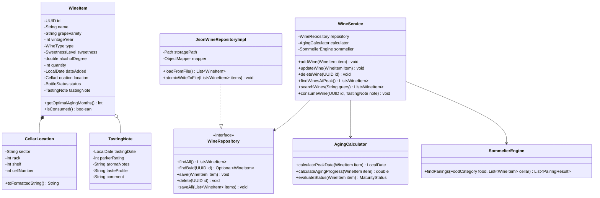
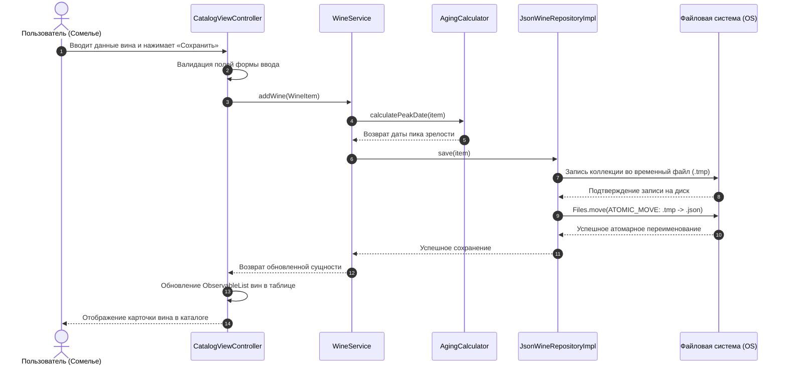

# Software Design Description (SDD) / Описание архитектуры и дизайна ПО

## Проект: WineVault (Каталог домашних вин с напоминанием о выдержке)

**Версия:** 1.0  
**Статус:** Согласовано с Заказчиком  
**Разработал (Архитектор ПО):** Студент группы 450503 Абрамчук Д. С.  
**Организация:** БГУИР, Факультет компьютерных систем и сетей, Кафедра ЭВМ  
**Дата:** 4 ноября 2026 г.  

---

## Оглавление

<!-- TOC -->
* [1. Введение](#1-введение)
  * [1.1 Назначение документа](#11-назначение-документа)
  * [1.2 Область применения](#12-область-применения)
  * [1.3 Определения, акронимы и сокращения](#13-определения-акронимы-и-сокращения)
  * [1.4 Нормативные и справочные ссылки](#14-нормативные-и-справочные-ссылки)
  * [1.5 Обзор структуры документа](#15-обзор-структуры-документа)
* [2. Архитектурный обзор (Design Overview)](#2-архитектурный-обзор-design-overview)
  * [2.1 Задачи стейкхолдеров (Stakeholder Concerns)](#21-задачи-стейкхолдеров-stakeholder-concerns)
  * [2.2 Выбранные архитектурные точки зрения (Viewpoints)](#22-выбранные-архитектурные-точки-зрения-viewpoints)
* [3. Проектные представления (Design Views)](#3-проектные-представления-design-views)
  * [3.1 Логическое представление: диаграмма классов предметной области (Logical View)](#31-логическое-представление-диаграмма-классов-предметной-области-logical-view)
  * [3.2 Композиционное и структурное представление (Composition & Structure View)](#32-композиционное-и-структурное-представление-composition--structure-view)
  * [3.3 Представление взаимодействия: диаграмма последовательности (Interaction View)](#33-представление-взаимодействия-диаграмма-последовательности-interaction-view)
  * [3.4 Информационное представление и схема хранения данных (Information View)](#34-информационное-представление-и-схема-хранения-данных-information-view)
  * [3.5 Алгоритмическое представление (Algorithm View)](#35-алгоритмическое-представление-algorithm-view)
  * [3.6 Представление состояний (State Dynamics View)](#36-представление-состояний-state-dynamics-view)
  * [3.7 Представление развертывания (Deployment View)](#37-представление-развертывания-deployment-view)
* [4. Каталог архитектурных решений (Decisions)](#4-каталог-архитектурных-решений-decisions)
* [5. Приоритизация системных требований (Requirement Prioritization)](#5-приоритизация-системных-требований-requirement-prioritization)
<!-- TOC -->

---

## История изменений

| Дата | Версия | Автор | Причина изменений |
| :--- | :---: | :--- | :--- |
| 04.11.2026 | 1.0 | Абрамчук Д. С. | Первоначальное создание и согласование Software Design Description в рамках ЛР №4 на основе SRS v1.1 |

---

## 1. Введение

### 1.1 Назначение документа
Настоящий документ Software Design Description (SDD) представляет собой техническое описание архитектуры, компонентного состава, структур данных и поведенческих моделей десктопного программного приложения **«WineVault: Home Sommelier & Aging Tracker»**. 
Документ составлен в строгом соответствии с международным стандартом **IEEE 1016-2009** (Standard for Information Technology — Systems Design — Software Design Descriptions) и концепцией точек зрения стандарта **ISO/IEC/IEEE 42010:2011**. Документ служит основным техническим руководством для разработчиков при реализации системы (ЛР №5), планировании автоматизированного тестирования (ЛР №6) и сдаче проекта заказчику.

### 1.2 Область применения
Проектируемый программный продукт WineVault предназначен для индивидуальных владельцев домашних винных коллекций, погребов и винных шкафов. Программное обеспечение функционирует полностью автономно на локальном персональном компьютере конечного пользователя без использования клиент-серверных сетевых протоколов (Air-gap архитектура).

### 1.3 Определения, акронимы и сокращения
* **SDD (Software Design Description)** — спецификация архитектуры и дизайна программного обеспечения (IEEE 1016-2009).
* **SRS (Software Requirements Specification)** — спецификация требований к ПО (ISO/IEC/IEEE 29148:2018).
* **ADR (Architectural Decision Record)** — протокол фиксации и обоснования архитектурного решения.
* **MVC (Model-View-Controller)** — шаблон архитектурного проектирования пользовательского интерфейса.
* **POJO (Plain Old Java Object)** — простой Java-объект без привязки к специализированным тяжелым фреймворкам.
* **DTO (Data Transfer Object)** — объект передачи данных между слоями приложения.
* **Винтаж (Vintage)** — год сбора урожая винограда, из которого изготовлено вино.
* **Пик выдержки (Peak Maturity)** — временной интервал максимального раскрытия органолептических качеств вина.

### 1.4 Нормативные и справочные ссылки
1. Спецификация требований к ПО «WineVault: Home Sommelier & Aging Tracker» (SRS v1.1 от 22.10.2026).
2. СТП 01–2024. Стандарт предприятия. Дипломные проекты (работы). Общие требования. — Минск : БГУИР, 2024.
3. IEEE Std 1016-2009. IEEE Standard for Information Technology — Systems Design — Software Design Descriptions.
4. ISO/IEC/IEEE 42010:2011. Systems and software engineering — Architecture description.
5. ГОСТ 19.701–90. Единая система программной документации. Схемы алгоритмов, программ, данных и систем.

### 1.5 Обзор структуры документа
Документ включает высокоуровневый обзор архитектурных драйверов (раздел 2), детальное проектное описание через призму семи архитектурных точек зрения с диаграммами UML и ГОСТ 19.701–90 (раздел 3), реестр архитектурных решений ADR (раздел 4) и шкалу приоритизации системного функционала от 10 до 50 (раздел 5).

---

## 2. Архитектурный обзор (Design Overview)

### 2.1 Задачи стейкхолдеров (Stakeholder Concerns)
Архитектурные решения приложения WineVault сформированы с учетом ключевых ожиданий заинтересованных сторон:
* **Конечный пользователь (Заказчик):** интуитивно понятный графический интерфейс, мгновенный отклик при фильтрации и поиске бутылок (< 100 мс), гарантированное сохранение коллекции без риска потери данных при выключении питания ПК, защита приватности коллекции.
* **Ведущий разработчик / Архитектор:** обеспечение слабой связанности (Low Coupling) и высокой зацепленности (High Cohesion) подсистем посредством разделения ответственности по слоям (UI, Service, Repository, Model).
* **Инженер по тестированию (QA):** легкая тестируемость алгоритмов выдержки и виртуального сомелье изолированными модульными тестами без поднятия тяжелого GUI или графической подсистемы ОС.

### 2.2 Выбранные архитектурные точки зрения (Viewpoints)
В соответствии со стандартом ISO/IEC/IEEE 42010:2011 в проекте задокументированы следующие представления:
1. **Context & Composition View:** границы приложения, взаимодействие с ОС и локальной файловой системой.
2. **Logical View:** объектно-ориентированная структура классов бизнес-модели, сервисов и репозитория.
3. **Structure & Dependency View:** пакетная архитектура Maven-проекта и направленность графа зависимостей.
4. **Interaction View:** динамическое взаимодействие объектов во времени при регистрации бутылки и пересчете пика выдержки.
5. **Information View:** модель сущностей и структура JSON-хранилища каталога вин.
6. **Algorithm View:** блочные схемы алгоритмов оценки зрелости вина и гастрономического подбора сомелье (ГОСТ 19.701–90).
7. **State Dynamics View:** граф жизненного цикла бутылки вина в коллекции.
8. **Deployment View:** физическое исполнение в среде JRE 21 LTS на кроссплатформенном оборудовании.

---

## 3. Проектные представления (Design Views)

### 3.1 Логическое представление: диаграмма классов предметной области (Logical View)
Логическая структура системы разделена на четыре классических уровня:
1. **Пакет представления (`by.bsuir.winevault.ui`):** контроллеры экранов JavaFX (`MainController`, `CatalogViewController`, `SommelierViewController`, `TimelineViewController`), связывающие FXML-компоненты с сервисами через Data Binding (`ObservableList`).
2. **Сервисный уровень (`by.bsuir.winevault.service`):**
   * `WineService` — координация операций с коллекцией вин, валидация бизнес-правил, интеграция с репозиторием.
   * `AgingCalculator` — алгоритмический движок расчета фаз выдержки (`isReadyToDrink`, `calculatePeakYear`, `calculateAgingProgress`).
   * `SommelierEngine` — алгоритм подбора вин под выбранное гастрономическое блюдо с расчетом рейтинга сочетаемости.
   * `CsvExportService` — формирование строкового представления реестра коллекции с кодировкой UTF-8 BOM.
3. **Слой доступа к данным (`by.bsuir.winevault.repository`):**
   * `WineRepository` (интерфейс) — контракт CRUD-операций.
   * `JsonWineRepositoryImpl` — реализация хранилища на базе библиотеки Jackson ObjectMapper с поддержкой атомарной записи.
4. **Модель предметной области (`by.bsuir.winevault.model`):**
   * `WineItem` — основная сущность винной бутылки (ID, наименование, сорт винограда, винтаж, сладость, цвет, крепость, объем, количество, дата закладки, статус).
   * `CellarLocation` — координатная привязка к погребу (сектор, стеллаж, полка, ячейка).
   * `TastingNote` — органолептические заметки дегустации (оценка 1–100 по шкале Паркера, дата, аромат, танины).
   * `WineType`, `SweetnessLevel`, `BottleStatus` — перечисления (Enums).



### 3.2 Композиционное и структурное представление (Composition & Structure View)
Приложение структурировано по принципу трехуровневой архитектуры с четким разграничением ответственности:
* `ui` зависит только от `service` и `model`. Слой представления не имеет прямых связей со слоем персистентности.
* `service` содержит чистую бизнес-логику и взаимодействует с `repository` исключительно через абстрактный интерфейс.
* `model` является пассивным ядром системы и не зависит от внешних слоев.

### 3.3 Представление взаимодействия: диаграмма последовательности (Interaction View)
Сценарий: добавление новой бутылки вина в каталог, расчет даты зрелости и сохранение в файловом хранилище.



### 3.4 Информационное представление и схема хранения данных (Information View)
Для хранения коллекции используется структурированный JSON-документ `wine_cellar.json`. Формат хранилища оптимизирован под чтение и редактирование человеком, а также обеспечивает кроссплатформенную переносимость.

Пример схемы хранения:
```json
{
  "version": "1.1",
  "lastModified": "2026-11-04T12:00:00Z",
  "wines": [
    {
      "id": "c3a6b8f1-8f52-4a7b-a279-d5c4b8101a91",
      "name": "Château Margaux Premier Grand Cru Classé",
      "grapeVariety": "Каберне Совиньон, Мерло",
      "vintageYear": 2018,
      "type": "RED_DRY",
      "sweetness": "DRY",
      "alcoholDegree": 13.5,
      "quantity": 3,
      "dateAdded": "2024-05-15",
      "location": {
        "sector": "A",
        "rack": 2,
        "shelf": 4,
        "cellNumber": 12
      },
      "status": "AGING",
      "tastingNote": null
    }
  ]
}
```

### 3.5 Алгоритмическое представление (Algorithm View)
В соответствии с ГОСТ 19.701–90 алгоритм оценки зрелости вина `AgingCalculator` выполняет вычисление текущего прогресса созревания $P$ по формуле:

$$P = \frac{T_{cur} - T_{harvest}}{T_{peak} - T_{harvest}} \times 100\%$$

Где:
* $T_{harvest}$ — винтаж (год и месяц сбора урожая);
* $T_{cur}$ — текущая календарная дата;
* $T_{peak}$ — расчетная дата достижения оптимального вкусового плато для данного сорта и категории вина (для легких белых вин норма выдержки составляет 24–36 месяцев, для коллекционных красных Бордо — 96–144 месяца).

При $P < 85\%$ вино имеет статус «Выдерживается» (Aging). При $85\% \le P \le 115\%$ вино получает статус «На пике» (At Peak). При $P > 115\%$ статус переходит в «Требует употребления / Перезрело» (Overdue).

### 3.6 Представление состояний (State Dynamics View)
Жизненный цикл винной единицы в системе:
1. `NEW` — первичное занесение в каталог.
2. `AGING` — вино находится на выдержке в погребе, калькулятор отслеживает приближение к пику.
3. `AT_PEAK` — вино достигло оптимального органолептического баланса (отображается в быстром фильтре).
4. `CONSUMED` — вино списано из фактического остатка и перенесено в дегустационный архив с сохранением органолептических заметок.

### 3.7 Представление развертывания (Deployment View)
Программное обеспечение собирается в виде самодостаточного исполняемого Uber-JAR архива посредством плагина `maven-shade-plugin` или нативного бандла (jlink/jpackage). Для работы приложения требуется среда JRE версии 21 LTS на операционных системах Microsoft Windows 10/11, Linux или macOS.

---

## 4. Каталог архитектурных решений (Decisions)

В процессе проектирования архитектуры системы были приняты и задокументированы в соответствии с нотацией MADR следующие ключевые решения:
* **ADR-0001:** Выбор архитектурного паттерна MVC (Model-View-Controller) и Service Layer для организации исходного кода.
* **ADR-0002:** Выбор автономного локального JSON-хранилища на базе библиотеки Jackson вместо встраиваемой реляционной СУБД SQLite для обеспечения портативности и требования Air-gap.
* **ADR-0003:** Стратегия обеспечения надежности и отказоустойчивости при сохранении данных через двухфазную атомарную замену файлов (`Atomic Move`).
* **ADR-0004:** Применение специализированных движков бизнес-правил (`AgingCalculator`, `SommelierEngine`) с отделением от слоев UI и I/O для обеспечения 100% покрытия модульными тестами.

---

## 5. Приоритизация системных требований (Requirement Prioritization)

В соответствии с требованиями задания на лабораторную работу №4 выполнена ранжированная оценка приоритетов реализации системных функций по шкале **от 10 (Highest Priority / Критический базовый функционал) до 50 (Lowest Priority / Дополнительный вспомогательный функционал)**.

| Priority | Requirement ID | Feature Name | Description | Justification |
| :---: | :---: | :--- | :--- | :--- |
| **10** | `REQ-FUNC-001` | Wine Catalog Management | CRUD operations for wine bottles (vintage, grape, sweetness, alcohol). | Core system capability. Without bottle cataloging the entire software is non-operational. |
| **10** | `REQ-NFR-REL-001` | Atomic File Storage | Two-phase atomic persistence to JSON (`.tmp` -> `.json`). | Prevents storage corruption on unexpected power outages, safeguarding private user collections. |
| **20** | `REQ-FUNC-003` | Aging Calculation Engine | Automatic calculation of optimal maturity window and peak date. | Core unique selling point of the application; required for the aging tracker concept. |
| **20** | `REQ-FUNC-002` | Cellar Topology Mapping | Exact cellar coordinates (Sector, Rack, Shelf, Cell ID). | Critical physical usability requirement for rapid bottle discovery in home cellars. |
| **20** | `REQ-FUNC-008` | Consumption & Inventory | Status transitions (`AGING` -> `CONSUMED`) and inventory tracking. | Essential inventory control to prevent consuming the same bottle multiple times. |
| **30** | `REQ-FUNC-005` | "At Peak" Quick Filter | One-click filter for wines ready for immediate consumption. | High-demand customer convenience feature for rapid daily wine selection. |
| **30** | `REQ-FUNC-010` | Real-time Search | Instant multi-parameter filtering across grape variety, name, vintage. | Usability requirement for collections exceeding 100 bottles. |
| **40** | `REQ-FUNC-006` | Virtual Sommelier Pairing | Food-pairing recommendation algorithm matching cellar inventory. | High-value analytic feature, but depends on a populated catalog. |
| **40** | `REQ-FUNC-004` | Visual Aging Timeline | Interactive calendar grid displaying maturation progress bars. | Visual enhancement of the aging calculation engine (`REQ-FUNC-003`). |
| **50** | `REQ-FUNC-007` | Tasting Notes Journal | Organoleptic rating (1–100 Parker scale) and sommelier notes. | Secondary historic logging; non-blocking for cellar operations. |
| **50** | `REQ-FUNC-009` | CSV Export Service | Export cellar registry to formatted CSV spreadsheet with BOM. | Auxiliary reporting feature for external spreadsheet analysis. |
