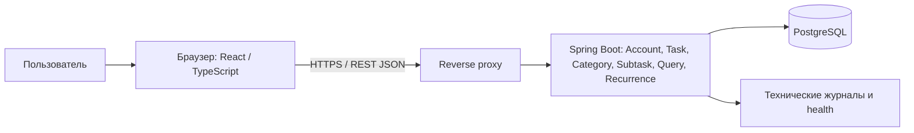
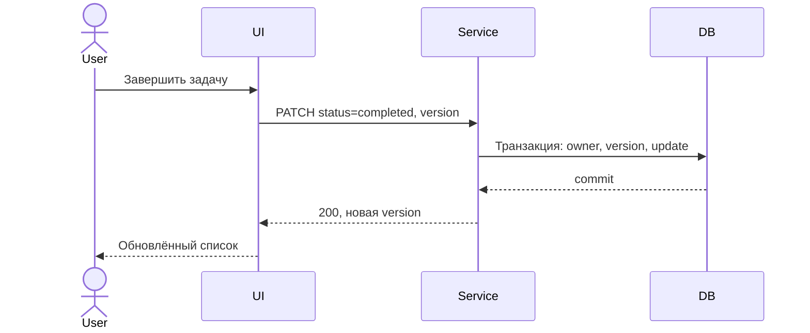

# Проектные представления Task Manager

Представления V01–V07 из раздела 3 [SDD](sdd.md). Каждая запись оформлена по `view-template.md` ветки main.

# V01 — контекст, композиция и зависимости

## Viewpoint

Context, Composition, Structure, Dependency, Patterns.

## Representation

Архитектура — модульный монолит, ADR-0001. Пакеты backend: account, task, category, subtask, query, recurrence. В каждом — controller → service → repository; сущности ORM не возвращаются напрямую в API. Общие DTO ошибок, пагинация и валидация вынесены в common. Frontend: страницы, API-клиент, формы и переиспользуемые компоненты. Query переиспользует общие правила фильтрации; Task проверяет владельца через Account. Зависимости функций приведены в SDD §5.

**SYS-ARCH-001:** Сервер должен проверять владельца каждого объекта до чтения/изменения; userId берётся только из сессии. Проверка: запросы двух пользователей к задачам, категориям, подзадачам. Покрывает REQ-FUNC-010, REQ-MAINT-001, REQ-REUSE-001.

## Дополнительная информация

Требования SRS: REQ-FUNC-010, REQ-MAINT-001, REQ-REUSE-001. [SRS](../srs.md). Связанные решения: [ADR](../adr/adr.md). Критерии проверки перечислены в требованиях SYS данного представления; статус — Planned.

# V02 — информация и логическая модель

## Viewpoint

Information, Logical.

## Representation
| Таблица | Основные поля и ограничения |
|---|---|
| users | UUID id; unique email; password_hash; consent_at; zone_id |
| tasks | UUID id; owner_id FK; title 1–200; description ≤5000; priority enum; status enum; deadline timestamptz nullable; category_id nullable; created_at; version |
| categories | UUID id; owner_id FK; name 1–100, unique(owner_id,name) |
| subtasks | UUID id; task_id FK; title 1–200; completed boolean |
| recurrence_rules | task_id unique FK; mode; weekdays/day; zone_id |

**SYS-DATA-001:** Запись задачи и подзадач должна быть транзакционной. Удаление задачи удаляет подзадачи; удаление категории обнуляет category_id и сохраняет задачи. Связь категории и задачи разрешена только при совпадении владельца; это проверяет сервис внутри транзакции. Проверка: сбой БД посреди операции не оставляет частичных данных. REQ-REL-001/002, REQ-FUNC-006/007; ADR-0002.

**SYS-DATA-002:** Дедлайны должны храниться в UTC, отображаться в zone_id пользователя; индекс tasks(owner_id,status,deadline), индекс tasks(owner_id,category_id). Схема меняется версионируемыми миграциями. Проверка: смена зоны не меняет момент дедлайна; чистая БД разворачивается миграциями. REQ-FUNC-005, REQ-INST-001.

## Дополнительная информация

Требования SRS: REQ-FUNC-005/006/007, REQ-REL-001/002. [SRS](../srs.md). Связанные решения: [ADR](../adr/adr.md). Критерии проверки перечислены в требованиях SYS данного представления; статус — Planned.

# V03 — интерфейсы и безопасность

## Viewpoint

Interface.

## Representation
| Метод и маршрут /api/v1 | Контракт |
|---|---|
| POST /auth/register, /auth/login; POST /auth/logout | Регистрация с согласием, вход, завершение сессии |
| GET /tasks | status, priority, category, overdue, q, sort, page, size (1–100) |
| POST /tasks | Создание: title обязателен, остальные поля опциональны |
| PATCH /tasks/{id}; DELETE /tasks/{id} | Изменение с version; подтверждённое удаление |
| GET/POST /categories; PATCH/DELETE /categories/{id} | Управление собственными категориями |
| POST /tasks/{id}/subtasks; PATCH/DELETE /subtasks/{id} | Работа с подзадачами |

JSON ошибки: {code,message,fieldErrors,correlationId}. 400 — валидация; 401 — нет сессии; 403 — неверный CSRF; 404 — отсутствующий или чужой объект; 409 — конфликт version/unique; 500 — безопасное сообщение без внутреннего стека. 404 для чужих объектов предотвращает раскрытие их существования.

**SYS-SEC-001:** Сервер должен использовать сессию в cookie HttpOnly, Secure, SameSite=Lax, проверять CSRF для изменяющих запросов и хранить только адаптивный хеш пароля BCrypt. Тайм-аут бездействия 30 минут, logout инвалидирует сессию. Проверки: неверная/истёкшая сессия 401, неверный CSRF 403, исходный пароль отсутствует в БД. REQ-SEC-001/002/004, ADR-0002.

**SYS-API-001:** Сервер должен валидировать ограничения V02 и enum до записи; UI должен показывать ошибки без ложного успеха. Повтор создания с тем же Idempotency-Key в пределах 24 ч возвращает исходный результат, ключ уникален для владельца; ключ и результат сохраняются в БД в транзакции. Проверка: повтор после потери ответа не дублирует задачу. REQ-SEC-003, REQ-REL-002, REQ-INT-007/008.

## Дополнительная информация

Требования SRS: REQ-FUNC-001/002/003/010, REQ-SEC-001–004. [SRS](../srs.md). Связанные решения: [ADR](../adr/adr.md). Критерии проверки перечислены в требованиях SYS данного представления; статус — Planned.

# V04 — взаимодействие и состояния

## Viewpoint

Interaction, State Dynamics.

## Representation

Состояния задачи: «Не выполнена» ↔ «Выполнена»; удаление — терминальное действие. Просроченность вычисляется: status!=completed и deadline<now, не хранится отдельным статусом. UI: loading → success/empty/error, повтор запроса доступен из error.

**SYS-STATE-001:** Изменение статуса должно проверять version; при конфликте возвращать 409 и предлагать обновление. Проверка: две вкладки не перезаписывают изменения молча. REQ-FUNC-003/008, REQ-REL-002.

## Дополнительная информация

Требования SRS: REQ-FUNC-003/008, REQ-REL-002. [SRS](../srs.md). Связанные решения: [ADR](../adr/adr.md). Критерии проверки перечислены в требованиях SYS данного представления; статус — Planned.

# V05 — алгоритмы

## Viewpoint

Algorithm.

## Representation
Прогресс подзадач = completed/total×100%, округление вниз; при total=0 показывается «Нет подзадач», не 0/0. Статус родителя пользователь меняет отдельно; незавершённые подзадачи видимы, автоматического завершения нет.

**SYS-ALG-001:** Прогресс должен пересчитываться после CRUD подзадачи; тесты 0, 1/3 и 3/3 дают отсутствие процента, 33% и 100%. REQ-FUNC-007.

Повторение (Deferred 0.3, не входит в приёмку 0.2): после первого завершения создаётся один следующий экземпляр; повторный PATCH completed не создаёт новый. Ежедневное правило добавляет календарный день в зоне пользователя, еженедельное выбирает следующий разрешённый день, ежемесячное берёт заданное число или последний день короткого месяца. Пропущенные даты не порождают пачку задач: выбирается первый срок после now. Для задачи без дедлайна правило недоступно. Копируются атрибуты и названия подзадач, подзадачи сбрасываются в невыполненные.

**SYS-REC-001 (Deferred 0.3):** Уникальный ключ predecessor_task_id нового экземпляра и транзакция завершения должны исключать дубли при конкурентных запросах. Тесты: двойной запрос, 31 января, високосный февраль, выбранные дни недели. REQ-FUNC-009, ADR-0003.

## Дополнительная информация

Требования SRS: REQ-FUNC-007/009. [SRS](../srs.md). Связанные решения: [ADR](../adr/adr.md). Критерии проверки перечислены в требованиях SYS данного представления; статус — Planned.

# V06 — параллелизм и ресурсы процесса

## Viewpoint

Concurrency.

## Representation
UI не блокируется сетевыми запросами, кнопка сохранения отключается на время операции. На сервере запросы независимы, запись ограничена транзакцией; optimistic locking через version, идемпотентность через уникальный ключ. Пул соединений ограничен 10, превышение тайм-аута даёт контролируемую ошибку, а не ложный успех.

**SYS-OBS-001:** Ошибки должны журналироваться с временем, endpoint, уровнем и correlationId без паролей, cookie и содержимого задач. Проверка: искусственный сбой находится по ID, секретов нет. REQ-OBS-001.

## Дополнительная информация

Требования SRS: REQ-REL-002, REQ-OBS-001. [SRS](../srs.md). Связанные решения: [ADR](../adr/adr.md). Критерии проверки перечислены в требованиях SYS данного представления; статус — Planned.

# V07 — физическое представление, развёртывание и качество

## Viewpoint

Physical, Deployment, Resources.

## Representation
Один учебный Linux-узел: 2 vCPU, 4 ГиБ RAM, 20 ГиБ диска; Docker Compose: reverse proxy со статикой, Java 21 / Spring Boot, PostgreSQL 16 с постоянным томом. Клиент собирается Node.js 20 по базе SRS; версии зависимостей фиксируются lock-файлами. Это проектные ограничения исходной SRS, не рекомендация актуальных версий на дату установки.

**SYS-DEP-001:** Конфигурация должна поступать из окружения без секретов в Git; развёртывание включает миграции и health-check. Резервная копия БД ежедневно, хранение 7 суток, восстановление проверяется на отдельном томе до приёмки. REQ-INST-001, REQ-BUILD-001, REQ-DIST-001, REQ-REL-001.

**SYS-PERF-001:** На стенде выше при 100 активных пользователях и 10 000 задач на пользователя p95 API списка должен быть ≤500 мс без сетевой задержки браузера; измерение 10 минут после 2 минут прогрева. UI — основные элементы ≤3 с в 95 из 100 загрузок при 20 Мбит/с и RTT 50 мс. Проверки Planned. REQ-PERF-001/002.

**SYS-OPS-001:** Health-check должен измеряться каждую минуту; месячная доступность рассчитывается по успешным проверкам вне заранее объявленных работ и должна быть ≥99%. На выпуске проверяется мониторинг, месячное значение — после эксплуатации. REQ-AVAIL-001.

**SYS-UX-001:** UI должен работать с ширины 360 px, поддерживать клавиатуру, видимый фокус и проверку контраста; браузерная матрица — Chrome, Firefox, Edge, Safari из SRS. Проверки: основные сценарии на каждой платформе, клавиатурный проход и аудит контраста. REQ-COMP-002, REQ-PORT-001.

Согласие фиксируется до регистрации; удаление аккаунта по запросу выполняется администратором по процедуре с проверкой личности и каскадным удалением личных данных. Это проектное покрытие REQ-COMP-001; юридическая оценка соответствия не объявляется проведённой.

## Дополнительная информация

Требования SRS: REQ-INST-001, REQ-BUILD-001, REQ-PERF-001/002, REQ-AVAIL-001. [SRS](../srs.md). Связанные решения: [ADR](../adr/adr.md). Критерии проверки перечислены в требованиях SYS данного представления; статус — Planned.

# V08 — экспорт задач в CSV

## Viewpoint

Interface, Information, Algorithm. Добавлено в версии 0.2 по CR-02.

## Representation

UI передаёт текущие фильтры и сортировку в GET /api/v1/tasks/export. Сервер получает владельца из сессии, переиспользует Query, исключает чужие задачи и возвращает text/csv с Content-Disposition: attachment. Параметры page/size не ограничивают выгрузку. Export читает данные порциями в согласованном снимке транзакции и записывает CSV потоково. Формат и экранирование — REQ-FUNC-011. Ошибки аутентификации и валидации возвращаются до начала файла; при обрыве передачи UI сообщает о неуспешной загрузке.

**SYS-EXP-001:** Система должна выгружать до 10 000 собственных задач с фильтрацией, сортировкой и защитой от формул по REQ-FUNC-011. Проверка: два пользователя, 10 000 строк, пустой набор, Unicode, запятые, кавычки, переводы строк и опасные префиксы. Статус Planned.

**SYS-EXP-002:** На стенде V07 экспорт должен соблюдать REQ-PERF-003: ≤5 с в 95 из 100 запусков и ≤32 МиБ дополнительной памяти. Проверка: инструментированный нагрузочный тест при одном экспорте. Статус Planned.

## Дополнительная информация

[SRS](../srs.md): REQ-FUNC-011, REQ-PERF-003, REQ-FUNC-010. [ADR-0004](../adr/adr.md). Зависимость F08 от F05; ранний UI использует mock API, окончательная интеграция и приёмка — I3 плана P2 в [переписке](../correspondence.md).
