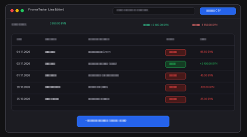
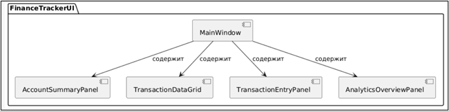

# Спецификация требований к ПО

Для FinanceTracker — кроссплатформенной десктопной системы персонального финансового учета и аналитики

Версия 0.2

Подготовил: Богдан М. А.

Группа: 450504, Вариант: 4

Белорусский государственный университет информатики и радиоэлектроники (БГУИР)

Дата изменения: 10 ноября 2026 г.

## Оглавление

<!-- TOC -->
* [1. Введение](#1-introduction)
  * [1.1 Назначение документа](#11-document-purpose)
  * [1.2 Область применения продукта](#12-product-scope)
  * [1.3 Определения, акронимы и сокращения](#13-definitions-acronyms-and-abbreviations)
  * [1.4 Ссылки](#14-references)
  * [1.5 Обзор документа](#15-document-overview)
* [2. Обзор продукта](#2-product-overview)
  * [2.1 Перспектива продукта](#21-product-perspective)
  * [2.2 Функции продукта](#22-product-functions)
  * [2.3 Ограничения продукта](#23-product-constraints)
  * [2.4 Характеристики пользователей](#24-user-characteristics)
  * [2.5 Допущения и зависимости](#25-assumptions-and-dependencies)
  * [2.6 Распределение требований](#26-apportioning-of-requirements)
* [3. Требования](#3-requirements)
  * [3.1 Внешние интерфейсы](#31-external-interfaces)
    * [3.1.1 Пользовательские интерфейсы](#311-user-interfaces)
    * [3.1.2 Аппаратные интерфейсы](#312-hardware-interfaces)
    * [3.1.3 Программные интерфейсы](#313-software-interfaces)
  * [3.2 Функциональные требования](#32-functional)
  * [3.3 Качество обслуживания](#33-quality-of-service)
    * [3.3.1 Производительность](#331-performance)
    * [3.3.2 Безопасность](#332-security)
    * [3.3.3 Надёжность](#333-reliability)
    * [3.3.4 Доступность](#334-availability)
    * [3.3.5 Наблюдаемость](#335-observability)
  * [3.4 Соответствие стандартам](#34-compliance)
  * [3.5 Проектирование и реализация](#35-design-and-implementation)
    * [3.5.1 Установка](#351-installation)
    * [3.5.2 Сборка и поставка](#352-build-and-delivery)
    * [3.5.3 Распределение](#353-distribution)
    * [3.5.4 Сопровождаемость](#354-maintainability)
    * [3.5.5 Повторное использование](#355-reusability)
    * [3.5.6 Переносимость](#356-portability)
    * [3.5.7 Стоимость](#357-cost)
    * [3.5.8 Сроки](#358-deadline)
    * [3.5.9 Доказательство концепции](#359-proof-of-concept)
    * [3.5.10 Управление изменениями](#3510-change-management)
  * [3.6 ИИ/МО](#36-aiml)
* [4. Верификация](#4-verification)
* [5. Приложения](#5-appendixes)
<!-- TOC -->

## История изменений

| Name | Date | Reason For Changes | Version |
|:---|:---|:---|:---|
| Богдан М. А. | 09.11.2026 | Инициализация спецификации бизнес-требований<br>к десктопной системе FinanceTracker в рамках лабораторной работы №3 по ЖЦРПО | 0.1 |
| Богдан М. А. | 10.11.2026 | Актуализация нефункциональных требований<br>по результатам код-ревью в Pull Request (добавлено<br>явное требование поддержки базовых валют BYN/USD/EUR<br>и порога предупреждения по объему локальной базы данных<br>от 100 МБ) | 0.2 |

---

## 1. Введение {#1-introduction}

Настоящий документ представляет собой спецификацию требований к программному обеспечению (SRS) для кроссплатформенной десктопной системы персонального финансового учета FinanceTracker (версия 0.2). Продукт предназначен для автоматизированного учета доходов и расходов, агрегирования баланса финансовых счетов и локального хранения журнала транзакций без передачи персональных сведений во внешние облачные сервисы. Документ определяет функциональные и качественные границы системы для использования при проектировании, разработке и верификации в рамках учебного курса.

### 1.1 Назначение документа {#11-document-purpose}

Настоящий SRS носит закрепительный характер и определяет полный комплект требований к поведению, возможностям и показателям качества системы FinanceTracker. Документ служит технической основой между разработчиком и проверяющей стороной (Заказчиком / преподавателем) на всех этапах жизненного цикла. Документ описывает поведение системы на уровне внешних интерфейсов («что» система делает) и условия её приемки.

### 1.2 Область применения продукта {#12-product-scope}

Система FinanceTracker — это автономное десктопное приложение, созданное для решения проблемы неструктурированного и небезопасного учета персональных финансов при помощи локального управления доходами и расходами на рабочей станции пользователя.

**В область применения продукта входит:**
- Регистрация и категоризация финансовых операций (доходов и расходов) с сохранением даты, типа, суммы, контрагента/описания и категории.
- Автоматический расчет и динамическое отображение текущего суммарного баланса, агрегированного месячного дохода и расхода.
- Табличный реестр транзакций с поддержкой сортировки по ключевым колонкам (дата, категория, статус, сумма).
- Локальная фильтрация журнала по строковым критериям описания и заданным финансовым категориям.
- Формирование экспорта реестра операций в формат структурированных файлов CSV (RFC 4180).

**В область применения НЕ входит:**
- Прямое подключение к банковским API и автоматическое списание/зачисление денежных средств со счетов кредитно-финансовых организаций.
- Синхронизация транзакций через сторонние публичные облачные серверы.
- Торговые операции на фондовых, сырьевых и криптовалютных биржах.

### 1.3 Определения, акронимы и сокращения {#13-definitions-acronyms-and-abbreviations}

| Термин / Аббревиатура | Определение |
|:---|:---|
| Транзакция | Запись об отдельной финансовой операции (доход или расход), изменяющая общий баланс счета. |
| Реестр операций (DataGrid) | Табличный компонент графического интерфейса пользователя для структурированного отображения перечня финансовых операций. |
| Базовая валюта | Денежная единица, в которой производятся расчет и представление агрегированного баланса (BYN, USD, EUR). |
| CSV | Comma-Separated Values — текстовый формат табличных данных, стандартизированный спецификацией RFC 4180. |
| SRS | Software Requirements Specification — спецификация требований к программному обеспечению. |
| SysMLv2 | Systems Modeling Language v2 — язык системного моделирования второго поколения для спецификации и проектирования систем. |

### 1.4 Ссылки {#14-references}

1. Методические указания по дисциплине «Жизненный цикл разработки программного обеспечения» для студентов специальности «Компьютерная инженерия». Минск, БГУИР. [Нормативная ссылка]
2. СТП 01–2024 «Дипломные проекты (работы). Общие требования». Минск, БГУИР, 2024. [Нормативная ссылка]
3. Спецификация платформы Java Standard Edition 17 LTS (https://docs.oracle.com/en/java/javase/17/). [Справочная ссылка]
4. Спецификация формата CSV RFC 4180 (https://datatracker.ietf.org/doc/html/rfc4180). [Справочная ссылка]

### 1.5 Обзор документа {#15-document-overview}

Раздел 1 содержит введение и описывает границы продукта. Раздел 2 задает контекст функционирования системы FinanceTracker и характеристики пользователей. Раздел 3 специфицирует верифицируемые функциональные и нефункциональные требования с уникальными идентификаторами. Раздел 4 содержит матрицу трассируемости и верификации, а в Разделе 5 приведены графический мокап и SysMLv2-описание интерфейса.

---

## 2. Обзор продукта {#2-product-overview}

### 2.1 Перспектива продукта {#21-product-perspective}

FinanceTracker разрабатывается как полностью самостоятельный кроссплатформенный десктопный инструмент, не требующий обязательного подключения к внешним серверам или облачным инфраструктурам. Приложение функционирует локально на стороне пользователя в среде Java Virtual Machine (JVM), взаимодействуя со встроенной реляционной базой данных (SQLite / H2) через стандартные программные интерфейсы JDBC. Продукт нацелен на заполнение ниши надежных, высокопроизводительных и конфиденциальных систем персонального финансового учета без скрытой передачи метаданных.

### 2.2 Функции продукта {#22-product-functions}

На основе спроектированного интерфейса система предоставляет следующие ключевые возможности:
- **Информационный индикатор баланса:** Постоянное отображение суммарного агрегированного баланса («Общий баланс: 3 850.00 BYN»), а также расчет текущего месячного дохода и расхода.
- **Интерактивный реестр транзакций:** Табличный аудит финансовой истории с отображением даты, категории, описания, статуса («Доход» / «Расход») и точной суммы операции.
- **Регистрация финансовых операций:** Добавление записей о доходах и расходах через модальное окно с валидацией числовых значений и категорий.
- **Динамическая фильтрация данных:** Поиск и фильтрация строк журнала в реальном времени по введенному текстовому шаблону или категории.
- **Экспорт выписок (Экспорт CSV):** Формирование текстового файла выгрузки всех отфильтрованных операций для архивации или обработки во внешних табличных редакторах.
- **Цветовая дифференциация статусов:** Наглядная визуализация типов операций (зеленые индикаторы для доходов, красные — для расходов).

### 2.3 Ограничения продукта {#23-product-constraints}

- **Кроссплатформенность:** Продукт должен бесшовно функционировать и сохранять идентичный пользовательский опыт в операционных системах семейств Windows 10/11, macOS (12+) и Linux (Ubuntu, Fedora).
- **Технологический стек:** В качестве основного языка разработки должна использоваться Java (версия Java SE 17 LTS или выше) с графической подсистемой JavaFX / Swing.
- **Локальное хранение:** База данных транзакций хранится исключительно на локальном накопителе пользователя в виде файла базы данных.
- **Поддержка валют:** Система должна обеспечивать расчет и хранение финансовых величин в валютах BYN, USD и EUR с точностью до двух знаков после запятой (дробная часть).
- **Ограничения по базе данных:** При превышении объема локального файла БД лимита в 100 МБ система должна информировать пользователя о возможности архивации старых записей.

### 2.4 Характеристики пользователей {#24-user-characteristics}

Основной целевой аудиторией FinanceTracker являются:
- **Частные пользователи и студенты:** Лица, заинтересованные в систематическом учете личных финансов, распределении бюджета по статьям затрат и контроле остатка средств.
- **Пользователи с повышенными требованиями к приватности:** Специалисты, избегающие использования банковских облачных ассистентов и сторонних онлайн-сервисов из соображений конфиденциальности.

Особых требований к доступности (Accessibility) интерфейса не предъявляется; эргономика системы рассчитана на пользователей с базовой компьютерной грамотностью и поддерживает стандартное масштабирование шрифтов операционной системы.

### 2.5 Допущения и зависимости {#25-assumptions-and-dependencies}

- **Допущение о системном времени:** Хронологический порядок и группировка операций по месяцам опираются на корректность системных часов и часового пояса операционной системы.
- **Зависимость от файловой системы:** Корректность записи журнала транзакций зависит от наличия у текущего пользователя прав на чтение и запись в рабочий каталог приложения или домашнюю директорию (`user.home`).

### 2.6 Распределение требований {#26-apportioning-of-requirements}

Разработка разделена на следующие фазы:
- **Фаза 1 (5 семестр, 2026 г.):** Анализ предметной области, выявление бизнес-требований (SRS), создание визуальных мокапов в Excalidraw, моделирование интерфейса на языке SysMLv2. Программный код на этом этапе не создается.
- **Фаза 2 (6 семестр, 2027 г.):** Разработка программного обеспечения на Java, реализация слоя хранения JDBC (SQLite), реализация GUI на JavaFX, модульное тестирование и сборка артефактов.
- **Отложено на будущие итерации:** Модуль автоматического прогнозирования остатка бюджета на основе скользящего среднего и визуализация аналитических круговых диаграмм.

---

## 3. Требования {#3-requirements}

Этот раздел специфицирует верифицируемые требования к ПО для обеспечения проектирования и тестирования системы FinanceTracker.

### 3.1 Внешние интерфейсы {#31-external-interfaces}

#### 3.1.1 Пользовательские интерфейсы {#311-user-interfaces}

Пользовательский интерфейс представляет собой главное однооконное десктопное приложение, спроектированное на базе платформы Java. Эскиз графического интерфейса вынесен в Приложение А.

**Структурная спецификация интерфейса на языке SysMLv2:**

```sysml
package FinanceTrackerUI {
    public part def MainWindow {
        part summaryBar : AccountSummaryPanel;
        part transactionTable : TransactionDataGrid;
        part entryPanel : TransactionEntryPanel;
    }

    part def AccountSummaryPanel {
        attribute totalBalanceText : String;
        attribute monthlyIncomeText : String;
        attribute monthlyExpenseText : String;
        part searchFilterInput : TextField;
        part exportCsvButton : Button [1] { attribute label = "Экспорт CSV"; }
    }

    part def TransactionDataGrid {
        part transactionRows : TransactionRow [*];
    }

    part def TransactionRow {
        attribute date : String;
        attribute category : String;
        attribute description : String;
        attribute operationType : String; // "Доход" | "Расход"
        attribute amount : String;
    }

    part def TransactionEntryPanel {
        part addTransactionButton : Button [1] { attribute label = "+ Добавить операцию (Расход / Доход)"; }
    }
}
```

**Описание элементов управления и поведения интерфейса:**
- **Панель баланса и фильтрации (AccountSummaryPanel):** Верхняя секция экрана, включающая поле общего остатка (`Общий баланс: 3 850.00 BYN`), показатели помесячного дохода/расхода, поле динамического поиска по категориям/описанию и кнопку «Экспорт CSV».
- **Таблица реестра операций (TransactionDataGrid):** Центральный компонент отображения списка транзакций, содержащий 5 колонок (`Дата`, `Категория`, `Описание операции`, `Статус`, `Сумма`) с цветовым выделением плашек статуса.
- **Панель добавления операции (TransactionEntryPanel):** Нижняя панель с акцентной кнопкой «+ Добавить операцию (Расход / Доход)», открывающей форму регистрации нового финансового события.

#### 3.1.2 Аппаратные интерфейсы {#312-hardware-interfaces}

Прямого взаимодействия с кастомными аппаратными интерфейсами приложение не осуществляет. Система взаимодействует со стандартными устройствами ввода (мышь, клавиатура), монитором и накопителями (HDD/SSD) через стандартные подсистемы JVM.

#### 3.1.3 Программные интерфейсы {#313-software-interfaces}

Система интегрируется со следующим системным программным обеспечением:
- **Java Virtual Machine (JRE/JDK >= 17):** Выполнение байт-кода приложения и отрисовка графических примитивов интерфейса.
- **Локальная СУБД (SQLite / H2):** Хранение реляционных таблиц финансовых транзакций и метаданных через JDBC-драйвер с поддержкой транзакционной целостности (ACID).
- **Файловая система операционной системы:** Сохранение сформированных файлов отчетов в формате CSV по выбранному пользователем пути.

---

### 3.2 Функциональные требования {#32-functional}

- **ID:** REQ-FUNC-001-01
- **Title:** Динамический расчет общего баланса
- **Statement:** Система должна выполнять автоматический пересчет и обновление общего баланса счетов в режиме реального времени при каждом добавлении, редактировании или удалении транзакции.
- **Verification Method:** Test

- **ID:** REQ-FUNC-002-01
- **Title:** Регистрация доходных и расходных операций
- **Statement:** Система должна сохранять параметры транзакции (дата проведения, категория, текстовое описание, тип операции «Доход/Расход», сумма) в локальную базу данных.
- **Verification Method:** Demonstration

- **ID:** REQ-FUNC-003-01
- **Title:** Валидация числовых значений сумм
- **Statement:** Система должна блокировать сохранение транзакций с отрицательными, нулевыми или некорректными символьными значениями в поле ввода суммы, фиксируя точность двумя знаками после запятой.
- **Verification Method:** Test

- **ID:** REQ-FUNC-004-01
- **Title:** Фильтрация реестра операций
- **Statement:** Система должна производить асинхронную фильтрацию списка записей в таблице по совпадению введенного текста в поле описания или по выбранной категории затрат.
- **Verification Method:** Demonstration

- **ID:** REQ-FUNC-005-01
- **Title:** Экспорт реестра в формат CSV
- **Statement:** При нажатии кнопки «Экспорт CSV» система должна формировать и сохранять структурированный текстовый файл всех отфильтрованных операций в соответствии со спецификацией RFC 4180.
- **Verification Method:** Demonstration

- **ID:** REQ-FUNC-006-01
- **Title:** Цветовая индикация финансовых потоков
- **Statement:** В таблице транзакций операции типа «Доход» должны выделяться зеленым цветовым индикатором статуса, а операции типа «Расход» — красным.
- **Verification Method:** Inspection

---

### 3.3 Качество обслуживания {#33-quality-of-service}

#### 3.3.1 Производительность {#331-performance}

- **REQ-PERF-001-01:** Время отклика графического интерфейса при добавлении новой записи и обновлении реестра не должно превышать 200 мс при базе данных объемом до 20 000 транзакций.
- **REQ-PERF-002-01:** «Холодный» запуск приложения и первичная инициализация главного окна не должны превышать 2,0 секунды на стандартной рабочей станции.

#### 3.3.2 Безопасность {#332-security}

- **REQ-SEC-001-01:** Приложение должно хранить все персональные финансовые записи строго локально, не отправляя телеметрию и персональные данные во внешние сети.

#### 3.3.3 Надёжность {#333-reliability}

- **REQ-REL-001-01:** При аварийном завершении работы приложения или сбое питания целостность базы данных должна гарантироваться механизмами журналирования СУБД SQLite (WAL-режим).

#### 3.3.4 Доступность {#334-availability}

- **REQ-AVAIL-001-01:** Приложение должно быть полностью работоспособно в автономном режиме без доступа к сети Интернет.

#### 3.3.5 Наблюдаемость {#335-observability}

- **REQ-OBS-001-01:** Критические сбои чтения/записи базы данных и системные исключения должны фиксироваться в локальном текстовом файле журнала `finance_tracker.log`.

---

### 3.4 Соответствие стандартам {#34-compliance}

Система должна соответствовать требованиям следующих нормативных документов:
1. **СТП 01–2024 БГУИР** — в части правил ведения, построения, оформления и верификации технической и отчетной документации к программному обеспечению.
2. **RFC 4180** — в части структуры и формата текстовых файлов со значениями, разделенными запятыми (CSV).

---

### 3.5 Проектирование и реализация {#35-design-and-implementation}

#### 3.5.1 Установка {#351-installation}
Поставляется в виде исполняемого JAR-архива или переносимого дистрибутива, собранного при помощи утилиты `jpackage`. Запуск выполняется без установки системных служб.

#### 3.5.2 Сборка и поставка {#352-build-and-delivery}
Сборка проекта выполняется с использованием системы автоматизации Apache Maven или Gradle под управление Java 17+.

#### 3.5.3 Распределение {#353-distribution}
Локальное десктопное приложение. Все исполняемые модули и база данных размещаются на рабочей станции пользователя.

#### 3.5.4 Сопровождаемость {#354-maintainability}
Использование архитектурного паттерна MVC / MVVM с четким разделением графического представления, бизнес-логики и слоя доступа к данным (DAO).

#### 3.5.5 Повторное использование {#355-reusability}
Модуль выгрузки и парсинга отчетов CSV проектируется в виде независимого служебного компонента.

#### 3.5.6 Переносимость {#356-portability}
Обеспечение кроссплатформенной переносимости между ОС Windows, macOS и Linux за счет платформонезависимой среды исполнения JVM.

#### 3.5.7 Стоимость {#357-cost}
Продукт разрабатывается как свободно распространяемое ПО с открытым исходным кодом. Использование платных внешних API исключено.

#### 3.5.8 Сроки {#358-deadline}
Сдача этапа спецификации требований выполняется в течение 5-го семестра в соответствии с графиком учебного процесса.

#### 3.5.9 Доказательство концепции {#359-proof-of-concept}
Проверка скорости выполнения SQL-запросов агрегации баланса и рендеринга таблицы на синтетическом наборе из 5 000 транзакций.

#### 3.5.10 Управление изменениями {#3510-change-management}
Ведение разработки в изолированных ветках Git с обязательным слиянием через публичный Pull Request и рецензирование Заказчиком.

---

### 3.6 ИИ/МО {#36-aiml}

Использование моделей машинного обучения или искусственного интеллекта в текущей версии FinanceTracker не предусмотрено.

---

## 4. Верификация {#4-verification}

В таблице представлена матрица трассируемости и верификации требований для системы FinanceTracker. Каждый тестовый сценарий проверяет соответствующий уникальный идентификатор из Раздела 3.

| Requirement ID | Verification Method | Test/Artifact Link | Status | Evidence |
|:---|:---|:---|:---|:---|
| REQ-FUNC-001-01 | Test | tests/BalanceCalcTest.java | Planned | Лабораторная работа №3 |
| REQ-FUNC-002-01 | Demonstration | specs/TransactionEntry.md | Planned | Лабораторная работа №3 |
| REQ-FUNC-003-01 | Test | tests/AmountValidationTest.java | Planned | Лабораторная работа №3 |
| REQ-FUNC-004-01 | Demonstration | specs/SearchFilter.md | Planned | Лабораторная работа №3 |
| REQ-FUNC-005-01 | Demonstration | specs/CsvExport.md | Planned | Лабораторная работа №3 |
| REQ-FUNC-006-01 | Inspection | specs/StatusColoring.md | Planned | Лабораторная работа №3 |
| REQ-PERF-001-01 | Test | tests/GridPerformanceTest.java | Planned | Лабораторная работа №3 |
| REQ-PERF-002-01 | Demonstration | specs/StartupBenchmark.md | Planned | Лабораторная работа №3 |
| REQ-SEC-001-01 | Inspection | specs/LocalDataAudit.md | Planned | Лабораторная работа №3 |
| REQ-REL-001-01 | Test | tests/SqliteCrashTest.java | Planned | Лабораторная работа №3 |
| REQ-AVAIL-001-01 | Demonstration | specs/OfflineCheck.md | Planned | Лабораторная работа №3 |
| REQ-OBS-001-01 | Inspection | logs/finance_tracker.log | Planned | Лабораторная работа №3 |

---

## 5. Приложения {#5-appendixes}

### Приложение А
#### (обязательное)
#### Прототип и структурная спецификация графического интерфейса системы FinanceTracker

**1. Визуальный мокап пользовательского интерфейса (Excalidraw):**


**2. Структурная спецификация интерфейса на языке SysMLv2:**


Примечание: Настоящий графический макет разработан на этапе анализа бизнес-требований для наглядности, а его формальная системная структурная спецификация на языке SysMLv2 приведена в подразделе 3.1.1 согласно требованиям СТП 01–2024 БГУИР.
