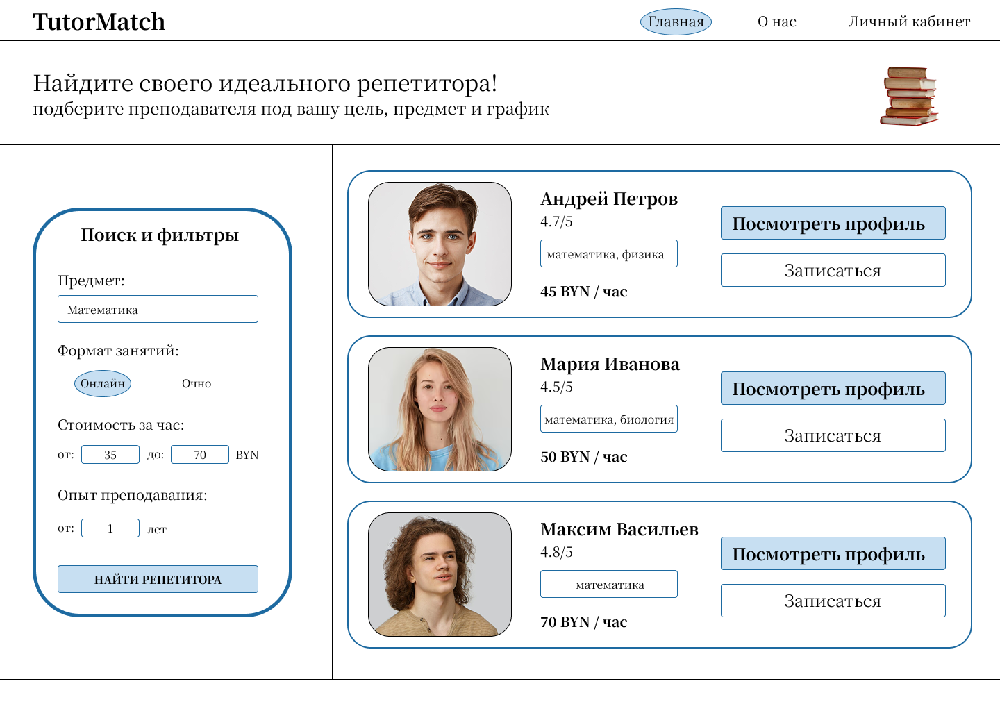
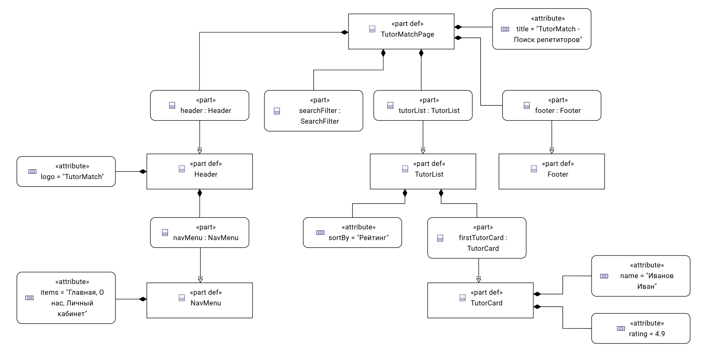

# Спецификация требований к ПО

Для платформы поиска и выбора репетиторов «TutorPlatform»

Версия 0.1

Подготовил: Соломенников Кирилл Игоревич

БГУИР, кафедра ЭВМ

04.11.2026

## Оглавление

* [1. Введение](#1-introduction)
  * [1.1 Назначение документа](#11-document-purpose)
  * [1.2 Область применения продукта](#12-product-scope)
  * [1.3 Определения, акронимы и сокращения](#13-definitions-acronyms-and-abbreviations)
  * [1.4 Ссылки](#14-references)
  * [1.5 Обзор документа](#15-document-overview)
* [2. Обзор продукта](#2-product-overview)
  * [2.1 Перспектива продукта](#21-product-perspective)
  * [2.2 Функции продукта](#22-product-functions)
  * [2.3 Ограничения продукта](#23-product-constraints)
  * [2.4 Характеристики пользователей](#24-user-characteristics)
  * [2.5 Допущения и зависимости](#25-assumptions-and-dependencies)
  * [2.6 Распределение требований](#26-apportioning-of-requirements)
* [3. Требования](#3-requirements)
  * [3.1 Внешние интерфейсы](#31-external-interfaces)
    * [3.1.1 Пользовательские интерфейсы](#311-user-interfaces)
    * [3.1.2 Аппаратные интерфейсы](#312-hardware-interfaces)
    * [3.1.3 Программные интерфейсы](#313-software-interfaces)
  * [3.2 Функциональные требования](#32-functional)
  * [3.3 Качество обслуживания](#33-quality-of-service)
    * [3.3.1 Производительность](#331-performance)
    * [3.3.2 Безопасность](#332-security)
    * [3.3.3 Надёжность](#333-reliability)
    * [3.3.4 Доступность](#334-availability)
    * [3.3.5 Наблюдаемость](#335-observability)
  * [3.4 Соответствие стандартам](#34-compliance)
  * [3.5 Проектирование и реализация](#35-design-and-implementation)
  * [3.6 ИИ/МО](#36-aiml)
* [4. Верификация](#4-verification)
* [5. Приложения](#5-appendixes)

## История изменений

| Name | Date | Reason For Changes | Version |
|------|------|--------------------|---------|
| Соломенников Кирилл Игоревич | 04.11.2026 | Первоначальная версия | 0.1 |

---

## 1. Введение

### 1.1 Назначение документа

Настоящий документ определяет требования к веб-платформе «TutorPlatform», предназначенной для поиска и выбора репетиторов. SRS описывает **что** должна делать система, а не **как** она реализуется. Документ предназначен для продуктовой команды, разработчиков, тестировщиков, а также для заказчика и других заинтересованных сторон. Он служит основой для проектирования, реализации и верификации продукта.

### 1.2 Область применения продукта

«TutorPlatform» — это веб-приложение, которое позволяет ученикам (или их родителям) находить репетиторов по заданным критериям: предмет, стоимость, местоположение, формат занятий (онлайн/офлайн), рейтинг и отзывы. Репетиторы могут регистрироваться, создавать профили и управлять расписанием. Платформа обеспечивает связь между учеником и репетитором, бронирование занятий и оплату (в перспективе).

**Входит в область проекта:** регистрация и аутентификация пользователей, поиск с фильтрами, профили репетиторов, система отзывов и рейтингов, запрос на бронирование, базовая панель администратора.

**Не входит:** собственная видеоплатформа для проведения занятий, встроенный мессенджер (только контактные данные), сложные финансовые расчёты (на первом этапе — только заявка на оплату).

### 1.3 Определения, акронимы и сокращения

| Term | Definition |
|------|------------|
| SRS | Software Requirements Specification — спецификация требований к ПО |
| UI | User Interface — пользовательский интерфейс |
| API | Application Programming Interface — программный интерфейс |
| Репетитор | Преподаватель, предоставляющий услуги на платформе |
| Ученик | Пользователь, ищущий репетитора (может быть родителем) |
| Администратор | Сотрудник платформы, управляющий контентом и пользователями |
| Бронирование | Запрос ученика на проведение занятия с репетитором |

### 1.4 Ссылки

- Шаблон SRS из репозитория (srs/srs-template.md).
- Стандарт СТП 01–2024 БГУИР.
- Руководство по доступности WCAG 2.1 (справочно).
- Документация фреймворка (например, Django/React) — по выбору.

### 1.5 Обзор документа

Раздел 1 содержит введение и глоссарий. Раздел 2 описывает продукт в целом, его функции и пользователей. Раздел 3 детализирует требования: интерфейсы, функциональные и нефункциональные требования, ограничения. Раздел 4 описывает подходы к верификации. Раздел 5 — приложения (при необходимости).

---

## 2. Обзор продукта

### 2.1 Перспектива продукта

«TutorPlatform» — новый самостоятельный продукт, не являющийся заменой существующих систем. Платформа работает в браузере и использует внешние сервисы: карты для отображения местоположения (например, Google Maps API или OpenStreetMap), платёжный шлюз (в будущем). Владелец продукта — учебный проект в рамках дисциплины ЖЦРПО; модель поддержки — учебная.

### 2.2 Функции продукта

- Регистрация и аутентификация пользователей (ученик, репетитор, администратор).
- Создание и редактирование профиля репетитора (предметы, стоимость, опыт, фото, описание).
- Поиск репетиторов с фильтрами: предмет, цена, формат (онлайн/офлайн), рейтинг, местоположение.
- Просмотр профиля репетитора с отзывами и расписанием.
- Система отзывов и рейтингов.
- Бронирование занятия (запрос с выбором даты и времени).
- Панель администратора для управления пользователями и модерации отзывов.

### 2.3 Ограничения продукта

- Веб-приложение должно работать в современных браузерах (Chrome, Firefox, Edge, Safari).
- Серверная часть — по выбору команды, но должна обеспечивать REST API.
- Аутентификация — по email и паролю с хешированием.
- Персональные данные должны храниться с учётом базовых требований безопасности.
- Платформа должна корректно отображаться на мобильных устройствах (адаптивная вёрстка).
- Сроки: в рамках семестра.

### 2.4 Характеристики пользователей

- **Ученик (клиент):** ищет репетитора, имеет базовые навыки работы с веб-сайтами. Частота использования — периодическая. Цель — найти подходящего преподавателя.
- **Репетитор:** создаёт профиль, управляет расписанием и заявками. Уровень подготовки — разный, но предполагается уверенное владение компьютером.
- **Администратор:** сотрудник платформы, управляет контентом, блокирует нарушителей. Имеет повышенные права доступа.

### 2.5 Допущения и зависимости

- Предполагается, что пользователи имеют доступ к интернету и современный браузер.
- Зависимость от внешнего API карт для отображения местоположения (если выбрано).
- Зависимость от выбранной СУБД (например, PostgreSQL).
- Если допущение о доступности API карт не выполнится, функциональность поиска по карте может быть ограничена.

### 2.6 Распределение требований

Основные требования распределены по релизам:
- **Релиз 1 (MVP):** регистрация, профили, поиск с фильтрами, отзывы, бронирование.
- **Релиз 2:** панель администратора, интеграция с картами, расширенные фильтры.

---

## 3. Требования

### 3.1 Внешние интерфейсы

#### 3.1.1 Пользовательские интерфейсы

- Веб-интерфейс, адаптивный для десктопа и мобильных устройств.
- Основные экраны: главная страница с поиском, страница результатов поиска, профиль репетитора, личный кабинет ученика/репетитора, страница бронирования, панель администратора.
- Элементы управления: фильтры (выпадающие списки, слайдеры), кнопки, формы.
- Соответствие базовым принципам доступности (контрастность, alt-тексты).
- Сообщения об ошибках и пустых состояниях должны быть понятны пользователю.

Основные экраны платформы и их компоновка отображены на UI-мокапе (Рисунок 1).

*Рисунок 1 – Визуальный мокап пользовательского интерфейса платформы TutorPlatform*

#### 3.1.2 Аппаратные интерфейсы

Не применимо (веб-приложение, доступ через браузер).

#### 3.1.3 Программные интерфейсы

- REST API для взаимодействия клиентской и серверной частей.
- Интеграция с внешним сервисом карт (например, Leaflet + OpenStreetMap) для отображения местоположения репетиторов.
- Формат обмена данными — JSON.
- Аутентификация через JWT или сессионные cookie.

### 3.2 Функциональные требования

**REQ-FUNC-001. Регистрация пользователя**
- **Statement:** Система должна позволять новому пользователю зарегистрироваться как ученик или репетитор, указав email, пароль и роль.
- **Rationale:** Разделение ролей необходимо для разграничения прав.
- **Acceptance Criteria:** После успешной регистрации пользователь перенаправляется в личный кабинет; email уникален.
- **Verification Method:** Test.

**REQ-FUNC-002. Аутентификация**
- **Statement:** Система должна обеспечивать вход по email и паролю с проверкой учётных данных.
- **Acceptance Criteria:** При неверном пароле выводится сообщение об ошибке; при успехе — доступ к защищённым страницам.
- **Verification Method:** Test.

**REQ-FUNC-003. Профиль репетитора**
- **Statement:** Система должна позволять репетитору создавать и редактировать профиль: предметы, стоимость занятия, описание, опыт, фото, формат занятий.
- **Acceptance Criteria:** Изменения сохраняются и отображаются в публичном профиле.
- **Verification Method:** Test.

**REQ-FUNC-004. Поиск репетиторов**
- **Statement:** Система должна предоставлять поиск репетиторов с фильтрами по предмету, цене, формату, рейтингу и местоположению.
- **Acceptance Criteria:** Результаты поиска соответствуют выбранным фильтрам; поддерживается сортировка по рейтингу и цене.
- **Verification Method:** Test.

**REQ-FUNC-005. Просмотр профиля репетитора**
- **Statement:** Система должна отображать публичный профиль репетитора с отзывами и расписанием.
- **Acceptance Criteria:** Данные профиля доступны без авторизации; отзывы отображаются с указанием автора и оценки.
- **Verification Method:** Test.

**REQ-FUNC-006. Отзывы и рейтинги**
- **Statement:** Система должна позволять авторизованным ученикам оставлять отзыв и оценку (1–5) после проведённого занятия.
- **Acceptance Criteria:** Отзыв сохраняется, средний рейтинг пересчитывается.
- **Verification Method:** Test.

**REQ-FUNC-007. Бронирование занятия**
- **Statement:** Система должна позволять ученику отправить запрос на бронирование занятия с выбором даты и времени.
- **Acceptance Criteria:** Запрос сохраняется и отображается в личном кабинете репетитора.
- **Verification Method:** Test.

**REQ-FUNC-008. Панель администратора**
- **Statement:** Система должна предоставлять администратору возможность просматривать список пользователей, блокировать нарушителей и модерировать отзывы.
- **Acceptance Criteria:** Действия администратора применяются немедленно.
- **Verification Method:** Demonstration.

### 3.3 Качество обслуживания

#### 3.3.1 Производительность

- Время загрузки страницы результатов поиска — не более 2 секунд при нагрузке до 100 одновременных пользователей.
- Время отклика API на запрос поиска — не более 500 мс.

#### 3.3.2 Безопасность

- Пароли хранятся в хешированном виде (например, bcrypt).
- Защита от SQL-инъекций и XSS.
- Доступ к административной панели — только для роли «администратор».
- Персональные данные не передаются третьим лицам без согласия.

#### 3.3.3 Надёжность

- Система должна корректно обрабатывать ошибки ввода и возвращать понятные сообщения.
- При недоступности внешнего API карт поиск по карте должен gracefully деградировать (показывать список без карты).

#### 3.3.4 Доступность

- Целевая доступность — 99% в учебном окружении (в рамках семестра).
- Плановые работы — не более 1 часа в неделю.

#### 3.3.5 Наблюдаемость

- Логирование основных действий (вход, регистрация, бронирование) с временными метками.
- Возможность просмотра логов администратором.

### 3.4 Соответствие стандартам

- Соблюдение требований СТП БГУИР к документации.
- Базовое соответствие WCAG 2.1 (уровень A) для доступности.

### 3.5 Проектирование и реализация

- **Установка:** развёртывание на сервере с помощью Docker (по возможности) или локально.
- **Сборка и поставка:** использование Git, CI/CD (например, GitHub Actions) для автоматической сборки и тестов.
- **Распределение:** клиент-серверная архитектура; база данных — PostgreSQL.
- **Сопровождаемость:** модульная структура кода, документирование API (Swagger/OpenAPI).
- **Повторное использование:** использование готовых библиотек для аутентификации, UI-компонентов.
- **Переносимость:** работа в современных браузерах; серверная часть — кроссплатформенная.
- **Стоимость:** минимальные затраты (учебный проект).
- **Сроки:** в рамках учебного семестра.
- **Доказательство концепции:** прототип главной страницы с поиском.
- **Управление изменениями:** через Pull Request и Git-ветки.

### 3.6 ИИ/МО

Не применимо. В текущей версии платформа не использует модели машинного обучения. В перспективе возможна рекомендательная система, но она не входит в текущие требования.

---

## 4. Верификация

| Requirement ID | Verification Method | Test/Artifact Link | Status | Evidence |
|----------------|---------------------|--------------------|--------|----------|
| REQ-FUNC-001 | Test | tests/test_registration.md | Planned | |
| REQ-FUNC-002 | Test | tests/test_login.md | Planned | |
| REQ-FUNC-003 | Test | tests/test_tutor_profile.md | Planned | |
| REQ-FUNC-004 | Test | tests/test_search.md | Planned | |
| REQ-FUNC-005 | Test | tests/test_view_profile.md | Planned | |
| REQ-FUNC-006 | Test | tests/test_reviews.md | Planned | |
| REQ-FUNC-007 | Test | tests/test_booking.md | Planned | |
| REQ-FUNC-008 | Demonstration | demo/admin_panel.md | Planned | |

---

## 5. Приложения

Приложение А. Структурная схема платформы.

*Рисунок 2 – Структурная компонентная схема платформы TutorPlatform (SysML v2)*