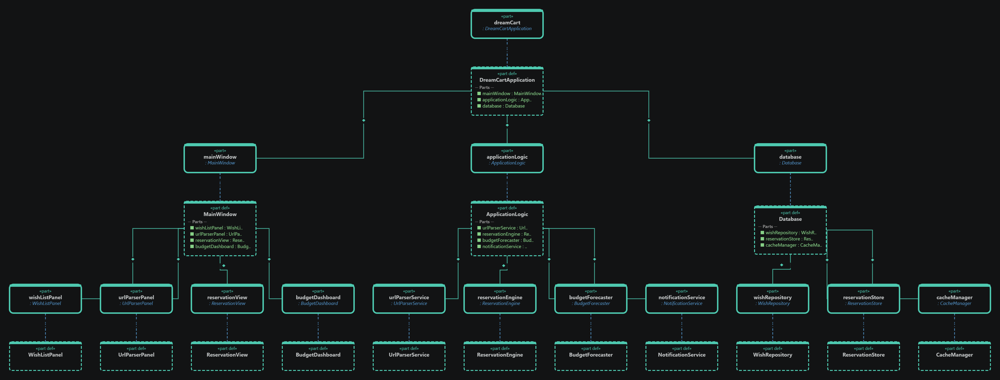
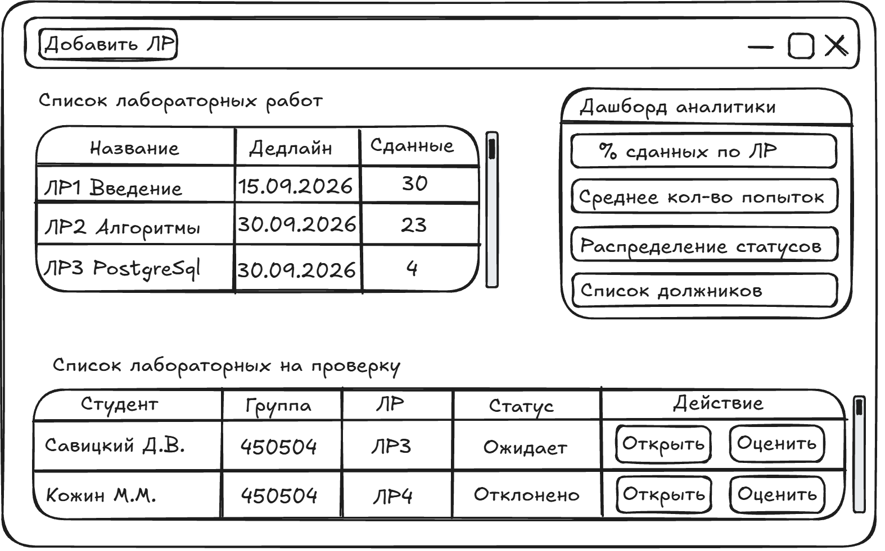

# Спецификация требований к ПО
## LabTracker — система контроля сдачи лабораторных работ (Демо-версия)

**Версия:** 1.0  
**Подготовил:** Савицкий Денис  
**Организация:** БГУИР  
**Дата изменения:** 08.11.2026

## Оглавление

<!-- TOC -->
* [1. Введение](#1-introduction)
    * [1.1 Назначение документа](#11-document-purpose)
    * [1.2 Область применения продукта](#12-product-scope)
    * [1.3 Определения, акронимы и сокращения](#13-definitions-acronyms-and-abbreviations)
    * [1.4 Ссылки](#14-references)
    * [1.5 Обзор документа](#15-document-overview)
* [2. Обзор продукта](#2-product-overview)
    * [2.1 Перспектива продукта](#21-product-perspective)
    * [2.2 Функции продукта](#22-product-functions)
    * [2.3 Ограничения продукта](#23-product-constraints)
    * [2.4 Характеристики пользователей](#24-user-characteristics)
    * [2.5 Допущения и зависимости](#25-assumptions-and-dependencies)
    * [2.6 Распределение требований](#26-apportioning-of-requirements)
* [3. Требования](#3-requirements)
    * [3.1 Внешние интерфейсы](#31-external-interfaces)
        * [3.1.1 Пользовательские интерфейсы](#311-user-interfaces)
        * [3.1.2 Аппаратные интерфейсы](#312-hardware-interfaces)
        * [3.1.3 Программные интерфейсы](#313-software-interfaces)
    * [3.2 Функциональные требования](#32-functional)
    * [3.3 Качество обслуживания](#33-quality-of-service)
        * [3.3.1 Производительность](#331-performance)
        * [3.3.2 Безопасность](#332-security)
        * [3.3.3 Надёжность](#333-reliability)
        * [3.3.4 Доступность](#334-availability)
        * [3.3.5 Наблюдаемость](#335-observability)
    * [3.4 Соответствие стандартам](#34-compliance)
    * [3.5 Проектирование и реализация](#35-design-and-implementation)
        * [3.5.1 Установка](#351-installation)
        * [3.5.2 Сборка и поставка](#352-build-and-delivery)
        * [3.5.3 Распределение](#353-distribution)
        * [3.5.4 Сопровождаемость](#354-maintainability)
        * [3.5.5 Повторное использование](#355-reusability)
        * [3.5.6 Переносимость](#356-portability)
        * [3.5.7 Стоимость](#357-cost)
        * [3.5.8 Сроки](#358-deadline)
        * [3.5.9 Доказательство концепции](#359-proof-of-concept)
        * [3.5.10 Управление изменениями](#3510-change-management)
    * [3.6 ИИ/МО](#36-aiml)
* [4. Верификация](#4-verification)
* [5. Приложения](#5-appendixes)
<!-- TOC -->

## 1. Введение

Документ определяет требования к LabTracker — локальному веб-приложению для демонстрации процесса сдачи и проверки лабораторных работ. Спецификация предназначена для разработчика, тестировщика и руководителя учебного проекта.

### 1.1 Назначение документа
Цель SRS — определить, **что** должно делать приложение LabTracker в рамках демонстрационной (MVP) версии. Документ используется на этапах разработки, тестирования и приёмки продукта.

### 1.2 Область применения продукта
LabTracker версии 1.0 — веб-приложение для контроля сдачи лабораторных работ. В демо-версии реализованы два отдельных интерфейса: «Студент» (для загрузки отчётов и отслеживания статусов) и «Преподаватель» (для управления ЛР, проверки работ и просмотра расширенной аналитики). Система аутентификации отсутствует; доступ к интерфейсам осуществляется через прямые URL или локальное меню навигации. Геймификация, email-уведомления и интеграция с внешними системами не входят в область версии 1.0.

### 1.3 Определения, акронимы и сокращения
| Термин | Определение |
|---|---|
| SRS | Software Requirements Specification — спецификация требований к ПО |
| UI | User Interface — пользовательский интерфейс |
| ЛР | Лабораторная работа — учебное задание, выполняемое студентом |
| MVP | Minimum Viable Product — минимально жизнеспособный продукт |
| Дедлайн | Крайний срок сдачи лабораторной работы |
| Spring Boot | Фреймворк для создания Java-приложений |
| PostgreSQL | Реляционная система управления базами данных |
| Версионность сдач | Хранение истории всех попыток сдачи лабораторной работы |

### 1.4 Ссылки
| Источник | Назначение | Статус |
|---|---|---|
| Концепция LabTracker, предоставленная автором | Назначение и основные возможности | Основной источник |
| Диаграмма компонентов LabTracker, предоставленная автором | Компоненты и связи системы | Основной источник |
| Документация Java / Spring Boot / PostgreSQL | Справка по технологиям | Справочный |

Версии Java, Spring Boot и PostgreSQL должны быть зафиксированы в проектной документации перед выпуском итоговой сборки.

### 1.5 Обзор документа
Раздел 1 описывает назначение продукта. Раздел 2 раскрывает контекст, функции и ограничения. Раздел 3 содержит детальные требования. Раздел 4 определяет методы проверки, а раздел 5 содержит приложения с диаграммами и макетами.

## 2. Обзор продукта

### 2.1 Перспектива продукта
LabTracker является самостоятельным демонстрационным продуктом. Класс `LabTrackerApplication` связывает веб-интерфейс `WebUI`, прикладную логику `ApplicationLogic` и слой хранения `Database`. Приложение работает как локальный веб-сервер и не требует внешних API или сложной настройки безопасности.

### 2.2 Функции продукта
1. Создание преподавателем лабораторных работ с указанием названия, описания и дедлайна.
2. Редактирование лабораторных работ (только до момента первой сдачи).
3. Загрузка студентом отчёта (PDF/DOCX, до 10 МБ) для конкретной ЛР.
4. Проверка работ преподавателем с принятием или отклонением.
5. Обязательный комментарий преподавателя при отклонении работы.
6. Версионность сдач — хранение истории всех пересдач с датами и статусами.
7. Цветовая индикация дедлайнов (зелёный, жёлтый, красный, серый).
8. Расширенный дашборд аналитики для преподавателя: процент сдавших, среднее время сдачи, выявление проблемных ЛР, среднее количество попыток сдачи на одного студента, визуальное распределение статусов (Принято/Ожидает/Отклонено), топ студентов с наибольшим числом отклонённых или просроченных сдач.

### 2.3 Ограничения продукта
- Backend: Java 17+, Spring Boot.
- База данных: PostgreSQL 12+.
- Frontend: HTML5, CSS3, JavaScript (адаптивный веб-интерфейс).
- Без внешних API, аутентификации и регистрации пользователей.
- Один файл на сдачу (до 10 МБ, форматы PDF/DOCX).
- Редактирование ЛР после начала сдач запрещено.

### 2.4 Характеристики пользователей
| Группа | Возможности | Подготовка |
|---|---|---|
| Демонстратор (Студент) | Загружает отчёты, отслеживает статусы, просматривает дедлайны | Базовые навыки работы с веб-интерфейсами |
| Демонстратор (Преподаватель) | Создаёт ЛР, проверяет работы, просматривает расширенную аналитику | Уверенный пользователь ПК |

### 2.5 Допущения и зависимости
| Допущение/зависимость | Последствие нарушения |
|---|---|
| Доступна локальная среда Java и СУБД | Приложение не запустится |
| Пользователь загружает файлы корректного формата | Ошибки валидации и отклонение файлов |

### 2.6 Распределение требований
| Компонент диаграммы | Ответственность |
|---|---|
| `LabTrackerApplication` | Инициализация и связывание главных компонентов |
| `WebUI` | Отдельные интерфейсы студента и преподавателя, визуализация дедлайнов |
| `ApplicationLogic` | Координация прикладных операций |
| `LabService` | Управление лабораторными работами и их параметрами |
| `SubmissionService` | Логика сдачи работ, версионности и статусов |
| `AnalyticsService` | Расчёт расширенной статистики успеваемости |
| `FileStorageService` | Валидация и сохранение загружаемых файлов |
| `DeadlineIndicator` | Определение цветовой индикации дедлайнов |
| `Database` | Доступ к хранилищу (PostgreSQL) |
| `LabRepository` | Хранение лабораторных работ |
| `SubmissionRepository` | Хранение сдач и истории версий |

## 3. Требования

### 3.1 Внешние интерфейсы
#### 3.1.1 Пользовательские интерфейсы
Приложение предоставляет два независимых веб-интерфейса. Интерфейс студента включает список лабораторных работ с цветовой индикацией дедлайнов и форму загрузки отчёта. Интерфейс преподавателя включает управление ЛР, таблицу сдач для проверки и расширенный дашборд аналитики. Переключение между режимами в рамках одной сессии не предусмотрено.

#### 3.1.2 Аппаратные интерфейсы
Специализированные аппаратные устройства не требуются. Необходим персональный компьютер с современным веб-браузером (Chrome, Firefox, Edge) и сетевым подключением (localhost).

#### 3.1.3 Программные интерфейсы
| Система/компонент | Назначение | Ограничения |
|------------|---|---|
| Java Runtime | Выполнение приложения | Версия 17 или выше |
| Spring Boot | Фреймворк для backend | Версия фиксируется при сборке |
| PostgreSQL | Хранение данных | Версия 12+  |
| HTTP       | Сетевое взаимодействие | Локальный порт (например, 8080) |

### 3.2 Функциональные требования

#### Управление лабораторными работами
**REQ-FUNC-001 — Создание лабораторной работы**
- **Statement:** Система должна позволять создавать ЛР, указав название, описание и дедлайн (дата и время).
- **Rationale:** Определение заданий и сроков.
- **Acceptance Criteria:** ЛР создана с указанными параметрами; отображается в списке с цветовой индикацией дедлайна.
- **Verification Method:** Test.
- **More Information:** `LabService`, `LabRepository`, `DeadlineIndicator`.

**REQ-FUNC-002 — Редактирование лабораторной работы**
- **Statement:** Система должна позволять редактировать параметры ЛР только если по этой работе ещё не было ни одной сдачи.
- **Rationale:** Защита от изменения условий задним числом.
- **Acceptance Criteria:** При наличии сдач — редактирование заблокировано; без сдач — доступно.
- **Verification Method:** Test.

#### Процесс сдачи и версионность
**REQ-FUNC-003 — Загрузка отчёта**
- **Statement:** Система должна позволять загрузить один файл отчёта (PDF, DOCX, до 10 МБ) для конкретной ЛР.
- **Rationale:** Сдача работы в электронном виде.
- **Acceptance Criteria:** Файл загружен; при превышении 10 МБ или неверном формате — сообщение об ошибке.
- **Verification Method:** Test.
- **More Information:** `SubmissionService`, `FileStorageService`, `SubmissionRepository`.

**REQ-FUNC-004 — Статусы сдачи и комментарий**
- **Statement:** Система должна присваивать сдаче статус: `Ожидает проверки`, `Принята` или `Отклонена`. При отклонении система должна требовать ввода текстового комментария.
- **Rationale:** Отслеживание состояния и обратная связь.
- **Acceptance Criteria:** Без комментария отклонение невозможно; после отклонения комментарий отображается в интерфейсе студента.
- **Verification Method:** Test.

**REQ-FUNC-005 — Версионность сдач**
- **Statement:** Система должна хранить историю всех версий сдач для каждой ЛР с указанием даты, статуса и комментария.
- **Rationale:** Прозрачность процесса пересдач.
- **Acceptance Criteria:** При пересдаче создаётся новая версия; история отображается хронологически.
- **Verification Method:** Test.
- **More Information:** `SubmissionRepository`.

#### Визуализация и аналитика
**REQ-FUNC-006 — Цветовая индикация дедлайнов**
- **Statement:** Система должна отображать цветовую индикацию статуса дедлайна: 🟢 зелёный (>7 дней), 🟡 жёлтый (3–7 дней), 🔴 красный (<3 дней), ⚫ серый (дедлайн истёк).
- **Rationale:** Визуальная оценка срочности задач.
- **Acceptance Criteria:** Цветовая маркировка обновляется автоматически и соответствует палитре.
- **Verification Method:** Test.
- **More Information:** `DeadlineIndicator`.

**REQ-FUNC-007 — Расширенный дашборд аналитики**
- **Statement:** Система должна предоставлять преподавателю дашборд аналитики, включающий: процент сдавших каждую ЛР, среднее время сдачи, среднее количество попыток сдачи на студента, визуальное распределение статусов (Принято/Ожидает/Отклонено), топ-5 студентов с наибольшим числом отклонённых или просроченных сдач.
- **Rationale:** Глубокий анализ успеваемости позволяет преподавателю точечно работать с отстающими и корректировать сложность заданий.
- **Acceptance Criteria:** Все метрики рассчитываются на актуальных данных; топ-студентов сортируется по убыванию проблемных сдач; распределение статусов отображается графически.
- **Verification Method:** Test.
- **More Information:** `AnalyticsService`.

### 3.3 Качество обслуживания
#### 3.3.1 Производительность
**REQ-PERF-001 — Время загрузки страниц**
- **Statement:** Система должна загружать любую страницу не более чем за 2 секунды в локальной среде.
- **Acceptance Criteria:** Все страницы загружаются за ≤2 секунд.
- **Verification Method:** Test.

#### 3.3.2 Безопасность
**REQ-SEC-001 — Валидация входных данных**
- **Statement:** Система должна валидировать все загружаемые файлы (формат, размер).
- **Acceptance Criteria:** Файлы проверяются на соответствие PDF/DOCX и ≤10 МБ. Невалидные файлы отклоняются.
- **Verification Method:** Test.
- **More Information:** `FileStorageService`.

#### 3.3.3 Надёжность
**REQ-REL-001 — Обработка ошибок загрузки файлов**
- **Statement:** Система должна корректно обрабатывать попытки загрузки файлов >10 МБ или неверного формата с понятным сообщением.
- **Acceptance Criteria:** При >10 МБ — "Размер файла не должен превышать 10 МБ"; при неверном формате — "Разрешены только PDF и DOCX".
- **Verification Method:** Test.

**REQ-REL-002 — Сохранность данных**
- **Statement:** Система должна сохранять подтверждённые изменения в постоянном хранилище.
- **Acceptance Criteria:** После перезапуска приложения ранее сохранённые данные доступны в прежнем состоянии.
- **Verification Method:** Test.

#### 3.3.4 Доступность
**REQ-AVAIL-001 — Локальная доступность**
- **Statement:** Система должна быть доступна по локальному адресу (localhost) во время работы сервера.
- **Acceptance Criteria:** Приложение отвечает на HTTP-запросы к порту 8080.
- **Verification Method:** Test.

#### 3.3.5 Наблюдаемость
**REQ-OBS-001 — Логирование**
- **Statement:** Система должна логировать ключевые операции (загрузка файлов, изменение статусов) с указанием времени и действия.
- **Acceptance Criteria:** Логи содержат timestamp и action type в консоли или файле.
- **Verification Method:** Inspection.

### 3.4 Соответствие стандартам
Исходный код должен соответствовать единому стилю Java. Документация и структура проекта должны соответствовать СТП 01-2024 БГУИР.

### 3.5 Проектирование и реализация
#### 3.5.1 Установка
**REQ-INST-001 — Запуск приложения**
- **Statement:** Приложение должно запускаться в целевой среде с предустановленной Java 17+ и СУБД.
- **Acceptance Criteria:** Приложение запускается по инструкции и отображает веб-интерфейс.
- **Verification Method:** Demonstration, Test.

#### 3.5.2 Сборка и поставка
**REQ-BUILD-001 — Сборка проекта**
- **Statement:** Проект должен собираться через Maven или Gradle, генерируя исполняемый JAR.
- **Acceptance Criteria:** Команда `mvn clean package` успешно создаёт JAR.
- **Verification Method:** Test, Inspection.

#### 3.5.4 Сопровождаемость
**REQ-MAINT-001 — Модульность**
- **Statement:** Система должна разделять интерфейс, прикладную логику, сдачу работ, аналитику и доступ к данным на отдельные компоненты.
- **Acceptance Criteria:** `WebUI`, `ApplicationLogic`, `SubmissionService`, `AnalyticsService` и `Database` имеют разграниченные обязанности.
- **Verification Method:** Inspection.

#### 3.5.6 Переносимость
**REQ-PORT-001 — Кроссплатформенность**
- **Statement:** Система должна работать на Linux, Windows и macOS без изменений в коде.
- **Acceptance Criteria:** Система успешно развёртывается на указанных ОС.
- **Verification Method:** Test, Inspection.

#### 3.5.9 Доказательство концепции
До полной реализации следует проверить:
1. Загрузка файлов должна корректно валидировать формат и размер.
2. Версионность сдач должна корректно хранить историю всех пересдач с комментариями.
3. Расширенная аналитика должна корректно рассчитывать среднее кол-во попыток и формировать топ проблемных студентов.

### 3.6 ИИ/МО
В версии 1.0 модели искусственного интеллекта и машинного обучения не используются. Разделы 3.6.1 – 3.6.6 не применяются.

## 4. Верификация

| ID требования | Метод проверки | Проверка/артефакт | Статус |
|---|---|---|---|
| REQ-FUNC-001 | Test | Создание лабораторной работы | Запланировано |
| REQ-FUNC-002 | Test | Редактирование ЛР до/после сдач | Запланировано |
| REQ-FUNC-003 | Test | Загрузка файла с валидацией | Запланировано |
| REQ-FUNC-004 | Test | Изменение статусов и комментарий | Запланировано |
| REQ-FUNC-005 | Test | Версионность сдач | Запланировано |
| REQ-FUNC-006 | Test | Цветовая индикация дедлайнов | Запланировано |
| REQ-FUNC-007 | Test | Расширенный дашборд аналитики | Запланировано |
| REQ-PERF-001 | Test | Время загрузки страниц | Запланировано |
| REQ-SEC-001 | Test | Валидация файлов | Запланировано |
| REQ-REL-001 | Test | Обработка ошибок загрузки | Запланировано |
| REQ-REL-002 | Test | Сохранность данных после перезапуска | Запланировано |
| REQ-INST-001 | Demonstration | Установка и запуск | Запланировано |
| REQ-BUILD-001 | Test, Inspection | Сборка проекта | Запланировано |
| REQ-MAINT-001 | Inspection | Проверка структуры компонентов | Запланировано |

Статус «Запланировано» означает, что способ проверки определён, но успешное выполнение ещё не подтверждено.

## 5. Приложения

### Приложение А. Архитектура системы

### Приложение Б. Макет пользовательского интерфейса

