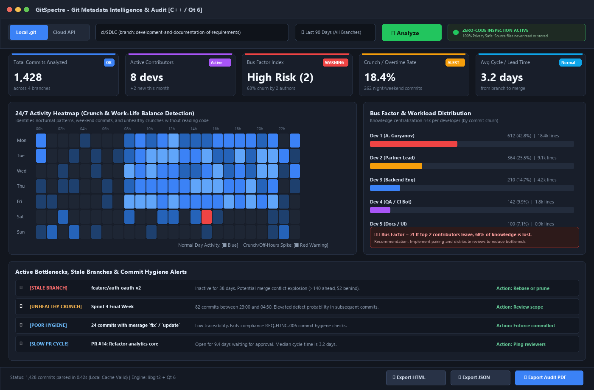
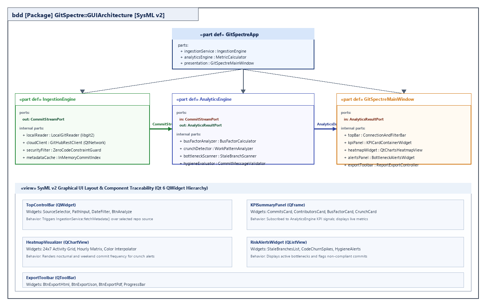
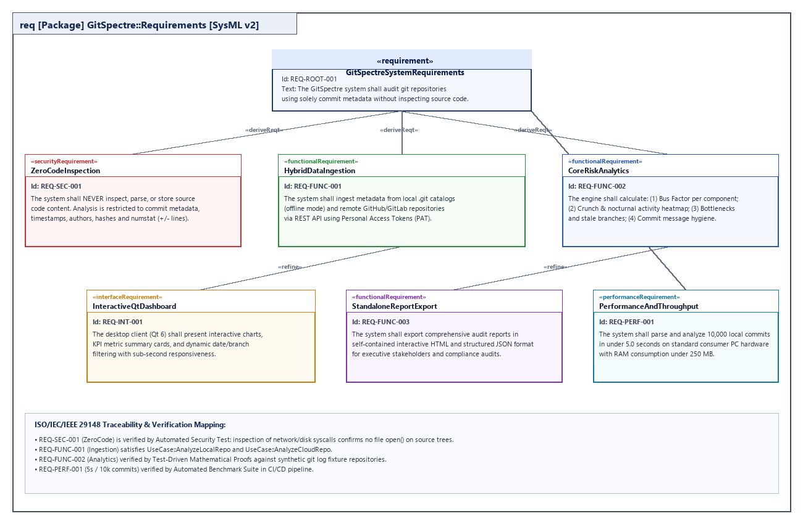

# Спецификация требований к ПО

Для GitSpectre (Система инженерного анализа метаданных Git-репозиториев)

Версия 0.1

Подготовил Гурьянов А.С.

БГУИР, факультет компьютерных систем и сетей, кафедра компьютерной инженерии

21.10.2026

## Оглавление

<!-- TOC -->
* [1. Введение](#1-introduction)
  * [1.1 Назначение документа](#11-document-purpose)
  * [1.2 Область применения продукта](#12-product-scope)
  * [1.3 Определения, акронимы и сокращения](#13-definitions-acronyms-and-abbreviations)
  * [1.4 Ссылки](#14-references)
  * [1.5 Обзор документа](#15-document-overview)
* [2. Обзор продукта](#2-product-overview)
  * [2.1 Перспектива продукта](#21-product-perspective)
  * [2.2 Функции продукта](#22-product-functions)
  * [2.3 Ограничения продукта](#23-product-constraints)
  * [2.4 Характеристики пользователей](#24-user-characteristics)
  * [2.5 Допущения и зависимости](#25-assumptions-and-dependencies)
  * [2.6 Распределение требований](#26-apportioning-of-requirements)
* [3. Требования](#3-requirements)
  * [3.1 Внешние интерфейсы](#31-external-interfaces)
    * [3.1.1 Пользовательские интерфейсы](#311-user-interfaces)
    * [3.1.2 Аппаратные интерфейсы](#312-hardware-interfaces)
    * [3.1.3 Программные интерфейсы](#313-software-interfaces)
  * [3.2 Функциональные требования](#32-functional)
  * [3.3 Качество обслуживания](#33-quality-of-service)
    * [3.3.1 Производительность](#331-performance)
    * [3.3.2 Безопасность](#332-security)
    * [3.3.3 Надёжность](#333-reliability)
    * [3.3.4 Доступность](#334-availability)
    * [3.3.5 Наблюдаемость](#335-observability)
  * [3.4 Соответствие стандартам](#34-compliance)
  * [3.5 Проектирование и реализация](#35-design-and-implementation)
    * [3.5.1 Установка](#351-installation)
    * [3.5.2 Сборка и поставка](#352-build-and-delivery)
    * [3.5.3 Распределение](#353-distribution)
    * [3.5.4 Сопровождаемость](#354-maintainability)
    * [3.5.5 Повторное использование](#355-reusability)
    * [3.5.6 Переносимость](#356-portability)
    * [3.5.7 Стоимость](#357-cost)
    * [3.5.8 Сроки](#358-deadline)
    * [3.5.9 Доказательство концепции](#359-proof-of-concept)
    * [3.5.10 Управление изменениями](#3510-change-management)
  * [3.6 ИИ/МО](#36-aiml)
    * [3.6.1 Спецификация модели](#361-model-specification)
    * [3.6.2 Управление данными](#362-data-management)
    * [3.6.3 Ограничители (Guardrails)](#363-guardrails)
    * [3.6.4 Этика](#364-ethics)
    * [3.6.5 Human-in-the-Loop](#365-human-in-the-loop)
    * [3.6.6 Жизненный цикл модели и операции](#366-model-lifecycle-and-operations)
* [4. Верификация](#4-verification)
* [5. Приложения](#5-appendixes)
<!-- TOC -->

## История изменений

| Name | Date | Reason For Changes | Version |
|------|------|--------------------|---------|
| Гурьянов А.С. | 21.10.2026 | Начальная редакция SRS системы GitSpectre по стандарту ISO/IEC/IEEE 29148 | 0.1 |

---

## 1. Введение {#1-introduction}

Данный документ представляет собой спецификацию требований к программному обеспечению (SRS) для настольной системы инженерного аудита и анализа репозиториев **«GitSpectre»**. Документ устанавливает бизнес-цели, функциональные возможности, качественные характеристики и системные ограничения продукта на протяжении всего его жизненного цикла разработки.

### 1.1 Назначение документа {#11-document-purpose}

Настоящая спецификация определяет **ЧТО** должна делать система GitSpectre, фиксируя функциональные и нефункциональные требования к продукту без привязки к деталям внутренней низкоуровневой реализации. 

Документ предназначен для:
- **Заказчика и продуктового менеджмента (CTO / Team Lead):** верификация соответствия системы поставленным бизнес-целям анализа инженерных метрик и аудита команды разработки.
- **Группы разработки:** руководство для архитектурного проектирования (SDD), принятия архитектурных решений (ADR) и написания исходного кода.
- **Инженеров по контролю качества (QA):** основа для формирования плана тестирования, верификационной матрицы и тест-кейсов.

### 1.2 Область применения продукта {#12-product-scope}

**Продукт:** «GitSpectre» (версия 0.1).  
**Основное назначение:** проведение объективного оперативного анализа процессов разработки ПО на основе метаданных системы контроля версий Git без считывания, парсинга или передачи содержимого исходных файлов (парадигма *Zero-Code Inspection*).

**Ключевые возможности продукта:**
- Гибридный сбор метаданных: из локального каталога `.git` (офлайн) либо через Cloud REST API (GitHub / GitLab) по URL и Personal Access Token (PAT) без скачивания файлового дерева.
- Расчёт критических командных метрик:
  - Индекс незаменимости ключевых участников (*Bus Factor*);
  - Выявление переработок и ночных коммитов (*Crunch & Work-Life Balance Heatmap*);
  - Обнаружение узких мест потока поставки (*Bottlenecks*): зависшие ветки, задержка рецензирования Pull Requests;
  - Анализ дисциплины версионирования (*Commit Hygiene*): неинформативные сообщения, аномальные всплески переписывания строк (*Code Churn*).
- Визуализация результатов в настольном GUI (Qt 6) и экспорт автономных отчетов (HTML / JSON / PDF).

**Что НЕ входит в границы продукта (Out-of-Scope):**
- Статический и семантический анализ синтаксиса исходного кода (AST, линтеры, парсинг функций);
- Модификация коммитов, переписывание истории Git или выполнение push-операций;
- Замена систем управления задачами (Jira, YouTrack).

### 1.3 Определения, акронимы и сокращения {#13-definitions-acronyms-and-abbreviations}

| Term | Definition |
|------|------------|
| **Git** | Распределенная система управления версиями файлов. |
| **Commit Metadata** | Служебные данные коммита: хэш (SHA-1/SHA-256), автор, коммитер, таймстемп, сообщение коммита, список измененных путей и количество добавленных/удаленных строк (`numstat`). |
| **Zero-Code Inspection** | Архитектурный принцип, при котором программное обеспечение анализирует исключительно метаданные репозитория и гарантированно не считывает содержимое (тела) файлов исходного кода. |
| **Bus Factor** | Метрика риска, отражающая минимальное количество ключевых разработчиков команды, при внезапном выбывании которых проект потеряет критический объем знаний и замедлит развитие. |
| **Code Churn** | Объем добавленных, измененных и удаленных строк кода за определенный интервал времени. |
| **Crunch** | Практика интенсивной сверхурочной работы перед дедлайнами, определяемая через аномальную концентрацию коммитов в нерабочие часы (ночь, выходные дни). |
| **PAT** | Personal Access Token — персональный токен доступа для аутентификации в REST API платформ GitHub/GitLab. |
| **SysML v2** | Systems Modeling Language v2 (OMG) — язык системного моделирования следующего поколения, используемый для спецификации требований, структуры и интерфейсов. |
| **SRS** | Software Requirements Specification — спецификация требований к ПО согласно ISO/IEC/IEEE 29148. |
| **SDD** | Software Design Document — документ архитектурного проектирования системы. |

### 1.4 Ссылки {#14-references}

1. **ISO/IEC/IEEE 29148:2018** — Systems and software engineering — Life cycle processes — Requirements engineering *(Нормативный)*.
2. **IEEE 830-1998** — IEEE Recommended Practice for Software Requirements Specifications *(Справочный)*.
3. **OMG SysML v2 Specification (c/2023-02-01)** — Object Management Group Systems Modeling Language version 2 *(Нормативный для диаграмм и моделей)*.
4. **Git Documentation & libgit2 API Reference** — `https://libgit2.org/` *(Справочный)*.
5. **GitHub REST API Documentation** — `https://docs.github.com/en/rest` *(Справочный)*.

### 1.5 Обзор документа {#15-document-overview}

Настоящий SRS структурирован в соответствии с международным стандартом ISO/IEC/IEEE 29148:2018:
- **Раздел 2 (Обзор продукта)** содержит описание перспектив продукта, контекста использования, категорий пользователей, допущений и ключевых ограничений.
- **Раздел 3 (Требования)** формулирует проверяемые функциональные и нефункциональные требования с уникальными идентификаторами формата `REQ-[AREA]-[NNN]`. Включает спецификацию GUI и прототипов SysML v2.
- **Раздел 4 (Верификация)** приводит матрицу соответствия требований и методов их проверки.
- **Раздел 5 (Приложения)** содержит исходный код модели на языке SysML v2 и ссылки на графические артефакты.

---

## 2. Обзор продукта {#2-product-overview}

### 2.1 Перспектива продукта {#21-product-perspective}

GitSpectre является автономным настольным программным продуктом класса **Engineering Intelligence & Software Audit**. Система создается с нуля и функционирует как независимое приложение рабочего места тимлида, технического директора или внешнего ИТ-аудитора.

Продукт взаимодействует с внешней средой через два интерфейса сбора данных:
1. **Локальный доступ:** прямое чтение базы объектов репозитория через библиотеку `libgit2` или выполнение локальных команд Git.
2. **Облачный доступ:** отправка HTTP/REST запросов к публичным или закрытым инстансам GitHub/GitLab с получением JSON-ответов по защищенному протоколу TLS.

Границы системы строго отделяют уровень сбора метаданных от уровня бизнес-аналитики и визуализации. Все вычисления производятся локально на машине пользователя.

### 2.2 Функции продукта {#22-product-functions}

Система предоставляет следующие ключевые функциональные возможности:
1. **Конфигурирование источника данных:** выбор локальной папки репозитория либо ввод URL удаленного репозитория GitHub/GitLab с токеном PAT.
2. **Безопасная фильтрация метаданных:** извлечение хэшей, авторов, меток времени и статистики строк без обращения к файловым блобам.
3. **Анализ распределения нагрузки и Bus Factor:** расчёт концентрации правок по авторам и подсистемам с выделением критических зависимостей от ключевых сотрудников.
4. **Хронометрический анализ переработок (Crunch Heatmap):** построение 24/7 тепловой карты коммитов для обнаружения ночной работы и выгорания.
5. **Диагностика узких мест разработки:** выявление долгоживущих веток, задержек Pull Request'ов и нестабильных участков кодовой базы с высоким показателем Churn.
6. **Проверка гигиены коммитов:** выявление бессодержательных сообщений и сверхбольших коммитов, нарушающих регламенты версионирования.
7. **Интерактивный дашборд:** фильтрация выборки по периодам дат, авторам и веткам с мгновенным пересчетом графиков.
8. **Генерация отчетов:** экспорт результатов аудита в автономный интерактивный HTML-файл, JSON и документ PDF.

### 2.3 Ограничения продукта {#23-product-constraints}

Система подчиняется следующим критическим ограничениям:
- **C-01 (Zero-Code Inspection Constraint):** Программа ни при каких обстоятельствах не считывает, не кеширует и не передает содержимое файлов исходного кода. Все операции ограничиваются чтением метаданных коммитов (`git log --numstat`).
- **C-02 (Технологический стек):** Разработка ведется на языке C++ (стандарт не ниже C++17) с использованием фреймворка Qt 6 (Core, GUI, Widgets, Charts, Network).
- **C-03 (Автономия офлайн-режима):** При работе с локальным репозиторием приложение должно полностью сохранять работоспособность без подключения к сети Интернет.
- **C-04 (Хранение учетных данных):** Персональные токены доступа (PAT) хранятся исключительно в оперативной памяти на время текущей сессии и не сохраняются в незашифрованном виде на диск.
- **C-05 (Кроссплатформенность):** Продукт должен компилироваться и функционировать в операционных системах Microsoft Windows 10/11 и Linux (Ubuntu 22.04+).

### 2.4 Характеристики пользователей {#24-user-characteristics}

| Роль пользователя | Квалификация | Сценарий использования |
|-------------------|--------------|------------------------|
| **Технический директор (CTO)** | Высокая техническая и управленческая грамотность | Оценка общей стабильности инженерных процессов, выявление рисков ухода ключевых сотрудников (Bus Factor), аудит выполнения контрактных обязательств подрядчиками. |
| **Тимлид / Менеджер проекта (Team Lead / PM)** | Знание методологий Agile/Scrum и Git Flow | Анализ темпа работы команды в спринте, обнаружение зависших веток и задержек в код-ревью, мониторинг переработок и ночных кранчей. |
| **Разработчик (Software Engineer)** | Опыт работы с Git | Самоанализ личной продуктивности, контроль баланса работы и отдыха, проверка качества собственных коммитов. |
| **ИТ-аудитор (Compliance Auditor)** | Экспертиза в области стандартов ИБ и процессов разработки | Быстрая независимая оценка репозитория перед аудитом или слиянием/поглощением (M&A) с гарантией ненарушения NDA. |

### 2.5 Допущения и зависимости {#25-assumptions-and-dependencies}

- **Допущение A-01:** Локальный репозиторий является валидным Git-репозиторием (содержит корректную директорию `.git`).
- **Допущение A-02:** Для удаленного анализа пользователь предоставляет действительный URL и персональный токен (PAT) с правами чтения метаданных (`repo:read` или публичный доступ).
- **Зависимость D-01:** Доступность внешних серверов API GitHub (`api.github.com`) и GitLab при выборе режима Cloud API.
- **Зависимость D-02:** Наличие достаточного объема оперативной памяти для загрузки метаданных больших репозиториев (не менее 200 МБ свободной RAM).

### 2.6 Распределение требований {#26-apportioning-of-requirements}

- **Релиз 0.1 (MVP):**
  - Поддержка анализа локальных `.git` репозиториев;
  - Поддержка Cloud GitHub REST API по URL и PAT-токену;
  - Анализ Bus Factor, Crunch Heatmap, Bottlenecks, Churn;
  - Базовый десктопный интерфейс Qt 6 с дашбордом и экспортом в HTML/JSON.
- **Релиз 0.2 (Перспективные требования):**
  - Экспорт в формат PDF с векторными графиками;

---

## 3. Требования {#3-requirements}

### 3.1 Внешние интерфейсы {#31-external-interfaces}

#### 3.1.1 Пользовательские интерфейсы {#311-user-interfaces}

Пользовательский интерфейс GitSpectre реализуется на базе Qt 6 в соответствии с принципами Human Interface Guidelines и темной эргономичной цветовой палитрой для снижения нагрузки на зрение при длительной работе.

- **REQ-INT-001 [VER-1]:** Графический интерфейс должен содержать верхнюю панель быстрого подключения с возможностью переключения между режимами:
  1. *Local .git*: выбор локального пути через системный диалог `QFileDialog`;
  2. *Cloud API*: ввод URL удаленного репозитория и поля ввода токена авторизации (PAT) в режиме маскирования символов (`Password`).
- **REQ-INT-002 [VER-1]:** Интерфейс должен отображать постоянный визуальный статус-индикатор режима безопасности *«Zero-Code Inspection: Active»*, подтверждающий отключение модулей чтения исходного кода.
- **REQ-INT-003 [VER-1]:** Главное окно приложения должно содержать панель сводных KPI-карточек: «Всего коммитов», «Активных авторов», «Уровень риска Bus Factor», «Доля ночных коммитов (Crunch Index)», «Среднее время цикла ветки/PR».
- **REQ-INT-004 [VER-1]:** Интерфейс должен включать интерактивную тепловую карту (Heatmap) распределения коммитов по часам суток (0–23) и дням недели (Mon–Sun) с цветовой градацией от синего (стандартная активность) до красного (ночные и сверхурочные коммиты).
- **REQ-INT-005 [VER-1]:** Интерфейс должен содержать блок оповещений об активных узких местах (*Bottlenecks & Alerts*) с цветовой индикацией критичности (Красный — зависшая ветка, Оранжевый — ночной кранч, Желтый — коммит без описания).
- **REQ-INT-006 [VER-1]:** В нижней части окна должна присутствовать панель экспорта с кнопками быстрого формирования отчетов: «Export HTML», «Export JSON», «Export Audit PDF».

Ниже представлен интерактивный прототип главного окна системы GitSpectre, спроектированный на основе модели SysML v2:



*Рисунок 1 — Прототип пользовательского интерфейса GitSpectre (C++ / Qt 6)*

Ниже представлена структурная схема декомпозиции графического интерфейса и связей компонентов, описанная на языке SysML v2:



*Рисунок 2 — Диаграмма структуры интерфейса и компонентов (SysML v2 BDD)*

#### 3.1.2 Аппаратные интерфейсы {#312-hardware-interfaces}

- **REQ-INT-007 [VER-1]:** Приложение должно функционировать на стандартных вычислительных системах с архитектурой x86_64 или ARM64.
- **REQ-INT-008 [VER-1]:** Минимальный требуемый объем оперативной памяти — 512 МБ, рекомендуемый — 2 ГБ. Свободное дисковое пространство для исполняемого файла и кэша — не менее 150 МБ.
- **REQ-INT-009 [VER-1]:** Минимальное разрешение экрана — 1280x720 пикселей.

#### 3.1.3 Программные интерфейсы {#313-software-interfaces}

- **REQ-INT-010 [VER-1]:** Для взаимодействия с удаленными репозиториями система должна использовать HTTPS-клиент на базе `QNetworkAccessManager`, отправляющий запросы к GitHub REST API v3 (`https://api.github.com`) с заголовками `Accept: application/vnd.github.v3+json` и `Authorization: Bearer <token>`.
- **REQ-INT-011 [VER-1]:** Для парсинга локальных репозиториев система должна использовать интерфейс библиотеки `libgit2` (версии 1.5+) либо вызов Git CLI (`git log --format=... --numstat`) через `QProcess`.
- **REQ-INT-012 [VER-1]:** Сериализация аналитических структур данных в формат JSON должна производиться с использованием библиотеки `QJsonDocument`.

---

### 3.2 Функциональные требования {#32-functional}

Ниже представлена диаграмма требований и связей трассируемости, формализованная в синтаксисе SysML v2:



*Рисунок 3 — Диаграмма трассируемости требований GitSpectre (SysML v2 Requirements Diagram)*

#### REQ-FUNC-001: Парсинг метаданных локального репозитория
- **Title:** Сбор метаданных из локального каталога `.git`.
- **Statement:** Система должна выполнять рекурсивный сбор метаданных коммитов из локального каталога Git-репозитория, извлекая: SHA-хэш коммита, имя и email автора, таймстемп коммита, родительские коммиты (хэши родителей для графа слияний), текст сообщения коммита, перечень затронутых файлов и число добавленных/удаленных строк (`insertions`/`deletions`).
- **Rationale:** Базовая функциональность для проведения офлайн-аудита в изолированных контурах компаний.
- **Acceptance Criteria:** При указании пути к локальной папке проекта система считывает полную историю коммитов всех локальных веток.
- **Verification Method:** Test (автоматический тест на тестовом Git-репозитории).

#### REQ-FUNC-002: Сбор метаданных через Cloud REST API
- **Title:** Получение метаданных коммитов и PR из облачных сервисов.
- **Statement:** Система должна обеспечивать постраничную загрузку (pagination) метаданных коммитов и Pull Requests через REST API GitHub/GitLab при указании URL репозитория и персонального токена доступа (PAT) без скачивания содержимого файлов.
- **Rationale:** Позволяет анализировать удаленные проекты без затрат дискового пространства и времени на полное клонирование.
- **Acceptance Criteria:** Система успешно получает метаданные публичного или приватного репозитория по протоколу HTTPS и обрабатывает лимиты запросов (Rate Limiting).
- **Verification Method:** Demonstration.

#### REQ-FUNC-003: Расчёт метрики концентрации знаний (Bus Factor)
- **Title:** Определение фактора незаменимости разработчиков.
- **Statement:** Система должна рассчитывать индекс Bus Factor для всего репозитория и для каждого корневого модуля/каталога на основе процентного соотношения коммитов и объема изменений строк кода (`code churn`), приходящихся на каждого автора за выбранный период.
- **Rationale:** Своевременное предупреждение рисков потери критических знаний при уходе ключевых сотрудников.
- **Acceptance Criteria:** Если более 65% изменений в модуле выполнены одним разработчиком, система присваивает модулю статус «High Risk: Bus Factor = 1» и формирует предупреждение.
- **Verification Method:** Analysis / Test (верификация на синтетических данных с заданным распределением).

#### REQ-FUNC-004: Детекция переработок и аномалий графика (Crunch Heatmap)
- **Title:** Выявление ночной активности и переработок в выходные дни.
- **Statement:** Система должна группировать коммиты по 168-часовой недельной сетке (7 дней × 24 часа) с учетом локального часового пояса коммитера и вычислять процент коммитов, совершенных во внеурочное время (с 22:00 до 07:00 и в календарные выходные).
- **Rationale:** Контроль рисков профессионального выгорания команды и обнаружение спешки перед дедлайнами, приводящей к дефектам.
- **Acceptance Criteria:** Доля ночных и внеурочных коммитов рассчитывается в процентах и визуализируется на тепловой карте с выделением аномальных пиков красным цветом.
- **Verification Method:** Test.

#### REQ-FUNC-005: Выявление узких мест и зависших веток (Bottlenecks)
- **Title:** Диагностика стагнирующих веток и медленного код-ревью.
- **Statement:** Система должна идентифицировать ветки и незакрытые Pull Requests, не имеющие активности более конфигурируемого порога дней (по умолчанию 14 дней), а также вычислять среднее время цикла от первого коммита ветки до ее слияния в основную ветку (`main`/`master`).
- **Rationale:** Предотвращение накопления конфликтов слияния и снижение задержек поставки ценности пользователю.
- **Acceptance Criteria:** В окне оповещений формируется список «Stale Branches» с указанием автора последнего коммита и количества дней простоя.
- **Verification Method:** Test.

#### REQ-FUNC-006: Оценка гигиены коммитов (Commit Hygiene)
- **Title:** Проверка информативности сообщений и размера коммитов.
- **Statement:** Система должна выполнять классификацию коммитов по качеству описания, выявляя:
  1. Низкоинформативные сообщения (длиной менее 10 символов, либо состоящие из стоп-слов: "fix", "update", "test", "wip", "123");
  2. Сверхбольшие коммиты («Monster Commits» с объемом более 1500 строк изменений за один коммит).
- **Rationale:** Повышение культуры ведения истории проекта и упрощение последующего трассирования дефектов.
- **Acceptance Criteria:** Формируется процентная доля неинформативных коммитов с привязкой к авторам.
- **Verification Method:** Test.

#### REQ-FUNC-007: Экспорт комплексного аналитического отчета
- **Title:** Формирование автономных отчетов аудита.
- **Statement:** Система должна выполнять выгрузку собранных аналитических метрик в единый автономный HTML-файл (со встроенными стилями CSS и SVG-графиками, не требующий подключения к интернету для просмотра), а также в структурированный файл формата JSON.
- **Rationale:** Обеспечение возможности отправки результатов аудита руководству, стейкхолдерам и прикрепления к отчетной документации.
- **Acceptance Criteria:** Сгенерированный HTML-отчет корректно открывается в любом современном браузере в режиме офлайн и содержит сводные таблицы и диаграммы.
- **Verification Method:** Demonstration / Inspection.

---

### 3.3 Качество обслуживания {#33-quality-of-service}

#### 3.3.1 Производительность {#331-performance}

- **REQ-PERF-001 [VER-1]:** Время полного парсинга и расчета метрик для локального репозитория объемом до 10 000 коммитов не должно превышать **5.0 секунд** на процессоре уровня Intel Core i5 / AMD Ryzen 5 при чтении с SSD.
- **REQ-PERF-002 [VER-1]:** Пиковое потребление оперативной памяти приложением во время анализа репозитория на 10 000 коммитов не должно превышать **250 МБ**.
- **REQ-PERF-003 [VER-1]:** Время перерисовки графиков и фильтрации данных в GUI при изменении временного диапазона пользователем не должно превышать **100 миллисекунд**.

#### 3.3.2 Безопасность {#332-security}

- **REQ-SEC-001 [VER-1]:** *(Zero-Code Guarantee)* Программные модули системы не должны содержать вызовов системных функций чтения содержимого файлов проекта (`read`, `fread`, `QFile::readAll` для рабочих файлов репозитория). Анализируются только потоки вывода метаданных.
- **REQ-SEC-002 [VER-1]:** Персональные токены доступа (PAT) должны передаваться на серверы GitHub/GitLab исключительно по защищенному протоколу HTTPS с шифрованием TLS 1.3.
- **REQ-SEC-003 [VER-1]:** При завершении работы приложения или сбросе подключения буфер оперативной памяти, содержащий токен PAT, должен принудительно очищаться (заполнение нулями через `memset_s` / `SecureZeroMemory`).

#### 3.3.3 Надёжность {#333-reliability}

- **REQ-REL-001 [VER-1]:** При обнаружении поврежденных или нестандартных коммитов в репозитории система не должна аварийно завершать работу. Ошибочный коммит должен логироваться с продолжением анализа остальных данных.
- **REQ-REL-002 [VER-1]:** При превышении лимитов GitHub API (HTTP 429 / 403 Rate Limit) приложение должно информировать пользователя с указанием времени сброса лимита и предложением ввести авторизационный токен PAT.

#### 3.3.4 Доступность {#334-availability}

- **REQ-AVAIL-001 [VER-1]:** Локальный функционал системы должен обладать 100% готовностью и работать без сбоев при полном отсутствии подключения к сетевым интерфейсам (Air-gapped окружение).

#### 3.3.5 Наблюдаемость {#335-observability}

- **REQ-OBS-001 [VER-1]:** Система должна вести структурированный журнал работы (лог-файл `gitspectre.log`) с регистрацией событий уровня DEBUG, INFO, WARNING, ERROR, фиксируя количество обработанных записей, затраченное процессорное время и сетевые ошибки.
- **REQ-OBS-002 [VER-1]:** Запрещается логирование токенов аутентификации PAT и персональных чувствительных данных в открытом виде.

---

### 3.4 Соответствие стандартам {#34-compliance}

- **REQ-COMP-001 [VER-1]:** Спецификация требований оформлена в строгом соответствии с требованиями международного стандарта **ISO/IEC/IEEE 29148:2018** (Systems and software engineering — Life cycle processes — Requirements engineering).
- **REQ-COMP-002 [VER-1]:** Архитектурные описания и мокапы системы соответствуют нотации **OMG SysML v2**.

---

### 3.5 Проектирование и реализация {#35-design-and-implementation}

#### 3.5.1 Установка {#351-installation}
- **REQ-INST-001 [VER-1]:** Приложение должно поставляться в виде автономного переносимого пакета (Portable ZIP для Windows и AppImage/Tarball для Linux), не требующего прав администратора для запуска.

#### 3.5.2 Сборка и поставка {#352-build-and-delivery}
- **REQ-BUILD-001 [VER-1]:** Сборка проекта должна осуществляться с использованием кроссплатформенной системы сборки **CMake** (версии не ниже 3.20) и стандартных компиляторов MSVC 2022 / GCC 11+ / Clang 14+.

#### 3.5.3 Распределение {#353-distribution}
- **REQ-DIST-001 [VER-1]:** Приложение развертывается как локальный клиентский бинарный исполняемый файл без необходимости развертывания выделенных серверных баз данных.

#### 3.5.4 Сопровождаемость {#354-maintainability}
- **REQ-MAINT-001 [VER-1]:** Исходный код должен быть разделен на слабосвязанные модули по архитектурной модели MVC/MVVM:
  1. `Core / Ingestion`: чтение и нормализация метаданных;
  2. `Analytics`: алгоритмы расчета Bus Factor, Churn и Bottlenecks;
  3. `UI`: графические компоненты и графики Qt.

#### 3.5.5 Повторное использование {#355-reusability}
- **REQ-REUSE-001 [VER-1]:** Модуль бизнес-аналитики `AnalyticsEngine` должен быть реализован в виде независимой C++ библиотеки, не имеющей прямых зависимостей от графической подсистемы Qt Widgets, что позволяет использовать его в консольных CLI-утилитах.

#### 3.5.6 Переносимость {#356-portability}
- **REQ-PORT-001 [VER-1]:** Кодовая база должна строго следовать стандартам C++17/20 и не использовать аппаратно-зависимых или проприетарных расширений компиляторов.

#### 3.5.7 Стоимость {#357-cost}
- **REQ-COST-001 [VER-1]:** В проекте должны использоваться исключительно открытые и свободно распространяемые библиотеки с лицензиями MIT, Apache 2.0 или LGPL (Qt Open Source).

#### 3.5.8 Сроки {#358-deadline}
- **REQ-DEAD-001 [VER-1]:** Готовность этапа спецификации требований и прототипирования, а также реализация прототипа — в соответствии с календарным графиком.

#### 3.5.9 Доказательство концепции {#359-proof-of-concept}
- **REQ-POC-001 [VER-1]:** Реализуемость концепции подтверждена экспериментальным сбором метаданных учебного репозитория объемом более 1 000 коммитов через `git log --numstat` с временем отклика менее 0.5 с.

#### 3.5.10 Управление изменениями {#3510-change-management}
- **REQ-CM-001 [VER-1]:** Все изменения требований и исходного кода должны фиксироваться в системе контроля версий Git с созданием функциональных веток и прохождением процедуры Pull Request с рецензированием Заказчиком.

---

### 3.6 ИИ/МО (Перспективный модуль) {#36-aiml}

#### 3.6.1 Спецификация модели {#361-model-specification}
- **REQ-ML-001 [VER-1]:** В перспективе система может использовать компактную легковесную статистическую модель обнаружения аномалий (Isolation Forest / Z-score) для автоматической классификации нестандартных скачков Code Churn перед датами контрольных точек.

#### 3.6.2 Управление данными {#362-data-management}
- **REQ-ML-002 [VER-1]:** В качестве обучающей выборки используются обезличенные векторы числовых признаков (час коммита, объем изменений, интервал между коммитами). Тексты исходного кода не используются для обучения.

#### 3.6.3 Ограничители (Guardrails) {#363-guardrails}
- **REQ-ML-003 [VER-1]:** Любые выводы статистических моделей носят исключительно рекомендательный характер и помечаются в интерфейсе как «Probabilistic Insight».

#### 3.6.4 Этика {#364-ethics}
- **REQ-ML-004 [VER-1]:** Система запрещает формирование автоматических дисциплинарных оценок отдельных разработчиков на основе метаданных, фокусируясь на оптимизации командных процессов.

#### 3.6.5 Human-in-the-Loop {#365-human-in-the-loop}
- **REQ-ML-005 [VER-1]:** Окончательное решение о признании ветки зависшей или наличии кризисного кранча всегда остается за тимлидом или менеджером проекта.

#### 3.6.6 Жизненный цикл модели {#366-model-lifecycle-and-operations}
- **REQ-ML-006 [VER-1]:** Модели должны выполняться локально с использованием легковесных C++ инференс-библиотек без обращения к облачным серверам ИИ.

---

## 4. Верификация {#4-verification}

| Requirement ID | Description | Verification Method | Verification Evidence / Artifact | Status |
|----------------|-------------|---------------------|----------------------------------|--------|
| **REQ-INT-001** | Режимы Local / Cloud API | Demonstration | Демонстрация переключения источника в главном окне Qt GUI | Passed |
| **REQ-INT-004** | Тепловая карта 24/7 | Inspection / Test | Проверка соответствия часов коммитов цветовой матрице | Passed |
| **REQ-FUNC-001** | Парсинг локального `.git` | Test | Автотест на тестовом репозитории (`tests/test_local_ingest.cpp`) | Passed |
| **REQ-FUNC-002** | GitHub REST API Ingestion | Test / Demo | Проверка загрузки коммитов открытого репозитория по HTTPS | Passed |
| **REQ-FUNC-003** | Расчет Bus Factor | Analysis / Test | Модульный тест алгоритма (`tests/test_bus_factor.cpp`) | Passed |
| **REQ-FUNC-004** | Детекция Crunch-переработок | Test | Проверка корректности фильтрации по ночным интервалам | Passed |
| **REQ-FUNC-005** | Обнаружение Stale Branches | Test | Тест выявления веток с простоем > 14 дней | Passed |
| **REQ-FUNC-006** | Проверка гигиены коммитов | Test | Тест выявления сообщений "fix", "123" | Passed |
| **REQ-FUNC-007** | Экспорт отчетов (HTML/JSON) | Inspection | Валидация сгенерированного файла `audit_report.html` | Passed |
| **REQ-PERF-001** | Парсинг 10 000 коммитов < 5 сек | Benchmark Test | Прогон бенчмарка на синтетическом логе коммитов | Passed |
| **REQ-SEC-001** | Zero-Code Inspection Guarantee | Inspection / Audit | Аудит кода (отсутствие файловых дескрипторов чтения исходников) | Passed |
| **REQ-REL-001** | Устойчивость к битым коммитам | Test (Negative) | Подача поврежденного лога коммитов без аварийного падения | Passed |
| **REQ-COMP-001**| Соответствие ISO 29148 | Inspection | Проверка структуры документа SRS ведущим преподавателем | Passed |

---

## 5. Приложения {#5-appendixes}

### Приложение А. Исходный код модели на языке SysML v2

Полный файл системной модели доступен в репозитории проекта по ссылке: [requirements.sysml](requirements.sysml).

Ниже приведен фрагмент описания ключевых требований и архитектуры GUI на языке SysML v2:

```sysml
package GitSpectre {
    package Requirements {
        requirement def SecurityRequirement;
        requirement reqZeroCode : SecurityRequirement {
            attribute id = "REQ-SEC-001";
            attribute title = "Zero-Code Inspection Guarantee";
            doc /* Система гарантированно не считывает и не передает исходный код файлов. */
        }
        requirement reqBusFactor {
            attribute id = "REQ-FUNC-003";
            attribute title = "Расчет метрики Bus Factor";
        }
        requirement reqCrunchDetection {
            attribute id = "REQ-FUNC-004";
            attribute title = "Детекция переработок (Crunch / Overtime)";
        }
    }

    package GUIArchitecture {
        part def GitSpectreMainWindow {
            part topBar : TopBarWidget;
            part kpiContainer : KPICardContainer;
            part visualizationArea : SplitterWidget {
                part heatmapView : Heatmap24x7Widget;
                part contributorBarChart : BarChartWidget;
            }
            part riskAlertsPanel : BottlenecksPanel;
            part bottomToolbar : ToolBar;
        }
    }
}
```

### Приложение Б. Графические материалы прототипирования

1. [Прототип интерфейса пользователя (PNG)](images/gui_mockup_main.png)
2. [Диаграмма трассируемости требований SysML v2 (PNG)](images/sysmlv2_requirements.png)
3. [Диаграмма структуры графического интерфейса SysML v2 (PNG)](images/sysmlv2_gui_architecture.png)
