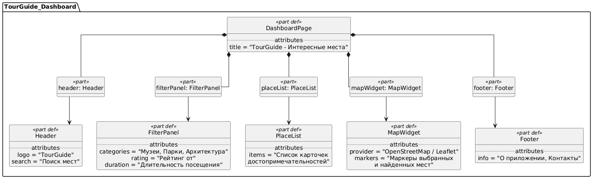
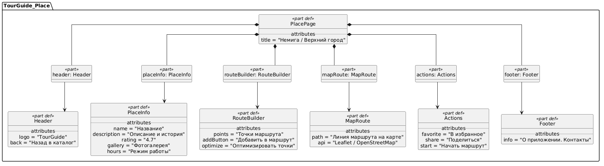

# Спецификация требований к программному обеспечению (SRS)

## 1. Введение {#1-introduction}

### 1.1 Назначение {#11-purpose}
Настоящий документ представляет собой спецификацию требований к программному обеспечению (Software Requirements Specification, SRS) для веб-приложения **«TourGuide»** — путеводителя по достопримечательностям с интерактивной картой и конструктором маршрутов экскурсий, разрабатываемого на платформе **C# (ASP.NET Core)**.

### 1.2 Область применения {#12-scope}
Система «TourGuide» позволяет туристам, экскурсоводам и местным жителям просматривать каталог интересных мест, фильтровать их по категориям, длительности посещения и рейтингу, собирать пешеходные и комбинированные экскурсионные маршруты и отображать объекты на интерактивной карте.

## 2. Обзор продукта {#2-product-overview}

### 2.1 Перспектива продукта {#21-product-perspective}
«TourGuide» - новый самостоятельный программный продукт на платформе C# (ASP.NET Core). Ранее туристам, гидам и местным жителям приходилось пользоваться несколькими инструментами одновременно: сайтами-путеводителями для описания мест, картами для навигации и заметками/мессенджерами для сборки маршрута. Информация о достопримечательностях разрознена, а переход между сервисами во время экскурсии неудобен. Приложение должно объединить каталог достопримечательностей, построение экскурсионных маршрутов и интерактивную карту в одном веб-интерфейсе.

**Внешние системы и зависимости:**
* **Картографический сервис** (OpenStreetMap + Leaflet и/или Яндекс.Карты API) - для отображения карты, маркеров достопримечательностей и линии экскурсионного маршрута.
* **SMTP-сервер** (опционально на этапе MVP+) - для отправки уведомлений и путевых листов экскурсий (например, подтверждение регистрации).

### 2.2 Функции продукта {#22-product-functions}
* Каталог достопримечательностей с описанием, фотогалереей, категориями, рейтингом и режимом работы.
* Поиск и фильтрация объектов по району, категории, длительности осмотра и минимальному рейтингу.
* Построение, оптимизация и сохранение экскурсионных маршрутов (ручной набор точек и автоподбор ближайших мест).
* Интерактивная карта с маркерами достопримечательностей и визуализацией выбранного маршрута.
* Личный кабинет пользователя (избранные места и сохранённые маршруты).

### 2.3 Технологический стек и ограничения {#23-constraints}
* **Backend**: язык программирования **C# (.NET 8)**, фреймворк **ASP.NET Core Web API**, ORM **Entity Framework Core**.
* **Frontend**: библиотека **React** (либо Blazor / Razor Pages) для адаптивного веб-интерфейса.
* **СУБД**: **PostgreSQL**.
* **Инфраструктура**: контейнеризация **Docker**.

## 3. Прототипы пользовательского интерфейса (SysMLv2) {#3-ui-prototypes}

### 3.1 Экран «Главная страница (Каталог и карта)»

### 3.2 Экран «Карточка места и маршрут»

## 4. Детальные требования {#4-specific-requirements}

### 4.1 Функциональные требования {#41-functional-requirements}
* **REQ-FUNC-001**: Система должна предоставлять каталог достопримечательностей с отображением названия, краткого описания, истории, категории, рейтинга, фотографий и режима работы.
* **REQ-FUNC-002**: Система должна обеспечивать поиск достопримечательностей по названию и фильтрацию по категориям («Музеи», «Парки», «Архитектура», «Еда»), рейтингу и длительности посещения.
* **REQ-FUNC-003**: Система должна позволять пользователю добавлять выбранные достопримечательности в экскурсионный маршрут и автоматически оптимизировать порядок обхода точек.
* **REQ-FUNC-004**: Система должна отображать маркеры достопримечательностей и построенную линию экскурсионного маршрута на интерактивной карте с использованием OpenStreetMap / Leaflet API.
* **REQ-FUNC-005**: Система должна позволять авторизованному пользователю сохранять понравившиеся достопримечательности в «Избранное» и сохранять готовые маршруты экскурсий.

### 4.2 Нефункциональные требования {#42-non-functional-requirements}
* **REQ-PERF-001**: Время загрузки главной страницы каталога и расчёта экскурсионного маршрута до 15 точек не должно превышать 2 секунд при стандартном интернет-соединении.
* **REQ-SEC-001**: Система должна обеспечивать безопасное хранение учётных данных пользователей (хеширование паролей) и аутентификацию через JWT-токены в ASP.NET Core Identity.
* **REQ-PORT-001**: Серверная часть на C# (ASP.NET Core) и база данных PostgreSQL должны разворачиваться в изолированных Docker-контейнерах на любой хост-системе.

## 5. Матрица верификации требований {#5-verification-matrix}

| ID требования | Описание | Метод верификации |
| :--- | :--- | :--- |
| REQ-FUNC-001 | Отображение каталога и карточки достопримечательности | Демонстрация / Тест |
| REQ-FUNC-002 | Поиск и фильтрация по категориям и рейтингу | Тест |
| REQ-FUNC-003 | Сборка и оптимизация маршрута экскурсии | Тест |
| REQ-FUNC-004 | Интеграция с интерактивной картой OpenStreetMap / Leaflet | Демонстрация |
| REQ-FUNC-005 | Сохранение избранных мест и маршрутов в профиле | Тест |
| REQ-PERF-001 | Время отклика API построения маршрута $\le$ 2 с | Испытание (нагрузочный тест) |
| REQ-SEC-001 | Аутентификация и защита маршрутов через ASP.NET Core Identity | Инспекция / Тест |
| REQ-PORT-001 | Контейнеризация приложения в Docker | Демонстрация |
