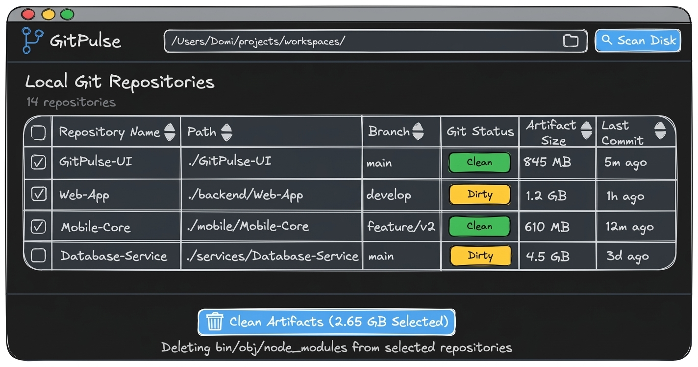
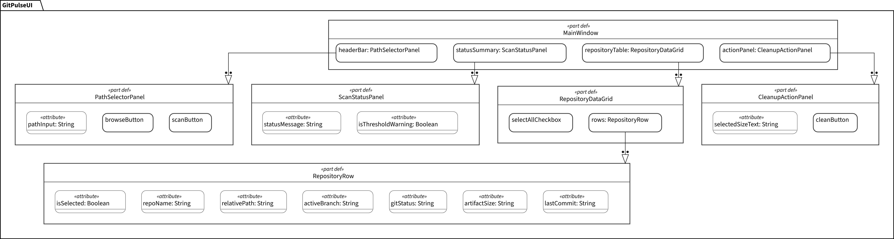

# Спецификация требований к ПО

Для GitPulse – кроссплатформенной десктопной утилиты аудита Git-репозиториев и очистки сборочных артефактов

Версия 0.4

Подготовил: Толкач Д. Г.

Группа: 450504, Вариант: 25

Белорусский государственный университет информатики и радиоэлектроники (БГУИР)

Дата изменения: 26 ноября 2026 г.

## Оглавление

<!-- TOC -->
* [1. Введение](#1-introduction)
  * [1.1 Назначение документа](#11-document-purpose)
  * [1.2 Область применения продукта](#12-product-scope)
  * [1.3 Определения, акронимы и сокращения](#13-definitions-acronyms-and-abbreviations)
  * [1.4 Ссылки](#14-references)
  * [1.5 Обзор документа](#15-document-overview)
* [2. Обзор продукта](#2-product-overview)
  * [2.1 Перспектива продукта](#21-product-perspective)
  * [2.2 Функции продукта](#22-product-functions)
  * [2.3 Ограничения продукта](#23-product-constraints)
  * [2.4 Характеристики пользователей](#24-user-characteristics)
  * [2.5 Допущения и зависимости](#25-assumptions-and-dependencies)
  * [2.6 Распределение требований](#26-apportioning-of-requirements)
* [3. Требования](#3-requirements)
  * [3.1 Внешние интерфейсы](#31-external-interfaces)
    * [3.1.1 Пользовательские интерфейсы](#311-user-interfaces)
    * [3.1.2 Аппаратные интерфейсы](#312-hardware-interfaces)
    * [3.1.3 Программные интерфейсы](#313-software-interfaces)
  * [3.2 Функциональные требования](#32-functional)
  * [3.3 Качество обслуживания](#33-quality-of-service)
    * [3.3.1 Производительность](#331-performance)
    * [3.3.2 Безопасность](#332-security)
    * [3.3.3 Надёжность](#333-reliability)
    * [3.3.4 Доступность](#334-availability)
    * [3.3.5 Наблюдаемость](#335-observability)
  * [3.4 Соответствие стандартам](#34-compliance)
  * [3.5 Проектирование и реализация](#35-design-and-implementation)
    * [3.5.1 Установка](#351-installation)
    * [3.5.2 Сборка и поставка](#352-build-and-delivery)
    * [3.5.3 Распределение](#353-distribution)
    * [3.5.4 Сопровождаемость](#354-maintainability)
    * [3.5.5 Повторное использование](#355-reusability)
    * [3.5.6 Переносимость](#356-portability)
    * [3.5.7 Стоимость](#357-cost)
    * [3.5.8 Сроки](#358-deadline)
    * [3.5.9 Доказательство концепции](#359-proof-of-concept)
    * [3.5.10 Управление изменениями](#3510-change-management)
  * [3.6 ИИ/МО](#36-aiml)
* [4. Верификация](#4-verification)
* [5. Приложения](#5-appendixes)
<!-- TOC -->

## История изменений

| Name | Date | Reason For Changes | Version |
|:---|:---|:---|:---|
| Толкач Д. Г. | 26.10.2026 | Инициализация спецификации бизнес-требований к утилите GitPulse в рамках лабораторной работы №3 по ЖЦРПО | 0.1 |
| Толкач Д. Г. | 27.10.2026 | Актуализация нефункциональных требований по результатам код-ревью (добавлено явное описание кроссплатформенности и порога информирования по сборочному кэшу от 500 МБ) | 0.2 |
| Толкач Д. Г. | 23.11.2026 | Обновлена структурная диаграмма пользовательского интерфейса (`gitpulse-ui.png`) по нотации SysML v2, исходная модель вынесена в `diagrams/gitpulse-ui.sysml` | 0.3 |
| Толкач Д. Г. | 26.11.2026 | Согласованы порог 500 МБ и фоновый сценарий на 5 ГБ без сдвига дедлайна (привлечение Junior-разработчика), актуализирована матрица верификации (Раздел 4) | 0.4 |

---

## 1. Введение {#1-introduction}

Настоящий документ представляет собой спецификацию требований к программному обеспечению (SRS) для кроссплатформенной десктопной утилиты GitPulse. Продукт предназначен для автоматизированного аудита локальных репозиториев Git и очистки дискового пространства от временных сборочных артефактов. Документ определяет функциональные и качественные границы системы для использования при проектировании, разработке и верификации в рамках учебного курса.

### 1.1 Назначение документа {#11-document-purpose}

Настоящий SRS носит закрепительный характер и определяет полный комплект требований к поведению, возможностям и показателям качества утилиты GitPulse. Документ служит технической основой между разработчиком и проверяющей стороной (Заказчиком / преподавателем) на всех этапах жизненного цикла. Документ описывает поведение системы на уровне внешних интерфейсов («что» система делает) и условия её приемки.

### 1.2 Область применения продукта {#12-product-scope}

Утилита GitPulse – это автономное десктопное приложение, созданное для решения проблемы нехватки свободного места на накопителях разработчиков из-за накопления неиспользуемых сборочных файлов и временных директорий.

**В область применения продукта входит:**
- Сканирование указанных пользователем локальных директорий на предмет наличия вложенных Git-репозиториев.
- Сбор и табличное отображение метаданных репозиториев: наименование, относительный путь, активная ветка, статус рабочей копии (`Clean` / `Dirty`).
- Динамическое определение типа проекта и расчет объема временных сборочных артефактов для экосистем C, C++, Java, C# и Node.js (`bin/`, `obj/`, `target/`, `build/`, `cmake-build-debug/`, `node_modules/`).
- Выборочная или пакетная безопасная очистка папок артефактов для выбранных проектов.

**В область применения НЕ входит:**
- Удаление нефиксированных файлов исходного кода или работа с пользовательскими данными вне стандартных папок компиляции.
- Удаление системных временных файлов операционной системы.
- Управление удаленными репозиториями (GitHub/GitLab API, операции push/pull).

### 1.3 Определения, акронимы и сокращения {#13-definitions-acronyms-and-abbreviations}

| Термин / Аббревиатура | Определение |
|:---|:---|
| Сборочные артефакты | Временные каталоги и результаты компиляции (`bin`, `obj`, `node_modules`), генерируемые инструментами сборки. |
| Репозиторий Git | Каталог под управлением системы контроля версий Git, содержащий служебную папку `.git`. |
| Рабочая копия (Working Tree) | Состояние файлов проекта на диске. Статус Clean указывает на отсутствие незафиксированных изменений, Dirty – на наличие незакоммиченных данных. |
| SRS | Software Requirements Specification – спецификация требований к ПО. |
| SysMLv2 | Systems Modeling Language v2 – язык системного моделирования для спецификации и проектирования систем. |

### 1.4 Ссылки {#14-references}

1. Методические указания по дисциплине «Жизненный цикл разработки программного обеспечения» для студентов специальности «Компьютерная инженерия». Минск, БГУИР. [Нормативная ссылка]
2. СТП 01–2024 «Дипломные проекты (работы). Общие требования». Минск, БГУИР, 2024. [Нормативная ссылка]
3. Официальная документация распределенной системы контроля версий Git (https://git-scm.com/doc). [Справочная ссылка]
4. Спецификация платформы Avalonia UI (https://docs.avaloniaui.net/). [Справочная ссылка]

### 1.5 Обзор документа {#15-document-overview}

Раздел 1 содержит введение и описывает границы продукта. Раздел 2 задает контекст функционирования утилиты и характеристики пользователей. Раздел 3 специфицирует верифицируемые функциональные и нефункциональные требования с уникальными идентификаторами (включая описание пользовательского интерфейса в подразделе 3.1.1). Раздел 4 содержит матрицу трассируемости и верификации, а в Разделе 5 приведены графический мокап и структурная схема интерфейса.

---

## 2. Обзор продукта {#2-product-overview}

### 2.1 Перспектива продукта {#21-product-perspective}

GitPulse разрабатывается как полностью самостоятельный кроссплатформенный инструмент, не требующий интеграции с коммерческими облачными экосистемами или тяжелыми IDE. Утилита функционирует локально на стороне пользователя, взаимодействуя с установленной в операционной системе распределенной системой контроля версий через низкоуровневые интерфейсы Git CLI или библиотеки прямого чтения метаданных `.git`. Продукт нацелен на заполнение ниши легковесных утилит «все в одном» для обслуживания дискового пространства инженеров-программистов.

### 2.2 Функции продукта {#22-product-functions}

На основе спроектированного интерфейса система предоставляет следующие ключевые возможности:
- **Выбор целевой директории:** Указание произвольного пути на диске с помощью текстового ввода или диалогового окна ОС для глубокого сканирования.
- **Поиск репозиториев (Scan Disk):** Автоматическое сканирование дерева каталогов и обнаружение всех инициализированных Git-проектов.
- **Табличный аудит состояния:** Вывод агрегированной информации по каждому найденному репозиторию (имя, путь, ветка, статус `Clean`/`Dirty`, размер артефактов, дата коммита).
- **Управление выбором:** Возможность пакетного выбора репозиториев через чекбоксы для групповой обработки.
- **Информационный индикатор:** Отображение точного суммарного объема данных, готового к высвобождению (например, *"2.65 GB Selected"*).
- **Безопасная очистка (Clean Artifacts):** Безвозвратное удаление целевых директорий (`bin/`, `obj/`, `node_modules/`) для выбранных элементов таблицы при условии безопасности их данных.

### 2.3 Ограничения продукта {#23-product-constraints}

- **Кроссплатформенность:** Продукт должен бесшовно работать и иметь идентичный интерфейс в операционных системах семейств Windows, macOS и Linux.
- **Технологический стек:** В качестве основного языка разработки должен использоваться C#.
- **Зависимости окружения:** Для корректной работы утилиты в операционной системе пользователя должен быть установлен Git версии не ниже 2.40.
- **Права доступа:** Утилита ограничена правами текущего пользователя ОС. Она не должна пытаться модифицировать или сканировать системные защищенные каталоги, требующие привилегий администратора (root).
- **Поддерживаемые операционные системы:** Утилита функционирует кроссплатформенно и поддерживает ОС Windows 10/11, Linux (Ubuntu, Fedora) и macOS (12+).
- **Ограничения по кэшу:** В базовом контуре информирование пользователя о превышении объёма сборочных артефактов срабатывает при достижении порога 500 МБ в интерфейсе; сценарий фонового режима с уведомлением при превышении 5 ГБ по итогам переговоров с заказчиком включается в текущий релиз без сдвига жёсткого дедлайна за счёт подключения Junior-разработчика.

### 2.4 Характеристики пользователей {#24-user-characteristics}

Основной целевой аудиторией GitPulse являются:
- **Разработчики программного обеспечения:** Профессионалы и студенты, активно работающие с большим количеством локальных проектов параллельно. Обладают высокой компьютерной грамотностью, используют утилиту регулярно (раз в несколько дней/недель) для поддержания чистоты на накопителях (SSD/HDD).
- **DevOps-инженеры и QA:** Специалисты, развертывающие локальные сборочные окружения. 

Особых требований к доступности (Accessibility) интерфейса не предъявляется, так как аудитория является технически квалифицированной, однако интерфейс должен поддерживать стандартное масштабирование шрифтов ОС.

### 2.5 Допущения и зависимости {#25-assumptions-and-dependencies}

- **Допущение о структуре артефактов:** Система предполагает, что сборочные артефакты располагаются в стандартных для конкретных фреймворков директориях (например, для .NET проектов это `bin/` и `obj/`, для Node.js – `node_modules/`). Если пользователь вручную переопределил пути вывода компиляции в нестандартные места, утилита может их не обнаружить в рамках базового сканирования.
- **Зависимость от стабильности ФС:** Корректность подсчета размера артефактов напрямую зависит от стабильности работы файловой системы. В процессе сканирования сторонние процессы (например, запущенная компиляция в IDE или индексация антивируса) могут временно блокировать доступ к файлам.

### 2.6 Распределение требований {#26-apportioning-of-requirements}

Разработка разделена на следующие фазы:
- **Фаза 1 (5 семестр, 2026 г.):** Анализ предметной области, выявление бизнес-требований (SRS), создание мокапов, объектно-ориентированное и системное проектирование (SysMLv2/UML). Программный код на этом этапе не создается.
- **Фаза 2 (6 семестр, 2027 г.):** Разработка программного обеспечения, реализация модулей сканирования, интеграция с Git CLI, тестирование и стабилизация продукта.
- **Отложено на будущие итерации:** Расширение функционала под пользовательские плагины очистки и глубокая оптимизация под файловые системы сетевых хранилищ.

---

## 3. Требования {#3-requirements}

Этот раздел специфицирует верифицируемые требования к ПО для обеспечения проектирования и тестирования утилиты GitPulse.

### 3.1 Внешние интерфейсы {#31-external-interfaces}

#### 3.1.1 Пользовательские интерфейсы {#311-user-interfaces}

Эскиз графического интерфейса и структурная схема интерфейса вынесены в Приложение А, исходная модель SysMLv2 – в файл `../diagrams/gitpulse-ui.sysml`.

**Описание элементов управления и поведения интерфейса:**
- **Поле пути и кнопка со значком папки:** Поле текстового ввода текущего каталога и кнопка вызова стандартного диалога выбора папки ОС. Разделители путей автоматически нормализуются под конкретную операционную систему (`/` или `\`).
- **Кнопка «Scan Disk»:** Элемент инициализации фонового рекурсивного сканирования структуры диска.
- **Панель статуса сканирования (`ScanStatusPanel`):** Отображает текущее состояние операции (`statusMessage`) и индикатор предупреждения при превышении порога сборочных артефактов 500 МБ (`isThresholdWarning`).
- **Таблица DataGrid:** Главный компонент вывода найденных проектов, содержащий чекбокс пакетного/построчного выбора (`Select All` / `IsSelected`) и 6 колонок метаданных (`Repository Name`, `Path`, `Branch`, `Git Status`, `Artifact Size`, `Last Commit`) с поддержкой сортировки (`↕`).
- **Индикатор состояния и кнопка «Clean Artifacts»:** Нижняя панель управления, отображающая динамически рассчитываемый объем выбранных данных (например, `2.65 GB Selected`) и запускающая процедуру очистки.

#### 3.1.2 Аппаратные интерфейсы {#312-hardware-interfaces}

Прямого взаимодействия с кастомными аппаратными интерфейсами утилита не осуществляет. Система взаимодействует со стандартными устройствами хранения данных (HDD/SSD накопители) через вызовы файловой системы операционной системы, обеспечиваемые средой выполнения .NET Runtime.

#### 3.1.3 Программные интерфейсы {#313-software-interfaces}

Утилита интегрируется со следующим системным программным обеспечением:
- **Операционная система (Windows / macOS / Linux):** Использование стандартного API для обхода дерева каталогов, чтения метаданных файлов, вычисления размера объектов файловой системы и выполнения процедур удаления папок.
- **Git CLI (версии >= 2.40):** Взаимодействие осуществляется посредством создания дочерних процессов (`System.Diagnostics.Process`) и выполнения консольных команд с последующим перенаправлением и парсингом стандартного вывода (stdout/stderr).

---

### 3.2 Функциональные требования {#32-functional}

- **ID:** REQ-FUNC-001-01
- **Title:** Рекурсивный поиск репозиториев
- **Statement:** Система должна выполнять асинхронный рекурсивный поиск каталогов, содержащих папку `.git`, выводя найденные проекты в таблицу.
- **Verification Method:** Demonstration

- **ID:** REQ-FUNC-002-01
- **Title:** Определение статуса рабочей копии Git
- **Statement:** Для каждого репозитория система должна извлекать активную ветку и определять статус рабочей копии (`Clean` при отсутствии изменений, `Dirty` при наличии незакоммиченных файлов).
- **Verification Method:** Test

- **ID:** REQ-FUNC-003-01
- **Title:** Расчет объема сборочных артефактов
- **Statement:** Система должна выполнять рекурсивный расчет размера папок `bin`, `obj` и `node_modules` для каждого найденного репозитория.
- **Verification Method:** Test

- **ID:** REQ-FUNC-004-01
- **Title:** Суммирование выбранного объема
- **Statement:** Система должна динамически пересчитывать суммарный объем артефактов для отмеченных чекбоксами строк и обновлять подпись кнопки очистки.
- **Verification Method:** Demonstration

- **ID:** REQ-FUNC-005-01
- **Title:** Блокировка очистки незакоммиченных проектов
- **Statement:** Система должна блокировать выбор проектов со статусом `Dirty` для предотвращения случайного удаления не зафиксированных в Git данных.
- **Verification Method:** Test

- **ID:** REQ-FUNC-006-01
- **Title:** Безопасное удаление целевых директорий
- **Statement:** При нажатии кнопки «Clean Artifacts» система должна производить удаление папок артефактов выбранных репозиториев без затрагивания исходного кода.
- **Verification Method:** Demonstration

---

### 3.3 Качество обслуживания {#33-quality-of-service}

#### 3.3.1 Производительность {#331-performance}

- **REQ-PERF-001-01:** Время сканирования директории с 5 000 папок не должно превышать 15 секунд.
- **REQ-PERF-002-01:** Операции чтения и удаления должны выполняться в фоновом потоке, сохраняя отзывчивость интерфейса.

#### 3.3.2 Безопасность {#332-security}

- **REQ-SEC-001-01:** Удаление должно производиться строго внутри явно определенных каталогов `bin`, `obj`, `node_modules`.

#### 3.3.3 Надёжность {#333-reliability}

- **REQ-REL-001-01:** При невозможности удаления заблокированного файла система должна логировать исключение и продолжать обработку остальных элементов.

#### 3.3.4 Доступность {#334-availability}

- **REQ-AVAIL-001-01:** Утилита должна выполнять 100% функций локально без подключения к сети Интернет.

#### 3.3.5 Наблюдаемость {#335-observability}

- **REQ-OBS-001-01:** Операции удаления должны фиксироваться в файле лога `gitpulse.log`.

---

### 3.4 Соответствие стандартам {#34-compliance}

Утилита должна соответствовать требованиям следующих нормативных документов:
1. **СТП 01–2024 БГУИР** – в части правил ведения, построения, оформления и верификации технической и отчетной документации к программному обеспечению.
2. **Git Core СLI Specification** – в части интерпретации локального состояния индексов, именования веток и парсинга результатов вывода консольной утилиты `git status`.

---

### 3.5 Проектирование и реализация {#35-design-and-implementation}

#### 3.5.1 Установка {#351-installation}
Поставляется в виде портативного архива (Portable). Запуск выполняется без инсталлятора.

#### 3.5.2 Сборка и поставка {#352-build-and-delivery}
Сборка в режиме `Self-contained` с использованием .NET 9 CLI.

#### 3.5.3 Распределение {#353-distribution}
Локальное исполнение. Все данные сканирования хранятся в оперативной памяти процесса.

#### 3.5.4 Сопровождаемость {#354-maintainability}
Использование шаблона MVVM с четким разделением слоев представления и логики.

#### 3.5.5 Повторное использование {#355-reusability}
Модуль сканирования и работы с Git проектируется как независимая библиотека классов .NET.

#### 3.5.6 Переносимость {#356-portability}
Поддержка ОС Windows, macOS и Linux (включая glibc-совместимые дистрибутивы: Ubuntu, Arch Linux, Fedora).

#### 3.5.7 Стоимость {#357-cost}
Продукт распространяется с открытым исходным кодом. Использование платных сторонних API не предусмотрено.

#### 3.5.8 Сроки {#358-deadline}
Сдача этапа спецификации требований выполняется в течение 5-го семестра согласно графику лабораторных работ.

#### 3.5.9 Доказательство концепции {#359-proof-of-concept}
Проверка технической возможности асинхронного сбора вывода `git status` при сканировании тестовых директорий, содержащих до 1 000 файлов.

#### 3.5.10 Управление изменениями {#3510-change-management}
Ведение разработки в изолированных ветках Git с объединением через Pull Request.

---

### 3.6 ИИ/МО {#36-aiml}

Использование моделей машинного обучения или ИИ в текущей спецификации утилиты GitPulse не предусмотрено.

---

## 4. Верификация {#4-verification}

В таблице представлена матрица трассируемости и верификации требований для утилиты GitPulse. Каждый тестовый сценарий проверяет соответствующий уникальный идентификатор из Раздела 3. На текущем этапе (5-й семестр, ЛР №3–№6) выполнена спецификация требований и архитектурное моделирование (SDD, ADR, SysMLv2/UML); запуск тестов и проверок на готовой сборке запланирован на этап реализации (Фаза 2, 6-й семестр).

| Requirement ID | Verification Method | Test/Artifact Link | Status | Evidence |
|:---|:---|:---|:---|:---|
| REQ-FUNC-001-01 | Demonstration | specs/FUNC-001.md | Modeled (Phase 2 Test) | SRS (разд. 3.2), SDD (`VIEW-001`, `VIEW-004`–`VIEW-006`, `VIEW-008`–`VIEW-009`, `ADR-002`, `ADR-004`–`ADR-005`) |
| REQ-FUNC-002-01 | Test | tests/GitParser.cs | Modeled (Phase 2 Test) | SRS (разд. 3.2), SDD (`VIEW-002`, `VIEW-004`–`VIEW-005`, `VIEW-007`–`VIEW-010`, `ADR-002`, `ADR-004`–`ADR-005`) |
| REQ-FUNC-003-01 | Test | tests/SizeCalc.cs | Modeled (Phase 2 Test) | SRS (разд. 2.2, 3.2), SDD (`VIEW-002`, `VIEW-005`–`VIEW-006`, `VIEW-008`–`VIEW-009`, `ADR-003`–`ADR-005`) |
| REQ-FUNC-004-01 | Demonstration | specs/UI-State.md | Modeled (Phase 2 Test) | SRS (разд. 2.2, 3.1.1, 3.2, прил. А), SDD (`VIEW-003`, `VIEW-005`–`VIEW-006`, `VIEW-008`, `ADR-001`, `ADR-004`) |
| REQ-FUNC-005-01 | Test | tests/SafetyLock.cs | Modeled (Phase 2 Test) | SRS (разд. 3.2), SDD (`VIEW-002`, `VIEW-005`–`VIEW-007`, `VIEW-009`, `ADR-002`, `ADR-004`–`ADR-005`) |
| REQ-FUNC-006-01 | Demonstration | specs/Cleaner.md | Modeled (Phase 2 Test) | SRS (разд. 2.2, 3.2), SDD (`VIEW-001`, `VIEW-003`, `VIEW-005`–`VIEW-010`, `ADR-004`–`ADR-005`) |
| REQ-PERF-001-01 | Test | tests/PerfTests.cs | Modeled (Phase 2 Test) | SRS (разд. 3.3.1), SDD (`VIEW-004`, `VIEW-006`, `ADR-002`, `ADR-004`) |
| REQ-PERF-002-01 | Demonstration | specs/AsyncUI.md | Modeled (Phase 2 Test) | SRS (разд. 3.3.1), SDD (`VIEW-004`, `VIEW-006`, `ADR-004`) |
| REQ-SEC-001-01 | Test | tests/Security.cs | Modeled (Phase 2 Test) | SRS (разд. 3.3.2), SDD (`VIEW-003`, `VIEW-005`–`VIEW-006`, `VIEW-008`–`VIEW-009`, `ADR-004`–`ADR-005`) |
| REQ-REL-001-01 | Test | tests/Exception.cs | Modeled (Phase 2 Test) | SRS (разд. 3.3.3), SDD (`VIEW-004`, `VIEW-007`, `VIEW-009`, `ADR-004`–`ADR-005`) |
| REQ-AVAIL-001-01 | Demonstration | specs/OfflineMode.md | Modeled (Phase 2 Test) | SRS (разд. 1.2, 2.1, 3.3.4), SDD (`VIEW-001`, `VIEW-010`, `ADR-002`–`ADR-003`, `ADR-005`) |
| REQ-OBS-001-01 | Inspection | logs/gitpulse.log | Modeled (Phase 2 Test) | SRS (разд. 3.3.5), SDD (`VIEW-004`–`VIEW-010`, `ADR-004`–`ADR-005`) |

---

## 5. Приложения {#5-appendixes}

### Приложение А
#### (обязательное)
#### Прототип и структурная спецификация графического интерфейса утилиты GitPulse

**1. Визуальный мокап пользовательского интерфейса (Excalidraw):**

**2. Структурная спецификация интерфейса на языке SysMLv2:**

Примечание: Настоящий графический макет разработан на этапе анализа бизнес-требований для наглядности, а его формальная системная структурная спецификация на языке SysMLv2 приведена в подразделе 3.1.1 и файле `../diagrams/gitpulse-ui.sysml` согласно требованиям СТП 01–2024 БГУИР.
