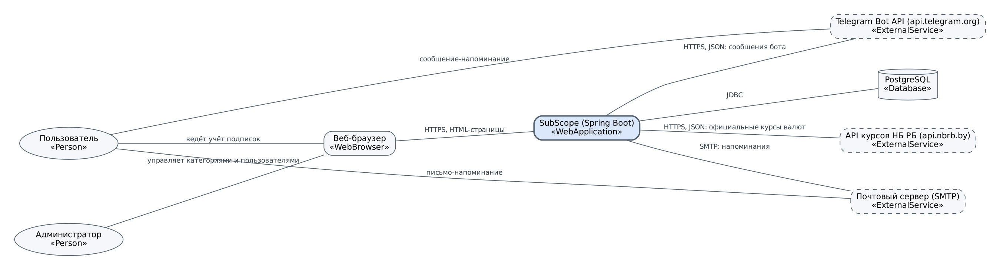
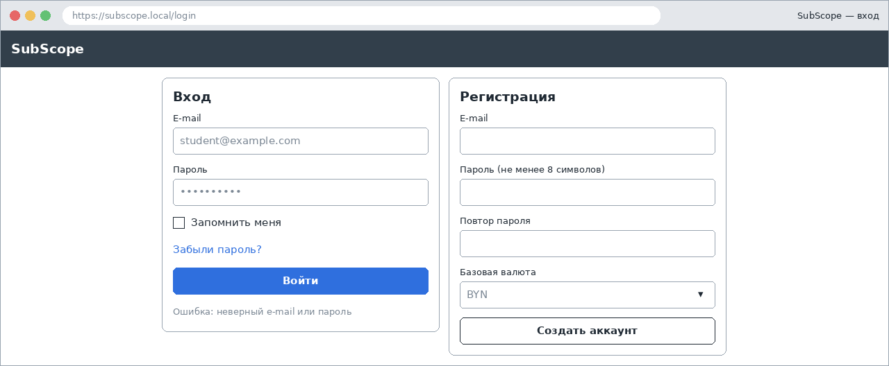
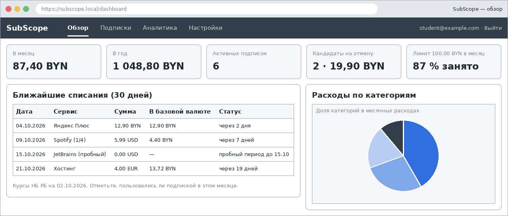
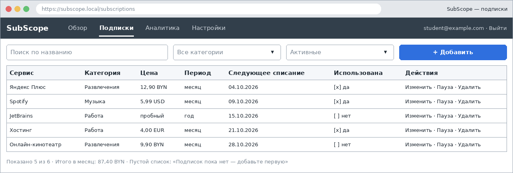
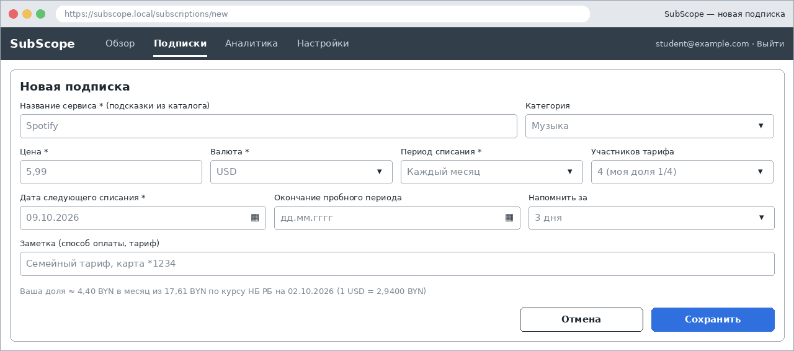
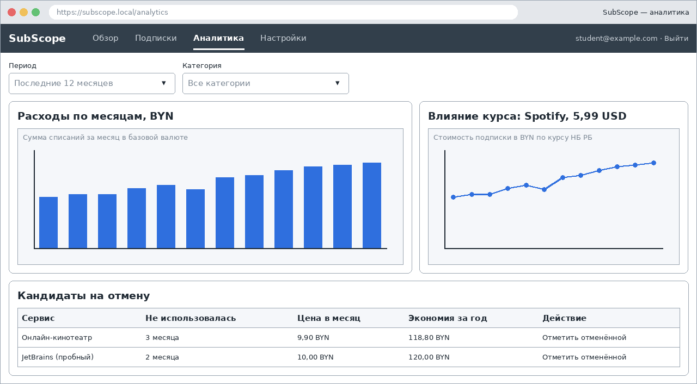
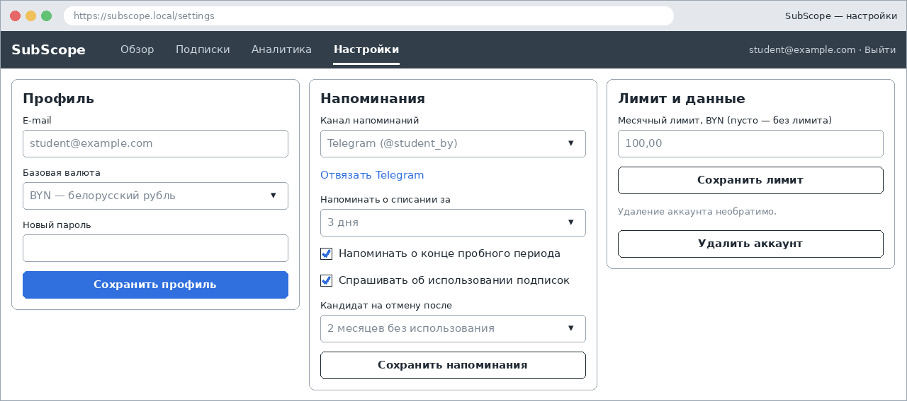
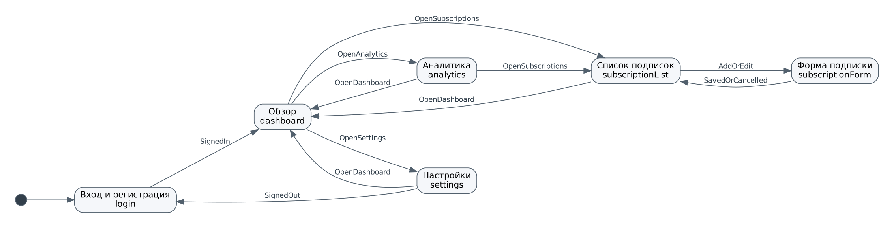

# Спецификация требований к ПО

Для SubScope — веб-приложения для учёта подписок и регулярных платежей

Версия 0.4

Подготовил Родкевич Н.А., гр. 434701

БГУИР, факультет компьютерных систем и сетей, кафедра ЭВМ

2026-11-16

## Оглавление

<!-- TOC -->
* [1. Введение](#1-introduction)
  * [1.1 Назначение документа](#11-document-purpose)
  * [1.2 Область применения продукта](#12-product-scope)
  * [1.3 Определения, акронимы и сокращения](#13-definitions-acronyms-and-abbreviations)
  * [1.4 Ссылки](#14-references)
  * [1.5 Обзор документа](#15-document-overview)
* [2. Обзор продукта](#2-product-overview)
  * [2.1 Перспектива продукта](#21-product-perspective)
  * [2.2 Функции продукта](#22-product-functions)
  * [2.3 Ограничения продукта](#23-product-constraints)
  * [2.4 Характеристики пользователей](#24-user-characteristics)
  * [2.5 Допущения и зависимости](#25-assumptions-and-dependencies)
  * [2.6 Распределение требований](#26-apportioning-of-requirements)
* [3. Требования](#3-requirements)
  * [3.1 Внешние интерфейсы](#31-external-interfaces)
    * [3.1.1 Пользовательские интерфейсы](#311-user-interfaces)
    * [3.1.2 Аппаратные интерфейсы](#312-hardware-interfaces)
    * [3.1.3 Программные интерфейсы](#313-software-interfaces)
  * [3.2 Функциональные требования](#32-functional)
  * [3.3 Качество обслуживания](#33-quality-of-service)
    * [3.3.1 Производительность](#331-performance)
    * [3.3.2 Безопасность](#332-security)
    * [3.3.3 Надёжность](#333-reliability)
    * [3.3.4 Доступность](#334-availability)
    * [3.3.5 Наблюдаемость](#335-observability)
  * [3.4 Соответствие стандартам](#34-compliance)
  * [3.5 Проектирование и реализация](#35-design-and-implementation)
    * [3.5.1 Установка](#351-installation)
    * [3.5.2 Сборка и поставка](#352-build-and-delivery)
    * [3.5.3 Распределение](#353-distribution)
    * [3.5.4 Сопровождаемость](#354-maintainability)
    * [3.5.5 Повторное использование](#355-reusability)
    * [3.5.6 Переносимость](#356-portability)
    * [3.5.7 Стоимость](#357-cost)
    * [3.5.8 Сроки](#358-deadline)
    * [3.5.9 Доказательство концепции](#359-proof-of-concept)
    * [3.5.10 Управление изменениями](#3510-change-management)
  * [3.6 ИИ/МО](#36-aiml)
* [4. Верификация](#4-verification)
* [5. Приложения](#5-appendixes)
<!-- TOC -->

## История изменений

| Name          | Date       | Reason For Changes                                                                                                                                                                                                                                                                                                                | Version |
|---------------|------------|-----------------------------------------------------------------------------------------------------------------------------------------------------------------------------------------------------------------------------------------------------------------------------------------------------------------------------------|---------|
| Родкевич Н.А. | 2026-10-02 | Первоначальная версия: бизнес-требования, мокапы, требования к ПО                                                                                                                                                                                                                                                                 | 0.1     |
| Родкевич Н.А. | 2026-10-15 | Итоги интервью с Заказчиком (Приложение Б): валюты, совместные подписки, каталог сервисов, настраиваемый порог неиспользования, CON-9; Telegram и семейный учёт отложены. Новые: REQ-FUNC-019, REQ-FUNC-020. Изменены: REQ-INT-002-2, REQ-FUNC-001-2, 003-2, 004-2, 009-2, 015-2, 018-2, REQ-COMP-001-2. Обновлены мокапы 2, 4, 6 | 0.2     |
| Родкевич Н.А. | 2026-10-16 | Замечания напарника по pull request: восстановление пароля (новое REQ-FUNC-021), время и часовой пояс напоминаний (REQ-FUNC-011-2), пробный период (REQ-FUNC-004-3, REQ-FUNC-009-3), исправление отметки использования (REQ-FUNC-012-2), импорт из CSV отложен. Обновлён мокап 1                                                  | 0.3     |
| Родкевич Н.А. | 2026-11-16 | ЛР4, согласование системных требований и плана (Приложение Г): порядок требований по возрастанию идентификаторов, горизонтальные линии между требованиями (замечание преподавателя к v0.3); новые REQ-FUNC-022, REQ-FUNC-023, REQ-INT-004; изменены REQ-FUNC-011-3, REQ-FUNC-014-2, REQ-COMP-001-3, REQ-DEAD-001-2, CON-9-2; REQ-FUNC-016 отложено; распределение по итерациям; мокапы 2, 3, 6 и контекстная диаграмма | 0.4     |

---

## 1. Введение {#1-introduction}

Документ описывает требования к веб-приложению SubScope — личному трекеру подписок и регулярных платежей с пересчётом расходов в базовую валюту по официальному курсу Национального банка Республики Беларусь. SubScope — учебный проект, который разрабатывается в течение всего курса «Жизненный цикл разработки программного обеспечения».

### 1.1 Назначение документа {#11-document-purpose}

SRS фиксирует, **что** должна делать система SubScope версии 1.0, и служит согласованной основой для Заказчика, менеджера проекта, разработчика и тестировщика. Заказчик использует документ для проверки, что его бизнес-требования поняты верно; разработчик — как исходные данные для проектирования (SDD, ADR) и реализации; тестировщик — как источник критериев приёмки. Способ реализации («как») описывается в документах [sdd/sdd.md](../sdd/sdd.md) и [adr/](../adr/), план реализации по итерациям — в [plan/plan.md](../plan/plan.md).

### 1.2 Область применения продукта {#12-product-scope}

**Продукт:** SubScope, релиз 1.0.

**Проблема.** Человек оформляет несколько подписок (музыка, видео, облачные хранилища, хостинг, программное обеспечение) в разных сервисах и разных валютах. Списания происходят автоматически и в разные дни, цены в иностранной валюте меняются вместе с курсом, пробные периоды незаметно превращаются в платные. В результате пользователь не знает, сколько на самом деле тратит, и продолжает платить за то, чем не пользуется.

**Бизнес-цели:**

| ID   | Бизнес-цель | Показатель успеха |
|------|-------------|-------------------|
| BG-1 | Дать пользователю полную картину регулярных расходов в одной валюте | Суммы «в месяц» и «в год» в базовой валюте с учётом доли в совместных подписках видны на первом экране после входа |
| BG-2 | Исключить неожиданные списания | Напоминание приходит не позднее чем за заданное число дней до списания или окончания пробного периода |
| BG-3 | Помочь сократить расходы на неиспользуемые подписки | Система показывает список кандидатов на отмену и возможную экономию за год; за первые три месяца пользователь отменяет хотя бы одну подписку из этого списка |
| BG-4 | Показать влияние курса валют на стоимость подписок | Для подписок в иностранной валюте доступна стоимость в базовой валюте по актуальному и историческим курсам НБ РБ |
| BG-5 | Минимальные затраты Заказчика на владение | Приложение работает на бесплатных компонентах и одном сервере |

**Входит в рамки:** регистрация и вход; ведение списка подписок, в том числе совместных (оплата делится между несколькими людьми); каталог популярных сервисов; обзор расходов и ближайших списаний; пересчёт валют по курсу НБ РБ; напоминания по e-mail и в Telegram; месячный лимит расходов; отметки использования и рекомендации по отмене; аналитика; администрирование категорий и пользователей.

**Не входит в рамки:** проведение платежей и хранение платёжных реквизитов; интеграция с банками и автоматический импорт списаний; автоматическая отмена подписок в сторонних сервисах; мобильное приложение; push- и SMS-уведомления; уведомления в мессенджерах, кроме Telegram; экспорт и импорт подписок в формате CSV (кандидаты на следующий релиз); общий список подписок для нескольких учётных записей (семейный учёт); реклама и передача данных пользователей третьим лицам, кроме случаев, указанных в CON-9-2.

Границы системы показаны на контекстной диаграмме в разделе 2.1.

### 1.3 Определения, акронимы и сокращения {#13-definitions-acronyms-and-abbreviations}

| Term | Definition |
|------|------------|
| API | Application Programming Interface — набор определений и протоколов для создания и интеграции прикладного ПО |
| CSV | Comma-Separated Values — текстовый формат табличных данных |
| SRS | Software Requirements Specification — документ, описывающий назначение, требования и характер ПО |
| SysML v2 | Systems Modeling Language версии 2 — язык моделирования систем с текстовой нотацией |
| Telegram Bot API | Программный интерфейс мессенджера Telegram для отправки сообщений от имени бота |
| UI | User Interface — визуальная часть приложения, через которую пользователь взаимодействует с ПО |
| Базовая валюта | Валюта, выбранная пользователем, в которую пересчитываются все суммы (по умолчанию BYN) |
| Каталог сервисов | Справочник популярных сервисов (название и категория по умолчанию), который ведёт администратор |
| Кандидат на отмену | Активная подписка, не отмеченная как использованная в течение порога неиспользования |
| Время системы | Все даты и время в системе (сроки списаний, отправка напоминаний, границы месяцев) определяются по часовому поясу Europe/Minsk (UTC+3) |
| Курс НБ РБ | Официальный курс белорусского рубля к иностранной валюте, установленный Национальным банком Республики Беларусь на дату |
| Месячный лимит | Сумма в базовой валюте, которую пользователь готов тратить на подписки в месяц; сравнивается со стоимостью активных подписок в месяц |
| Мокап | Схематичное изображение экрана, показывающее состав и расположение элементов интерфейса |
| Канал напоминаний | Способ доставки напоминаний, выбранный пользователем: e-mail или Telegram |
| Напоминание | Письмо или сообщение в Telegram, отправляемое пользователю перед списанием или окончанием пробного периода |
| Период списания | Интервал между регулярными платежами: неделя, месяц, квартал, год |
| Подписка | Запись о регулярном платеже за сервис: название, цена, валюта, период и дата следующего списания |
| Порог неиспользования | Число завершённых месяцев подряд без отметки использования (1, 2 или 3; по умолчанию 2), после которого подписка считается кандидатом на отмену |
| Пробный период | Срок бесплатного использования сервиса, по окончании которого начинаются списания |
| Совместная подписка | Подписка, оплата которой делится поровну между несколькими участниками (например, семейный тариф); в расходах пользователя учитывается его доля |
| Списание | Очередной платёж по подписке в дату, определяемую периодом списания |

### 1.4 Ссылки {#14-references}

| Источник | Владелец, версия | Статус | Расположение |
|----------|------------------|--------|--------------|
| ISO/IEC/IEEE 29148:2018 Systems and software engineering — Life cycle processes — Requirements engineering | ISO/IEC/IEEE, 2018 | Справочная | [docs/standards.md](../docs/standards.md) |
| Шаблон SRS | Кафедра ЭВМ БГУИР, 2026 | Нормативная | [srs-template.md](srs-template.md) |
| API официальных курсов валют НБ РБ | Национальный банк Республики Беларусь | Нормативная | <https://www.nbrb.by/apihelp/exrates> |
| Web Content Accessibility Guidelines (WCAG) 2.1 | W3C, 2018 | Справочная | <https://www.w3.org/TR/WCAG21/> |
| Закон Республики Беларусь «О защите персональных данных» № 99-З | 2021 | Нормативная | <https://pravo.by> |
| Telegram Bot API | Telegram | Нормативная | <https://core.telegram.org/bots/api> |
| Описание дизайна SubScope (SDD) и протоколы ADR-0001…0007 | Родкевич Н.А., 0.3 | Справочная | [sdd/sdd.md](../sdd/sdd.md), [adr/](../adr/) |
| План реализации и переписка с Заказчиком | Родкевич Н.А., v3 | Справочная | [plan/plan.md](../plan/plan.md), [plan/correspondence.md](../plan/correspondence.md) |
| Модели SysML v2: библиотека элементов UI | Родкевич Н.А., 0.1 | Нормативная | [models/UiKit.sysml](models/UiKit.sysml) |
| Модели SysML v2: мокапы экранов | Родкевич Н.А., 0.3 | Нормативная | [models/Mockups.sysml](models/Mockups.sysml) |
| Модели SysML v2: контекст и карта экранов | Родкевич Н.А., 0.2 | Нормативная | [models/Context.sysml](models/Context.sysml) |

### 1.5 Обзор документа {#15-document-overview}

Раздел 2 описывает контекст продукта, его функции, ограничения, пользователей и допущения. Раздел 3 содержит верифицируемые требования с идентификаторами вида `REQ-[AREA]-[NNN]`; внутри каждого подраздела требования расположены по возрастанию идентификаторов и отделены друг от друга горизонтальными линиями; слово «должна» обозначает обязательное требование, «следует» — желательное. Раздел 4 содержит матрицу верификации, раздел 5 — перечень графических материалов, вопросы к Заказчику с принятыми решениями, журнал замечаний по pull request и решения по итогам согласования системных требований и плана. Изменения вносятся через pull request в ветку `main` и фиксируются в таблице «История изменений».

---

## 2. Обзор продукта {#2-product-overview}

### 2.1 Перспектива продукта {#21-product-perspective}

SubScope — новый самостоятельный продукт, не являющийся частью более крупной системы. Это веб-приложение с серверной частью, которое хранит данные в собственной базе данных и использует три внешних сервиса: API курсов валют НБ РБ (источник курсов), почтовый сервер и Telegram Bot API (доставка напоминаний). Владелец продукта — Заказчик; разработку и сопровождение в рамках курса выполняет автор документа. Соглашения об уровне обслуживания не заключаются.

Рисунок 2.1 — Контекстная диаграмма (модель: [models/Context.sysml](models/Context.sysml), часть `systemContext`). Версия 0.4: добавлен Telegram Bot API

### 2.2 Функции продукта {#22-product-functions}

- **Учётные записи:** регистрация, вход и выход, восстановление пароля, настройка профиля и базовой валюты, удаление аккаунта.
- **Подписки:** добавление (с подсказками из каталога сервисов), изменение, удаление, приостановка и отмена; совместные подписки с делением оплаты; поиск и фильтрация списка.
- **Обзор:** суммарные расходы в месяц и в год в базовой валюте, ближайшие списания.
- **Курсы валют:** автоматическое получение официальных курсов НБ РБ и пересчёт сумм.
- **Напоминания:** письма или сообщения в Telegram (по выбору пользователя) перед списанием и перед окончанием пробного периода.
- **Месячный лимит:** заполнение лимита расходов на «Обзоре» и предупреждения о превышении.
- **Контроль использования:** ежемесячная отметка «пользовался / не пользовался» и список кандидатов на отмену с расчётом экономии.
- **Аналитика:** расходы по категориям и по месяцам, влияние курса на стоимость подписки.
- **Администрирование:** справочник категорий, каталог сервисов, блокировка пользователей.

### 2.3 Ограничения продукта {#23-product-constraints}

| ID | Ограничение | Тип |
|----|-------------|-----|
| CON-1 | Продукт должен быть веб-приложением, доступным через браузер без установки на устройство пользователя | Обязательное, внешнее |
| CON-2 | Серверная часть должна быть реализована на Java 17 и Spring Boot 3 со сборкой Maven в папке `project/` репозитория | Обязательное, внутреннее |
| CON-3 | Данные должны храниться в PostgreSQL | Предпочтительное, внутреннее |
| CON-4 | Курсы валют должны получаться только из официального API НБ РБ | Обязательное, внешнее |
| CON-5 | Должны использоваться только бесплатные компоненты и сервисы со свободными лицензиями | Обязательное, внешнее |
| CON-6 | Язык интерфейса и документации — русский | Обязательное, внешнее |
| CON-7 | Система не должна хранить номера банковских карт и иные платёжные реквизиты | Обязательное, внешнее |
| CON-8 | Исходный код и документация должны вестись в Git-репозитории, изменения — через pull request | Обязательное, внутреннее |
| CON-9-2 | Приложение не должно показывать рекламу и передавать данные пользователей третьим лицам, кроме адреса e-mail почтовому серверу и текста напоминаний Telegram для пользователей, которые сами привязали Telegram | Обязательное, внешнее |

### 2.4 Характеристики пользователей {#24-user-characteristics}

| Класс | Описание | Подготовка | Частота использования | Доступ |
|-------|----------|------------|-----------------------|--------|
| Гость | Посетитель без учётной записи | Обычный пользователь Интернета | Однократно | Страницы входа и регистрации |
| Пользователь | Человек 18–30 лет с 3–10 подписками, в том числе в иностранной валюте и на общих тарифах: студент, IT-специалист, глава семьи | Уверенно пользуется браузером и электронной почтой, специальных знаний не требуется | Несколько раз в месяц и после каждого напоминания | Только собственные данные |
| Администратор | Сотрудник Заказчика, поддерживающий справочник категорий и каталог сервисов | Базовые навыки администрирования веб-приложений | По необходимости | Справочник категорий, каталог сервисов, список пользователей; чужие подписки не видит |

Интерфейс — на русском языке, форматы дат и чисел — принятые в Беларуси (`дд.мм.гггг`, запятая как десятичный разделитель).

### 2.5 Допущения и зависимости {#25-assumptions-and-dependencies}

| ID | Допущение или зависимость | Влияние, если неверно | Мера |
|----|---------------------------|------------------------|------|
| ASM-1 | API НБ РБ остаётся бесплатным и доступным без ключа | Пересчёт валют невозможен по свежим курсам | Кэширование последних курсов (REQ-REL-001) |
| ASM-2 | Пользователь вводит данные о подписках вручную и поддерживает их актуальность | Суммы и напоминания будут неточными | Простая форма, автоматический перенос даты списания (REQ-FUNC-017) |
| ASM-3 | У пользователя есть действующий e-mail | Напоминания не доставляются | Ближайшие списания дублируются на экране «Обзор» |
| ASM-4 | Доступен SMTP-сервер для отправки писем | Напоминания не отправляются | Повторные попытки и запись в журнал (REQ-OBS-001) |
| ASM-5 | Число пользователей в рамках учебного проекта не превышает 100 | Потребуется пересмотр требований к производительности | Целевые показатели в 3.3.1 |
| ASM-6 | Telegram Bot API остаётся бесплатным и доступным из Беларуси | Напоминания в Telegram не доставляются | Канал автоматически переключается на e-mail (REQ-FUNC-023) |
| DEP-1 | Spring Boot 3, Spring Security, Thymeleaf, PostgreSQL, Flyway, Chart.js, Telegram Bot API | Замена компонента потребует изменения проектных решений | Фиксируется в ADR-0001…0007 |

### 2.6 Распределение требований {#26-apportioning-of-requirements}

Релиз 1.0 разрабатывается пятью недельными итерациями; в конце каждой итерации результат показывается Заказчику. Распределение согласовано с Заказчиком 16.11.2026 (план v3, [plan/plan.md](../plan/plan.md); Приложение Г).

| Итерация | Даты | Содержание | Требования |
|----------|------|------------|------------|
| 1 | 23.11–27.11.2026 | Каркас, вход и регистрация, загрузка курсов НБ РБ | REQ-INT-001, REQ-INT-002; REQ-FUNC-001, 002; REQ-SEC-001, 003; REQ-POC-001; REQ-OBS-001 |
| 2 | 30.11–04.12.2026 | Профиль, восстановление пароля, ведение подписок | REQ-FUNC-003 … 008, 019, 021; REQ-SEC-002 |
| 3 — MVP | 07.12–11.12.2026 | Обзор, пересчёт и курсы на прошедшие даты, перенос дат, отметки использования; начало администрирования и каталога | REQ-FUNC-009, 010, 012, 013, 017; REQ-REL-001; REQ-FUNC-018, 020 (частично) |
| 4 | 14.12–18.12.2026 | Напоминания на e-mail, кандидаты на отмену, аналитика по категориям и месяцам, лимит | REQ-FUNC-011, 014 (частично), 015, 018, 022 (частично); REQ-INT-003 |
| 5 — релиз 1.0 | 21.12–25.12.2026 | Telegram, влияние курса, проверка лимита, каталог, нагрузочный тест, развёртывание, приёмка | REQ-FUNC-014, 020, 022, 023; REQ-INT-004; REQ-PERF-001; REQ-INST-001; остальные нефункциональные |
| Отложено | после 1.0 | Экспорт в CSV, импорт подписок из CSV, импорт списаний из банковских выписок, мобильное приложение, push-уведомления, семейный учёт | REQ-FUNC-016; вне релиза 1.0 |

---

## 3. Требования {#3-requirements}

Схема идентификаторов: `REQ-[AREA]-[NNN]`. Каждое требование описано по шаблону: Statement, Rationale, Acceptance Criteria, Verification Method, More Information.

### 3.1 Внешние интерфейсы {#31-external-interfaces}

#### 3.1.1 Пользовательские интерфейсы {#311-user-interfaces}

Мокапы экранов разработаны на языке SysML v2 ([models/Mockups.sysml](models/Mockups.sysml), библиотека элементов — [models/UiKit.sysml](models/UiKit.sysml)) и сохранены в формате PNG. Версия 0.4: на «Обзоре» добавлен показатель лимита, в «Настройках» — канал напоминаний, привязка Telegram и лимит; кнопки экспорта в CSV удалены (экраны 2, 3, 6).

| № | Экран | Мокап | Связанные требования |
|---|-------|-------|----------------------|
| 1 | Вход и регистрация | [mockup-01-login.png](images/mockup-01-login.png) | REQ-FUNC-001, 002, 021 |
| 2 | Обзор | [mockup-02-dashboard.png](images/mockup-02-dashboard.png) | REQ-FUNC-009, 010, 012, 013, 015, 022 |
| 3 | Список подписок | [mockup-03-subscription-list.png](images/mockup-03-subscription-list.png) | REQ-FUNC-006, 007, 008, 012 |
| 4 | Форма подписки | [mockup-04-subscription-form.png](images/mockup-04-subscription-form.png) | REQ-FUNC-004, 005, 013, 019, 020 |
| 5 | Аналитика | [mockup-05-analytics.png](images/mockup-05-analytics.png) | REQ-FUNC-014, 015 |
| 6 | Настройки | [mockup-06-settings.png](images/mockup-06-settings.png) | REQ-FUNC-003, 011, 015, 022, 023 |

Рисунок 3.1 — Экран «Вход и регистрация»

Рисунок 3.2 — Экран «Обзор»

Рисунок 3.3 — Экран «Список подписок»

Рисунок 3.4 — Экран «Форма подписки»

Рисунок 3.5 — Экран «Аналитика»

Рисунок 3.6 — Экран «Настройки»

Переходы между экранами описаны автоматом состояний `ScreenFlow` в [models/Context.sysml](models/Context.sysml).

Рисунок 3.7 — Карта экранов

---

- **ID:** REQ-INT-001
- **Title:** Общие правила пользовательского интерфейса
- **Statement:** Система должна предоставлять веб-интерфейс на русском языке, в котором на каждой странице авторизованного пользователя присутствует главное меню с пунктами «Обзор», «Подписки», «Аналитика», «Настройки» и командой «Выйти», а состав элементов экранов соответствует мокапам 1–6.
- **Rationale:** Единая навигация сокращает время освоения; мокапы согласованы с Заказчиком.
- **Acceptance Criteria:**
  - страницы корректно отображаются при ширине окна от 360 до 1920 пикселей без горизонтальной прокрутки;
  - любой экран достижим из любого другого не более чем за два щелчка;
  - обязательные поля форм помечены знаком `*`; при ошибке ввода рядом с полем выводится текст ошибки, введённые значения сохраняются;
  - для пустого списка подписок выводится сообщение «Подписок пока нет — добавьте первую» и кнопка добавления;
  - все элементы управления доступны с клавиатуры, контраст текста не ниже 4,5:1 (WCAG 2.1, уровень AA);
  - интерфейс работает в актуальных версиях Chrome, Firefox и Edge.
- **Verification Method:** Demonstration, Inspection
- **More Information:** Рисунки 3.1–3.7.

---

#### 3.1.2 Аппаратные интерфейсы {#312-hardware-interfaces}

Система не взаимодействует с аппаратными устройствами напрямую. Клиентское устройство — любое, на котором работает поддерживаемый браузер (REQ-INT-001).

#### 3.1.3 Программные интерфейсы {#313-software-interfaces}

---

- **ID:** REQ-INT-002-2
- **Title:** Получение курсов валют из API НБ РБ
- **Statement:** Система должна получать официальные курсы валют из API НБ РБ запросом `GET https://api.nbrb.by/exrates/rates?periodicity=0` (на текущую дату) и с параметром `ondate=ГГГГ-ММ-ДД` (на прошедшую дату) и использовать из ответа поля `Cur_Abbreviation`, `Cur_Scale`, `Cur_OfficialRate`, `Date`.
- **Rationale:** BG-1, BG-4; CON-4. Официальный курс — единый и проверяемый источник.
- **Acceptance Criteria:**
  - курсы на текущую дату запрашиваются не чаще одного раза в сутки и сохраняются в базе данных;
  - таймаут запроса — 5 секунд; при ошибке или таймауте выполняется до 3 повторных попыток, затем применяется REQ-REL-001;
  - курс учитывает масштаб: стоимость одной единицы валюты равна `Cur_OfficialRate / Cur_Scale`;
  - валютой подписки может быть BYN или любая валюта из ежедневного перечня курсов НБ РБ (`periodicity=0`);
  - базовой валютой пользователя может быть BYN, USD или EUR.
- **Verification Method:** Test
- **More Information:** Аутентификация для API не требуется. Описание API — раздел 1.4. Версия 2: перечень валют уточнён Заказчиком (Приложение Б, вопрос 1).

---

- **ID:** REQ-INT-003
- **Title:** Отправка писем через SMTP
- **Statement:** Система должна отправлять письма-напоминания через SMTP-сервер, параметры которого (адрес, порт, учётные данные, адрес отправителя) задаются в конфигурации.
- **Rationale:** BG-2; электронная почта не требует от пользователя установки дополнительных приложений.
- **Acceptance Criteria:**
  - соединение с SMTP-сервером устанавливается с шифрованием TLS;
  - при ошибке отправки выполняется до 3 повторных попыток с интервалом не менее 10 минут; неуспех записывается в журнал;
  - письмо содержит название сервиса, сумму в валюте подписки и в базовой валюте, дату списания и ссылку на приложение.
- **Verification Method:** Test
- **More Information:** Для разработки и тестирования используется локальный тестовый SMTP-сервер.

---

- **ID:** REQ-INT-004
- **Title:** Отправка сообщений через Telegram Bot API
- **Statement:** Система должна отправлять напоминания пользователям, привязавшим Telegram, запросом `sendMessage` Telegram Bot API и получать команды бота запросом `getUpdates`; токен бота задаётся в конфигурации.
- **Rationale:** BG-2: пользователи читают Telegram чаще почты (Приложение Г, № 5).
- **Acceptance Criteria:**
  - сообщение содержит те же сведения, что и письмо по REQ-INT-003;
  - обращения к Telegram Bot API выполняются только по HTTPS, токен бота не записывается в журнал;
  - при ошибке отправки выполняется до 3 повторных попыток с интервалом не менее 10 минут; неуспех записывается в журнал;
  - если Telegram отвечает, что пользователь заблокировал бота, канал напоминаний пользователя переключается на e-mail;
  - при ответе «слишком много запросов» отправка приостанавливается на время, указанное в ответе.
- **Verification Method:** Test
- **More Information:** Добавлено по итогам второго раунда обсуждения с Заказчиком (Приложение Г, № 5). Для разработки и тестирования используются отдельный тестовый бот и заглушка Bot API. ADR-0007.

---

### 3.2 Функциональные требования {#32-functional}

Функциональные требования расположены по возрастанию идентификаторов. Группировка по функциям продукта (раздел 2.2):

| Группа | Требования |
|--------|------------|
| Учётные записи | REQ-FUNC-001-2, 002, 003-2, 021, 023 |
| Подписки | REQ-FUNC-004-3, 005, 006, 007, 008, 017, 019 |
| Обзор и курсы | REQ-FUNC-009-3, 010, 013, 022 |
| Напоминания и контроль использования | REQ-FUNC-011-3, 012-2, 015-2 |
| Аналитика, экспорт, администрирование | REQ-FUNC-014-2, 016 (отложено), 018-2, 020 |

---

- **ID:** REQ-FUNC-001-2
- **Title:** Регистрация
- **Statement:** Система должна позволять гостю создать учётную запись, указав e-mail, пароль с подтверждением и базовую валюту.
- **Rationale:** Данные о подписках личные и должны быть привязаны к владельцу.
- **Acceptance Criteria:**
  - при корректных данных создаётся учётная запись, пользователь входит в систему и попадает на экран «Обзор»;
  - e-mail, уже зарегистрированный в системе, отклоняется с сообщением об ошибке;
  - пароль короче 8 символов или не совпадающий с подтверждением отклоняется;
  - базовая валюта выбирается из значений BYN, USD, EUR; по умолчанию — BYN;
  - регистрация невозможна без согласия на обработку персональных данных (REQ-COMP-001).
- **Verification Method:** Test
- **More Information:** Рисунок 3.1. Версия 2: перечень базовых валют (Приложение Б, вопрос 1).

---

- **ID:** REQ-FUNC-002
- **Title:** Вход и выход
- **Statement:** Система должна предоставлять вход по e-mail и паролю и выход из системы.
- **Rationale:** Защита личных данных от доступа посторонних.
- **Acceptance Criteria:**
  - при верных данных открывается экран «Обзор»;
  - при неверных данных выводится сообщение «Неверный e-mail или пароль» без указания, какое именно поле неверно;
  - после выхода страницы приложения недоступны без повторного входа;
  - неавторизованный запрос любой страницы приложения перенаправляется на страницу входа.
- **Verification Method:** Test
- **More Information:** Рисунок 3.1; REQ-SEC-001.

---

- **ID:** REQ-FUNC-003-2
- **Title:** Управление профилем
- **Statement:** Система должна позволять пользователю изменить базовую валюту и пароль, а также удалить свою учётную запись.
- **Rationale:** BG-1; право пользователя на удаление своих данных (REQ-COMP-001).
- **Acceptance Criteria:**
  - базовая валюта выбирается из значений BYN, USD, EUR; после её смены все суммы на всех экранах пересчитываются в новую валюту;
  - пользователь может выбрать порог неиспользования: 1, 2 или 3 месяца (REQ-FUNC-015);
  - удаление учётной записи требует подтверждения и удаляет все подписки, отметки использования и настройки пользователя;
  - после удаления вход с прежними данными невозможен.
- **Verification Method:** Test
- **More Information:** Рисунок 3.6. Версия 2: перечень базовых валют, порог неиспользования.

---

- **ID:** REQ-FUNC-004-3
- **Title:** Добавление подписки
- **Statement:** Система должна позволять пользователю добавить подписку, указав название сервиса, цену, валюту, период списания и дату следующего списания (обязательные поля), а также категорию, число участников совместной подписки, дату окончания пробного периода, срок напоминания и заметку (необязательные поля).
- **Rationale:** BG-1. Список подписок — основа всех остальных функций.
- **Acceptance Criteria:**
  - подписка с корректными данными появляется в списке со статусом «Активна»;
  - цена — неотрицательное число не более чем с двумя знаками после запятой; иное значение отклоняется;
  - название — от 1 до 100 символов; заметка — до 500 символов;
  - период списания выбирается из значений: неделя, месяц, квартал, год;
  - число участников — целое от 1 до 10, по умолчанию 1 (REQ-FUNC-019);
  - дата следующего списания раньше текущей даты отклоняется;
  - если указана дата окончания пробного периода, она не может быть позже даты следующего списания; при нарушении поле помечается сообщением об ошибке;
  - при незаполненном обязательном поле подписка не сохраняется, поле помечается сообщением об ошибке.
- **Verification Method:** Test
- **More Information:** Рисунок 3.4. Версия 2: поле «Число участников». Версия 3: согласование дат пробного периода и списания (замечание 3).

---

- **ID:** REQ-FUNC-005
- **Title:** Изменение подписки
- **Statement:** Система должна позволять пользователю изменить любое поле своей подписки.
- **Rationale:** Цены и тарифы сервисов меняются.
- **Acceptance Criteria:**
  - форма открывается с текущими значениями; действуют те же правила проверки, что и в REQ-FUNC-004;
  - после сохранения суммы на экране «Обзор» отражают новые значения;
  - прежняя цена не изменяет суммы уже прошедших месяцев в аналитике.
- **Verification Method:** Test
- **More Information:** Рисунок 3.4.

---

- **ID:** REQ-FUNC-006
- **Title:** Удаление подписки
- **Statement:** Система должна позволять пользователю удалить свою подписку после подтверждения.
- **Rationale:** Исправление ошибочно созданных записей.
- **Acceptance Criteria:**
  - перед удалением запрашивается подтверждение с названием подписки;
  - удалённая подписка отсутствует в списке, в суммах и в напоминаниях;
  - при отказе от подтверждения подписка не изменяется.
- **Verification Method:** Test
- **More Information:** Рисунок 3.3.

---

- **ID:** REQ-FUNC-007
- **Title:** Статусы подписки
- **Statement:** Система должна позволять пользователю приостановить, возобновить и отметить отменённой свою подписку.
- **Rationale:** BG-3. Отменённые подписки сохраняются для истории расходов, но не должны учитываться в будущих расходах.
- **Acceptance Criteria:**
  - подписка имеет один из статусов: «Активна», «Приостановлена», «Отменена»;
  - приостановленные и отменённые подписки не входят в суммы «в месяц» и «в год» и по ним не отправляются напоминания;
  - при возобновлении приостановленной подписки запрашивается новая дата следующего списания.
- **Verification Method:** Test
- **More Information:** Рисунок 3.3.

---

- **ID:** REQ-FUNC-008
- **Title:** Список подписок с поиском и фильтрами
- **Statement:** Система должна отображать список подписок пользователя с поиском по названию, фильтрами по категории и статусу и сортировкой по названию, цене в базовой валюте и дате следующего списания.
- **Rationale:** BG-1. Быстрый доступ к нужной записи.
- **Acceptance Criteria:**
  - для каждой подписки выводятся сервис, категория, цена с валютой, период, дата следующего списания, отметка использования, действия;
  - поиск находит подписки по вхождению строки в название без учёта регистра;
  - под списком выводятся число показанных записей и их суммарная стоимость в месяц в базовой валюте;
  - пользователь видит только свои подписки.
- **Verification Method:** Test
- **More Information:** Рисунок 3.3.

---

- **ID:** REQ-FUNC-009-3
- **Title:** Суммарные расходы
- **Statement:** Система должна показывать на экране «Обзор» суммарную стоимость активных подписок в месяц и в год в базовой валюте, число активных подписок и число кандидатов на отмену с их суммарной стоимостью в месяц.
- **Rationale:** BG-1.
- **Acceptance Criteria:**
  - стоимость в месяц приводится к месяцу: недельная цена × 52 / 12, квартальная / 3, годовая / 12;
  - стоимость в год равна стоимости в месяц × 12;
  - суммы округляются до двух знаков и выводятся с обозначением базовой валюты;
  - подписка в пробном периоде не входит в суммы «в месяц» и «в год», пока не наступила дата окончания пробного периода; до этой даты она показывается только в ближайших списаниях (REQ-FUNC-010);
  - для совместной подписки учитывается доля пользователя (REQ-FUNC-019).
- **Verification Method:** Test
- **More Information:** Рисунок 3.2. Версия 2: учёт доли в совместных подписках. Версия 3: уточнён учёт пробного периода (замечание 3).

---

- **ID:** REQ-FUNC-010
- **Title:** Ближайшие списания
- **Statement:** Система должна показывать на экране «Обзор» списания активных подписок и окончания пробных периодов на ближайшие 30 дней в порядке возрастания даты.
- **Rationale:** BG-2.
- **Acceptance Criteria:**
  - для каждого списания выводятся дата, сервис, сумма в валюте подписки, сумма в базовой валюте и число дней до списания;
  - окончание пробного периода помечено отдельно;
  - при отсутствии списаний выводится сообщение «В ближайшие 30 дней списаний нет».
- **Verification Method:** Test
- **More Information:** Рисунок 3.2.

---

- **ID:** REQ-FUNC-011-3
- **Title:** Напоминания о списании и об окончании пробного периода
- **Statement:** Система должна отправлять пользователю напоминание в выбранный им канал (e-mail или Telegram) за заданное число дней до списания по активной подписке и до окончания пробного периода.
- **Rationale:** BG-2.
- **Acceptance Criteria:**
  - канал выбирается в настройках из значений «E-mail» и «Telegram»; значение «Telegram» доступно только после привязки (REQ-FUNC-023); по умолчанию — «E-mail»;
  - срок напоминания выбирается из значений 1, 3, 7 дней; значение по умолчанию задаётся в настройках (3 дня) и может быть изменено для отдельной подписки;
  - напоминания отправляются один раз в сутки в 09:00 по времени Europe/Minsk; число дней до списания отсчитывается по календарным датам этого часового пояса;
  - по каждому списанию отправляется не более одного напоминания;
  - пользователь может отключить напоминания о списаниях и о пробных периодах по отдельности; после отключения напоминания не отправляются;
  - содержание напоминания соответствует REQ-INT-003 для e-mail и REQ-INT-004 для Telegram.
- **Verification Method:** Test
- **More Information:** Рисунки 3.4, 3.6. Версия 2: время отправки и часовой пояс (замечание 1). Версия 3: канал Telegram (Приложение Г, № 5).

---

- **ID:** REQ-FUNC-012-2
- **Title:** Отметка использования
- **Statement:** Система должна позволять пользователю отметить для каждой активной подписки, пользовался ли он ею в текущем месяце.
- **Rationale:** BG-3. Отметки — исходные данные для рекомендаций по отмене.
- **Acceptance Criteria:**
  - отметка ставится и снимается одним действием в списке подписок;
  - отметки хранятся по каждому календарному месяцу отдельно;
  - в начале месяца отметки текущего месяца не установлены;
  - отметку за прошедший месяц можно поставить или снять в течение первых 7 дней следующего месяца; кандидаты на отмену (REQ-FUNC-015) по прошедшему месяцу определяются после окончания этого срока.
- **Verification Method:** Test
- **More Information:** Рисунок 3.3. Версия 2: исправление отметок за прошедший месяц (замечание 4).

---

- **ID:** REQ-FUNC-013
- **Title:** Пересчёт в базовую валюту
- **Statement:** Система должна пересчитывать цену подписки в базовую валюту пользователя по официальному курсу НБ РБ и указывать дату использованного курса.
- **Rationale:** BG-1, BG-4.
- **Acceptance Criteria:**
  - для будущих списаний используется последний сохранённый курс, для прошедших — курс на дату списания;
  - пересчёт между двумя иностранными валютами выполняется через BYN;
  - рядом с пересчитанными суммами указана дата курса;
  - в форме подписки при вводе цены и валюты показывается оценка стоимости в месяц в базовой валюте.
- **Verification Method:** Test
- **More Information:** REQ-INT-002, REQ-REL-001; рисунки 3.2, 3.4.

---

- **ID:** REQ-FUNC-014-2
- **Title:** Аналитика расходов
- **Statement:** Система должна показывать расходы на подписки по категориям и по месяцам за выбранный период в базовой валюте, а также изменение стоимости выбранной подписки в базовой валюте из-за изменения курса.
- **Rationale:** BG-1, BG-4.
- **Acceptance Criteria:**
  - период выбирается из значений: 3, 6, 12 месяцев;
  - диаграмма по категориям показывает долю каждой категории в расходах; сумма долей равна 100 %;
  - диаграмма по месяцам показывает сумму списаний каждого месяца по курсу на дату списания;
  - для подписки в иностранной валюте строится график её стоимости в базовой валюте за последние 12 месяцев по курсу НБ РБ на первое число каждого месяца;
  - числовые значения диаграмм доступны в виде подсказок или таблицы.
- **Verification Method:** Test, Demonstration
- **More Information:** Рисунки 3.2, 3.5. Версия 2: график влияния курса строится по курсу на первое число месяца (Приложение Г, № 2).

---

- **ID:** REQ-FUNC-015-2
- **Title:** Кандидаты на отмену
- **Statement:** Система должна показывать список активных подписок, не отмеченных как использованные в течение порога неиспользования (1, 2 или 3 завершённых месяца подряд по выбору пользователя, по умолчанию 2), с расчётом экономии за год при их отмене.
- **Rationale:** BG-3.
- **Acceptance Criteria:**
  - для каждого кандидата выводятся сервис, число месяцев без использования, цена в месяц и экономия за год в базовой валюте;
  - подписки, добавленные позже, чем порог неиспользования назад, в список не попадают;
  - после изменения порога в настройках список пересчитывается при следующем открытии экрана;
  - экономия за год для совместной подписки рассчитывается по доле пользователя;
  - из списка доступно действие «Отметить отменённой» (REQ-FUNC-007);
  - при отсутствии кандидатов выводится сообщение «Неиспользуемых подписок нет».
- **Verification Method:** Test
- **More Information:** Рисунки 3.5, 3.6. Версия 2: порог неиспользования настраивается (Приложение Б, вопрос 5).

---

- **ID:** REQ-FUNC-016
- **Title:** Экспорт в CSV
- **Statement:** Система должна позволять пользователю выгрузить список своих подписок в файл CSV.
- **Rationale:** Пользователь остаётся владельцем своих данных и может обрабатывать их в табличном редакторе.
- **Acceptance Criteria:**
  - файл в кодировке UTF-8 с разделителем «;» содержит строку заголовков и по одной строке на подписку;
  - столбцы: сервис, категория, цена, валюта, период, дата следующего списания, статус, заметка;
  - файл открывается в Microsoft Excel и LibreOffice Calc без искажения кириллицы.
- **Verification Method:** Test
- **More Information:** **Отложено:** исключено из релиза 1.0 решением Заказчика 15.11.2026 (Приложение Г, № 4), сохраняется для следующего релиза. Кнопки экспорта удалены с мокапов 3 и 6.

---

- **ID:** REQ-FUNC-017
- **Title:** Автоматический перенос даты списания
- **Statement:** Система должна после наступления даты следующего списания активной подписки переносить эту дату вперёд на период списания.
- **Rationale:** ASM-2. Пользователь не должен вручную обновлять даты после каждого платежа.
- **Acceptance Criteria:**
  - на следующий день после даты списания у подписки с периодом «месяц» дата следующего списания — то же число следующего месяца, а если такого числа нет — последний день месяца;
  - прошедшее списание учитывается в аналитике в сумме и по курсу на дату списания;
  - для приостановленных и отменённых подписок дата не переносится.
- **Verification Method:** Test
- **More Information:** Пример: 31.01 → 28.02 (29.02 в високосный год) → 31.03.

---

- **ID:** REQ-FUNC-018-2
- **Title:** Администрирование
- **Statement:** Система должна позволять администратору вести справочник категорий и каталог сервисов (REQ-FUNC-020) и блокировать и разблокировать учётные записи пользователей.
- **Rationale:** Единый справочник категорий нужен для аналитики; блокировка — мера против злоупотреблений.
- **Acceptance Criteria:**
  - администратор может добавить, переименовать и удалить категорию; подписки удалённой категории получают категорию «Без категории»;
  - администратор может добавить, изменить и удалить сервис каталога (название, категория по умолчанию); удаление сервиса из каталога не изменяет созданные подписки;
  - заблокированный пользователь не может войти в систему и не получает напоминаний;
  - администратор не имеет доступа к подпискам других пользователей;
  - страницы администрирования недоступны пользователям без роли администратора.
- **Verification Method:** Test
- **More Information:** Мокап экрана администрирования будет добавлен в итерации 3 (раздел 2.6). Версия 2: каталог сервисов. Начальный справочник категорий загружается при установке (Приложение Г, № 3).

---

- **ID:** REQ-FUNC-019
- **Title:** Совместные подписки
- **Statement:** Система должна позволять указать для подписки число участников, между которыми поровну делится оплата, и учитывать в расходах пользователя только его долю.
- **Rationale:** BG-1. По данным интервью у целевых пользователей распространены семейные и общие тарифы; без учёта доли расходы завышаются.
- **Acceptance Criteria:**
  - доля пользователя равна цене, делённой на число участников, с округлением до двух знаков;
  - в суммах «в месяц» и «в год», в ближайших списаниях, в аналитике и в расчёте экономии используется доля пользователя;
  - в списке подписок и в письме-напоминании показываются полная цена и доля (например, «5,99 USD, ваша доля 1/4»);
  - при числе участников 1 подписка обрабатывается как обычная.
- **Verification Method:** Test
- **More Information:** Добавлено по итогам интервью (Приложение Б, вопрос 3); рисунок 3.4. Общий список подписок для нескольких учётных записей отложен (раздел 2.6).

---

- **ID:** REQ-FUNC-020
- **Title:** Каталог сервисов
- **Statement:** Система должна при вводе названия подписки предлагать подходящие сервисы из каталога и подставлять категорию выбранного сервиса.
- **Rationale:** Ускоряет ввод и делает названия и категории единообразными, что повышает точность аналитики.
- **Acceptance Criteria:**
  - после ввода двух и более символов показывается не более 10 сервисов каталога, в названии которых встречается введённая строка, без учёта регистра;
  - при выборе сервиса поле «Категория» заполняется категорией по умолчанию; пользователь может её изменить;
  - цена из каталога не подставляется;
  - пользователь может ввести название, отсутствующее в каталоге.
- **Verification Method:** Test
- **More Information:** Добавлено по итогам интервью (Приложение Б, вопрос 4). Цены в каталоге не хранятся: они зависят от страны и тарифа и часто меняются.

---

- **ID:** REQ-FUNC-021
- **Title:** Восстановление пароля
- **Statement:** Система должна позволять пользователю, забывшему пароль, задать новый пароль по ссылке, отправленной на e-mail учётной записи.
- **Rationale:** Без восстановления пароля пользователь теряет доступ к своим данным, а напоминания продолжают приходить на почту без возможности их настроить.
- **Acceptance Criteria:**
  - на странице входа есть ссылка «Забыли пароль?», ведущая к форме ввода e-mail;
  - после ввода e-mail выводится одно и то же сообщение «Если такой адрес зарегистрирован, на него отправлено письмо» независимо от того, существует ли учётная запись;
  - ссылка в письме одноразовая и действует 1 час; после её использования или истечения срока смена пароля по ней невозможна;
  - к новому паролю применяются правила REQ-FUNC-001; после смены пароля все прежние сеансы пользователя завершаются.
- **Verification Method:** Test
- **More Information:** Добавлено по замечанию напарника в pull request (замечание 2); рисунок 3.1; REQ-INT-003, REQ-SEC-001.

---

- **ID:** REQ-FUNC-022
- **Title:** Месячный лимит расходов
- **Statement:** Система должна позволять пользователю задать месячный лимит расходов на подписки в базовой валюте, показывать на экране «Обзор», какая часть лимита занята, и предупреждать о превышении лимита.
- **Rationale:** BG-1, BG-3: пользователь видит не только сумму расходов, но и её отношение к своему бюджету (Приложение Г, № 6).
- **Acceptance Criteria:**
  - лимит — неотрицательное число не более чем с двумя знаками после запятой; пустое значение означает «без лимита»;
  - занятая часть лимита равна стоимости активных подписок в месяц по REQ-FUNC-009 и выводится на «Обзоре» в процентах и в базовой валюте;
  - при сохранении подписки, после которого стоимость в месяц превышает лимит, выводится предупреждение с суммой превышения; подписка при этом сохраняется;
  - если лимит превышен, в том числе из-за изменения курса, пользователю отправляется одно напоминание в выбранный канал в месяц;
  - после смены базовой валюты лимит пересчитывается по курсу НБ РБ на дату смены.
- **Verification Method:** Test
- **More Information:** Добавлено по итогам второго раунда обсуждения с Заказчиком (Приложение Г, № 6); рисунки 3.2, 3.6.

---

- **ID:** REQ-FUNC-023
- **Title:** Привязка Telegram
- **Statement:** Система должна позволять пользователю привязать свою учётную запись к Telegram по ссылке на бота с одноразовым кодом и отвязать её.
- **Rationale:** Без привязки система не знает, кому отправлять сообщения (REQ-FUNC-011-3); привязка выполняется только по действию самого пользователя (CON-9-2).
- **Acceptance Criteria:**
  - в настройках есть действие «Привязать Telegram», открывающее ссылку на бота с одноразовым кодом, который действует 15 минут;
  - после команды «Start» в боте с действующим кодом учётная запись привязывается, бот подтверждает привязку сообщением;
  - просроченный или использованный код отклоняется с сообщением в боте;
  - после отвязки или блокировки бота пользователем сообщения в Telegram не отправляются, канал напоминаний становится «E-mail»;
  - одна учётная запись привязывается не более чем к одному чату Telegram.
- **Verification Method:** Test
- **More Information:** Добавлено по итогам второго раунда обсуждения с Заказчиком (Приложение Г, № 5); рисунок 3.6; REQ-INT-004, ADR-0007.

---

### 3.3 Качество обслуживания {#33-quality-of-service}

#### 3.3.1 Производительность {#331-performance}

---

- **ID:** REQ-PERF-001
- **Title:** Время отклика
- **Statement:** Система должна формировать любую страницу не более чем за 2 секунды.
- **Rationale:** Пользователь обращается к приложению ненадолго; задержки снижают готовность им пользоваться.
- **Acceptance Criteria:**
  - при 20 одновременных пользователях и 50 подписках у каждого 95 % запросов выполняются не более чем за 2 секунды;
  - обращение к API НБ РБ не выполняется во время обработки запроса пользователя.
- **Verification Method:** Test
- **More Information:** Измеряется на сервере с 2 ядрами процессора и 2 ГБ оперативной памяти.

---

#### 3.3.2 Безопасность {#332-security}

---

- **ID:** REQ-SEC-001
- **Title:** Аутентификация и хранение паролей
- **Statement:** Система должна хранить пароли только в виде хешей, полученных алгоритмом BCrypt, и ограничивать число неудачных попыток входа.
- **Rationale:** Защита учётных записей при утечке базы данных и от подбора пароля.
- **Acceptance Criteria:**
  - в базе данных и в журналах отсутствуют пароли в открытом виде;
  - после 5 неудачных попыток входа подряд вход для этой учётной записи блокируется на 15 минут;
  - сеанс завершается после 30 минут бездействия, если не выбран режим «Запомнить меня».
- **Verification Method:** Test, Inspection
- **More Information:** REQ-FUNC-002.

---

- **ID:** REQ-SEC-002
- **Title:** Разграничение доступа
- **Statement:** Система должна предоставлять пользователю доступ только к его собственным данным.
- **Rationale:** Сведения о расходах — личная информация.
- **Acceptance Criteria:**
  - запрос чужой подписки по идентификатору возвращает ошибку 404 и не раскрывает данных;
  - страницы администрирования для обычного пользователя возвращают ошибку 403.
- **Verification Method:** Test
- **More Information:** REQ-FUNC-018.

---

- **ID:** REQ-SEC-003
- **Title:** Защита передаваемых данных и ввода
- **Statement:** Система должна обмениваться данными с браузером только по HTTPS и проверять все входные данные на сервере.
- **Rationale:** Защита от перехвата данных, внедрения SQL-кода, межсайтового скриптинга и подделки запросов.
- **Acceptance Criteria:**
  - запрос по HTTP перенаправляется на HTTPS;
  - все формы, изменяющие данные, защищены CSRF-токеном;
  - строка `` в названии подписки отображается как текст и не выполняется;
  - запросы к базе данных выполняются только с параметрами, без склейки строк.
- **Verification Method:** Test, Inspection
- **More Information:** CON-7: платёжные реквизиты не хранятся.

---

#### 3.3.3 Надёжность {#333-reliability}

---

- **ID:** REQ-REL-001
- **Title:** Работа при недоступности API НБ РБ
- **Statement:** Система должна при недоступности API НБ РБ продолжать работу, используя последние сохранённые курсы.
- **Rationale:** ASM-1. Отказ внешнего сервиса не должен останавливать работу приложения.
- **Acceptance Criteria:**
  - при недоступности API все экраны открываются, суммы рассчитываются по последним сохранённым курсам;
  - рядом с суммами указана дата использованного курса; если курс старше 3 дней, выводится предупреждение;
  - после восстановления API курсы обновляются без вмешательства администратора.
- **Verification Method:** Test
- **More Information:** REQ-INT-002.

---

#### 3.3.4 Доступность {#334-availability}

---

- **ID:** REQ-AVAIL-001
- **Title:** Доступность сервиса
- **Statement:** Система должна быть доступна не менее 99 % времени в месяц, не считая плановых работ.
- **Rationale:** Приложение не является критичным, но напоминания должны приходить вовремя.
- **Acceptance Criteria:**
  - суммарный незапланированный простой не превышает 7 часов в месяц;
  - после перезапуска сервера приложение запускается автоматически, а напоминания, не отправленные за время простоя, отправляются в течение часа после запуска.
- **Verification Method:** Analysis, Demonstration
- **More Information:** Плановые работы проводятся с 02:00 до 04:00 по минскому времени.

---

#### 3.3.5 Наблюдаемость {#335-observability}

---

- **ID:** REQ-OBS-001
- **Title:** Журналирование
- **Statement:** Система должна вести журнал событий: вход и неудачные попытки входа, обновление курсов, отправка напоминаний, ошибки.
- **Rationale:** Диагностика сбоев внешних сервисов и разбор обращений пользователей.
- **Acceptance Criteria:**
  - запись журнала содержит дату и время, уровень, источник и сообщение;
  - журнал не содержит паролей и текста заметок пользователей;
  - журналы хранятся не менее 30 дней;
  - состояние приложения доступно по адресу проверки работоспособности `/actuator/health`.
- **Verification Method:** Inspection
- **More Information:** —

---

### 3.4 Соответствие стандартам {#34-compliance}

---

- **ID:** REQ-COMP-001-3
- **Title:** Обработка персональных данных
- **Statement:** Система должна обрабатывать персональные данные пользователей (e-mail) в соответствии с Законом Республики Беларусь «О защите персональных данных».
- **Rationale:** Нормативное обязательство оператора персональных данных.
- **Acceptance Criteria:**
  - при регистрации пользователь даёт согласие на обработку e-mail для входа и отправки напоминаний;
  - собираются только данные, необходимые для работы функций из раздела 2.2;
  - данные пользователей не передаются третьим лицам, за исключением адреса e-mail почтовому серверу для доставки писем и текста напоминаний Telegram для пользователей, которые сами привязали Telegram (CON-9-2);
  - пользователь может отвязать Telegram в любой момент, после чего сообщения в Telegram не отправляются;
  - пользователь может удалить свою учётную запись и все связанные данные (REQ-FUNC-003).
- **Verification Method:** Inspection
- **More Information:** Раздел 1.4. Версия 2: запрет передачи данных третьим лицам. Версия 3: исключение для Telegram (Приложение Г, № 5).

---

### 3.5 Проектирование и реализация {#35-design-and-implementation}

#### 3.5.1 Установка {#351-installation}

---

- **ID:** REQ-INST-001
- **Title:** Развёртывание
- **Statement:** Система должна развёртываться на сервере с JDK 17 и PostgreSQL 15 или новее одной командой запуска, а все параметры окружения должны задаваться переменными окружения.
- **Rationale:** BG-5; простое развёртывание на учебном стенде.
- **Acceptance Criteria:**
  - параметры базы данных, SMTP-сервера и адрес API задаются переменными окружения, в репозитории нет паролей;
  - структура базы данных создаётся и обновляется автоматически при запуске;
  - порядок установки описан в `README.md` и воспроизводится на чистой машине.
- **Verification Method:** Demonstration
- **More Information:** —

---

#### 3.5.2 Сборка и поставка {#352-build-and-delivery}

---

- **ID:** REQ-BUILD-001
- **Title:** Сборка
- **Statement:** Система должна собираться командой `mvn package` в папке `project/` в один исполняемый JAR-файл.
- **Rationale:** CON-2; воспроизводимость сборки.
- **Acceptance Criteria:**
  - сборка на чистой копии репозитория завершается успешно и выполняет все автоматические тесты;
  - версии зависимостей зафиксированы в `pom.xml`;
  - при непройденном тесте сборка завершается с ошибкой.
- **Verification Method:** Demonstration
- **More Information:** —

---

#### 3.5.3 Распределение {#353-distribution}

Приложение развёртывается на одном сервере: один экземпляр приложения и одна база данных. Горизонтальное масштабирование и репликация в релизе 1.0 не требуются (ASM-5).

#### 3.5.4 Сопровождаемость {#354-maintainability}

---

- **ID:** REQ-MAINT-001
- **Title:** Качество кода и тесты
- **Statement:** Исходный код должен быть разделён на слои представления, бизнес-логики и доступа к данным, а бизнес-логика должна быть покрыта автоматическими тестами.
- **Rationale:** Заказчик может изменить требования на любом этапе; изменения должны вноситься быстро и без регрессий.
- **Acceptance Criteria:**
  - покрытие строк кода слоя бизнес-логики модульными тестами — не менее 70 %;
  - расчёт сумм, пересчёт валют и перенос дат списания покрыты тестами, включая граничные случаи;
  - обращение к API НБ РБ изолировано в отдельном компоненте, заменяемом в тестах.
- **Verification Method:** Analysis, Inspection
- **More Information:** Проектные решения фиксируются в `sdd/` и `adr/`.

---

#### 3.5.5 Повторное использование {#355-reusability}

Компонент получения курсов НБ РБ следует реализовать независимым от остальной логики приложения, чтобы его можно было использовать в других проектах. Библиотека [models/UiKit.sysml](models/UiKit.sysml) используется повторно для мокапов всех экранов.

#### 3.5.6 Переносимость {#356-portability}

---

- **ID:** REQ-PORT-001
- **Title:** Поддерживаемые платформы
- **Statement:** Серверная часть должна работать под управлением Windows 10 и новее и Linux на любой платформе, для которой доступна JDK 17.
- **Rationale:** Разработка ведётся в Windows, развёртывание возможно в Linux.
- **Acceptance Criteria:**
  - сборка и все тесты проходят в Windows и в Linux без изменения исходного кода;
  - в коде нет путей и команд, зависящих от операционной системы.
- **Verification Method:** Demonstration
- **More Information:** —

---

#### 3.5.7 Стоимость {#357-cost}

---

- **ID:** REQ-COST-001
- **Title:** Нулевые лицензионные затраты
- **Statement:** Система должна использовать только компоненты и внешние сервисы, не требующие оплаты.
- **Rationale:** BG-5, CON-5.
- **Acceptance Criteria:**
  - все зависимости распространяются по свободным лицензиям (Apache 2.0, MIT, BSD, PostgreSQL License и совместимым);
  - внешние сервисы используются в пределах бесплатного доступа.
- **Verification Method:** Inspection
- **More Information:** —

---

#### 3.5.8 Сроки {#358-deadline}

---

- **ID:** REQ-DEAD-001-2
- **Title:** Этапы поставки
- **Statement:** Система должна разрабатываться пятью недельными итерациями согласно разделу 2.6, а релиз 1.0 должен быть показан Заказчику не позднее 25.12.2026.
- **Rationale:** Срок определяется графиком лабораторных работ: 25.12.2026 — последнее занятие осеннего семестра 2026/2027 учебного года; перенос срока Заказчиком не допускается (Приложение Г, № 7).
- **Acceptance Criteria:**
  - результат каждой итерации показывается Заказчику в последний день итерации и принимается по критериям приёмки требований этой итерации;
  - изменения требований, полученные от Заказчика, оцениваются по трудоёмкости и согласовываются с Заказчиком до включения в план;
  - стоимость разработки не превышает согласованную в плане v3 (8 900 BYN).
- **Verification Method:** Demonstration
- **More Information:** План v3: [plan/plan.md](../plan/plan.md). Версия 2: пять итераций вместо трёх инкрементов, точная дата выпуска, стоимость (Приложение Г).

---

#### 3.5.9 Доказательство концепции {#359-proof-of-concept}

---

- **ID:** REQ-POC-001
- **Title:** Проверка интеграции с API НБ РБ
- **Statement:** До начала реализации инкремента 1 должна быть проверена возможность получения курсов из API НБ РБ на текущую и прошедшую дату.
- **Rationale:** Пересчёт валют — ключевая функция; ASM-1 необходимо подтвердить заранее.
- **Acceptance Criteria:**
  - получены курсы USD, EUR, RUB на текущую дату и на дату 30 дней назад;
  - подтверждено, что API доступен без ключа и ограничения частоты запросов не мешают одному запросу в сутки.
- **Verification Method:** Demonstration
- **More Information:** Результат фиксируется в ADR.

---

#### 3.5.10 Управление изменениями {#3510-change-management}

---

- **ID:** REQ-CM-001
- **Title:** Порядок внесения изменений
- **Statement:** Изменения требований и кода должны вноситься в отдельной ветке и попадать в ветку `main` только через pull request после рассмотрения замечаний.
- **Rationale:** CON-8; прослеживаемость решений и согласование с Заказчиком.
- **Acceptance Criteria:**
  - каждое изменение SRS отражено в таблице «История изменений» с увеличением версии документа;
  - идентификаторы требований не переиспользуются; изменённое требование получает суффикс версии `-[VER]`;
  - отклонённые замечания сопровождаются обоснованием в обсуждении pull request.
- **Verification Method:** Inspection
- **More Information:** [CONTRIBUTING.md](../CONTRIBUTING.md).

---

### 3.6 ИИ/МО {#36-aiml}

Не применимо: система не содержит компонентов машинного обучения. Список кандидатов на отмену (REQ-FUNC-015) формируется по фиксированному правилу.

---

## 4. Верификация {#4-verification}

Методы: Test — автоматические (JUnit 5, Spring Boot Test) и ручные тесты; Demonstration — показ Заказчику; Inspection — просмотр кода, конфигурации и документов; Analysis — расчёт по отчётам инструментов. Обращения к API НБ РБ и SMTP-серверу в автоматических тестах заменяются заглушками.

| Requirement ID | Verification Method | Test/Artifact Link | Status | Evidence |
|----------------|---------------------|--------------------|--------|----------|
| REQ-INT-001 | Demonstration, Inspection | Мокапы 1–6, показ Заказчику | Draft | |
| REQ-INT-002 | Test | Интеграционный тест клиента курсов | Draft | |
| REQ-INT-003 | Test | Тест с тестовым SMTP-сервером | Draft | |
| REQ-INT-004 | Test | Тест с заглушкой Telegram Bot API, показ с тестовым ботом | Draft | |
| REQ-FUNC-001 … 003, 021, 023 | Test | Тесты учётных записей, восстановления пароля и привязки Telegram | Draft | |
| REQ-FUNC-004 … 008, 017, 019 | Test | Тесты ведения подписок | Draft | |
| REQ-FUNC-009, 010, 013, 022 | Test | Модульные тесты расчёта сумм, пересчёта и лимита | Draft | |
| REQ-FUNC-011, 012, 015 | Test | Тесты напоминаний и рекомендаций | Draft | |
| REQ-FUNC-014 | Test, Demonstration | Тесты агрегации, показ диаграмм | Draft | |
| REQ-FUNC-016 | — | — | Deferred | Отложено после 1.0 (Приложение Г, № 4) |
| REQ-FUNC-018, 020 | Test | Тесты администрирования и каталога сервисов | Draft | |
| REQ-PERF-001 | Test | Нагрузочный тест | Draft | |
| REQ-SEC-001 … 003 | Test, Inspection | Тесты безопасности, просмотр конфигурации | Draft | |
| REQ-REL-001 | Test | Тест с недоступным API | Draft | |
| REQ-AVAIL-001 | Analysis, Demonstration | Журнал простоев, перезапуск сервера | Draft | |
| REQ-OBS-001 | Inspection | Просмотр журналов | Draft | |
| REQ-COMP-001 | Inspection | Форма регистрации, удаление аккаунта | Draft | |
| REQ-INST-001, REQ-BUILD-001, REQ-PORT-001 | Demonstration | Сборка и запуск на чистой машине | Draft | |
| REQ-MAINT-001 | Analysis, Inspection | Отчёт о покрытии кода | Draft | |
| REQ-COST-001 | Inspection | Перечень лицензий зависимостей | Draft | |
| REQ-DEAD-001, REQ-POC-001 | Demonstration | Показ итераций, ADR-0004, план v3 | Draft | |
| REQ-CM-001 | Inspection | История pull request | Draft | |

---

## 5. Приложения {#5-appendixes}

### Приложение А. Графические материалы

Изображения получены из моделей SysML v2 скриптом [tools/sysml2png.py](tools/sysml2png.py) (запуск из корня репозитория: `python srs/tools/sysml2png.py`).

| Файл | Содержание | Модель |
|------|------------|--------|
| [images/context.png](images/context.png) | Контекстная диаграмма | [models/Context.sysml](models/Context.sysml) |
| [images/screen-flow.png](images/screen-flow.png) | Карта экранов | [models/Context.sysml](models/Context.sysml) |
| [images/mockup-01-login.png](images/mockup-01-login.png) | Вход и регистрация | [models/Mockups.sysml](models/Mockups.sysml) |
| [images/mockup-02-dashboard.png](images/mockup-02-dashboard.png) | Обзор | [models/Mockups.sysml](models/Mockups.sysml) |
| [images/mockup-03-subscription-list.png](images/mockup-03-subscription-list.png) | Список подписок | [models/Mockups.sysml](models/Mockups.sysml) |
| [images/mockup-04-subscription-form.png](images/mockup-04-subscription-form.png) | Форма подписки | [models/Mockups.sysml](models/Mockups.sysml) |
| [images/mockup-05-analytics.png](images/mockup-05-analytics.png) | Аналитика | [models/Mockups.sysml](models/Mockups.sysml) |
| [images/mockup-06-settings.png](images/mockup-06-settings.png) | Настройки | [models/Mockups.sysml](models/Mockups.sysml) |

Данные на мокапах (названия сервисов, цены, курсы) — условные примеры.

### Приложение Б. Вопросы к Заказчику и принятые решения

Вопросы были открыты в версии 0.1 и закрыты на интервью с Заказчиком 2026-10-15.

| № | Вопрос | Решение Заказчика | Изменения в SRS |
|---|--------|-------------------|-----------------|
| 1 | Нужны ли базовые валюты, кроме BYN, USD, EUR, RUB? | Подписки оплачиваются в разных валютах, в том числе PLN и CNY, поэтому валютой подписки может быть любая валюта из ежедневного перечня НБ РБ. Итог пользователи смотрят в BYN, реже в USD или EUR; RUB как базовая валюта не нужен | REQ-INT-002-2, REQ-FUNC-001-2, REQ-FUNC-003-2 |
| 2 | Достаточно ли напоминаний по e-mail или нужен ещё один канал (например, Telegram)? | Для релиза 1.0 достаточно e-mail. Telegram удобнее, но не в ущерб срокам — после релиза 1.0 | Раздел 1.2 (вне рамок), раздел 2.6 (отложено); REQ-FUNC-011 без изменений |
| 3 | Нужен ли общий учёт подписок для семьи (несколько пользователей — один список)? | Общий список для нескольких аккаунтов не нужен. Нужно отмечать, что тариф общий и на сколько человек он делится, чтобы в расходах была только своя доля | Новое REQ-FUNC-019; REQ-FUNC-004-2, REQ-FUNC-009-2; мокапы 2 и 4; семейный учёт — в разделе 2.6 (отложено) |
| 4 | Нужен ли каталог популярных сервисов с готовыми названиями и ценами? | Нужен, но только названия и категории — цены у всех разные и часто меняются. Каталог ведёт администратор, свой сервис можно ввести вручную | Новое REQ-FUNC-020; REQ-FUNC-018-2; инкремент 3 |
| 5 | Достаточен ли порог «два месяца без использования» для кандидата на отмену? | Порог должен выбирать сам пользователь: 1, 2 или 3 месяца, по умолчанию 2 | REQ-FUNC-015-2, REQ-FUNC-003-2; глоссарий; мокапы 2 и 6 |

Решение по вопросу 2 пересмотрено Заказчиком 15.11.2026: напоминания в Telegram включены в релиз 1.0 (Приложение Г, № 5).

Дополнительно Заказчик потребовал, чтобы в приложении не было рекламы и данные пользователей не передавались третьим лицам (CON-9, REQ-COMP-001-2), и уточнил показатель успеха BG-3.

### Приложение В. Замечания по pull request и решения

Замечания напарника к версии 0.2 (pull request из ветки `lab3`). Принятые замечания внесены в версию 0.3.

| № | Раздел | Замечание | Решение | Обоснование |
|---|--------|-----------|---------|-------------|
| 1 | REQ-FUNC-011 | Не указано, в какое время и по какому часовому поясу отправляются напоминания; «за 3 дня» можно понять по-разному | Принято: REQ-FUNC-011-2, термин «Время системы» в глоссарии | Без этого требование нельзя однозначно проверить тестом |
| 2 | 3.2, мокап 1 | Нет восстановления пароля: пользователь, забывший пароль, теряет доступ к данным | Принято: новое REQ-FUNC-021, ссылка «Забыли пароль?» на мокапе 1 | Типовой сценарий, без которого нарушается BG-2: напоминания приходят, а настроить их нельзя |
| 3 | REQ-FUNC-004, 009 | Неясно, входит ли подписка в пробном периоде в сумму «в месяц» и как связаны дата окончания пробного периода и дата списания | Принято: REQ-FUNC-004-3, REQ-FUNC-009-3 | Неоднозначность влияет на главный показатель BG-1 |
| 4 | REQ-FUNC-012 | Если пользователь забыл поставить отметку до конца месяца, подписка ошибочно станет кандидатом на отмену | Принято: REQ-FUNC-012-2 (7 дней на исправление) | Ложные рекомендации снижают доверие к функции BG-3 |
| 5 | 2.2 | Добавить импорт подписок из CSV | Отложено: раздел 2.6 | У целевого пользователя 3–10 подписок, ручной ввод с каталогом (REQ-FUNC-020) занимает несколько минут; импорт не влияет на бизнес-цели и увеличил бы инкремент 1 |
| 6 | DEP-1 | Делать интерфейс на React вместо Thymeleaf | Отклонено | SRS описывает, что должна делать система, а не как; выбор технологии интерфейса — проектное решение, оно будет рассмотрено в ADR на этапе проектирования. Требования к интерфейсу (REQ-INT-001) от выбора не зависят |
| 7 | REQ-SEC-001 | Вместо блокировки после 5 неудачных попыток входа использовать CAPTCHA | Отклонено | Распространённые сервисы CAPTCHA передают данные пользователя третьей стороне, что противоречит CON-9; при масштабе проекта (ASM-5) временной блокировки на 15 минут достаточно |

### Приложение Г. Решения по итогам согласования системных требований и плана

Системные требования, архитектура (SDD v0.1) и оценка трудоёмкости обсуждались с Заказчиком в переписке 12–16.11.2026 в два раунда ([plan/correspondence.md](../plan/correspondence.md)). Принятые решения внесены в версию 0.4.

| № | Раунд, письмо | Решение Заказчика | Изменения в SRS |
|---|---------------|-------------------|-----------------|
| 1 | 1, письма 2–4 | Приоритеты функций: контроль использования — 10, каталог сервисов — 30, администрирование — 40, экспорт в CSV — 50 | Раздел 2.6 (порядок итераций) |
| 2 | 1, письма 2–4 | График влияния курса строится по курсу на первое число месяца за последние 12 месяцев | REQ-FUNC-014-2 |
| 3 | 1, письма 2–4 | Начальный справочник категорий загружается при установке; список пользователей — без поиска | REQ-FUNC-018-2 (More Information) |
| 4 | 2, письмо 5 | Экспорт в CSV не нужен в релизе 1.0 | REQ-FUNC-016 отложено; разделы 1.2, 2.2, 2.6; мокапы 3, 6 |
| 5 | 2, письма 5–7 | Напоминания в Telegram нужны в релизе 1.0; передача текста напоминаний Telegram допускается только для пользователей, сами привязавших Telegram | Новые REQ-FUNC-023, REQ-INT-004; изменены REQ-FUNC-011-3, REQ-COMP-001-3, CON-9-2; ASM-6; мокап 6, рисунок 2.1 |
| 6 | 2, письмо 5 | Нужен месячный лимит расходов с предупреждением о превышении | Новое REQ-FUNC-022; мокапы 2, 6 |
| 7 | 2, письма 6–9 | Срок 25.12.2026 не переносится; к проекту с итерации 3 подключается junior-разработчик; стоимость — 8 900 BYN | REQ-DEAD-001-2, раздел 2.6 |
