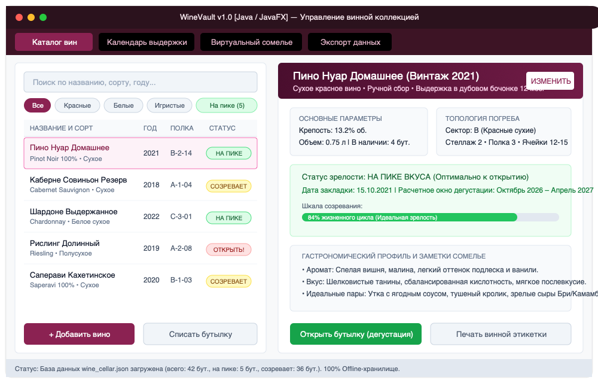
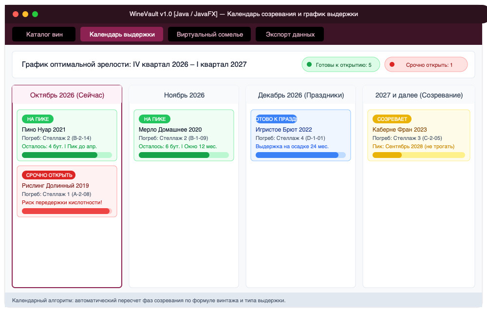
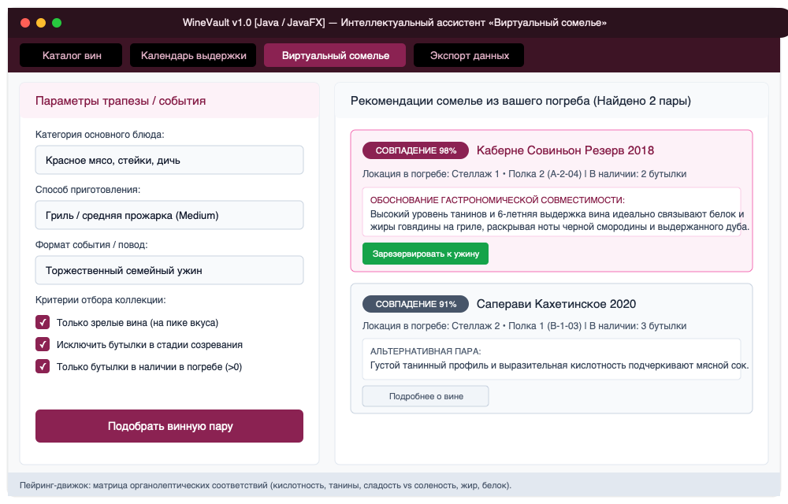
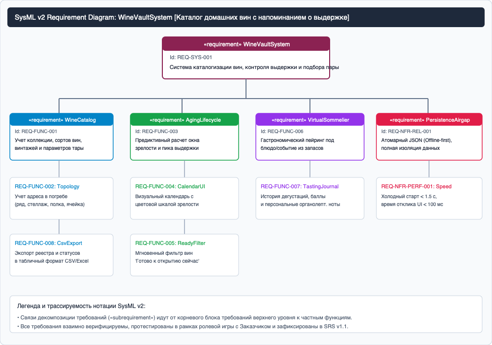

# Спецификация требований к программному обеспечению (SRS)

## Проект: WineVault (Каталог домашних вин с напоминанием о выдержке)

**Версия:** 1.1 (Final Review)  
**Статус:** Согласовано Заказчиком (по результатам Pull Request #1)  
**Подготовил:** Студент группы 450503 Абрамчук Д. С.  
**Организация:** БГУИР, Факультет компьютерных систем и сетей, Кафедра ЭВМ  
**Дата утверждения:** 22 октября 2026 г.  

---

## Оглавление

<!-- TOC -->
* [История изменений](#история-изменений)
* [1. Введение](#1-введение)
  * [1.1 Назначение документа](#11-назначение-документа)
  * [1.2 Область применения продукта](#12-область-применения-продукта)
  * [1.3 Определения, акронимы и сокращения](#13-определения-акронимы-и-сокращения)
  * [1.4 Нормативные и справочные ссылки](#14-нормативные-и-справочные-ссылки)
  * [1.5 Обзор структуры документа](#15-обзор-структуры-документа)
* [2. Обзор продукта](#2-обзор-продукта)
  * [2.1 Перспектива продукта и бизнес-контекст](#21-перспектива-продукта-и-бизнес-контекст)
  * [2.2 Границы проекта (Scope)](#22-границы-проекта-scope)
  * [2.3 Основные функции продукта](#23-основные-функции-продукта)
  * [2.4 Характеристики пользователей](#24-характеристики-пользователей)
  * [2.5 Ограничения и допущения](#25-ограничения-и-допущения)
* [3. Детальные требования к системе](#3-детальные-требования-к-системе)
  * [3.1 Спецификация внешних интерфейсов](#31-спецификация-внешних-интерфейсов)
    * [3.1.1 Пользовательский графический интерфейс (GUI)](#311-пользовательский-графический-интерфейс-gui)
    * [3.1.2 Аппаратные интерфейсы](#312-аппаратные-интерфейсы)
    * [3.1.3 Программные интерфейсы и форматы хранения](#313-программные-интерфейсы-и-форматы-хранения)
  * [3.2 Функциональные требования](#32-функциональные-требования)
  * [3.3 Нефункциональные требования (Качество обслуживания)](#33-нефункциональные-требования-качество-обслуживания)
    * [3.3.1 Производительность](#331-производительность)
    * [3.3.2 Надежность и отказоустойчивость](#332-надежность-и-отказоустойчивость)
    * [3.3.3 Безопасность и автономность](#333-безопасность-и-автономность)
    * [3.3.4 Переносимость и кроссплатформенность](#334-переносимость-и-кроссплатформенность)
  * [3.4 Моделирование требований на языке SysML v2](#34-моделирование-требований-на-языке-sysml-v2)
* [4. Матрица верификации требований](#4-матрица-верификации-требований)
* [5. Приложения](#5-приложения)
<!-- TOC -->

---

## История изменений

| Дата | Версия | Автор | Причина и суть изменений |
| :--- | :--- | :--- | :--- |
| 21.10.2026 | 1.0 | Абрамчук Д. С. | Первоначальная редакция SRS. Формализация требований Заказчика, мокапы GUI, модель SysML v2. |
| 22.10.2026 | 1.1 | Абрамчук Д. С. | Внесение изменений по итогам рецензирования Pull Request #1 Заказчиком: добавлено поле физической топологии ячейки погреба (REQ-FUNC-002), фильтр вин 'На пике' в 1 клик (REQ-FUNC-005), требование экспорта реестра в CSV (REQ-FUNC-009). Обновлена матрица верификации. |

---

## 1. Введение

### 1.1 Назначение документа
Настоящая Спецификация требований к программному обеспечению (Software Requirements Specification, SRS) описывает функциональные и качественные требования к настольному приложению **«WineVault» (Каталог домашних вин с напоминанием о выдержке)**. Документ регламентирует требования к поведению системы, форматам хранения данных, интерфейсам пользователя и критериям приемки. Спецификация предназначена для разработчиков, специалистов по тестированию, системных архитекторов и Заказчика на всех этапах жизненного цикла разработки ПО (SDLC). Документ фиксирует соглашение о том, **ЧТО** разрабатывается, без предвосхищения низкоуровневых технических деталей внутренней реализации.

### 1.2 Область применения продукта
Программный продукт «WineVault» представляет собой автономную персональную информационную систему для домашних виноделов, коллекционеров и ценителей благородных напитков.  
Система обеспечивает:
* ведение структурированного цифрового паспорта каждой бутылки;
* точный координатный учет расположения бутылок по стеллажам и полкам погреба;
* автоматический расчет жизненного цикла и предиктивных фаз выдержки вин;
* календарный мониторинг дат достижения пика зрелости и риска передержки;
* экспертный гастрономический подбор вина из имеющихся резервов погреба под конкретные блюда и события («Виртуальный сомелье»).

### 1.3 Определения, акронимы и сокращения
* **Винтаж (Vintage)** — год сбора урожая винограда, из которого изготовлено вино.
* **Выдержка (Aging / Maturation)** — процесс созревания вина в бочках или бутылках, сопровождающийся сложными биохимическими реакциями формирования органолептического букета.
* **Пик зрелости (Peak Maturity)** — расчетный временной диапазон, в течение которого органолептические свойства вина (баланс кислотности, танинов и спирта) достигают наивысшего качества.
* **Танины** — фенольные соединения растительного происхождения, придающие вину терпкость, структуру и обеспечивающие длительный потенциал хранения.
* **Гастрономический пейринг (Wine Pairing)** — искусство гармоничного сочетания вина и еды на основе кислотно-жирового и танинного баланса.
* **Air-gap / Offline-first** — концепция полной изолированности программного обеспечения от сети Интернет с сохранением 100% функциональности в локальном контуре.
* **JSON (JavaScript Object Notation)** — текстовый структурированный формат сериализации и обмена данными.
* **GUI (Graphical User Interface)** — графический пользовательский интерфейс взаимодействия человека с вычислительной системой.
* **SysML v2 (Systems Modeling Language v2)** — стандарт языка системного моделирования второго поколения.

### 1.4 Нормативные и справочные ссылки
1. **ISO/IEC/IEEE 29148:2018** Systems and software engineering — Life cycle processes — Requirements engineering.
2. **IEEE 830-1998** IEEE Recommended Practice for Software Requirements Specifications.
3. **СТП 01–2024** Стандарт предприятия БГУИР. Дипломные проекты (работы). Общие требования. — Минск: БГУИР, 2024.
4. **OMG SysML v2** Systems Modeling Language Specification. Version 2.0. Object Management Group, 2023.

### 1.5 Обзор структуры документа
Раздел 2 раскрывает общее видение продукта, границы проекта (In-Scope / Out-of-Scope), целевую аудиторию и ограничения. Раздел 3 содержит спецификацию функциональных требований, требований к GUI (включая мокапы), архитектурную модель SysML v2 и качественные атрибуты (QoS). Раздел 4 содержит трассировочную матрицу верификации требований.

---

## 2. Обзор продукта

### 2.1 Перспектива продукта и бизнес-контекст
Частные виноделы и коллекционеры сталкиваются с проблемой несистемного хранения напитков: бутылки теряются в ячейках погреба, пропускается оптимальный период употребления (вино стареет, теряет баланс и окисляется), а выбор напитка к праздничному столу или ужину происходит наугад.  
Система «WineVault» решает эти проблемы за счет создания единого цифрового реестра погреба с автоматизированным хронологическим контролем стадий старения вин.

### 2.2 Границы проекта (Scope)

| Входит в границы системы (In-Scope) | Вынесено за рамки системы (Out-of-Scope) |
| :--- | :--- |
| **Каталог вин:** паспорт бутылки, сорт винограда, винтаж, крепость, содержание сахара, объем, дата закладки. | **Интеграция с датчиками IoT:** подключение аппаратных термометров и датчиков влажности погреба. |
| **Топология погреба:** точный учет координат размещения (сектор, стеллаж, полка, номер ячейки). | **Оптическое распознавание этикеток (OCR / AI-камера):** фотосъемка бутылки с автозаполнением полей. |
| **Календарь выдержки:** предиктивный расчет фаз «Созревает», «На пике», «Риск передержки» с цветовой индикацией. | **Интеграция с внешними торговыми сервисами и Vivino API:** подгрузка мировых цен и отзывов сомелье. |
| **Виртуальный сомелье:** эвристический движок подбора вина из наличия под тип блюда и повод трапезы. | **Облачная синхронизация:** хранение базы на удаленных серверах (система работает строго локально). |
| **Экспорт данных:** выгрузка каталога вин и графика готовности в форматы JSON и CSV/Excel. | **Печать фискальных чеков:** система не является коммерческой кассовой POS-системой. |

### 2.3 Основные функции продукта
1. **Ведение каталога вин:** добавление, редактирование, просмотр подробной карточки и списание бутылок с указанием дегустационных оценок.
2. **Координатный поиск по погребу:** фильтрация по месту расположения бутылки, исключающая необходимость перемещения и взбалтывания других вин.
3. **Хроно-мониторинг стадий зрелости:** расчет окна дегустации на основе сорта и потенциала выдержки; предупреждение о критических сроках.
4. **Интеллектуальный гастрономический ассистент:** фильтрация имеющихся зрелых вин по матрице сочетаемости ингредиентов (мясо, рыба, птица, сыры, десерты).
5. **Экспорт и резервирование:** формирование отчетных ведомостей в CSV и гарантированная сохранность базы в JSON.

### 2.4 Характеристики пользователей
* **Домашний винодел:** обладает специальными знаниями о технологии виноделия, ведет учет партий, заинтересован в отслеживании созревания молодого вина.
* **Коллекционер / энофил:** ориентирован на длительную выдержку редких бутылок, контроль их рыночной зрелости и удобную навигацию по винному погребу.
* **Обычный пользователь / хозяин дома:** ценит простоту интерфейса, функцию мгновенного подбора вина под ужин и напоминания о том, какую бутылку открыть в ближайшие выходные.

### 2.5 Ограничения и допущения
* Приложение реализуется на языке Java (Java 17+ LTS) с использованием графической библиотеки JavaFX.
* Персистентное хранилище основывается на локальном JSON-файле без необходимости развертывания СУБД (PostgreSQL/MySQL).
* Приложение должно функционировать на персональных компьютерах под управлением ОС Windows, macOS и Linux в полностью изолированном сетевом контуре (Air-gap).

---

## 3. Детальные требования к системе

### 3.1 Спецификация внешних интерфейсов

#### 3.1.1 Пользовательский графический интерфейс (GUI)
Интерфейс пользователя спроектирован по принципу модульной однооконной компоновки с навигационной панелью переключения вкладок. Для валидации требований разработаны высокодетализированные мокапы:

1. **Экран управления каталогом вин (Рисунок 3.1):** содержит левую панель реестра вин с поиском и переключателями категорий («Все», «Красные», «Белые», «Игристые», «На пике»), а также правую панель подробного паспорта выбранного вина с визуальным индикатором стадии выдержки.
   
     
   *Рисунок 3.1 – Графический интерфейс каталога и карточки винной коллекции*

2. **Экран календаря выдержки и напоминаний (Рисунок 3.2):** представляет временную хронологическую сетку по месяцам и годам. Бутылки сгруппированы по статусу готовности с цветовой маркировкой (Зеленый — на пике, Желтый — созревает, Красный — критический риск передержки).
   
     
   *Рисунок 3.2 – Графический интерфейс календаря готовности и стадий выдержки*

3. **Экран интеллектуального ассистента «Виртуальный сомелье» (Рисунок 3.3):** левая панель предназначена для задания параметров трапезы (блюдо, метод готовки, повод), правая — выводит ранжированный список рекомендованных бутылок из текущих запасов с развернутым гастрономическим обоснованием.
   
     
   *Рисунок 3.3 – Графический интерфейс интеллектуального подбора вин «Виртуальный сомелье»*

#### 3.1.2 Аппаратные интерфейсы
* Стандартная клавиатура и двухкнопочный манипулятор типа «мышь» (или тачпад).
* Минимальное разрешение экрана дисплея: 1280 × 720 пикселей; рекомендуемое: 1920 × 1080 пикселей.

#### 3.1.3 Программные интерфейсы и форматы хранения
* Среда исполнения: Java Virtual Machine (JRE / JDK 17 или новее).
* Локальный файл базы данных `wine_cellar.json` со структурой объектов: идентификатор (`id`), наименование (`title`), сорт винограда (`grapeVariety`), винтаж (`vintageYear`), крепость (`abv`), категория сахара (`sweetness`), объем (`volumeMl`), дата закладки (`bottlingDate`), координаты в погребе (`cellarLocation: {rack, shelf, slot}`), потенциал хранения в месяцах (`agingPotentialMonths`), дегустационные заметки (`tastingNotes`).

---

### 3.2 Функциональные требования

* **REQ-FUNC-001 [Каталогизация вин]:** Система должна обеспечивать добавление новой бутылки в каталог с фиксацией названия, сорта винограда, винтажа, крепости, сладости, объема и количества экземпляров.
* **REQ-FUNC-002 [Координатный учет погреба]:** Система должна позволять задавать и редактировать физическое местоположение каждой бутылки в формате «Сектор – Стеллаж – Полка – Номер ячейки» (добавлено по замечанию Заказчика).
* **REQ-FUNC-003 [Расчет фаз выдержки]:** Система должна автоматически рассчитывать даты вхождения в фазу оптимальной зрелости и дату критического старения на основе даты закладки и типа вина.
* **REQ-FUNC-004 [Календарный таймлайн]:** Система должна отображать интерактивный календарь с группировкой бутылок по месяцам готовности и визуализацией шкалы созревания (в процентах от жизненного цикла).
* **REQ-FUNC-005 [Быстрый фильтр зрелости]:** Система должна предоставлять кнопку быстрой фильтрации «На пике формы», выводящую только те вина, которые готовы к дегустации в текущем месяце (добавлено по замечанию Заказчика).
* **REQ-FUNC-006 [Гастрономический подбор]:** Система должна подбирать вина из имеющихся в погребе под выбранную категорию блюда (красное мясо, птица, рыба, зрелые сыры, десерты) с выводом коэффициента совместимости и текстового обоснования.
* **REQ-FUNC-007 [Журнал дегустаций]:** При списании бутылки система должна предлагать внести дату дегустации, органолептические заметки (аромат, вкус, танины) и оценку по 100-балльной шкале Роберта Паркера.
* **REQ-FUNC-008 [Списание и инвентаризация]:** При уменьшении количества бутылок до нуля система должна переводить запись в статус «Выпито» без безвозвратного удаления истории.
* **REQ-FUNC-009 [Экспорт реестра в CSV]:** Система должна формировать сводную ведомость винной коллекции в файл формата CSV с разделителями-запятыми для печати и анализа в Microsoft Excel / LibreOffice Calc (добавлено по замечанию Заказчика).
* **REQ-FUNC-010 [Многопараметрический поиск]:** Система должна производить мгновенную фильтрацию списка вин по подстроке в названии, сорту винограда или диапазону винтажей.

---

### 3.3 Нефункциональные требования (Качество обслуживания)

#### 3.3.1 Производительность
* **REQ-NFR-PERF-001:** Время холодного старта приложения до отображения главного окна не должно превышать 1.5 секунды на стандартном офисном ПК.
* **REQ-NFR-PERF-002:** Фильтрация коллекции объемом до 5 000 бутылок при вводе поискового запроса должна выполняться за время не более 100 мс.

#### 3.3.2 Надежность и отказоустойчивость
* **REQ-NFR-REL-001 [Атомарность сохранения]:** Сохранение базы данных в файл `wine_cellar.json` должно осуществляться атомарно через запись во временный файл `wine_cellar.tmp` с последующим переименованием (Atomic Move). Это исключает порчу данных при внезапном обесточивании ПК.
* **REQ-NFR-REL-002 [Резервные копии]:** При каждом запуске система должна автоматически создавать резервную копию базы данных `wine_cellar_backup.json`.

#### 3.3.3 Безопасность и автономность
* **REQ-NFR-SEC-001 [Air-gap / Offline]:** Приложение не должно инициировать никаких сетевых исходящих HTTP/HTTPS соединений. Все вычисления и хранение проводятся строго на локальной машине пользователя.

#### 3.3.4 Переносимость и кроссплатформенность
* **REQ-NFR-PORT-001:** Программный пакет должен без изменений исходного кода собираться и запускаться в среде Java 17+ на операционных системах Microsoft Windows 10/11, macOS и Linux (Ubuntu / Debian).

---

### 3.4 Моделирование требований на языке SysML v2

Для системного описания структуры требований разработана модель на формальном языке SysML v2, представленная в файле `diagrams/requirements.sysml`. Архитектурная диаграмма декомпозиции и трассируемости требований приведена на рисунке 3.4.

  
*Рисунок 3.4 – Диаграмма требований системы WineVault в нотации SysML v2*

---

## 4. Матрица верификации требований

Матрица определяет метод проверки каждого требования системы:
* **Test (T)** — автоматизированный или ручной тест воспроизведения функционала.
* **Demonstration (D)** — демонстрация работы пользовательского сценария в графическом интерфейсе.
* **Inspection (I)** — экспертная визуальная проверка структуры кода, файла конфигурации или данных.

| Идентификатор | Наименование требования | Метод верификации | Артефакт / Критерий приемки |
| :--- | :--- | :--- | :--- |
| **REQ-FUNC-001** | Каталогизация вин | Demonstration (D) | Форма добавления сохраняет все атрибуты бутылки в карточку и JSON. |
| **REQ-FUNC-002** | Координатный учет погреба | Demonstration (D) | В карточке отображается стеллаж, полка и ячейка; поиск по полке находит вино. |
| **REQ-FUNC-003** | Расчет фаз выдержки | Test (T) | Модульный тест расчета даты пика: винтаж 2021 + 60 мес. = 2026 год. |
| **REQ-FUNC-004** | Календарный таймлайн | Demonstration (D) | Экран календаря группирует вина по месяцам и красит бейджи (зеленый/красный). |
| **REQ-FUNC-005** | Быстрый фильтр зрелости | Demonstration (D) | Нажатие на кнопку «На пике» мгновенно оставляет в таблице только готовые вина. |
| **REQ-FUNC-006** | Гастрономический подбор | Test (T) + Demonstration (D) | При выборе «Стейк» в топ рекомендаций выходит красное сухое танинное вино. |
| **REQ-FUNC-007** | Журнал дегустаций | Demonstration (D) | Заметки сомелье и оценка 1-100 сохраняются в истории выпитых бутылок. |
| **REQ-FUNC-008** | Списание и инвентаризация | Demonstration (D) | Уменьшение остатка до 0 переводит карточку в архив без удаления. |
| **REQ-FUNC-009** | Экспорт реестра в CSV | Test (T) + Inspection (I) | Созданный CSV-файл открывается в MS Excel без искажения кириллицы (UTF-8 with BOM). |
| **REQ-FUNC-010** | Многопараметрический поиск | Test (T) | Поиск по фразе «Пино» фильтрует список менее чем за 100 мс. |
| **REQ-NFR-PERF-001** | Время холодного старта | Test (T) | Замер системного таймера: от старта JVM до показа Stage <= 1.5 с. |
| **REQ-NFR-REL-001** | Атомарное сохранение | Inspection (I) | Исходный код использует метод `Files.move(..., ATOMIC_MOVE)`. |
| **REQ-NFR-SEC-001** | Локальная изоляция (Air-gap) | Inspection (I) | В зависимостях отсутствуют сетевые библиотеки; трафик равен 0 байт. |
| **REQ-NFR-PORT-001** | Кроссплатформенность | Test (T) | Успешный запуск jar-пакета на Windows и macOS. |

---

## 5. Приложения

### Приложение А. Пример структуры файла базы данных (`wine_cellar.json`)
```json
[
  {
    "id": "wine-2021-pn-01",
    "title": "Пино Нуар Домашнее",
    "grapeVariety": "Pinot Noir",
    "vintageYear": 2021,
    "abv": 13.2,
    "sweetness": "DRY",
    "volumeMl": 750,
    "bottlingDate": "2021-10-15",
    "quantity": 4,
    "cellarLocation": {
      "sector": "B",
      "rack": 2,
      "shelf": 3,
      "slot": 14
    },
    "agingPotentialMonths": 60,
    "peakStart": "2026-10-01",
    "peakEnd": "2027-04-30",
    "status": "PEAK_READY",
    "tastingNotes": "Шелковистые танины, спелая вишня, легкая ваниль."
  }
]
```
