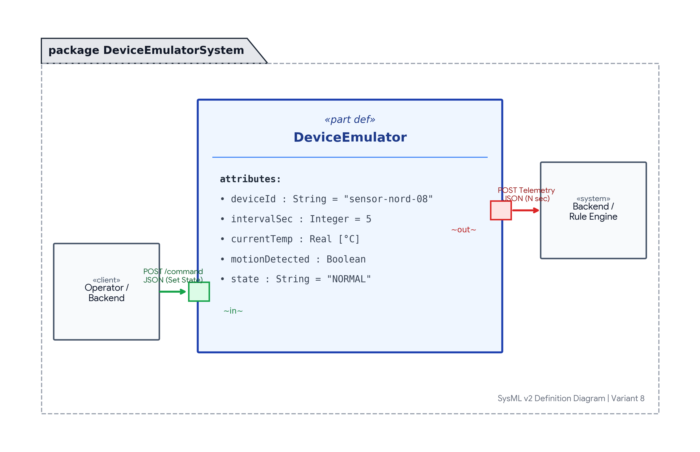

# Спецификация требований к программному обеспечению (SRS)
## Проект: IoT Device Emulator (Вариант 8)

### 1. Бизнес-требования (Business Requirements)

#### 1.1 Исходные условия и контекст (Business Context)
При разработке комплексной IoT-системы («умный дом / производство») смежные команды (разработка движка правил и аналитической веб-панели) сталкиваются с проблемой отсутствия достаточного количества физических сенсоров на ранних стадиях разработки. Покупка и подключение реального оборудования замедляют тестирование, а симуляция критических сценариев (аномальный перегрев, сбои питания) на физических платах сопряжена с рисками.

#### 1.2 Бизнес-цели и критерии успеха (Business Opportunities & Objectives)
* **BO-1:** Сократить время вывода IoT-платформы на рынок (Time-to-Market) на 35% за счет обеспечения команд бэкенда и фронтенда автономным генератором тестовых данных.
* **BO-2:** Обеспечить 100% покрытие тестами краевых аварийных состояний (критическая температура, непрерывное движение) без использования физических сенсоров.
* **SC-1 (Успех):** Достижение стабильной непрерывной генерации телеметрии с задаваемой частотой (раз в N секунд) и задержкой ответа на управляющие команды менее 100 мс.

#### 1.3 Потребности пользователей и стейкхолдеров (User Needs)
* **Разработчик бэкенда / движка правил:** нуждается в стандартизированном JSON-потоке данных для отладки триггеров и алгоритмов реакции.
* **QA-инженер:** нуждается в возможности удаленного изменения внутреннего состояния эмулятора через HTTP-запрос для проверки реакции системы на аномалии.

#### 1.4 Границы проекта (Scope and Limitations)
* **В рамках проекта:**
  * Эмуляция сенсора с атрибутами: `device_id`, `temperature`, `motion`.
  * Периодическая генерация JSON-пакетов телеметрии (раз в N секунд).
  * HTTP-сервер, слушающий эндпоинт `/command` и меняющий параметры генерации.
* **Вне рамок проекта (Out of Scope):**
  * Физическая передача сигналов по протоколам Zigbee/Bluetooth (только JSON over HTTP/WebSocket).
  * Постоянное хранение исторических данных (задача базы данных бэкенда).

#### 1.5 Бизнес-правила (Business Rules)
* **BR-1 (Интервал):** По умолчанию телеметрия отправляется раз в 5 секунд. Интервал N может быть изменен через `/command` в диапазоне от 1 до 60 секунд.
* **BR-2 (Формат телеметрии):** Пакет данных обязан содержать:
  * `device_id` (строка, уникальный идентификатор);
  * `temperature` (число с плавающей точкой, в градусах Цельсия);
  * `motion` (булево значение: `true` / `false`).
* **BR-3 (Реакция на команду):** При получении запроса на `/command` внутреннее состояние эмулятора изменяется немедленно без перезапуска процесса.

### 2. Графическая модель требований (SysML v2)

Архитектурная схема эмулятора устройств, портов телеметрии и приема команд:

