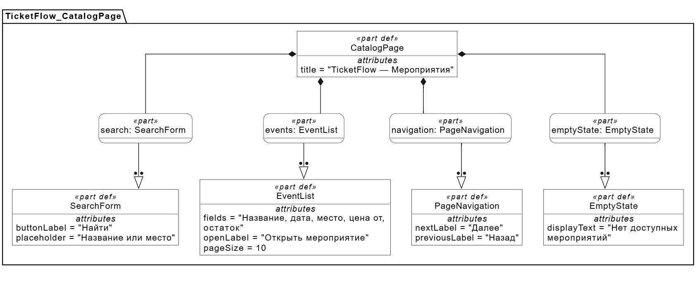
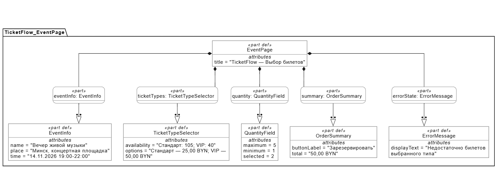
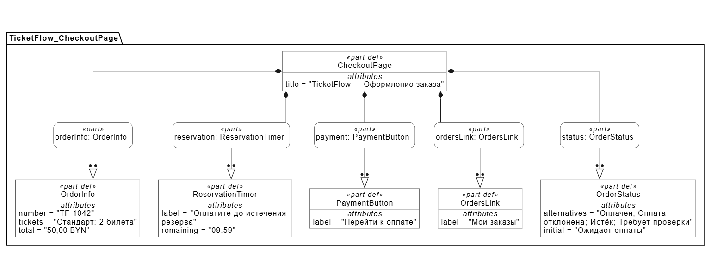
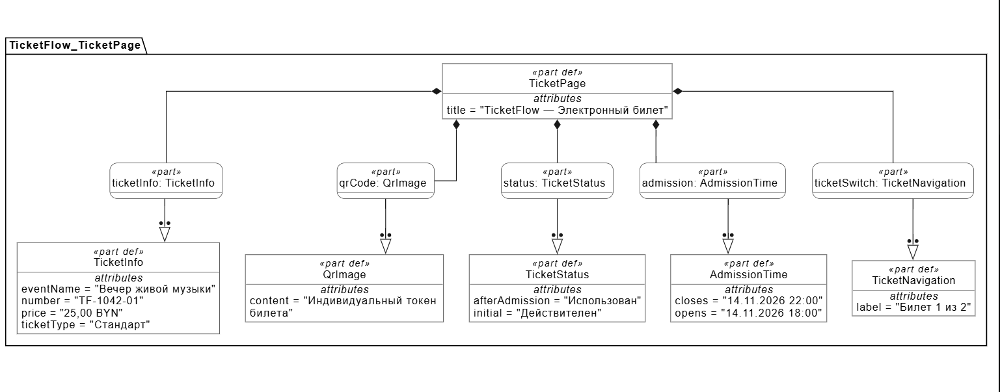
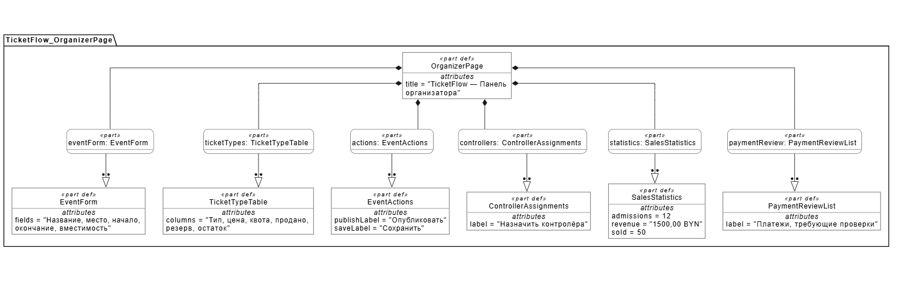
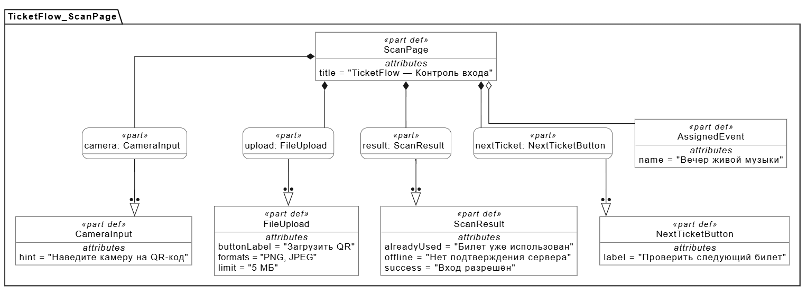

# UI-спецификация TicketFlow

Версия 0.3. Дата 29.10.2026. Основные требования: [подраздел 3.1.1 SRS](../srs.md#311-пользовательские-интерфейсы-311-user-interfaces).

Текст актуализирован для редакции 0.2. Существующие PNG относятся к редакции 0.1: в них ещё отсутствуют места, регистрация, окно продаж и новый срок резерва. Изображения требуют повторного экспорта из обновлённых моделей SysMLv2; они не являются полным прототипом новых требований.

## Общие правила

Язык — русский; основные суммы имеют формат `25,00 BYN`, время мероприятия показывается в Europe/Minsk. Страница содержит навигацию «Мероприятия» и «Мои заказы», действия сотрудников отображаются по роли. Видимость кнопки не заменяет серверную проверку прав. При ширине 360 CSS-пикселей блоки располагаются вертикально; при 1440 CSS-пикселях используются колонки. Горизонтальная прокрутка страницы отсутствует. Управление формами с клавиатуры и текстовые состояния проверяются REQ-INT-004.

## Вход и регистрация

Гость видит «Войти» и «Зарегистрироваться». Форма входа: логин, пароль, сообщение об ошибке и выход после входа. Регистрация покупателя: логин, пароль, подтверждение, имя и email. Создание профиля организатора дополнительно запрашивает наименование организации/ИП, УНП из 9 цифр и телефон; существующий покупатель добавляет профиль после входа. УНП не заменяет пароль и не является отметкой о проверенных полномочиях. Роль контролёра не выбирается в регистрации: её назначает организатор для своего мероприятия. Форматы и границы задают [REQ-FUNC-019](../srs.md#req-func-019) и [REQ-FUNC-020](../srs.md#req-func-020).

После истечения 15 минут бездействия сессии требуется повторный вход, но резерв мест сохраняется до своего 20-минутного срока. Повторный вход сам по себе не продлевает все заказы; продление требует действия с конкретным действующим заказом.

Графическая часть содержит структурные схемы шести экранов на SysMLv2. Они показывают состав элементов и примеры их содержимого; расположение блоков на диаграммах не задаёт положение полей и кнопок на веб-странице. Полный состав полей, переходы и бизнес-правила задаются текстом SRS и этой спецификации. Значения статусов и сообщений на схемах являются альтернативами, из которых при работе отображается соответствующий результат. Элемент `QrImage` обозначает область QR-кода электронного билета.

## 1. Каталог

Элементы: поиск по названию или месту, список опубликованных будущих мероприятий, дата и место, минимальная цена, остаток, переход к выбору билетов и постраничная навигация. Нормальное состояние — до 10 мероприятий на странице; пустое — «Нет доступных мероприятий» с возможностью изменить запрос. Выбор карточки открывает экран мероприятия. Покупка требует входа, просмотр не требует.

Связь: REQ-FUNC-003–005.

## 2. Выбор билетов

Элементы: сведения о мероприятии, площадка и зал, даты, открытие и закрытие продаж, таблица типов с ценами и остатками, выбор типа и 1–5 разных мест его сектора. Места показывают сектор, ряд, номер и состояние; необходим доступный с клавиатуры список. Для VIP нельзя выбрать место сектора «Стандарт». Количество вычисляется по выбранным местам; сумма берётся из серверных цен. До открытия и с момента закрытия продаж резервирование недоступно. Занятое место даёт «Место уже занято. Выберите другое» без частичного заказа. Успех открывает заказ с серверным сроком.

Если у покупателя есть оплаченный заказ на другое пересекающееся по времени мероприятие, перед резервированием показываются название/время конфликта, «Продолжить» и «Отмена». Это предупреждение, а не запрет: покупатель может приобретать билеты другим людям. Отмена не удерживает места; подтверждение проверяется сервером по [REQ-FUNC-024](../srs.md#req-func-024).

Связь: REQ-FUNC-002, 006–008.

## 3. Оформление заказа

Элементы: номер заказа, мероприятие, тип, сектор/ряд/номер каждого места, количество, зафиксированная цена и сумма, обратный отсчёт до актуального серверного срока, учётная запись, «Продолжить бронирование», «Перейти к оплате» и личные заказы. Срок — 20 минут с последнего принятого действия, но не позже закрытия продаж. Кнопка продолжения, ручное открытие/обновление заказа и принятое нажатие оплаты продлевают срок; автоопрос и движение мыши не продлевают. При закрытии продаж раньше 20 минут показаны фактический срок и причина сокращения.

До подтверждения сервера статус — «Ожидает оплаты»; после истечения — «Резерв истёк», места освобождаются. Ожидание банка после принятого нажатия оплаты входит в новые 20 минут; таймер не останавливается бессрочно. Поздний успех — «Платёж требует проверки организатором» без выдачи билета и повторного занятия места. Технические повторы используют тот же заказ и платёжную сессию, не считаются новыми действиями.

Связь: REQ-INT-003, REQ-FUNC-008–011.

## 4. Электронный билет

Элементы: мероприятие, дата, площадка/зал, сектор, ряд, номер места, тип, цена, номер билета, QR, текст состояния, время открытия входа и переключатель отдельных билетов заказа. Один билет соответствует одному выбранному месту. Личные заказы доступны только владельцу. Состояние «Действителен» сменяется на «Использован» после допуска; повторное открытие показывает тот же токен, место и актуальное состояние. Неоплаченный заказ не содержит QR-билетов. Пустой список личных заказов — «У вас пока нет заказов».

Связь: REQ-FUNC-012–015.

## 5. Управление мероприятием

Элементы: название, описание, выбор площадки/зала с городом и адресом, начало/окончание, открытие/закрытие продаж, вместимость, секторы с рядами и номерами, привязка секторов к типам и цены. ID, владелец и статус назначаются сервером. Полный перечень и ограничения приведены в [REQ-FUNC-001](../srs.md#req-func-001). Квота вычисляется по включённым местам; проданные и удерживаемые места исключить нельзя. После публикации расписание, зал и обозначения мест не меняются.

При пересечении с опубликованным мероприятием этого организатора либо с любым мероприятием того же зала публикация отклоняется с причиной и временем конфликта. Непересекающиеся мероприятия не ограничены произвольным количеством. Панель также показывает продажи/допуски, сумму, свободные/удерживаемые/проданные места, назначения контролёров и проблемные платежи. Управление чужим мероприятием запрещено.

Связь: REQ-FUNC-001–003, 017–018.

## 6. Контроль входа

Элементы: назначенное мероприятие, окно камеры, загрузка PNG/JPEG до 5 МБ, одно сообщение результата и переход к следующему билету. Отказ разрешения камеры оставляет загрузку файла. Успех — «Вход разрешён» с номером и типом; повтор — «Билет уже использован» с временем первого прохода. Неизвестный код, другое мероприятие, ранняя/поздняя проверка и отсутствие связи дают отдельные текстовые причины. Неподтверждённый ответ не показывается как успешный допуск. Цвет каждого результата дублируется словами.

Связь: REQ-INT-002, REQ-INT-004, REQ-FUNC-014–016.

## Обозначения и получение изображений

Диаграммы построены в Visual Paradigm SysML v2 Studio по текстовым моделям SysMLv2 и сохранены в PNG. Использовано представление Tree.

- `part def` — определение элемента экрана, например `SearchForm` или `OrderSummary`.
- `part` — элемент, включённый в конкретный экран, например `search : SearchForm`.
- Чёрный ромб обозначает включение элемента в состав экрана.
- Стрелка с полым треугольником связывает элемент с определением его типа.
- `attributes` содержит подписи, поля и примеры значений для согласования требований.

Изменение редакции 0.3 относится к панели организатора: добавлена доступная с клавиатуры кнопка «Скачать CSV» только для владельца текущего мероприятия. Во время формирования показано «Готовим файл», при ошибке — текстовая причина и повтор. Файл соответствует REQ-FUNC-025, не содержит email/QR/УНП и использует те же формулы снимка, что экранная сводка.
