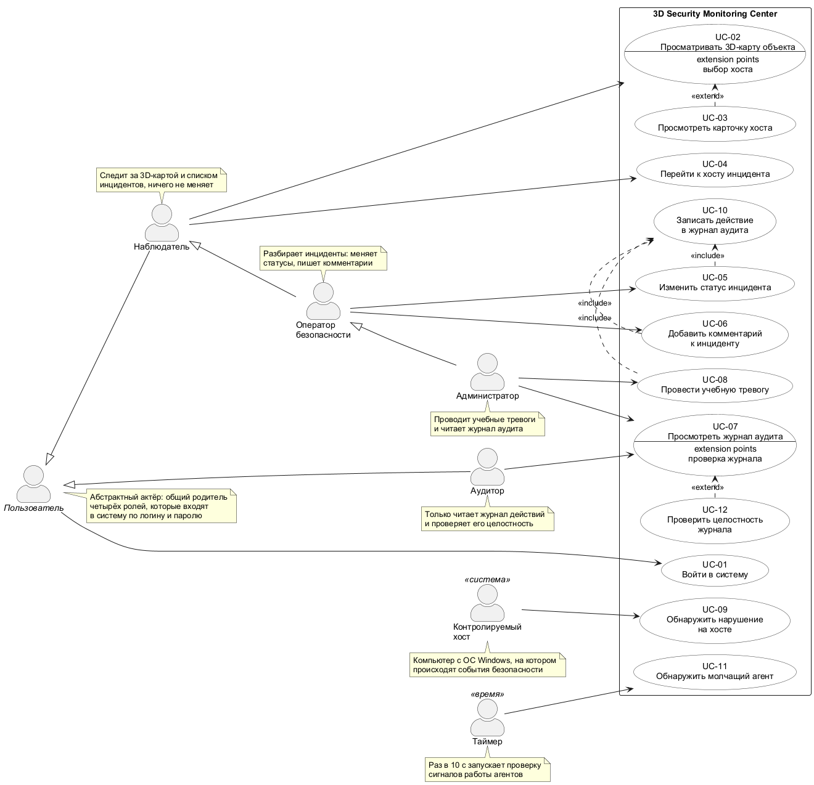

# Модель вариантов использования

Проект: 3D Security Monitoring Center. Версия модели: 1.0.

Модель описывает функции версии 1.0 системы с точки зрения её пользователей. Функции, отложенные Заказчиком на версию 1.1 (таймлайн, экраны администрирования, второй фактор, контроль портов), в модель не входят. Диаграмма построена в файле [use-case.puml](use-case.puml), термины определены в [glossary.md](glossary.md), общие для всех прецедентов требования вынесены в [supplementary-specification.md](supplementary-specification.md).

## 1. Актёры

| Актёр | Описание роли в системе |
|---|---|
| Пользователь | Любой человек с учётной записью в системе. Абстрактный актёр: от него наследуются четыре роли, и общий для них прецедент – вход в систему |
| Наблюдатель | Дежурный, который следит за 3D-картой объекта и списком инцидентов. Ничего не меняет в системе |
| Оператор безопасности | Специалист по защите информации, который разбирает инциденты. Может всё, что наблюдатель, и дополнительно меняет статусы и пишет комментарии |
| Администратор | Системный администратор. Может всё, что оператор, а также проводит учебные тревоги и читает журнал аудита |
| Аудитор | Специалист по контролю, который читает журнал действий пользователей и проверяет его целостность. Инциденты не видит |
| Контролируемый хост | Внешний для системы компьютер с ОС Windows, на котором происходят действия, порождающие события безопасности |
| Таймер | Время как актёр: раз в 10 секунд запускает на сервере проверку сигналов работы агентов |

Обобщение «Наблюдатель ← Оператор безопасности ← Администратор» показано потому, что поведение ролей действительно различается: каждая следующая роль добавляет новые прецеденты к прецедентам предыдущей. Связей между остальными актёрами нет, поскольку актёры находятся вне системы.

## 2. Прецеденты

| ID | Прецедент | Актёры | Связи | Требования SRS |
|---|---|---|---|---|
| UC-01 | Войти в систему | Пользователь | – | REQ-FUNC-026, REQ-SEC-003 |
| UC-02 | Просматривать 3D-карту объекта | Наблюдатель | расширяется UC-03 | REQ-FUNC-018, REQ-FUNC-019 |
| UC-03 | Просмотреть карточку хоста | – | «extend» UC-02 | REQ-FUNC-021 |
| UC-04 | Перейти к хосту инцидента | Наблюдатель | – | REQ-FUNC-020 |
| UC-05 | Изменить статус инцидента | Оператор безопасности | «include» UC-10 | REQ-FUNC-022 |
| UC-06 | Добавить комментарий к инциденту | Оператор безопасности | «include» UC-10 | REQ-FUNC-023 |
| UC-07 | Просмотреть журнал аудита | Аудитор, Администратор | расширяется UC-12 | REQ-FUNC-028 |
| UC-08 | Провести учебную тревогу | Администратор | «include» UC-10 | REQ-FUNC-031 |
| UC-09 | Обнаружить нарушение на хосте | Контролируемый хост | – | REQ-FUNC-001 – REQ-FUNC-013, REQ-FUNC-015, REQ-FUNC-016 |
| UC-10 | Записать действие в журнал аудита | – | включается в UC-05, UC-06, UC-08 | REQ-SEC-005 |
| UC-11 | Обнаружить молчащий агент | Таймер | – | REQ-FUNC-014 |
| UC-12 | Проверить целостность журнала | – | «extend» UC-07 | REQ-SEC-005 |

## 3. Потоки событий

### UC-01. Войти в систему

**Краткое описание.** Прецедент позволяет пользователю войти в консоль по логину и паролю и получить интерфейс, соответствующий его роли.

**Актёр.** Пользователь (любая из четырёх ролей).

**Предусловия.** Консоль запущена и показывает окно входа. Сервер доступен по защищённому каналу. Учётная запись пользователя создана администратором.

**Основной поток.**
1. Прецедент начинается, когда пользователь вводит логин и пароль и нажимает «Войти».
2. Консоль устанавливает соединение WSS с сервером и отправляет запрос `login`.
3. Сервер находит учётную запись и проверяет, что она не заблокирована.
4. Сервер сравнивает пароль с хешем Argon2id. Если пароль неверный, выполняется альтернативный поток А1.
5. Сервер создаёт сеанс, обнуляет счётчик неудачных попыток и отвечает `login_ok` с ролью пользователя.
6. Консоль запрашивает план объекта (`get_layout`) и открытые инциденты (`get_open_incidents`), если они доступны роли.
7. Консоль показывает главный экран с кнопками, разрешёнными роли.
8. Прецедент завершается.

**Альтернативные потоки.**
- А1. Неверный пароль. Сервер увеличивает счётчик неудачных попыток. Если попыток стало 5, выполняется поток А2. Иначе консоль сообщает «Неверный логин или пароль» и возвращается к шагу 1.
- А2. Блокировка. Сервер блокирует учётную запись на 15 минут, а консоль сообщает о блокировке и времени её окончания. Прецедент завершается без входа.
- А3. Учётная запись заблокирована ранее. На шаге 3 сервер отвечает ошибкой блокировки, консоль показывает время её окончания. Прецедент завершается без входа.

**Потоки ошибок.**
- Е1. Сервер недоступен или сертификат сервера не прошёл проверку. Консоль сообщает об ошибке связи и остаётся на окне входа.

**Постусловия.** При успешном входе у пользователя есть сеанс, сервер знает его роль и рассылает ему изменения. При неудаче доступно только окно входа.

### UC-02. Просматривать 3D-карту объекта

**Краткое описание.** Прецедент позволяет следить за состоянием всех хостов объекта на 3D-сцене: здание, этажи, помещения и компьютеры окрашены по состоянию.

**Актёр.** Наблюдатель и унаследовавшие его роли.

**Предусловия.** Выполнен UC-01. План объекта загружен с сервера.

**Основной поток.**
1. Прецедент начинается после входа, когда консоль строит сцену по полученному плану объекта.
2. Консоль окрашивает каждый хост по состоянию: зелёный – норма, жёлтый – предупреждение, красный – инцидент, серый – агент молчит.
3. Пользователь вращает и приближает камеру, переключает этажи.
4. При получении уведомления `host_state` консоль меняет цвет хоста без обновления экрана.
5. Если пользователь щёлкает по хосту, выполняется расширение UC-03 (точка расширения «выбор хоста»).
6. Прецедент продолжается, пока пользователь не выйдет из системы.

**Альтернативные потоки.**
- А1. В плане нет ни одного здания. Консоль показывает сообщение «Объект не описан в данных» и пустую сцену.

**Потоки ошибок.**
- Е1. Потеряна связь с сервером. Консоль показывает сообщение о потере связи и предлагает войти повторно (UC-01).

**Постусловия.** Состояние, которое видит пользователь, совпадает с состоянием на сервере.

### UC-03. Просмотреть карточку хоста

**Краткое описание.** Расширение UC-02: по щелчку на хосте консоль показывает его карточку с именем, адресом, пользователем, последними событиями и открытыми инцидентами.

**Актёр.** Наблюдатель (через UC-02).

**Предусловия.** Выполняется UC-02, пользователь щёлкнул по хосту.

**Основной поток.**
1. Расширение начинается, когда пользователь щёлкает по хосту на сцене.
2. Консоль отправляет запросы `get_host` и `get_host_events`.
3. Сервер проверяет права и возвращает данные хоста и последние события.
4. Консоль показывает карточку хоста и подсвечивает хост на сцене.
5. Расширение завершается, пользователь возвращается к UC-02.

**Альтернативные потоки.**
- А1. Хост удалён из данных. Сервер отвечает «объект не найден», консоль закрывает карточку и сообщает об этом.

**Постусловия.** Карточка показывает актуальные данные выбранного хоста.

### UC-04. Перейти к хосту инцидента

**Краткое описание.** Прецедент позволяет по щелчку на инциденте в списке переместить камеру к хосту, на котором он возник.

**Актёр.** Наблюдатель и унаследовавшие его роли.

**Предусловия.** Выполнен UC-01, в списке открытых инцидентов есть хотя бы один инцидент.

**Основной поток.**
1. Прецедент начинается, когда пользователь щёлкает по инциденту в списке.
2. Консоль находит на сцене хост инцидента и переключает этаж, если хост на другом этаже.
3. Камера плавно перемещается к хосту, хост пульсирует.
4. Консоль открывает карточку хоста (как в UC-03).
5. Прецедент завершается.

**Альтернативные потоки.**
- А1. Хост инцидента не размещён на плане. Консоль показывает карточку хоста без перемещения камеры и сообщение «Хост не размещён на плане».

**Постусловия.** Камера направлена на хост инцидента.

### UC-05. Изменить статус инцидента

**Краткое описание.** Прецедент позволяет оператору провести инцидент по этапам разбора: новый, в работе, решён, ложное срабатывание.

**Актёр.** Оператор безопасности и Администратор.

**Предусловия.** Выполнен UC-01 с ролью оператора или администратора. Инцидент открыт.

**Основной поток.**
1. Прецедент начинается, когда оператор выбирает инцидент и нажимает кнопку нового статуса.
2. Консоль отправляет запрос `set_incident_status` с идентификатором инцидента и статусом.
3. Сервер проверяет права пользователя и допустимость перехода по диаграмме состояний ST-01. Если переход недопустим, выполняется альтернативный поток А1.
4. Сервер в одной транзакции меняет статус и выполняет UC-10 «Записать действие в журнал аудита».
5. Сервер пересчитывает состояние хоста и рассылает всем консолям `incident_update` и `host_state`.
6. Консоль показывает новый статус. Если у хоста больше нет открытых инцидентов, он становится зелёным.
7. Прецедент завершается.

**Альтернативные потоки.**
- А1. Недопустимый переход, например из «решён» в «новый». Сервер отклоняет запрос, консоль показывает «Переход статуса недопустим».
- А2. Инцидент уже изменил другой оператор. Консоль получает `incident_update` раньше ответа и показывает актуальный статус.

**Потоки ошибок.**
- Е1. У пользователя нет прав (например, наблюдатель отправил запрос в обход интерфейса). Сервер отвечает ошибкой прав и записывает отказ в журнал работы.
- Е2. Ошибка базы данных. Транзакция откатывается, статус и журнал не меняются, консоль сообщает об ошибке.

**Постусловия.** Статус инцидента изменён, в журнале аудита есть запись о действии, все консоли видят новый статус.

### UC-06. Добавить комментарий к инциденту

**Краткое описание.** Прецедент позволяет оператору записать к инциденту комментарий, который увидят другие операторы.

**Актёр.** Оператор безопасности и Администратор.

**Предусловия.** Выполнен UC-01 с ролью оператора или администратора. Карточка инцидента открыта.

**Основной поток.**
1. Прецедент начинается, когда оператор вводит текст и нажимает «Добавить».
2. Консоль отправляет запрос `add_comment`.
3. Сервер проверяет права и длину сообщения.
4. Сервер сохраняет комментарий с автором и временем и выполняет UC-10.
5. Сервер рассылает `incident_update`, комментарий появляется у всех операторов.
6. Прецедент завершается.

**Альтернативные потоки.**
- А1. Пустой текст. Консоль не отправляет запрос и подсвечивает поле ввода.

**Потоки ошибок.**
- Е1. Сообщение больше 64 КБ. Сервер отклоняет его, консоль сообщает о превышении размера.

**Постусловия.** Комментарий сохранён и связан с инцидентом, действие записано в журнал аудита.

### UC-07. Просмотреть журнал аудита

**Краткое описание.** Прецедент позволяет аудитору прочитать действия пользователей за выбранный период.

**Актёр.** Аудитор и Администратор.

**Предусловия.** Выполнен UC-01 с ролью аудитора или администратора.

**Основной поток.**
1. Прецедент начинается, когда пользователь открывает экран журнала и задаёт период.
2. Консоль отправляет запрос `get_audit_log`.
3. Сервер проверяет права и возвращает записи: время, пользователь, действие, объект.
4. Консоль показывает записи в таблице.
5. Если пользователь нажимает «Проверить целостность», выполняется расширение UC-12 (точка расширения «проверка журнала»).
6. Прецедент завершается.

**Альтернативные потоки.**
- А1. За период нет записей. Консоль показывает пустую таблицу и сообщение «Записей нет».

**Постусловия.** Журнал не изменился: прецедент только читает данные.

### UC-08. Провести учебную тревогу

**Краткое описание.** Прецедент позволяет администратору проверить реакцию операторов: на стендовых хостах воспроизводится атака, а сервер замеряет время реакции.

**Актёр.** Администратор.

**Предусловия.** Выполнен UC-01 с ролью администратора. Стендовые хосты подключены, их агенты работают.

**Основной поток.**
1. Прецедент начинается, когда администратор выбирает сценарий (перебор пароля, USB-накопитель, неизвестная программа) и нажимает «Запустить».
2. Сервер создаёт сеанс учений и выполняет UC-10.
3. Генератор учебных атак воспроизводит сценарий на стендовых хостах.
4. Возникшие инциденты создаются по UC-09 с признаком drill и отметкой «Учения» в консоли.
5. Операторы разбирают инциденты по UC-05.
6. Когда все учебные инциденты закрыты, сервер завершает сеанс и формирует отчёт: время взятия в работу и время закрытия по каждому оператору.
7. Прецедент завершается.

**Альтернативные потоки.**
- А1. Администратор останавливает учения. Сеанс получает статус «прерван», открытые учебные инциденты закрываются, отчёт строится по закрытым.

**Потоки ошибок.**
- Е1. Стендовый хост недоступен. Сервер не запускает сеанс и сообщает, какой хост не отвечает.

**Постусловия.** Отчёт учений сохранён, боевая статистика инцидентов не изменилась.

### UC-09. Обнаружить нарушение на хосте

**Краткое описание.** Прецедент описывает путь события от контролируемого хоста до инцидента в консоли. Подробный алгоритм показан на диаграмме активности AD-01.

**Актёр.** Контролируемый хост.

**Предусловия.** Агент установлен на хосте как служба и имеет действующий сертификат. Правила обнаружения загружены из базы.

**Основной поток.**
1. Прецедент начинается, когда на хосте происходит действие, порождающее событие безопасности, например неудачный вход.
2. Агент приводит событие к единому формату и кладёт в очередь на диске.
3. Агент отправляет пачку событий по каналу mTLS.
4. Сервер сохраняет события, отвечает подтверждением `Ack` и передаёт события движку обнаружения.
5. Движок находит правила, подходящие к событию, и считает события в скользящем окне.
6. Если порог превышен, движок создаёт инцидент с важностью правила, скорректированной зоной помещения, и связывает его с событиями.
7. Сервер рассылает `incident_new` и `host_state` всем консолям.
8. Прецедент завершается.

**Альтернативные потоки.**
- А1. Порог не превышен. Событие только сохраняется, прецедент завершается на шаге 5.
- А2. По этому правилу и хосту уже есть открытый инцидент. Событие дописывается в него, новый инцидент не создаётся.
- А3. Сервер недоступен. Агент хранит пачки на диске до 24 часов и досылает их после восстановления связи.

**Потоки ошибок.**
- Е1. Пачка с этим номером уже принята. Сервер отвечает `Ack`, но события повторно не сохраняет.
- Е2. Кадр не прошёл проверку (неверный заголовок или длина больше 1 МБ). Сервер разрывает соединение и пишет запись в журнал работы.

**Постусловия.** События сохранены в базе. При нарушении есть инцидент, а хост окрашен в консолях по его важности.

### UC-10. Записать действие в журнал аудита

**Краткое описание.** Включаемый прецедент: сервер добавляет в журнал аудита запись о действии пользователя так, чтобы её нельзя было незаметно изменить.

**Актёр.** Нет, прецедент включается в UC-05, UC-06 и UC-08.

**Предусловия.** Выполняется транзакция изменяющего действия пользователя.

**Основной поток.**
1. Сервер берёт блокировку журнала `pg_advisory_xact_lock`, чтобы записи шли строго по порядку.
2. Сервер читает хеш последней записи журнала.
3. Сервер вычисляет SHA-256 от новой записи и хеша предыдущей.
4. Сервер вставляет запись под пользователем базы с правом только на добавление.
5. Транзакция фиксируется вместе с самим действием.

**Потоки ошибок.**
- Е1. Запись не удалась. Откатывается вся транзакция, включая действие пользователя.

**Постусловия.** В журнале есть запись о действии, связанная с предыдущей записью хешем.

### UC-11. Обнаружить молчащий агент

**Краткое описание.** Прецедент позволяет заметить отключение или удаление агента: если сигнала нет 90 секунд, создаётся инцидент.

**Актёр.** Таймер.

**Предусловия.** Сервер работает, агенты присылают heartbeat каждые 30 секунд.

**Основной поток.**
1. Прецедент начинается по сигналу таймера раз в 10 секунд.
2. Сервер находит хосты, от которых нет heartbeat больше 90 секунд.
3. Для каждого такого хоста сервер создаёт инцидент «Агент молчит» и переводит хост в состояние «агент молчит».
4. Сервер рассылает `incident_new` и `host_state`, хост в консолях становится серым.
5. Прецедент завершается.

**Альтернативные потоки.**
- А1. Таких хостов нет. Прецедент завершается на шаге 2.
- А2. Heartbeat снова пришёл. Сервер закрывает инцидент «Агент молчит» системным комментарием, хост получает состояние по своим инцидентам.

**Постусловия.** Каждый хост без сигнала дольше 90 секунд имеет открытый инцидент и серый цвет.

### UC-12. Проверить целостность журнала

**Краткое описание.** Расширение UC-07: сервер проходит цепочку хешей журнала и сообщает, не изменена ли какая-нибудь запись.

**Актёр.** Аудитор (через UC-07).

**Предусловия.** Выполняется UC-07, пользователь нажал «Проверить целостность».

**Основной поток.**
1. Расширение начинается по нажатию кнопки.
2. Сервер читает записи журнала по порядку и пересчитывает хеш каждой записи.
3. Хеши совпадают, консоль показывает «Журнал не изменялся».
4. Расширение завершается.

**Альтернативные потоки.**
- А1. Хеш записи не совпал. Консоль показывает номер первой изменённой записи, а сервер пишет предупреждение в журнал работы.

**Постусловия.** Аудитор знает, можно ли доверять журналу за выбранный период.
