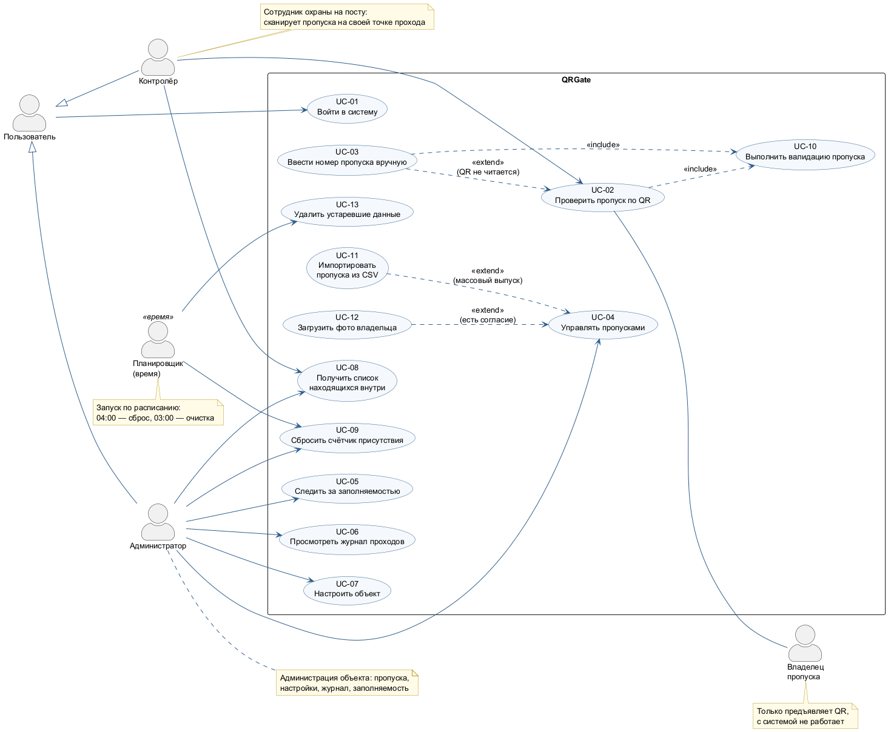

# Модель вариантов использования QRGate

Версия 1.0 · 05.11.2026 · Гамза Г. А.

Модель уточняет диаграмму вариантов использования SRS (UC-01 – UC-07, рисунок 2 SRS) с учётом
изменений второго раунда согласования (список эвакуации, фото владельца) и добавляет включаемые,
расширяющие прецеденты и неличностного актёра «Планировщик». Термины — по [глоссарию](../docs/glossary.md),
бизнес-правила BR и сквозные требования SUP — в [дополнительных спецификациях](../docs/supplementary-specification.md).

*Рисунок 1 – Диаграмма вариантов использования (PlantUML, [`models/usecase-diagram.puml`](models/usecase-diagram.puml))*

## 1. Актёры

| Актёр | Тип | Описание (роль в системе) |
|-------|-----|---------------------------|
| Пользователь | Абстрактный | Любое лицо с учётной записью QRGate; обобщает контролёра и администратора — для обоих одинаково выполняется только вход (UC-01). |
| Контролёр | Основной, человек | Сотрудник охраны на посту: проверяет пропуска на назначенной ему точке прохода и при эвакуации сверяет список находящихся внутри. |
| Администратор | Основной, человек | Сотрудник администрации объекта: выпускает и отзывает пропуска, настраивает объект, следит за заполняемостью, разбирает инциденты по журналу. |
| Владелец пропуска | Второстепенный, человек | Посетитель или сотрудник, предъявляющий QR-код контролёру; с системой напрямую не работает, но получает результат проверки. |
| Планировщик (время) | Основной, время | Расписание сервера: в 04:00 инициирует сброс присутствия (UC-09), в 03:00 — удаление данных старше 12 месяцев (UC-13). |

Связи между актёрами не моделируются, кроме обобщения «Пользователь ← Контролёр, Администратор»: оно
уместно, потому что общий для них прецедент UC-01 выполняется одинаково, а остальные различаются.

## 2. Перечень прецедентов

| ID | Прецедент | Актёры | Связи | Требования | Функции |
|----|-----------|--------|-------|------------|---------|
| UC-01 | Войти в систему | Пользователь | — | REQ-FUNC-001, REQ-SEC-001, 003 | F02 |
| UC-02 | Проверить пропуск по QR | Контролёр, Владелец пропуска | include UC-10 | REQ-FUNC-002, 007, REQ-REL-001 | F05, F06 |
| UC-03 | Ввести номер пропуска вручную | Контролёр | extend UC-02, include UC-10 | REQ-FUNC-003 | F07 |
| UC-04 | Управлять пропусками | Администратор | расширяется UC-11, UC-12 | REQ-FUNC-008, 005 | F03, F08 |
| UC-05 | Следить за заполняемостью | Администратор | — | REQ-FUNC-009, 010 | F11, F12 |
| UC-06 | Просмотреть журнал проходов | Администратор | — | REQ-FUNC-011 | F13 |
| UC-07 | Настроить объект | Администратор | — | REQ-FUNC-012 | F14 |
| UC-08 | Получить список находящихся внутри | Контролёр, Администратор | — | REQ-FUNC-014 | F21 |
| UC-09 | Сбросить счётчик присутствия | Администратор, Планировщик | — | REQ-FUNC-013 | F15 |
| UC-10 | Выполнить валидацию пропуска | — (включаемый) | включается в UC-02, UC-03 | REQ-FUNC-004, 006, REQ-REL-002 | F04 |
| UC-11 | Импортировать пропуска из CSV | Администратор | extend UC-04 | REQ-FUNC-008 | F10 |
| UC-12 | Загрузить фото владельца | Администратор | extend UC-04 | REQ-FUNC-015, REQ-SEC-005-2 | F22 |
| UC-13 | Удалить устаревшие данные | Планировщик | — | REQ-SEC-005-2 | F17 |

## 3. Спецификации прецедентов

### UC-01 Войти в систему

- **Краткое описание:** пользователь входит по логину и паролю; контролёр затем выбирает точку прохода и направление, администратор попадает на главную страницу панели.
- **Актёры:** Пользователь (Контролёр, Администратор).
- **Предусловия:** учётная запись создана администратором (UC-07); устройство подключено к сети.
- **Основной поток:**
  1. Прецедент начинается, когда пользователь открывает сканер или панель без действующей сессии.
  2. Система показывает форму входа.
  3. Пользователь вводит логин и пароль.
  4. Система проверяет, что учётная запись не заблокирована. Если заблокирована — А2.
  5. Система сверяет пароль с хешем bcrypt. Если не совпадает — А1.
  6. Система обнуляет счётчик неудачных попыток и создаёт сессию на 12 ч.
  7. Для контролёра система показывает список назначенных ему точек прохода (BR-10); контролёр выбирает точку и направление «Вход/Выход». Если точек нет — А3.
  8. Система показывает рабочий экран (сканирование или главную страницу панели). Прецедент завершается.
- **Альтернативные потоки:**
  - А1. Неверный пароль: система увеличивает счётчик попыток; на 5-й попытке подряд блокирует учётную запись на 15 мин; показывает «Неверный логин или пароль» (без уточнения, что именно неверно); возврат к шагу 3.
  - А2. Учётная запись заблокирована: система показывает время окончания блокировки; прецедент завершается.
  - А3. Контролёру не назначено ни одной точки: система показывает «Обратитесь к администратору»; прецедент завершается.
- **Поток ошибки:** Е1. Сервер недоступен — «Нет связи с сервером», кнопка «Повторить».
- **Постусловия:** создана сессия, привязанная к пользователю; для контролёра выбраны точка и направление; сканер в состоянии «Сканирование».
- **Диаграммы:** [`sequence-login.puml`](models/sequence-login.puml), состояния `login → session` в [`state-scanner.puml`](models/state-scanner.puml).

### UC-02 Проверить пропуск по QR

- **Краткое описание:** контролёр сканирует QR-код владельца пропуска камерой смартфона и получает решение «проход разрешён / отказ» с причиной.
- **Актёры:** Контролёр (основной), Владелец пропуска (второстепенный).
- **Предусловия:** выполнен UC-01, выбраны точка и направление; разрешён доступ к камере.
- **Основной поток:**
  1. Прецедент начинается, когда владелец пропуска предъявляет QR-код, а контролёр наводит на него камеру.
  2. Сканер анализирует видеопоток не реже 10 кадров/с и распознаёт токен. Если QR не читается — расширение UC-03; если тот же токен распознан менее 3 с назад — А1.
  3. Сканер отправляет запрос валидации с токеном, точкой и направлением и переходит в состояние «Проверка».
  4. Выполняется включаемый прецедент UC-10.
  5. Сканер получает решение. Если ответа нет 5 с — Е1; если сессия истекла — А3.
  6. При ALLOW сканер показывает зелёную карточку с ФИО, типом, сроком действия и фото владельца, подаёт звук и через 3 с возвращается к сканированию. При DENY — А2.
  7. Прецедент завершается.
- **Альтернативные потоки:**
  - А1. Повторное распознавание: сканер игнорирует токен (BR-06), продолжает с шага 2.
  - А2. Отказ: сканер показывает красную карточку с причиной на русском языке, подаёт звук отказа и вибрацию 200 мс; возврат к сканированию только по кнопке «Следующий».
  - А3. Сессия истекла (401): сканер переходит на экран входа (UC-01).
- **Поток ошибки:** Е1. Нет ответа сервера 5 с или ошибка сети: сканер показывает «Нет связи с сервером — проверка невозможна» и никогда не показывает ALLOW (fail-closed); по кнопке «Повторить» — шаг 2.
- **Постусловия:** решение показано контролёру; событие записано в журнал (BR-11); при ALLOW изменены присутствие и счётчик, панель получила обновление.
- **Диаграммы:** [`activity-validate-pass.puml`](models/activity-validate-pass.puml), [`sequence-validate-pass.puml`](models/sequence-validate-pass.puml), [`state-scanner.puml`](models/state-scanner.puml).

### UC-03 Ввести номер пропуска вручную

- **Краткое описание:** расширение UC-02 для случая, когда QR повреждён или экран телефона разбит: контролёр вводит номер пропуска.
- **Актёры:** Контролёр.
- **Точка расширения:** шаг 2 UC-02 «QR не читается».
- **Предусловия:** выполнен UC-01; сканер в состоянии «Сканирование».
- **Основной поток:**
  1. Контролёр нажимает «Ввести код».
  2. Сканер показывает поле ввода с маской `P-______` / `G-______`.
  3. Контролёр вводит номер с документа или экрана владельца.
  4. Сканер проверяет формат (BR-02). Если формат неверен — А1.
  5. Сканер отправляет запрос `POST /validate/manual`; выполняется UC-10, событие помечается `manual = true`.
  6. Продолжение с шага 5 UC-02.
- **Альтернативные потоки:** А1. Неверный формат — поле подсвечивается, кнопка «Проверить» недоступна. А2. «Отмена» — возврат к сканированию.
- **Постусловия:** как у UC-02; событие журнала имеет признак ручного ввода.

### UC-04 Управлять пропусками

- **Краткое описание:** администратор выпускает, продлевает, отзывает, перевыпускает пропуск и скачивает его QR.
- **Актёры:** Администратор.
- **Точки расширения:** «массовый выпуск» (UC-11), «есть согласие на фото» (UC-12).
- **Предусловия:** выполнен вход с ролью «администратор»; созданы объект и зоны (UC-07).
- **Основной поток (выпуск):**
  1. Администратор открывает «Пропуска» и нажимает «Создать».
  2. Вводит ФИО, тип, e-mail, срок действия, зоны, отмечает основание обработки персональных данных.
  3. Система проверяет данные (BR-02, BR-03) и создаёт владельца и пропуск с версией 1 в статусе «Активен» или «Ожидает начала действия».
  4. Система формирует подписанный токен (REQ-FUNC-005) и показывает QR (PNG ≥ 300×300, уровень коррекции M).
  5. Администратор скачивает или печатает QR. Прецедент завершается.
- **Альтернативные потоки:**
  - А1. Продление: администратор задаёт новую дату окончания; просроченный пропуск снова становится активным.
  - А2. Отзыв: после подтверждения статус «Отозван», версия + 1; все QR пропуска получают `DENY_REVOKED` (BR-05).
  - А3. Перевыпуск: версия + 1, формируется новый QR; старый недействителен.
  - А4. Ошибка в данных: система подсвечивает поля, пропуск не создаётся.
  - А5. Удаление данных владельца по запросу: пропуск переводится в «Удалён», ФИО, e-mail и фото удаляются (BR-09).
- **Постусловия:** изменение пропуска сохранено и записано в журнал действий (SUP-F-01).
- **Диаграммы:** [`state-pass-lifecycle.puml`](models/state-pass-lifecycle.puml).

### UC-05 Следить за заполняемостью

- **Краткое описание:** администратор видит число людей внутри, заполняемость и live-график за сутки, получает предупреждение при достижении порога.
- **Актёры:** Администратор.
- **Предусловия:** выполнен вход; объект настроен.
- **Основной поток:**
  1. Администратор открывает главную страницу панели.
  2. Система загружает данные за текущие сутки и подписывает панель на WebSocket объекта.
  3. Система показывает карточки показателей, график с линиями вместимости и порога и ленту событий.
  4. При каждом проходе система обновляет последнюю точку графика, карточки и ленту не позже 2 с.
  5. При заполняемости ≥ порога система показывает жёлтый баннер и подаёт звук (А1).
- **Альтернативные потоки:** А1. Достигнуто 100 % при включённой блокировке — баннер красный, сканеры получают `DENY_CAPACITY` на вход. А2. Обрыв связи — индикатор «нет связи», переподключение 1–30 с, после восстановления данные за сутки запрашиваются заново.
- **Постусловия:** данные не изменяются.

### UC-06 Просмотреть журнал проходов

- **Краткое описание:** администратор фильтрует события прохода и выгружает их в CSV.
- **Актёры:** Администратор.
- **Предусловия:** выполнен вход.
- **Основной поток:** 1. Администратор открывает «Журнал». 2. Задаёт период, точку, пропуск, результат. 3. Система показывает события постранично по 100, не дольше 3 с. 4. Администратор нажимает «Выгрузить CSV», система формирует файл с теми же фильтрами.
- **Альтернативные потоки:** А1. Событий нет — «Ничего не найдено».
- **Постусловия:** данные не изменяются; факт выгрузки записан в журнал действий.

### UC-07 Настроить объект

- **Краткое описание:** администратор создаёт объекты, зоны, точки прохода, учётные записи контролёров, задаёт вместимость, порог и режимы.
- **Актёры:** Администратор.
- **Предусловия:** выполнен вход.
- **Основной поток:** 1. Администратор открывает «Настройки». 2. Создаёт или изменяет объект, зону, точку, контролёра. 3. Система проверяет данные (вместимость > 0, порог 50–100 %). 4. Система сохраняет изменения и сразу применяет их в проверке и на графике.
- **Альтернативные потоки:** А1. Удаление точки, на которой есть события, — точка архивируется, а не удаляется.
- **Постусловия:** настройки сохранены и записаны в журнал действий.

### UC-08 Получить список находящихся внутри

- **Краткое описание:** при эвакуации контролёр или администратор получает список владельцев пропусков, находящихся внутри объекта.
- **Актёры:** Контролёр, Администратор.
- **Предусловия:** выполнен вход; контролёр видит только свой объект (BR-10).
- **Основной поток:** 1. Пользователь нажимает «Кто внутри». 2. Система формирует список (ФИО, тип, время и точка входа) не дольше 2 с. 3. Пользователь фильтрует по зоне. 4. Администратор печатает список или выгружает PDF (40 строк на лист A4).
- **Альтернативные потоки:** А1. Внутри никого нет — «Объект пуст».
- **Постусловия:** данные не изменяются.

### UC-09 Сбросить счётчик присутствия

- **Краткое описание:** обнуление присутствия всех пропусков объекта, чтобы вышедшие без сканирования не блокировались anti-passback.
- **Актёры:** Планировщик (ежедневно 04:00), Администратор (вручную).
- **Предусловия:** для ручного сброса — вход администратора.
- **Основной поток:** 1. Планировщик в 04:00 по времени объекта инициирует сброс (или администратор нажимает «Сбросить» и указывает причину). 2. Система берёт блокировку счётчика объекта. 3. Обнуляет присутствие и счётчик. 4. Записывает событие сброса с автором и причиной (BR-07). 5. Публикует новое значение на панели.
- **Альтернативные потоки:** А1. Причина не указана при ручном сбросе — кнопка недоступна.
- **Постусловия:** счётчик = 0, все пропуска объекта в состоянии «Снаружи».

### UC-10 Выполнить валидацию пропуска

- **Краткое описание:** включаемый прецедент: серверная проверка пропуска по цепочке BR-01 в одной транзакции.
- **Актёры:** нет (выполняется в составе UC-02 и UC-03).
- **Предусловия:** запрос от авторизованного контролёра для его точки; не превышен лимит 10 запросов/с.
- **Основной поток:**
  1. Система проверяет подпись токена без обращения к БД. Если неверна — А1.
  2. Система начинает транзакцию и блокирует строку счётчика объекта.
  3. Загружает пропуск, его зоны и присутствие.
  4. Последовательно проверяет: существование, отзыв и версию, срок, зону, anti-passback, вместимость; первая нарушенная проверка определяет код (А2).
  5. Записывает событие в журнал.
  6. При OK обновляет присутствие и счётчик.
  7. Фиксирует транзакцию и публикует изменения в WebSocket.
  8. Возвращает `{decision, reason, pass, occupancy}`.
- **Альтернативные потоки:** А1. Неверная подпись — событие `DENY_BAD_SIGNATURE`, шаги 2–4 пропускаются. А2. Нарушена проверка — `DENY_<причина>`, шаг 6 пропускается.
- **Поток ошибки:** Е1. Ошибка БД — откат транзакции, ответ 503; сканер ведёт себя как при отсутствии связи.
- **Постусловия:** решение, событие и счётчик согласованы (REQ-REL-002).

### UC-11 Импортировать пропуска из CSV

- **Краткое описание:** расширение UC-04 для массового выпуска пропусков из файла.
- **Актёры:** Администратор.
- **Точка расширения:** «массовый выпуск» UC-04.
- **Предусловия:** выполнен вход; файл в формате SUP-I-02.
- **Основной поток и альтернативы:** см. [`activity-import-csv.puml`](models/activity-import-csv.puml): строки с ошибками попадают в отчёт и не прерывают загрузку остальных; 500 строк — не дольше 10 с.
- **Постусловия:** созданы пропуска для всех корректных строк; отчёт импорта показан администратору.

### UC-12 Загрузить фото владельца

- **Краткое описание:** расширение UC-04: загрузка фото владельца для сверки лица на карточке результата.
- **Актёры:** Администратор.
- **Точка расширения:** «есть согласие на фото» UC-04 (BR-08).
- **Предусловия:** у владельца отмечено согласие на обработку фото.
- **Основной поток:** 1. Администратор выбирает JPEG/PNG до 5 МБ. 2. Кадрирует до квадрата. 3. Система сжимает до 480×480 и сохраняет на томе (ADR-0008). 4. Фото показывается на карточке сканера.
- **Альтернативные потоки:** А1. Согласия нет — загрузка недоступна. А2. Файл больше 5 МБ или другого формата — ошибка.
- **Постусловия:** фото сохранено, дата согласия записана.

### UC-13 Удалить устаревшие данные

- **Краткое описание:** планировщик ежедневно удаляет события журнала старше 12 месяцев и данные владельцев удалённых пропусков.
- **Актёры:** Планировщик.
- **Предусловия:** нет.
- **Основной поток:** 1. В 03:00 планировщик запускает задачу. 2. Система удаляет секции журнала старше 12 месяцев. 3. Удаляет фото и данные владельцев в статусе «Удалён». 4. Записывает отчёт задачи в лог.
- **Поток ошибки:** Е1. Ошибка удаления — задача повторяется на следующий день, в лог пишется предупреждение.
- **Постусловия:** в БД нет данных, срок хранения которых истёк (BR-09).

## 4. Связь прецедентов с диаграммами поведения

| Прецедент | Активность | Состояния | Последовательность |
|-----------|------------|-----------|--------------------|
| UC-01 | — | `state-scanner` (login → session) | `sequence-login` |
| UC-02, UC-03, UC-10 | `activity-validate-pass` | `state-scanner`, `state-pass-lifecycle` (Снаружи ↔ Внутри) | `sequence-validate-pass` |
| UC-04 | — | `state-pass-lifecycle` | — |
| UC-11 | `activity-import-csv` | `state-pass-lifecycle` (начальные переходы) | — |
| UC-08 | — | `state-scanner` (evacuation) | — |
| UC-09, UC-13 | — | `state-pass-lifecycle` (сброс, удаление) | — |
