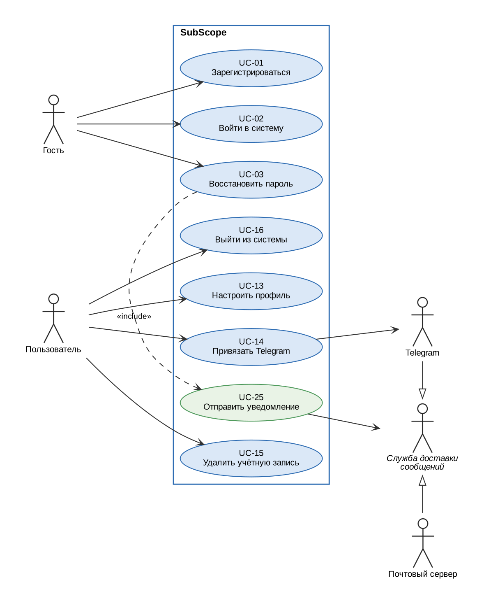
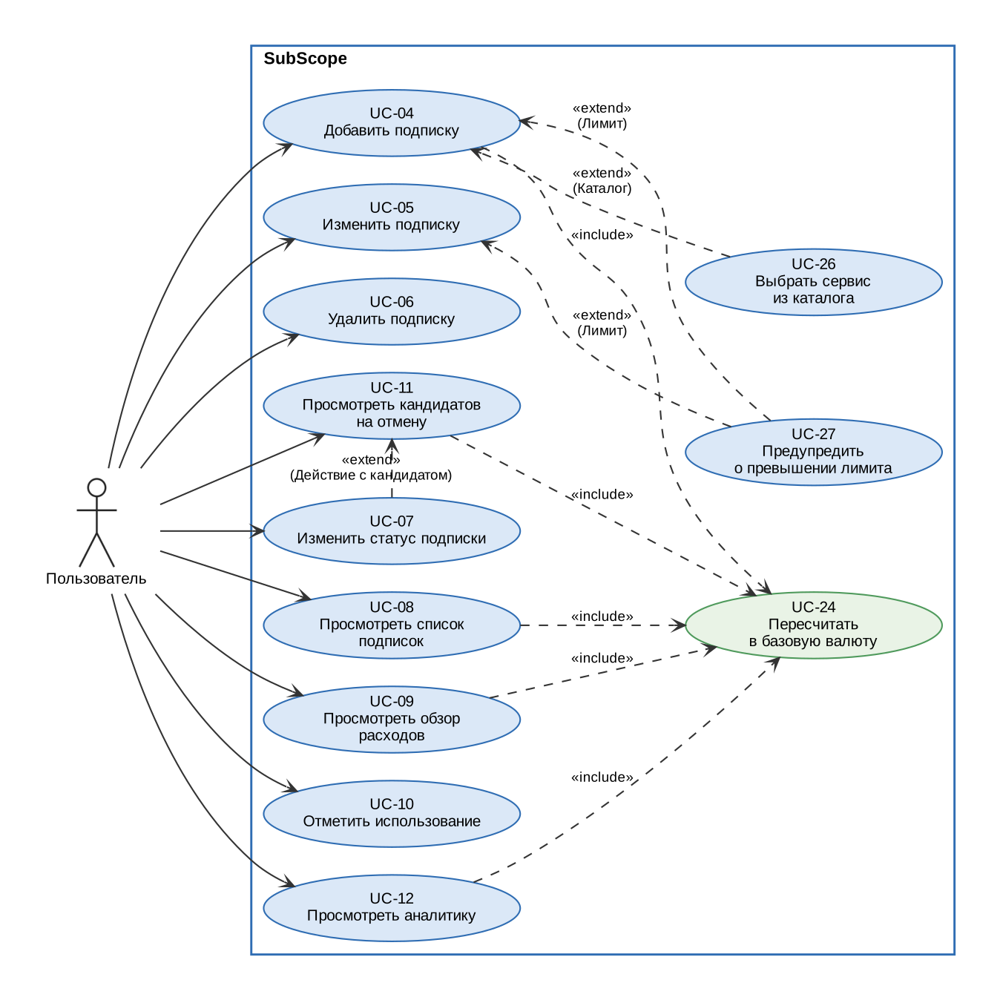
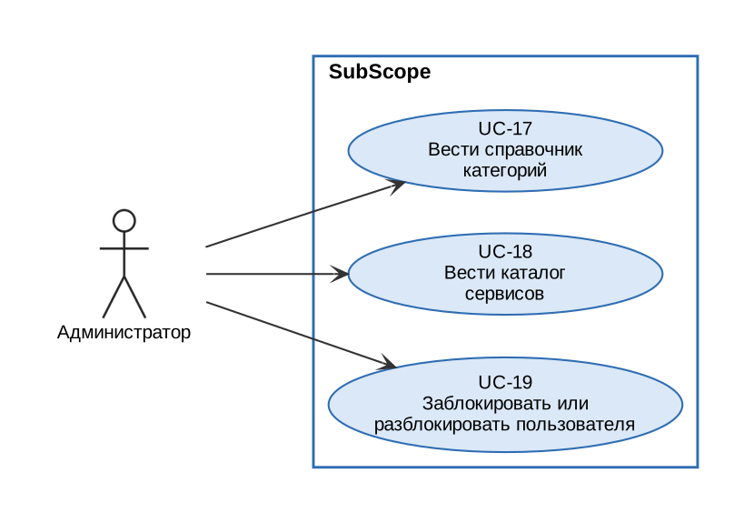
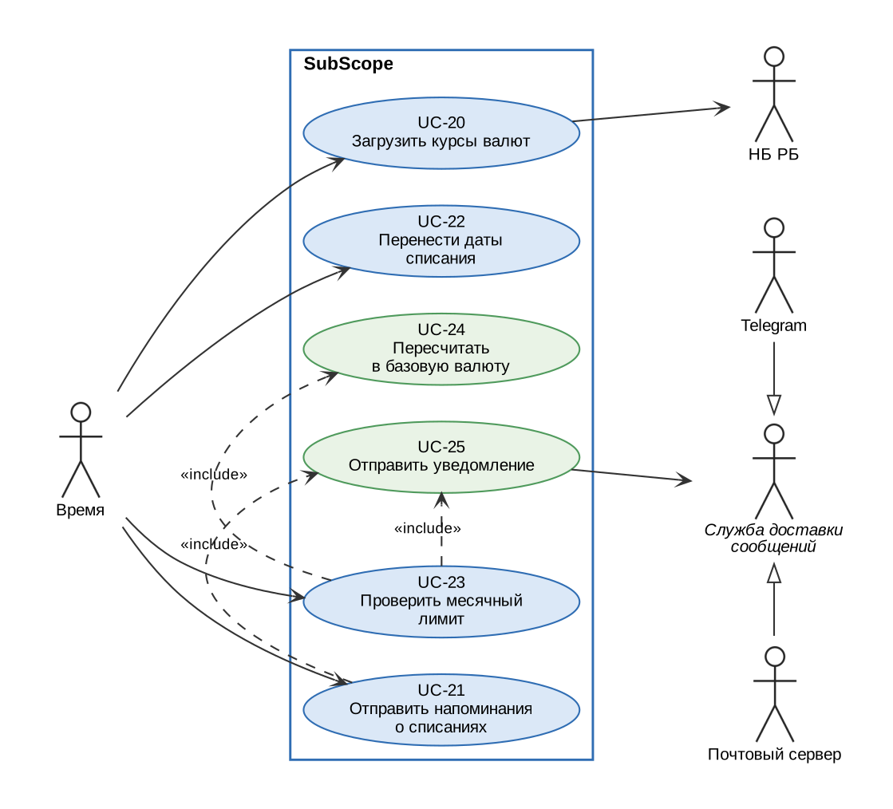

# Модель прецедентов SubScope

Версия 1.0 от 19.11.2026. Подготовил Родкевич Н.А., гр. 434701.

Модель построена по требованиям [SRS v0.4](../srs/srs.md) и описывает функции SubScope с точки зрения внешних участников: кто взаимодействует с системой (актёры), какие результаты он получает (прецеденты) и как протекает каждое взаимодействие (потоки событий). Термины — в [глоссарии](glossary.md); требования, общие для многих прецедентов (безопасность, журналирование, правила расчёта, качество), — в [дополнительных спецификациях](supplementary-specification.md). Диаграммы построены из текстовых моделей папки [models/](models) скриптом [tools/uml.py](tools/uml.py) (ADR-0008).

Работа над моделью начиналась с перечня событий внешнего мира, на которые система должна реагировать:

| Событие | Источник | Прецедент |
|---------|----------|-----------|
| Посетитель хочет начать пользоваться сервисом | Гость | UC-01 |
| Посетитель хочет войти или забыл пароль | Гость | UC-02, UC-03 |
| Пользователь оформил, изменил или отменил подписку в стороннем сервисе | Пользователь | UC-04…UC-07 |
| Пользователь хочет узнать, сколько и на что он тратит | Пользователь | UC-08, UC-09, UC-12 |
| Закончился месяц, пользователь отмечает, чем пользовался | Пользователь | UC-10, UC-11 |
| Пользователь меняет настройки, канал напоминаний или уходит из сервиса | Пользователь | UC-13…UC-16 |
| Нужно поправить справочники или остановить нарушителя | Администратор | UC-17…UC-19 |
| Наступили сутки, НБ РБ установил новые курсы | Время, НБ РБ | UC-20 |
| Приближается списание или конец пробного периода; дата списания прошла | Время | UC-21, UC-22 |
| Расходы превысили лимит, в том числе из-за курса | Время | UC-23 |

## 1. Актёры

Актёры находятся вне системы, поэтому связи между ними, кроме одного обобщения, не моделируются (см. А-08). Основные актёры инициируют прецеденты (стрелка от актёра к прецеденту), второстепенные получают от системы данные или сообщения (стрелка от прецедента к актёру).

| ID | Актёр | Вид | Описание (роль в системе) |
|----|-------|-----|---------------------------|
| А-01 | Гость | Человек, основной | Посетитель без учётной записи или до входа; может зарегистрироваться, войти и восстановить пароль. |
| А-02 | Пользователь | Человек, основной | Зарегистрированный владелец подписок; ведёт их учёт, получает обзор расходов, аналитику и напоминания, видит только свои данные. |
| А-03 | Администратор | Человек, основной | Сотрудник Заказчика; ведёт справочник категорий и каталог сервисов, блокирует учётные записи; подписок пользователей не видит. |
| А-04 | Время | Таймер, основной | Системные часы (Europe/Minsk), по которым ежедневно запускаются загрузка курсов, перенос дат, напоминания и проверка лимита. |
| А-05 | НБ РБ | Внешняя система, второстепенный | API Национального банка, из которого система получает официальные курсы валют на текущую и прошедшие даты. |
| А-06 | Почтовый сервер | Внешняя система, второстепенный | SMTP-сервер, через который система отправляет письма-напоминания и ссылки для сброса пароля. |
| А-07 | Telegram | Внешняя система, второстепенный | Telegram Bot API: доставляет сообщения бота SubScope и передаёт системе команды `/start` при привязке. |
| А-08 | *Служба доставки сообщений* | Абстрактный, второстепенный | Обобщение почтового сервера и Telegram: получает от системы уведомления для доставки пользователю. |

Обобщение А-06, А-07 → А-08 показано потому, что поведение этих актёров различается: оба принимают уведомления (UC-25), но Telegram дополнительно участвует в привязке аккаунта (UC-14) как инициатор события `/start`. Обобщение «Администратор → Пользователь» не вводится: администратор — отдельная роль без собственных подписок (REQ-FUNC-018-2), а общего поведения, кроме входа и выхода, у них нет.

## 2. Диаграммы прецедентов

Прецеденты разбиты на четыре диаграммы по группам функций SRS (раздел 2.2). Включаемые прецеденты UC-24 «Пересчитать в базовую валюту» и UC-25 «Отправить уведомление» повторяются на нескольких диаграммах.

Рисунок 1 — Прецеденты учётной записи (модель: [models/uc-1-account.dot](models/uc-1-account.dot))

Рисунок 2 — Прецеденты ведения подписок и анализа расходов (модель: [models/uc-2-subscriptions.dot](models/uc-2-subscriptions.dot))

Рисунок 3 — Прецеденты администрирования (модель: [models/uc-3-admin.dot](models/uc-3-admin.dot))

Рисунок 4 — Прецеденты, инициируемые временем (модель: [models/uc-4-background.dot](models/uc-4-background.dot))

Связи на диаграммах:

| Связь | Обозначение | Где применена |
|-------|-------------|---------------|
| Коммуникация | Сплошная линия со стрелкой от инициатора | Актёр → прецедент; прецедент → второстепенный актёр |
| Включение | Пунктирная стрелка «include» к включаемому прецеденту | UC-03, UC-21, UC-23 → UC-25; UC-04, UC-08, UC-09, UC-11, UC-12, UC-23 → UC-24 |
| Расширение | Пунктирная стрелка «extend» к базовому прецеденту | UC-26 → UC-04; UC-27 → UC-04, UC-05; UC-07 → UC-11 |
| Обобщение | Сплошная линия с незакрашенным треугольником к общему элементу | А-06, А-07 → А-08 |

## 3. Перечень прецедентов

| ID | Прецедент | Основной актёр | Второстепенные актёры | Требования SRS | Итерация |
|----|-----------|----------------|------------------------|----------------|----------|
| UC-01 | Зарегистрироваться | Гость | — | REQ-FUNC-001-2, REQ-COMP-001-3 | 1 |
| UC-02 | Войти в систему | Гость | — | REQ-FUNC-002, REQ-SEC-001 | 1 |
| UC-03 | Восстановить пароль | Гость | Почтовый сервер | REQ-FUNC-021 | 2 |
| UC-04 | Добавить подписку | Пользователь | — | REQ-FUNC-004-3, 013, 019 | 2 |
| UC-05 | Изменить подписку | Пользователь | — | REQ-FUNC-005 | 2 |
| UC-06 | Удалить подписку | Пользователь | — | REQ-FUNC-006 | 2 |
| UC-07 | Изменить статус подписки | Пользователь | — | REQ-FUNC-007 | 2 |
| UC-08 | Просмотреть список подписок | Пользователь | — | REQ-FUNC-008 | 2 |
| UC-09 | Просмотреть обзор расходов | Пользователь | — | REQ-FUNC-009-3, 010, 022 | 3 |
| UC-10 | Отметить использование | Пользователь | — | REQ-FUNC-012-2 | 3 |
| UC-11 | Просмотреть кандидатов на отмену | Пользователь | — | REQ-FUNC-015-2 | 4 |
| UC-12 | Просмотреть аналитику | Пользователь | — | REQ-FUNC-014-2 | 4–5 |
| UC-13 | Настроить профиль | Пользователь | — | REQ-FUNC-003-2, 011-3, 022 | 2, 4 |
| UC-14 | Привязать Telegram | Пользователь | Telegram | REQ-FUNC-023, REQ-INT-004 | 5 |
| UC-15 | Удалить учётную запись | Пользователь | — | REQ-FUNC-003-2, REQ-COMP-001-3 | 2 |
| UC-16 | Выйти из системы | Пользователь | — | REQ-FUNC-002 | 1 |
| UC-17 | Вести справочник категорий | Администратор | — | REQ-FUNC-018-2 | 3 |
| UC-18 | Вести каталог сервисов | Администратор | — | REQ-FUNC-018-2, 020 | 3 |
| UC-19 | Заблокировать или разблокировать пользователя | Администратор | — | REQ-FUNC-018-2 | 4 |
| UC-20 | Загрузить курсы валют | Время | НБ РБ | REQ-INT-002-2, REQ-REL-001 | 1, 3 |
| UC-21 | Отправить напоминания о списаниях | Время | Служба доставки | REQ-FUNC-011-3, REQ-INT-003, 004 | 4–5 |
| UC-22 | Перенести даты списания | Время | — | REQ-FUNC-017 | 3 |
| UC-23 | Проверить месячный лимит | Время | Служба доставки | REQ-FUNC-022 | 5 |
| UC-24 | Пересчитать в базовую валюту | — (включаемый) | — | REQ-FUNC-013 | 3 |
| UC-25 | Отправить уведомление | — (включаемый) | Служба доставки | REQ-INT-003, 004 | 4 |
| UC-26 | Выбрать сервис из каталога | — (расширение UC-04) | — | REQ-FUNC-020 | 5 |
| UC-27 | Предупредить о превышении лимита | — (расширение UC-04, UC-05) | — | REQ-FUNC-022 | 4 |

Итерации взяты из согласованного плана v3 ([plan/plan.md](../plan/plan.md)).

## 4. Описания прецедентов

Каждое описание содержит краткое описание, актёров, предусловия, основной поток, альтернативные потоки (А1, А2, …), потоки ошибок (Е1, …) и постусловия. Шаги, в которых выполняется включаемый прецедент или может выполниться расширение, отмечены его идентификатором. Общие правила (вход, CSRF, журналирование, расчёты) не повторяются — они заданы в дополнительных спецификациях.

---

- **ID:** UC-01
- **Название:** Зарегистрироваться
- **Краткое описание:** Гость создаёт учётную запись, после чего сразу входит в систему и видит пустой «Обзор».
- **Актёры:** Гость.
- **Предусловия:** Гость не выполнил вход.
- **Основной поток:**
  1. Прецедент начинается, когда гость нажимает «Зарегистрироваться» на странице входа.
  2. Система показывает форму: e-mail, пароль, подтверждение пароля, базовая валюта (BYN, USD, EUR; по умолчанию BYN), согласие на обработку персональных данных.
  3. Гость заполняет форму и нажимает «Создать аккаунт».
  4. Система проверяет данные. Если e-mail уже зарегистрирован — поток А1, если пароль или согласие не прошли проверку — поток А2.
  5. Система сохраняет учётную запись с хешем пароля BCrypt, ролью «Пользователь» и настройками по умолчанию (порог неиспользования 2 месяца, напоминание за 3 дня, канал «E-mail»).
  6. Система выполняет вход от имени нового пользователя и открывает экран «Обзор» с сообщением «Подписок пока нет — добавьте первую».
  7. Прецедент завершается.
- **Альтернативные потоки:**
  - **А1. E-mail занят.** На шаге 4 система выводит у поля e-mail сообщение «Этот e-mail уже зарегистрирован» и ссылку на восстановление пароля (UC-03); введённые значения, кроме паролей, сохраняются. Возврат к шагу 3.
  - **А2. Ошибка ввода.** На шаге 4 пароль короче 8 символов, не совпадает с подтверждением или не отмечено согласие: система помечает поле сообщением об ошибке. Возврат к шагу 3.
- **Потоки ошибок:**
  - **Е1. Сбой базы данных.** Система показывает страницу «Сервис временно недоступен, попробуйте позже», записывает ошибку в журнал; учётная запись не создаётся.
- **Постусловия:** Существует учётная запись в состоянии «Активна» с настройками по умолчанию; пользователь вошёл в систему. При неуспехе данные не изменены.

---

- **ID:** UC-02
- **Название:** Войти в систему
- **Краткое описание:** Гость подтверждает личность e-mail и паролем и получает доступ к своим данным; при подборе пароля вход временно блокируется.
- **Актёры:** Гость.
- **Предусловия:** Гость не выполнил вход.
- **Основной поток:**
  1. Прецедент начинается, когда гость открывает любую страницу приложения или страницу входа.
  2. Система показывает форму входа: e-mail, пароль, флажок «Запомнить меня», ссылки «Зарегистрироваться» и «Забыли пароль?».
  3. Гость вводит e-mail и пароль и нажимает «Войти».
  4. Система находит учётную запись по e-mail. Если учётная запись временно заблокирована — поток А2, если заблокирована администратором — поток А3.
  5. Система сверяет пароль с хешем. Если пароль неверен или учётная запись не найдена — поток А1.
  6. Система обнуляет счётчик неудачных попыток, создаёт сеанс, записывает вход в журнал и открывает страницу, которую гость запрашивал, или «Обзор».
  7. Прецедент завершается.
- **Альтернативные потоки:**
  - **А1. Неверные данные.** Система увеличивает счётчик неудачных попыток (если учётная запись существует) и выводит «Неверный e-mail или пароль», не указывая, какое поле неверно. Если это пятая попытка подряд, система устанавливает временную блокировку на 15 минут и записывает её в журнал. Возврат к шагу 3.
  - **А2. Временная блокировка.** Система выводит «Слишком много попыток входа. Повторите через N мин» без проверки пароля. Прецедент завершается.
  - **А3. Блокировка администратором.** Система выводит «Учётная запись заблокирована. Обратитесь к администратору». Прецедент завершается.
  - **А4. Забыт пароль.** На шаге 3 гость нажимает «Забыли пароль?» — выполняется UC-03.
- **Потоки ошибок:**
  - **Е1. Истёк CSRF-токен формы.** Система повторно показывает форму входа с сообщением «Страница устарела, войдите ещё раз».
- **Постусловия:** При успехе создан сеанс пользователя (на 30 минут бездействия или с «Запомнить меня»), счётчик неудачных попыток равен 0. При неуспехе сеанс не создан, счётчик и блокировка обновлены.

---

- **ID:** UC-03
- **Название:** Восстановить пароль
- **Краткое описание:** Гость получает на e-mail одноразовую ссылку и задаёт по ней новый пароль; все прежние сеансы завершаются.
- **Актёры:** Гость; Почтовый сервер (второстепенный).
- **Предусловия:** Гость не выполнил вход.
- **Основной поток:**
  1. Прецедент начинается, когда гость нажимает «Забыли пароль?» на странице входа.
  2. Система показывает форму ввода e-mail.
  3. Гость вводит e-mail и нажимает «Отправить ссылку».
  4. Система выводит «Если такой адрес зарегистрирован, на него отправлено письмо» независимо от результата поиска.
  5. Если учётная запись найдена и активна, система создаёт одноразовый токен `PASSWORD_RESET` сроком 1 час и отправляет письмо со ссылкой (UC-25). Иначе — поток А1.
  6. Гость открывает ссылку из письма. Система проверяет токен; если он просрочен или использован — поток А2.
  7. Система показывает форму нового пароля с подтверждением.
  8. Гость вводит пароль и подтверждение. Если они не проходят проверку (UC-01, А2) — система помечает поле и повторяет шаг 8.
  9. Система сохраняет хеш нового пароля, гасит токен, завершает все сеансы пользователя и открывает страницу входа с сообщением «Пароль изменён».
  10. Прецедент завершается.
- **Альтернативные потоки:**
  - **А1. Учётная запись не найдена или заблокирована.** Письмо не отправляется; гость видит то же сообщение, что на шаге 4. Прецедент завершается.
  - **А2. Ссылка недействительна.** Система выводит «Ссылка устарела или уже использована» и предлагает запросить новую (переход к шагу 2).
- **Потоки ошибок:**
  - **Е1. Почтовый сервер недоступен.** UC-25 записывает уведомление со статусом «Ошибка» и повторяет отправку; гостю по-прежнему показывается сообщение шага 4.
- **Постусловия:** Пароль заменён, токен погашен, прежние сеансы завершены. При неуспехе пароль не изменён.
- **Отношения:** «include» UC-25.

---

- **ID:** UC-04
- **Название:** Добавить подписку
- **Краткое описание:** Пользователь вносит новую подписку; система проверяет данные, показывает стоимость в месяц в базовой валюте и предупреждает о превышении лимита.
- **Актёры:** Пользователь.
- **Предусловия:** Пользователь вошёл в систему (UC-02).
- **Основной поток:**
  1. Прецедент начинается, когда пользователь нажимает «Добавить подписку» на «Обзоре» или в списке подписок.
  2. Система показывает форму: обязательные поля — название, цена, валюта, период, дата следующего списания; необязательные — категория, число участников (по умолчанию 1), дата окончания пробного периода, срок напоминания, заметка.
  3. Пользователь вводит название. **Точка расширения «Каталог»:** UC-26.
  4. Пользователь вводит цену и валюту и выбирает период. Система показывает оценку стоимости в месяц в базовой валюте с датой курса (UC-24).
  5. Пользователь заполняет остальные поля и нажимает «Сохранить».
  6. Система проверяет данные (SUP-FUNC-04). При ошибке — поток А1.
  7. Система сохраняет подписку в состоянии «Активна» (в пробном периоде, если указана дата его окончания).
  8. Система пересчитывает стоимость активных подписок в месяц. **Точка расширения «Лимит»:** UC-27.
  9. Система открывает список подписок с сообщением «Подписка добавлена».
  10. Прецедент завершается.
- **Альтернативные потоки:**
  - **А1. Ошибка ввода.** Цена отрицательная или с тремя и более знаками после запятой, название пустое или длиннее 100 символов, заметка длиннее 500, число участников вне 1…10, дата списания в прошлом, дата окончания пробного периода позже даты списания или не заполнено обязательное поле: система помечает поля сообщениями, введённые значения сохраняются. Возврат к шагу 5.
  - **А2. Отмена.** На любом шаге до 5 пользователь нажимает «Отмена»; система возвращается на предыдущую страницу без сохранения.
  - **А3. Нет курса валюты.** На шаге 4 для валюты ещё не загружен ни один курс: вместо оценки система выводит «Курс будет доступен после ближайшей загрузки»; сохранение разрешено.
- **Потоки ошибок:**
  - **Е1. Сеанс истёк.** Система перенаправляет на страницу входа (UC-02); после входа форма открывается пустой.
- **Постусловия:** Подписка сохранена в состоянии «Активна» и учитывается в списке, суммах (кроме пробного периода) и напоминаниях. При неуспехе данные не изменены.
- **Отношения:** «include» UC-24; расширяется UC-26 и UC-27.

---

- **ID:** UC-05
- **Название:** Изменить подписку
- **Краткое описание:** Пользователь меняет поля своей подписки; суммы и напоминания пересчитываются с новыми значениями.
- **Актёры:** Пользователь.
- **Предусловия:** Пользователь вошёл в систему; подписка принадлежит ему.
- **Основной поток:**
  1. Прецедент начинается, когда пользователь нажимает «Изменить» у подписки в списке.
  2. Система открывает форму UC-04 с текущими значениями.
  3. Пользователь изменяет поля и нажимает «Сохранить».
  4. Система проверяет данные по правилам UC-04 (поток А1 UC-04 при ошибке).
  5. Система сохраняет изменения; суммы прошедших месяцев в аналитике не меняются, так как прошедшие списания хранятся отдельно.
  6. Система пересчитывает стоимость в месяц. **Точка расширения «Лимит»:** UC-27.
  7. Система открывает список подписок с сообщением «Изменения сохранены».
  8. Прецедент завершается.
- **Альтернативные потоки:**
  - **А1. Отмена.** Пользователь нажимает «Отмена»; изменения не сохраняются.
- **Потоки ошибок:**
  - **Е1. Чужая или удалённая подписка.** Система возвращает страницу «Не найдено» (404).
- **Постусловия:** Подписка содержит новые значения; «Обзор» отражает их при следующем открытии.
- **Отношения:** расширяется UC-27.

---

- **ID:** UC-06
- **Название:** Удалить подписку
- **Краткое описание:** Пользователь удаляет ошибочно созданную подписку после подтверждения.
- **Актёры:** Пользователь.
- **Предусловия:** Пользователь вошёл в систему; подписка принадлежит ему.
- **Основной поток:**
  1. Прецедент начинается, когда пользователь нажимает «Удалить» у подписки.
  2. Система запрашивает подтверждение: «Удалить подписку «<название>»?».
  3. Пользователь подтверждает.
  4. Система удаляет подписку вместе с её отметками использования.
  5. Система обновляет список с сообщением «Подписка удалена».
  6. Прецедент завершается.
- **Альтернативные потоки:**
  - **А1. Отказ.** На шаге 3 пользователь нажимает «Отмена»; подписка не изменяется.
- **Потоки ошибок:**
  - **Е1. Чужая или уже удалённая подписка.** Система возвращает 404.
- **Постусловия:** Подписка отсутствует в списке, суммах и напоминаниях.

---

- **ID:** UC-07
- **Название:** Изменить статус подписки
- **Краткое описание:** Пользователь приостанавливает, возобновляет или отмечает отменённой подписку, не удаляя её из истории.
- **Актёры:** Пользователь.
- **Предусловия:** Пользователь вошёл в систему; подписка принадлежит ему и не отменена.
- **Основной поток:**
  1. Прецедент начинается, когда пользователь выбирает действие «Приостановить», «Возобновить» или «Отметить отменённой» у подписки в списке или в списке кандидатов на отмену (UC-11).
  2. Для «Возобновить» — поток А1.
  3. Система запрашивает подтверждение действия.
  4. Пользователь подтверждает.
  5. Система меняет статус подписки (диаграмма состояний подписки); приостановленная и отменённая подписки исключаются из сумм и напоминаний.
  6. Система обновляет страницу с сообщением о новом статусе.
  7. Прецедент завершается.
- **Альтернативные потоки:**
  - **А1. Возобновление.** Система запрашивает новую дату следующего списания (не раньше сегодняшней). Пользователь вводит дату; при ошибке система помечает поле. Далее шаг 5.
  - **А2. Отказ.** Пользователь отменяет подтверждение; статус не меняется.
- **Потоки ошибок:**
  - **Е1. Недопустимый переход.** Запрос на возобновление отменённой подписки отклоняется с сообщением «Отменённую подписку нельзя возобновить — добавьте её заново».
- **Постусловия:** Подписка находится в новом состоянии; история её списаний сохранена.
- **Отношения:** «extend» UC-11 (точка расширения «Действие с кандидатом»).

---

- **ID:** UC-08
- **Название:** Просмотреть список подписок
- **Краткое описание:** Пользователь просматривает свои подписки с поиском, фильтрами и сортировкой и видит их суммарную стоимость в месяц.
- **Актёры:** Пользователь.
- **Предусловия:** Пользователь вошёл в систему.
- **Основной поток:**
  1. Прецедент начинается, когда пользователь выбирает пункт меню «Подписки».
  2. Система выбирает подписки пользователя и для каждой пересчитывает цену в базовую валюту (UC-24).
  3. Система показывает таблицу: сервис, категория, цена с валютой и долей, период, дата следующего списания, отметка использования, действия; под таблицей — число записей и суммарная стоимость в месяц.
  4. Пользователь вводит строку поиска, выбирает категорию или статус либо меняет сортировку.
  5. Система показывает подписки, название которых содержит строку без учёта регистра и которые соответствуют фильтрам, в выбранном порядке, и пересчитывает итог. Шаги 4–5 повторяются.
  6. Прецедент завершается, когда пользователь уходит со страницы.
- **Альтернативные потоки:**
  - **А1. Подписок нет.** Система выводит «Подписок пока нет — добавьте первую» и кнопку добавления (UC-04).
  - **А2. Ничего не найдено.** Система выводит «По заданным условиям ничего не найдено» и кнопку сброса фильтров.
- **Потоки ошибок:** —
- **Постусловия:** Данные не изменяются.
- **Отношения:** «include» UC-24.

---

- **ID:** UC-09
- **Название:** Просмотреть обзор расходов
- **Краткое описание:** Пользователь видит суммарные расходы в месяц и в год в базовой валюте, заполнение лимита, ближайшие списания и число кандидатов на отмену.
- **Актёры:** Пользователь.
- **Предусловия:** Пользователь вошёл в систему.
- **Основной поток:**
  1. Прецедент начинается после входа или когда пользователь выбирает пункт меню «Обзор».
  2. Система выбирает активные подписки пользователя, не находящиеся в пробном периоде, и рассчитывает стоимость в месяц и в год (SUP-RULE-01) с пересчётом в базовую валюту (UC-24).
  3. Система рассчитывает число кандидатов на отмену и их стоимость в месяц (SUP-RULE-05).
  4. Если задан месячный лимит, система рассчитывает занятую часть в процентах и в базовой валюте.
  5. Система выбирает списания и окончания пробных периодов на ближайшие 30 дней в порядке возрастания даты.
  6. Система показывает экран «Обзор» с датой использованного курса.
  7. Прецедент завершается.
- **Альтернативные потоки:**
  - **А1. Курс устарел.** Если дата курса старше 3 дней, рядом с суммами выводится предупреждение (SUP-REL-01).
  - **А2. Нет ближайших списаний.** Выводится «В ближайшие 30 дней списаний нет».
  - **А3. Лимит превышен.** Индикатор лимита выделяется и показывает сумму превышения.
- **Потоки ошибок:** —
- **Постусловия:** Данные не изменяются.
- **Отношения:** «include» UC-24.

---

- **ID:** UC-10
- **Название:** Отметить использование
- **Краткое описание:** Пользователь отмечает, пользовался ли подпиской в текущем месяце, а в первые 7 дней месяца может исправить отметку за прошлый месяц.
- **Актёры:** Пользователь.
- **Предусловия:** Пользователь вошёл в систему; подписка принадлежит ему и активна.
- **Основной поток:**
  1. Прецедент начинается, когда пользователь нажимает переключатель «Пользовался в <месяц>» у подписки в списке или на «Обзоре».
  2. Система определяет месяц отметки — текущий месяц по Europe/Minsk.
  3. Система сохраняет или снимает отметку за этот месяц.
  4. Система обновляет переключатель без перезагрузки остальных данных.
  5. Прецедент завершается.
- **Альтернативные потоки:**
  - **А1. Исправление за прошлый месяц.** Если сегодня 1–7 число, рядом показан переключатель за прошлый месяц; пользователь меняет его, система сохраняет отметку за прошлый месяц. После 7 числа переключатель за прошлый месяц не показывается.
- **Потоки ошибок:**
  - **Е1. Срок исправления истёк.** Запрос на отметку за месяц, срок которого прошёл (например, страница была открыта до полуночи 8 числа), отклоняется с сообщением «Отметку за <месяц> изменить уже нельзя».
- **Постусловия:** Для подписки сохранена отметка за выбранный месяц; при следующем расчёте кандидатов она учитывается.

---

- **ID:** UC-11
- **Название:** Просмотреть кандидатов на отмену
- **Краткое описание:** Пользователь видит неиспользуемые подписки и годовую экономию от их отмены и может сразу отметить подписку отменённой.
- **Актёры:** Пользователь.
- **Предусловия:** Пользователь вошёл в систему.
- **Основной поток:**
  1. Прецедент начинается, когда пользователь открывает блок «Кандидаты на отмену» на «Обзоре» или в аналитике.
  2. Система определяет окно из N последних завершённых месяцев, где N — порог неиспользования пользователя (SUP-RULE-05).
  3. Система выбирает активные подписки, созданные до начала окна и без отметки использования в окне.
  4. Для каждой подписки система рассчитывает стоимость в месяц и экономию за год в базовой валюте (UC-24).
  5. Система показывает список: сервис, месяцев без использования, цена в месяц, экономия за год, действие «Отметить отменённой». **Точка расширения «Действие с кандидатом»:** UC-07.
  6. Прецедент завершается.
- **Альтернативные потоки:**
  - **А1. Кандидатов нет.** Выводится «Неиспользуемых подписок нет».
- **Потоки ошибок:** —
- **Постусловия:** Данные не изменяются (если не выполнено расширение UC-07).
- **Отношения:** «include» UC-24; расширяется UC-07.

---

- **ID:** UC-12
- **Название:** Просмотреть аналитику
- **Краткое описание:** Пользователь видит расходы по категориям и по месяцам за выбранный период и влияние курса на стоимость подписки в иностранной валюте.
- **Актёры:** Пользователь.
- **Предусловия:** Пользователь вошёл в систему.
- **Основной поток:**
  1. Прецедент начинается, когда пользователь выбирает пункт меню «Аналитика».
  2. Система показывает период 3 месяца по умолчанию; пользователь может выбрать 3, 6 или 12 месяцев.
  3. Система суммирует прошедшие списания по категориям и по месяцам, пересчитывая каждое по курсу на дату списания (UC-24).
  4. Система показывает круговую диаграмму по категориям (сумма долей 100 %) и столбчатую по месяцам с подсказками значений.
  5. Пользователь выбирает подписку в иностранной валюте в списке «Влияние курса».
  6. Система строит график стоимости подписки в базовой валюте за 12 месяцев по курсу на первое число каждого месяца (UC-24).
  7. Прецедент завершается.
- **Альтернативные потоки:**
  - **А1. Нет данных за период.** Вместо диаграмм выводится «За выбранный период списаний не было».
  - **А2. Нет подписок в иностранной валюте.** Блок «Влияние курса» не показывается.
- **Потоки ошибок:**
  - **Е1. Нет курса на прошедшую дату.** Курс запрашивается при ближайшем запуске UC-20; до этого точка графика не показывается и выводится пояснение.
- **Постусловия:** Данные не изменяются.
- **Отношения:** «include» UC-24.

---

- **ID:** UC-13
- **Название:** Настроить профиль
- **Краткое описание:** Пользователь меняет базовую валюту, пароль, порог неиспользования, параметры и канал напоминаний и месячный лимит.
- **Актёры:** Пользователь.
- **Предусловия:** Пользователь вошёл в систему.
- **Основной поток:**
  1. Прецедент начинается, когда пользователь выбирает пункт меню «Настройки».
  2. Система показывает текущие значения: базовая валюта, порог неиспользования (1, 2, 3), срок напоминания по умолчанию (1, 3, 7 дней), напоминания о списаниях и о пробных периодах (вкл./выкл.), канал («E-mail», «Telegram» — доступен после привязки), месячный лимит, состояние привязки Telegram.
  3. Пользователь изменяет значения и нажимает «Сохранить».
  4. Система проверяет данные; лимит — неотрицательное число не более чем с двумя знаками после запятой или пустое значение («без лимита»).
  5. Если изменилась базовая валюта, система пересчитывает лимит в новую валюту по курсу НБ РБ на сегодня (SUP-RULE-02).
  6. Система сохраняет настройки и показывает «Настройки сохранены»; все суммы выводятся в новой базовой валюте.
  7. Прецедент завершается.
- **Альтернативные потоки:**
  - **А1. Смена пароля.** Пользователь вводит текущий пароль, новый пароль и подтверждение. Система проверяет текущий пароль и правила UC-01; сохраняет хеш и завершает другие сеансы пользователя.
  - **А2. Ошибка ввода.** Система помечает поле; значения не сохраняются. Возврат к шагу 3.
  - **А3. Привязка или отвязка Telegram.** Пользователь нажимает «Привязать Telegram» (UC-14) или «Отвязать»; при отвязке канал становится «E-mail».
  - **А4. Удаление учётной записи.** Пользователь нажимает «Удалить аккаунт» — выполняется UC-15.
- **Потоки ошибок:**
  - **Е1. Неверный текущий пароль.** В потоке А1 пароль не меняется, выводится «Текущий пароль указан неверно».
- **Постусловия:** Настройки сохранены и применяются при следующем расчёте и следующем запуске фоновых задач.

---

- **ID:** UC-14
- **Название:** Привязать Telegram
- **Краткое описание:** Пользователь связывает учётную запись с чатом бота SubScope по ссылке с одноразовым кодом, чтобы получать напоминания в Telegram.
- **Актёры:** Пользователь; Telegram (второстепенный).
- **Предусловия:** Пользователь вошёл в систему; Telegram ещё не привязан.
- **Основной поток:**
  1. Прецедент начинается, когда пользователь нажимает «Привязать Telegram» в настройках.
  2. Система создаёт одноразовый код `TELEGRAM_LINK` сроком 15 минут и показывает ссылку `t.me/<бот>?start=<код>`.
  3. Пользователь открывает ссылку и нажимает «Start» в боте.
  4. Telegram передаёт системе команду `/start <код>` и идентификатор чата при очередном опросе обновлений.
  5. Система проверяет код. Если он просрочен, использован или неизвестен — поток А1.
  6. Система сохраняет идентификатор чата в учётной записи, гасит код и выбирает канал «Telegram».
  7. Система отправляет в чат сообщение «Напоминания SubScope подключены».
  8. При следующем открытии настроек пользователь видит «Telegram привязан».
  9. Прецедент завершается.
- **Альтернативные потоки:**
  - **А1. Недействительный код.** Система отвечает в бот «Ссылка устарела. Получите новую в настройках SubScope»; учётная запись не меняется.
  - **А2. Чат уже привязан к другой учётной записи.** Система отвечает «Этот чат уже привязан к другому аккаунту SubScope»; привязка не выполняется.
- **Потоки ошибок:**
  - **Е1. Telegram недоступен.** Опрос обновлений повторяется; код остаётся действительным до истечения 15 минут.
- **Постусловия:** Учётная запись привязана ровно к одному чату; канал напоминаний — «Telegram».

---

- **ID:** UC-15
- **Название:** Удалить учётную запись
- **Краткое описание:** Пользователь удаляет учётную запись вместе со всеми своими данными.
- **Актёры:** Пользователь.
- **Предусловия:** Пользователь вошёл в систему.
- **Основной поток:**
  1. Прецедент начинается, когда пользователь нажимает «Удалить аккаунт» в настройках.
  2. Система предупреждает, что будут удалены все подписки, отметки и настройки, и просит ввести пароль.
  3. Пользователь вводит пароль и подтверждает.
  4. Система проверяет пароль; при ошибке — поток А1.
  5. Система удаляет учётную запись и каскадно все связанные данные, завершает сеанс и открывает страницу входа с сообщением «Учётная запись удалена».
  6. Прецедент завершается.
- **Альтернативные потоки:**
  - **А1. Неверный пароль.** Выводится «Неверный пароль», данные не удаляются.
  - **А2. Отказ.** Пользователь нажимает «Отмена»; данные не изменяются.
- **Потоки ошибок:** —
- **Постусловия:** Данных пользователя в системе нет; вход с прежними данными невозможен.

---

- **ID:** UC-16
- **Название:** Выйти из системы
- **Краткое описание:** Пользователь завершает сеанс.
- **Актёры:** Пользователь (а также администратор).
- **Предусловия:** Пользователь вошёл в систему.
- **Основной поток:**
  1. Прецедент начинается, когда пользователь нажимает «Выйти» в главном меню.
  2. Система завершает сеанс и удаляет cookie «Запомнить меня».
  3. Система открывает страницу входа с сообщением «Вы вышли из системы».
  4. Прецедент завершается.
- **Альтернативные потоки:** —
- **Потоки ошибок:** —
- **Постусловия:** Страницы приложения недоступны без повторного входа.

---

- **ID:** UC-17
- **Название:** Вести справочник категорий
- **Краткое описание:** Администратор добавляет, переименовывает и удаляет категории подписок.
- **Актёры:** Администратор.
- **Предусловия:** Администратор вошёл в систему.
- **Основной поток:**
  1. Прецедент начинается, когда администратор открывает «Администрирование → Категории».
  2. Система показывает список категорий с числом подписок в каждой (без сведений о владельцах).
  3. Администратор вводит название новой категории и нажимает «Добавить».
  4. Система проверяет уникальность и длину названия (1–50 символов) и сохраняет категорию.
  5. Прецедент завершается.
- **Альтернативные потоки:**
  - **А1. Переименование.** Администратор меняет название; система проверяет уникальность и сохраняет; подписки сохраняют связь с категорией.
  - **А2. Удаление.** Администратор нажимает «Удалить» и подтверждает; подписки этой категории получают значение «Без категории», сервисы каталога — категорию «Другое».
  - **А3. Название занято.** Выводится «Такая категория уже есть».
- **Потоки ошибок:** —
- **Постусловия:** Справочник изменён; новые значения доступны в формах подписок.

---

- **ID:** UC-18
- **Название:** Вести каталог сервисов
- **Краткое описание:** Администратор добавляет, изменяет и удаляет сервисы каталога, из которого пользователям предлагаются подсказки.
- **Актёры:** Администратор.
- **Предусловия:** Администратор вошёл в систему.
- **Основной поток:**
  1. Прецедент начинается, когда администратор открывает «Администрирование → Каталог».
  2. Система показывает список сервисов с категорией по умолчанию.
  3. Администратор вводит название сервиса, выбирает категорию и нажимает «Добавить».
  4. Система проверяет уникальность названия (1–100 символов) и сохраняет сервис.
  5. Прецедент завершается.
- **Альтернативные потоки:**
  - **А1. Изменение.** Администратор меняет название или категорию; созданные подписки не меняются.
  - **А2. Удаление.** Администратор удаляет сервис после подтверждения; созданные подписки не меняются.
  - **А3. Название занято.** Выводится «Такой сервис уже есть в каталоге».
- **Потоки ошибок:** —
- **Постусловия:** Каталог изменён; подсказки UC-26 строятся по новому каталогу.

---

- **ID:** UC-19
- **Название:** Заблокировать или разблокировать пользователя
- **Краткое описание:** Администратор запрещает вход и уведомления нарушителю или снимает блокировку.
- **Актёры:** Администратор.
- **Предусловия:** Администратор вошёл в систему.
- **Основной поток:**
  1. Прецедент начинается, когда администратор открывает «Администрирование → Пользователи».
  2. Система показывает список учётных записей: e-mail, дата регистрации, статус (подписки не показываются).
  3. Администратор находит учётную запись по e-mail и нажимает «Заблокировать».
  4. Система запрашивает подтверждение; администратор подтверждает.
  5. Система переводит учётную запись в состояние «Заблокирована», завершает её сеансы и записывает действие в журнал.
  6. Прецедент завершается.
- **Альтернативные потоки:**
  - **А1. Разблокировка.** У заблокированной записи администратор нажимает «Разблокировать»; запись возвращается в состояние «Активна».
  - **А2. Попытка заблокировать себя.** Действие недоступно: администратор не может заблокировать собственную учётную запись.
- **Потоки ошибок:** —
- **Постусловия:** Заблокированный пользователь не может войти (UC-02, А3) и не получает уведомлений.

---

- **ID:** UC-20
- **Название:** Загрузить курсы валют
- **Краткое описание:** Ежедневно система загружает из API НБ РБ официальные курсы на текущую дату и сохраняет их; при сбое использует последние сохранённые курсы.
- **Актёры:** Время; НБ РБ (второстепенный).
- **Предусловия:** Приложение запущено.
- **Основной поток:**
  1. Прецедент начинается в 00:10 по Europe/Minsk, а также при запуске приложения.
  2. Система проверяет, есть ли курсы на сегодняшнюю дату; если есть — прецедент завершается.
  3. Система запрашивает у НБ РБ курсы на сегодня (`periodicity=0`, тайм-аут 5 с).
  4. НБ РБ возвращает перечень курсов.
  5. Система сохраняет для каждой валюты масштаб и официальный курс с ключом (валюта, дата), не создавая дублей.
  6. Система записывает в журнал число загруженных курсов.
  7. Прецедент завершается.
- **Альтернативные потоки:**
  - **А1. Курсы на прошедшую дату.** Если для аналитики (UC-12) нужен курс на прошедшую дату, которого нет, система ставит дату в очередь и при ближайшем запуске запрашивает её с параметром `ondate`.
- **Потоки ошибок:**
  - **Е1. API недоступен или ответ некорректен.** Система повторяет запрос до 3 раз с интервалом 10 минут; если все попытки неуспешны, записывает ошибку в журнал, а расчёты используют последние сохранённые курсы (SUP-REL-01).
- **Постусловия:** В системе есть курсы на сегодня либо (при сбое) последние сохранённые курсы и запись об ошибке.

---

- **ID:** UC-21
- **Название:** Отправить напоминания о списаниях
- **Краткое описание:** Ежедневно в 09:00 система отправляет пользователям напоминания о предстоящих списаниях и окончаниях пробных периодов через выбранный канал.
- **Актёры:** Время; Служба доставки сообщений (второстепенный).
- **Предусловия:** Приложение запущено.
- **Основной поток:**
  1. Прецедент начинается в 09:00 по Europe/Minsk.
  2. Система выбирает активные подписки незаблокированных пользователей, у которых дата следующего списания наступает ровно через срок напоминания (срок подписки или срок по умолчанию пользователя) и напоминания о списаниях включены.
  3. Система выбирает подписки, у которых через срок напоминания заканчивается пробный период и напоминания о пробных периодах включены.
  4. Для каждого найденного события система формирует текст: сервис, сумма в валюте подписки и в базовой валюте (доля для совместной), дата, ссылка на приложение.
  5. Система отправляет уведомление в канал пользователя (UC-25).
  6. После обработки всех событий система записывает в журнал число отправленных и неуспешных уведомлений.
  7. Прецедент завершается.
- **Альтернативные потоки:**
  - **А1. Событие уже обработано.** Если для события уже есть запись в журнале уведомлений (например, после перезапуска сервера), оно пропускается.
  - **А2. Событий нет.** Система записывает в журнал «Напоминаний нет» и завершает прецедент.
- **Потоки ошибок:**
  - **Е1. Ошибка доставки.** Обрабатывается в UC-25 (повторы); остальные события продолжают обрабатываться.
- **Постусловия:** Для каждого события дня существует ровно одна запись в журнале уведомлений со статусом «Отправлено» или «Ошибка».
- **Отношения:** «include» UC-25.

---

- **ID:** UC-22
- **Название:** Перенести даты списания
- **Краткое описание:** Ежедневно система переносит прошедшие даты списания активных подписок на следующий период и фиксирует прошедшее списание для аналитики.
- **Актёры:** Время.
- **Предусловия:** Приложение запущено.
- **Основной поток:**
  1. Прецедент начинается в 00:20 по Europe/Minsk (после загрузки курсов).
  2. Система выбирает активные подписки, у которых дата следующего списания раньше сегодняшней.
  3. Для каждой подписки система сохраняет прошедшее списание (дата, сумма, валюта, доля) для аналитики.
  4. Система переносит дату вперёд на период (SUP-RULE-04), повторяя перенос, пока дата не станет не раньше сегодняшней.
  5. Система записывает в журнал число перенесённых подписок.
  6. Прецедент завершается.
- **Альтернативные потоки:**
  - **А1. Окончание пробного периода.** Если вчера закончился пробный период, подписка начинает учитываться в суммах; отдельных изменений данных не требуется.
- **Потоки ошибок:**
  - **Е1. Ошибка при обработке подписки.** Изменения этой подписки откатываются, ошибка записывается в журнал, обработка продолжается со следующей подписки; при следующем запуске она будет обработана повторно.
- **Постусловия:** У всех активных подписок дата следующего списания не раньше сегодняшней.

---

- **ID:** UC-23
- **Название:** Проверить месячный лимит
- **Краткое описание:** Ежедневно после загрузки курсов система проверяет, не превышен ли лимит пользователя, и раз в месяц уведомляет о превышении.
- **Актёры:** Время; Служба доставки сообщений (второстепенный).
- **Предусловия:** Курсы на сегодня загружены или используются последние сохранённые (UC-20).
- **Основной поток:**
  1. Прецедент начинается в 00:30 по Europe/Minsk.
  2. Система выбирает незаблокированных пользователей с заданным лимитом.
  3. Для каждого пользователя система рассчитывает стоимость активных подписок в месяц в базовой валюте (UC-24).
  4. Если стоимость не превышает лимит, пользователь пропускается.
  5. Если в текущем месяце уведомление о превышении уже было, пользователь пропускается.
  6. Система отправляет уведомление «Расходы на подписки превысили лимит на <сумма>» (UC-25).
  7. Прецедент завершается после обработки всех пользователей.
- **Альтернативные потоки:** —
- **Потоки ошибок:**
  - **Е1. Ошибка доставки.** Обрабатывается в UC-25.
- **Постусловия:** Каждый пользователь с превышенным лимитом получил не более одного уведомления в текущем месяце.
- **Отношения:** «include» UC-24, UC-25.

---

- **ID:** UC-24
- **Название:** Пересчитать в базовую валюту
- **Краткое описание:** Включаемый прецедент: переводит сумму из валюты подписки в базовую валюту пользователя по курсу НБ РБ и сообщает дату курса.
- **Актёры:** — (выполняется в составе UC-04, UC-08, UC-09, UC-11, UC-12, UC-23).
- **Предусловия:** Известны сумма, исходная валюта, целевая валюта и дата.
- **Основной поток:**
  1. Если исходная и целевая валюты совпадают, сумма возвращается без изменений.
  2. Система находит курс исходной валюты на последнюю дату, не позже заданной (для BYN курс равен 1).
  3. Система переводит сумму в BYN: сумма × `Cur_OfficialRate` / `Cur_Scale`.
  4. Система находит курс целевой валюты так же и делит сумму в BYN на него.
  5. Система округляет результат до 2 знаков и возвращает его вместе с датой более старого из двух курсов.
- **Альтернативные потоки:**
  - **А1. Курс старше 3 дней.** К результату добавляется признак «курс устарел».
- **Потоки ошибок:**
  - **Е1. Курса нет ни на одну дату.** Возвращается признак «курс недоступен»; вызывающий прецедент выводит пояснение (UC-04, А3).
- **Постусловия:** Данные не изменяются.

---

- **ID:** UC-25
- **Название:** Отправить уведомление
- **Краткое описание:** Включаемый прецедент: записывает уведомление в журнал и доставляет его через почтовый сервер или Telegram, повторяя попытки при сбое.
- **Актёры:** Служба доставки сообщений (почтовый сервер или Telegram).
- **Предусловия:** Известны пользователь, вид уведомления, дата события, канал и текст.
- **Основной поток:**
  1. Система записывает событие в журнал уведомлений со статусом «Ожидает отправки». Если запись с тем же ключом (пользователь, подписка, вид, дата, канал) уже существует — поток А1.
  2. Система выбирает канал: «Telegram», если он выбран и чат привязан, иначе «E-mail».
  3. Система передаёт сообщение службе доставки.
  4. Служба доставки подтверждает приём.
  5. Система отмечает запись как «Отправлено».
- **Альтернативные потоки:**
  - **А1. Дубль.** Уведомление не отправляется повторно.
  - **А2. Пользователь заблокировал бота.** Telegram отвечает ошибкой 403: система отвязывает чат, переключает канал на «E-mail» и повторяет шаги 2–5.
  - **А3. Слишком много запросов.** Telegram отвечает 429: система ждёт `retry_after` секунд и повторяет шаг 3.
- **Потоки ошибок:**
  - **Е1. Служба доставки недоступна.** Запись получает статус «Ошибка»; задача повтора каждые 10 минут повторяет отправку, всего не более 3 попыток; после третьей неуспешной попытки уведомление считается недоставленным и записывается в журнал событий.
- **Постусловия:** Для события существует одна запись журнала в конечном состоянии «Отправлено» или «Не доставлено».

---

- **ID:** UC-26
- **Название:** Выбрать сервис из каталога
- **Краткое описание:** Расширение UC-04: по мере ввода названия система предлагает сервисы каталога и подставляет категорию выбранного.
- **Актёры:** Пользователь (в составе UC-04).
- **Условие расширения:** В поле «Название» введено 2 и более символа (точка расширения «Каталог» UC-04).
- **Основной поток:**
  1. Система находит до 10 сервисов каталога, название которых содержит введённую строку без учёта регистра, и показывает их списком подсказок.
  2. Пользователь выбирает сервис.
  3. Система подставляет название и категорию по умолчанию; цена не подставляется.
  4. Выполнение UC-04 продолжается с шага 4.
- **Альтернативные потоки:**
  - **А1. Совпадений нет или подсказка не выбрана.** Пользователь продолжает ввод собственного названия; UC-04 продолжается.
- **Потоки ошибок:** —
- **Постусловия:** Поля «Название» и «Категория» заполнены; пользователь может их изменить.

---

- **ID:** UC-27
- **Название:** Предупредить о превышении лимита
- **Краткое описание:** Расширение UC-04 и UC-05: если после сохранения подписки стоимость в месяц превысила лимит, система предупреждает пользователя, не отменяя сохранения.
- **Актёры:** Пользователь (в составе UC-04, UC-05).
- **Условие расширения:** У пользователя задан лимит, и стоимость активных подписок в месяц после сохранения больше лимита (точка расширения «Лимит»).
- **Основной поток:**
  1. Система рассчитывает сумму превышения: стоимость в месяц − лимит.
  2. Система добавляет к сообщению о сохранении предупреждение «Расходы превышают месячный лимит на <сумма>».
  3. Выполнение базового прецедента продолжается.
- **Альтернативные потоки:** —
- **Потоки ошибок:** —
- **Постусловия:** Подписка сохранена; пользователь предупреждён.

---

## 5. Трассируемость

| Требование SRS | Прецеденты |
|----------------|------------|
| REQ-FUNC-001-2 | UC-01 |
| REQ-FUNC-002 | UC-02, UC-16 |
| REQ-FUNC-003-2 | UC-13, UC-15 |
| REQ-FUNC-004-3 | UC-04 |
| REQ-FUNC-005 | UC-05 |
| REQ-FUNC-006 | UC-06 |
| REQ-FUNC-007 | UC-07 |
| REQ-FUNC-008 | UC-08 |
| REQ-FUNC-009-3, 010 | UC-09 |
| REQ-FUNC-011-3 | UC-13, UC-21, UC-25 |
| REQ-FUNC-012-2 | UC-10 |
| REQ-FUNC-013 | UC-24 |
| REQ-FUNC-014-2 | UC-12 |
| REQ-FUNC-015-2 | UC-11 |
| REQ-FUNC-016 | — (отложено после 1.0) |
| REQ-FUNC-017 | UC-22 |
| REQ-FUNC-018-2 | UC-17, UC-18, UC-19 |
| REQ-FUNC-019 | UC-04, UC-09, UC-21 |
| REQ-FUNC-020 | UC-18, UC-26 |
| REQ-FUNC-021 | UC-03 |
| REQ-FUNC-022 | UC-09, UC-13, UC-23, UC-27 |
| REQ-FUNC-023 | UC-14 |
| REQ-INT-002-2, REQ-REL-001 | UC-20, UC-24 |
| REQ-INT-003, REQ-INT-004 | UC-25 |
| Нефункциональные требования | [Дополнительные спецификации](supplementary-specification.md) |
